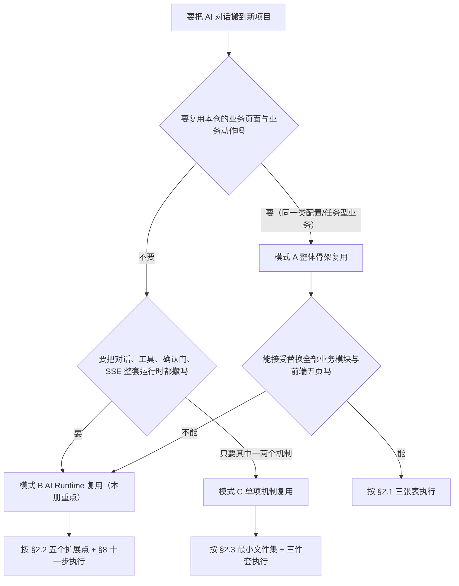
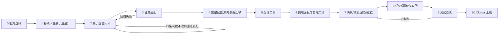

# D6 新项目复用与落地指南

> `doc_id=D6` ｜ 读者：新项目负责人、迁移实施者 ｜ 范围：**只讲 AI 对话能力的迁移**
> 事实源：截至 2026-10-30 的本仓代码（一切结论以代码路径为准，不引用尚未成文的 D1~D5 章节号）
> 本册约定：`D6-§x.y` 指本册章节；文件路径相对仓库根；命令中的 `<base>` 指目标项目后端基址，`<项目测试命令>` 指目标项目自己的测试入口。

**目录**

| 章节 | 内容 | 什么时候读 |
| --- | --- | --- |
| §1 | 定位与承诺边界、三模式判据、照做不照抄 | 开工前，判断成本 |
| §2 | 模式 A / B / C 的适用、前置、保留/改造/删除、验收 | 选型与估工时 |
| §3 | 源到目标映射表（逐资产搬什么/不搬什么/依赖倒置点） | 搬代码当天 |
| §4 | 业务耦合剥离：删/改/留 + 可执行 grep 词表 | 搬完第一版编译不过时 |
| §5 | 禁止照抄五类清单 | 提交前 |
| §6 | 运行机理与必换适配点（身份、TTL、发号、模型、Redis、会话、SSE、多语言、KB、部署） | 设计评审与联调 |
| §7 | 最小垂直闭环的四条判据与反例 | 步骤 2 卡住时 |
| §8 | 11 步迁移表（动作 / 对接点 / 完成判据） | 全程 |
| §9 | 契约测试与验收（含不迁移的测试设施） | 提测前 |
| §10 | 常见失败模式（现象 / 根因 / 正确做法） | 出问题时先查这里 |
| §11 | 附录：开工检查单、grep 脚本、交付物模板、错误码速查 | 随时 |

---

## 1 本册的定位与承诺边界

### 1.1 「参考实现」≠「零耦合框架」

**本仓是业务仓，不是产品化框架。**

这句话不是免责声明，它有三个可验证的后果，直接决定你的工期估算：

1. `backend/src/main/java/com/example/configmgr/ai/**` 里**存在业务 import**：`tools/AiTools.java` 依赖 `TaskService`/`DefinitionService`/`JobService`/`ConfigDataService`，`gate/ToolPreflightService` 依赖 `TaskRepository`/`JobService`/`ConfigStagingRowRepository`，`form/ConditionsForm` 依赖 `TaskService`，`slot/*` 依赖 `DefinitionService`/`TaskService`，`web/AiController` 依赖 `JobWatchdog`。整包拷过去必然编译不过，且"编译不过"是最小的麻烦——真正的问题是这些类会把目标项目并不存在的业务语义带进来。
2. 身份是**演示目录**：`ai/tenant/TenantUserDirectory.java` 硬编码 `1/101`、`1/102`、`2/201`、`2/202` 四个组合，`TenantIdentityFilter` 只放行清单内组合。它证明"边界存在"，不提供"认证"。
3. 会话号是**毫秒时间戳**：`common/id/TimestampIdGenerator.java` 的 `nextId()` 就是 `System.currentTimeMillis()`，同毫秒/跨实例撞号时入口返回 503。它是"留好替换点"，不是"已解决分布式唯一"。

本仓特化点（搬走即失效，逐条对应代码）：

| # | 特化点 | 证据 | 搬走后的直接后果 |
| --- | --- | --- | --- |
| S1 | 演示身份目录代替认证 | `ai/tenant/TenantUserDirectory.java` | 任何人自称 `X-Tenant-Id: 2` 就能读写租户 2 的全部对话 |
| S2 | 业务工具方法体直连业务服务 | `ai/tools/AiTools.java`、`ai/gate/ToolPreflightService.java` | 编译不过；或把业务表/服务拖进新仓 |
| S3 | 默认目标硬绑定单一 provider | `ai/config/AiConfigService#resolveDefault`、`AiProviderRegistry#target` | 多供应商路由/灰度/降级需自建 |
| S4 | 毫秒时间戳发号 | `common/id/TimestampIdGenerator.java` | 多实例高频建会话时 503 明显上升 |
| S5 | 单库 + Flyway，无分库分表 | `resources/db/migration/`、`spring.datasource.*` | 数据量上去后要自己拆 |
| S6 | AI 状态全在 Redis，单键族设计 | `ai/run/RunStore.java`、`ai/memory/RedisChatMemoryRepository.java` | 想换存储等于重写一半运行时 |
| S7 | 中文单语提示词与工具 description | `resources/ai/tools.yaml`（`lang: zh`）、`ai/run/ReplyLanguage.java` | 想英文提示词要重做评测，不是改字符串 |
| S8 | 页面/向导标签驱动工具披露 | `ai/tool/ToolScope.java`（`page:*`/`task:*`） | 目标项目没有这些页面，披露面会全空或全开 |
| S9 | KB 用 BM25（Lucene smartcn），无向量检索 | `ai/kb/KbService.java`、`KbSearchResult` | 语义检索需替换检索实现 |

复用方必须自建（本册不给现成件，给了也是骗你）：

| # | 必须自建 | 做不到的后果 |
| --- | --- | --- |
| B1 | 真实身份源：令牌/会话 → `(tenantId, userId)`，含租户与用户的归属校验 | 身份头可伪造，隔离形同虚设 |
| B2 | 租户生命周期与配额（开通/停用/迁移/删除） | 只能靠人工改库 |
| B3 | 分布式 ID（雪花/号段/Redis 取号），保留 `IdGenerator` 接口 | 多实例撞号 |
| B4 | 业务工具集：每个工具的名称/参数/风险档/幂等/结果上限 | 没有工具就没有"能干活"的对话 |
| B5 | 前端业务渲染件：表格、表单、上传、结果视图 | 面板只能聊天，不能驱动业务 |
| B6 | 数据层与迁移（自己的表、自己的迁移工具链） | 迁移脚本冲突 |
| B7 | 可观测性落点（指标、日志采集、trace 后端） | 出事只能靠翻日志 |
| B8 | 容量与发布（Redis 规划、反代 SSE 配置、灰度与回滚） | 上线即事故 |

### 1.2 三种复用模式与选择判据

**只有三种模式，不设"混合模式"**——说不清的第四种会在验收时变成"什么都做了但什么都没闭环"。



| 模式 | 起步成本 | 典型周期（1~2 人） | 主要风险 | 适用 | 不适用 |
| --- | --- | --- | --- | --- | --- |
| A 整体骨架复用 | 低（克隆即跑） | 2~4 周改业务 | 业务模块与演示数据缠在 AI 代码里，删不干净；身份仍是演示目录 | 与本仓同构的"配置/任务/导入导出"型后台 | 业务形态不同、已有前端栈 |
| B AI Runtime 复用 | 中（要写 5 个扩展点） | 4~8 周 | 误以为 `ai/**` 零耦合；忽略 Redis/身份/发号三处硬适配 | 已有自己业务与前端，只要对话能力 | 只想做 demo、不想维护运行时 |
| C 单项机制复用 | 低（单点） | 3~10 天/项 | 只搬"协议"不搬"存储"或只搬"存储"不搬"测试"，机制在目标环境里半残 | 已有对话或已有 Agent，只缺确认门/SSE/KB 之一 | 什么都不具备，逐项拼装成本高于模式 B |

三条判据口径（写进开工清单，别口头定）：

- **判据 1**：目标项目的业务实体能否被 `ai/tools/**` 的工具签名表达？不能 ⇒ 不要选 A。
- **判据 2**：目标项目是否已有可复用的前端与业务状态管理？有 ⇒ 优先 B，别为了面板重写整个前端。
- **判据 3**：目标项目是否已有对话循环（自己的 Agent）？有 ⇒ 只做 C，别把两套循环缝在一起。

### 1.3 只能"照做"不能"照抄"的清单

**先说范围**：本册只讲 AI 对话能力的迁移。业务功能（配置定义与数据、导入/导出/发布向导、任务与作业中心、表格编辑、主数据、种子数据）**不在迁移范围内**，它们要么整体重写（模式 A 的改造面），要么根本不该出现（模式 B/C）。同理，测试设施（模拟多实例、模拟 Redis、模型桩、Fake/InMemory、harness、Playwright 端口段、测试语料）也**不迁移**，只迁"不变量"，见 §9.3。

以下五类**一律不得照抄**，展开见 §5：数据与密钥、配置与默认值、测试与证据、文档结论、演示身份与演示数据。

本册每一处"搬"都跟一句"必须改"；**没有一处是"拷贝即可"**。如果你在实施中发现某段代码确实不需要改就通过了 §4 的剥离检查与 §9 的契约测试，请记录在交付物里（附录 §11.3 有模板），那是一条有价值的复用结论。

---

## 2 三种复用模式

### 2.1 模式 A：整体骨架复用（整仓起步，改业务）

#### 2.1.1 适用场景与反例

- 适用：新项目同样是"配置定义 + 数据浏览 + 导入/导出/发布 + 任务中心"形态；接受 Vue 3 + Element Plus + Spring Boot 栈；接受以本仓为基座长期演进。
- 反例：业务是电商/CRM/工单；前端已定型为 React；只需要一个"能问答的侧栏"。

#### 2.1.2 先决条件

| 项 | 要求 | 事实源 |
| --- | --- | --- |
| JDK | 21 | `backend/pom.xml` 的 `java.version` |
| Spring Boot | 3.5.14 | `backend/pom.xml` parent |
| Spring AI | 1.1.7（**版本被 enforcer 锁定**，升级须先评审 `ReasoningAwareOpenAiChatModel` 补丁去留） | `backend/pom.xml` 的 `spring-ai.version` 与 `maven-enforcer-plugin` |
| Redis | 7.x（键与脚本按 5.0.14 兼容面编写） | `README.md`、`scripts/ci/forbid-redis-cluster-unsafe.mjs` |
| Node | 22 + yarn | `README.md`、`frontend/package.json` |
| 数据库 | H2 文件库（dev）/ PostgreSQL（profile） | `backend/src/main/resources/application*.yml` |

#### 2.1.3 保留面 / 改造面 / 删除面

**保留面（原样搬，只做配置）**

| 资产 | 路径 | 说明 |
| --- | --- | --- |
| AI 后端全部子包 | `backend/src/main/java/com/example/configmgr/ai/**`（18 个子包，约 225 个 Java 文件） | 运行时骨架 |
| SSE 写侧基座 | `common/sse/**` | 写预算、投递 |
| 发号接口 | `common/id/**` | 接口 + 时间戳实现 |
| 统一响应与错误码 | `common/ApiResponse`、`common/ErrorCodes`（取 AI 子集） | 契约面 |
| 健康与就绪 | `health/**` | live/ready/drain |
| 工具定义覆盖 | `resources/ai/tools.yaml` | 仅保留结构，条目全换 |
| 多语言资源 | `resources/messages*.properties` | 键集需与目标错误码对齐 |
| AI 前端目录 | `frontend/src/components/AiPanel/**`、`stores/ai.ts`、`api/{ai,sse,aiConfig}.ts`、`types/{ai,sse,tools}.ts`、`utils/ai-*.ts` 等 | 见 §3.2 |

**改造面（结构留、内容换）**

| 对象 | 改什么 | 不改什么 |
| --- | --- | --- |
| `ai/tools/AiTools.java` | 工具方法体全部重写为目标业务 | 注解元数据形态（`@Tool`+`@ToolRisk`+`@ToolScope`+`@ToolChannel`+`@ToolCategory`） |
| `ai/form/*` | 表单 schema 与选项源换成目标业务 | `GenerativeFormGuard`/`GenerativeFormRules` 的校验骨架 |
| `ai/slot/*` | 槽位定义换成目标业务 | 槽位解析器与 `FORM_SLOTS_ALREADY_KNOWN` 的判定顺序 |
| `ai/resultview/*` | 结果视图 provider 全部替换 | `ResultView*` 数据模型与前端 registry |
| `ai/tenant/TenantUserDirectory` | 换成真实身份源/目录服务 | `TenantUser` 组合校验与 fail-closed 语义 |
| 业务模块 | `definition/`、`data/`、`task/`、`job/`、`excel/`、`file/`、`masterdata/`、`seed/` 整体替换 | 目录分层与包名约定 |
| 前端五页 | `views/`、`router/` 按目标业务重写 | `stores/workspace` 的窄接口约定 |

**删除面（一律不搬）**

| 对象 | 为什么删 |
| --- | --- |
| `spike/`（sp01ab / sp01c / sp01d / sp02） | PoC 工程，与运行时无关 |
| `frontend/e2e/**` 与 `frontend/playwright*.config.ts` | 真机 E2E 与端口纪律属于本仓（§9.3） |
| `scripts/ci/stub-upstream.mjs`、`stub-routes.json` | 模型桩，属测试替身（§9.3） |
| `scripts/b23l1-dual-instance.ps1` | 双实例模拟 harness（§9.3） |
| `scripts/verify-e2e.ps1` | 本仓用例与语料绑定 |
| `docs/research/**`、`docs/evidence/**`、`docs/adr/**` | 本仓结论与证据，不是你的决策（§5.4） |
| `db/migration/V8,V9,V10`（`ai_chat_message` 建表→幂等→删表） | 已在本仓走完一轮并删除的表，搬过去只会制造无用往返 |
| `data/`（H2 库、文件、KB 索引） | 演示数据 |

#### 2.1.4 验收：最小可用业务闭环

1. 目标业务的一个真实页面能用 AI 完成一条端到端动作（不是"能聊天"）。
2. 该动作至少有 1 个只读工具 + 1 个走确认门的写工具（判据见 §7）。
3. 业务原有的导入/导出/发布链路在 AI 关闭时不受影响（AI 是加法，不是前置）。

### 2.2 模式 B：AI Runtime 复用（只搬 ai 包 + 相关前端）

本册重点。**做法是"搬运行时、写适配"，不是"改运行时"**：`ai/**` 里除 §4 列出的业务耦合文件外，其余部分不应为目标业务做任何修改；一旦你开始为业务改 `run/`、`context/`、`gate/`，说明你选错了模式或漏了扩展点。

#### 2.2.1 适用场景与反例

- 适用：目标项目已有业务后台与前端；要把"对话 + 工具 + 确认门 + 流式 + 记忆"整套能力接上；接受 Redis 为运行时硬依赖。
- 反例：目标项目不允许引入 Redis；团队不接受 Spring AI；只需要"接一个大模型做摘要"。

#### 2.2.2 先决条件（目标项目必须先具备）

| 前置 | 具体要求 | 缺失时的表现 |
| --- | --- | --- |
| 运行时 | JDK 21；Spring Boot 3.5.x；能引入 Spring AI 1.1.7（或自研等价 `ChatModel` 适配层） | 编译不过 / 模型调用语义不符 |
| Redis | 生产可用 Redis（standalone 或 cluster）；`spring.data.redis.timeout` 收紧到 2s 量级 | AI 端点反复 503，或一次请求挂十几秒才报错 |
| 数据库 | 有迁移工具（Flyway/Liquibase 均可）；能建 5 张 AI 表（由**步骤 1** 的迁移建成，见 §8） | 反馈、provider 配置无处落 |
| 身份 | 真实身份源，能在 HTTP 边界得出 `(tenantId, userId)` | 只能继续用演示目录（=无隔离，§6.1） |
| 反代 | 支持 SSE：不缓冲响应、读超时大于帧间静默预算 | 前端恒定"连接中断" |
| 前端 | Vue 3 + TS + Pinia（搬面板）；或自写面板只消费帧契约 | 面板搬不过来 |
| 观测 | 有日志采集与实例标识 | 多实例排障只能猜 |

#### 2.2.3 依赖收敛：必须一并搬的最小集

| 层 | 最小集 | 备注 |
| --- | --- | --- |
| Maven 依赖 | `spring-ai-starter-model-openai`、`spring-boot-starter-data-redis`、`transmittable-thread-local` | TTL 版本本仓 2.14.5；Spring AI 1.1.7 语义被补丁类冻结 |
| 后端包 | `ai/{config,context,exec,feedback,form,gate,history,kb,memory,observe,resultview,run,session,slot,tenant,tool,tools,web}` | `slot`/`tools`/`form` 部分文件属业务，见 §4 |
| 后端基座 | `common/sse`、`common/id`、`common/ApiResponse`、`common/ErrorCodes`（AI 子集） | 错误码是前后端契约，不能各自命名 |
| 配置 | `application.yml` 的 `app.ai.*` 全段 + `spring.ai.openai.*` + `spring.data.redis.*` | 逐键见 §6.4/§6.5；取值须逐条重新裁决并登记（§11.3） |
| 迁移 | `ai_feedback`（含 `V11` 身份列）、`ai_provider`、`ai_model`、`ai_setting`、`ai_config_audit` | 不要搬 `ai_chat_message` 三件套 |
| 前端 | `components/AiPanel/**`、`stores/ai.ts`、`stores/locale.ts`、`api/{ai,sse,aiConfig,http}.ts`、`types/{ai,sse,tools,resultview,api,job}.ts`、`utils/{ai-dom-tools,ai-identity,ai-regions,ai-suggestions,blocks,confirm-irreversible,context-usage,error-card,form-draft,form-scope,frontend-tools,markdown,parts,polling,resultview,run-expiry,sheet-tools,time-constants,tool-summaries,ui-lifetime,ui-receipt,format,publish-links}.ts`、`locales/{zh-CN,en-US}.json` | `stores/workspace.ts` 只保留窄接口；`utils/sheet-tools.ts`、`utils/spreadjs.ts`、`utils/publish-links.ts` 属业务渲染，按 §4 处理 |

#### 2.2.4 接口面：新项目必须实现的 5 个扩展点

| 扩展点 | 目标项目要提供的 | 本仓对应物（只作形态参考） | 判据 |
| --- | --- | --- | --- |
| E1 身份源 | 令牌/会话 → `(tenantId, userId)`，含归属校验 | `ai/tenant/TenantIdentityFilter` + `TenantUserDirectory` | 伪造头被拒；跨身份读写被拒 |
| E2 工具集 | 每个工具：名称、描述、参数 schema、风险档、scope、通道、幂等键、结果上限 | `ai/tools/AiTools.java` + `resources/ai/tools.yaml` | 缺风险档或 scope 的工具数 = 0 |
| E3 前端渲染与前端工具 | 结果视图注册、表单渲染、`ui_*` 执行器、上传交接 | `components/AiPanel/resultview/registry.ts`、`utils/frontend-tools.ts`、`utils/ai-dom-tools.ts` | 回灌成功 1 次；`ui_*` consequential 零执行 |
| E4 模型与 provider 配置 | provider/base-url/模型 allowlist/默认目标 | `ai/config/AiProviderRegistry`、`AiModelResolver`、`ai_*` 四表 | `/api/ai/health` 返回可用 |
| E5 业务副作用与文件存储 | 业务动作执行、附件落盘、结果视图数据 | `file/FileStorageService`（业务实现） | 写工具执行一次且可回滚/可审计 |

五个扩展点之外的一切（帧契约、挂起机制、租约、看门狗、压缩、记忆）**不应为新项目修改**。

#### 2.2.5 保留面 / 改造面 / 删除面（与 §2.1.3 同列口径）

- **保留面**：`ai/{config,context,exec,memory,observe,run,session,tenant,tool,web}` 的运行时部分 + `common/{sse,id}` + 前端面板骨架与 `types/*` 契约层。
- **改造面**：`ai/tools/**`（工具）、`ai/form/**`（表单内容）、`ai/resultview/**`（结果视图）、`ai/slot/**`（槽位语义）、`ai/gate/{ToolPreflightService,ToolTargetResolver}`（业务预检）、`ai/tenant/TenantUserDirectory`（身份源）、`resources/ai/tools.yaml`（条目全换）、前端 `locales/*`（文案全换）。
- **删除面**：业务包整体、`ai/tools/AiTools.java`（重写而非修改）、`spike/`、`frontend/e2e/**`、`scripts/**` 的测试替身与 harness、`docs/{research,evidence,adr,s4,merge}/**`、`data/`。

#### 2.2.6 验收：对话 + 1 只读工具 + 1 走确认门的写工具

四条判据全过才算模式 B 落地（缺一不得进入业务适配，理由见 §8 的顺序硬约束）：

1. 对话能回：一轮请求收到 `start` 与终帧 `done`（或 `error`），正文可见。
2. 一个只读工具能跑：`READ` 档工具自动执行，`tool_result` 回灌到正文。
3. 一个写工具能拦住并放行：`DANGER` 档工具先出 `confirm_request`，批准后执行、拒绝后不执行。
4. 一条 SSE 能到：前端在刷新/断流后能通过 `GET /api/ai/events/{runId}?lastSeq=N` 拿回差量。

### 2.3 模式 C：单项机制复用（只搬一个机制）

#### 2.3.1 适用场景与反例（机制 → 最小文件集）

| 机制 | 最小文件集 | 适用 | 反例 |
| --- | --- | --- | --- |
| SSE 帧契约与重挂 | `types/sse.ts`、`api/sse.ts`、`ai/run/{SseChatEmitter,FrameStore,RedisFrameStore,FrameWakeBus}`、`ai/web/AiController`（chat/events） | 已有对话，缺稳定流式与断线续传 | 没有 Redis，重挂无处回放 |
| HITL 确认门 | `ai/gate/{ConfirmGate,SpToolCallingManager,ToolCallEndTrace}`、`ai/web/AiController`（confirm）、`ai/tool/{ToolRisk,ToolChannel,ToolMeta}` | 已有工具执行，缺"高风险先问人" | 工具都是只读的 |
| 身份上下文 + TTL | `ai/tenant/**`（9 文件）、`config/AsyncConfig`、`ai/exec/AiExecutorConfig` | 多租户/多用户，异步会串身份 | 单用户单机工具 |
| 会话发号 | `common/id/**`、`ai/session/AiSessionService`、`ai/web/AiSessionController` | 需要后端权威会话号 | 前端可自造 id 且无隔离要求 |
| Redis 记忆 | `ai/memory/**`（9 文件）、`ai/session/SessionPurgeGuard` | 需要跨实例共享对话历史 | 单进程内存足够 |
| 上下文压缩 | `ai/context/**`（21 文件）+ `app.ai.{memory,context}.*` | 长对话会撞模型窗口 | 每轮都短 |
| 知识库 | `ai/kb/**`（29 文件）、`ai/kb/AiKbController`、`app.ai.kb.*` | 需要引用内部资料回答 | 只有通用问答 |
| 前端工具通道 | `ai/tool/{FrontendToolGuard,UiPrimitiveGuard,ToolChannel}`、`utils/frontend-tools.ts`、`utils/ai-dom-tools.ts` | 要让模型驱动前端界面 | 前端无交互面 |

#### 2.3.2 先决条件（该机制依赖的存储/配置/相邻机制）

| 机制 | 存储 | 配置 | 相邻机制 |
| --- | --- | --- | --- |
| SSE 重挂 | Redis（`ai:xevents:{...}` Stream、`ai:seq:`、`ai:events:`） | `app.ai.sse.write-timeout`、`app.ai.session-ttl` | 会话号、身份（帧按身份定键） |
| 确认门 | Redis（`ai:pending:`、`ai:claim:`、`ai:decided:`、`ai:req:`） | `app.ai.park.*`、`app.ai.suspend.pool-size` | SSE（`confirm_request`/`confirm_decision` 帧） |
| 身份 | 无（线程上下文） | TTL 依赖 | 所有按身份定键的存储 |
| 发号 | Redis（`ai:session:*`，`SET NX`） | `app.ai.session-ttl` | 身份 |
| 压缩 | Redis（`ai:ctx:*`） | `app.ai.context.*`、`app.ai.memory.*` | 记忆窗口 |
| KB | 本地目录或 HTTP 源 + Redis 缓存 | `app.ai.kb.*` | 工具集（`kb_search`/`kb_read`） |

#### 2.3.3 单项机制的"三件套"要求（协议 + 存储 + 测试）

一个机制**必须同时具备三件**，缺一件就是半残：

- **协议**：帧类型/接口形状/错误码。例：确认门必须定义 `confirm_request` 与 `confirm_decision` 两个帧、`POST /api/ai/confirm` 的请求体、`409 DUPLICATE_TOOL_CALL_ID` 与 `409 UNKNOWN_TOOL_CALL` 两个码。
- **存储**：键形、TTL、原子性。例：待决条目落在 `ai:pending:<tag>`，认领落 `ai:claim:<tag>`，决策 guard 落 `ai:decided:<tag>`，三者同一 hash tag 才能一次 `DEL` 回收。
- **测试**：不变量断言。例：同一 `toolCallId` 两次决策，一次 200、一次 409，且工具体只执行一次。

判据：三件套里任何一件缺失，该机制禁止进入步骤 2 的闭环验收。

#### 2.3.4 接入面：目标项目要改的 3 处

| 接入面 | 改什么 | 例（确认门） |
| --- | --- | --- |
| 装配点 | Bean 注册 / 组件挂载 | 注册 `ConfirmGate`、把工具通道标为 `BACKEND`；前端在面板挂确认卡组件 |
| 配置键 | 该机制的键与默认值 | `app.ai.park.enabled`、`app.ai.suspend.pool-size`；前端超时预算常量 |
| 调用点 | 业务代码在哪里触发它 | 工具方法标 `@ToolRisk(DANGER)`；前端执行器注册到 `registerFrontendToolExecutor` |

#### 2.3.5 验收

1. 该机制在本仓的不变量（§9.2 对应行）在目标项目**逐条有断言**——不是"跑通了"，是"断言在"。
2. 目标项目一条冒烟：真实请求走通该机制一次（确认门批准、或重挂拿回差量、或 KB 命中一篇自己的文档）。

---

## 3 源到目标映射表（复用主表）

### 3.1 列定义与填写规则

| 列 | 填写规则 |
| --- | --- |
| 类别 | 后端包 / 前端目录 / 配置 / 迁移 / 脚本 / 文档 |
| 源路径 | 本仓精确路径；目录类写到子包级 |
| 规模 | 文件数（截至 2026-10-30，仅作搬运工作量的量级参考，**不是验收指标**） |
| 目标落点 | 目标项目的相对路径（保持同构，便于回溯差异） |
| 搬什么 | 具体到"搬这个类/这个目录" |
| 不搬什么 | 业务耦合文件、测试替身、演示数据 |
| 依赖倒置点 | 目标项目必须先提供的能力，否则搬过去也不可用 |
| 改动类型 | 原样 / 改配置 / 改实现 / 删 |

### 3.2 逐资产映射

| 类别 | 源路径 | 规模 | 目标落点 | 搬什么 | 不搬什么 | 依赖倒置点 | 改动类型 |
| --- | --- | --- | --- | --- | --- | --- | --- |
| 后端包 | `ai/config` | 28 | 同构 `ai/config` | provider 注册、模型解析、可用性、KEK、URL 闸、重试 | 无（全部可搬） | 5 张 AI 表；KEK 环境变量 | 改配置 |
| 后端包 | `ai/context` | 21 | `ai/context` | 计量、压缩谱系、摘要、熔断、工具结果清理 | 无 | 模型窗口参数（自己的 `max_context`） | 改配置 |
| 后端包 | `ai/exec` | 1 | `ai/exec` | 挂起池、触发池、看门狗调度器 | 无 | 线程池容量按目标并发重定 | 改配置 |
| 后端包 | `ai/feedback` | 3 | `ai/feedback` | 反馈实体/仓储/摘要防泄漏 | 无 | `ai_feedback` 表（含身份列） | 原样 |
| 后端包 | `ai/form` | 13 | `ai/form` | 表单护栏规则、附件存储抽象、校验码 | `ConditionsForm`/`DefinitionSelectionForm`/`TaskTypeForm`/`HostForm`/`FormOptionSource`/`GenerativeFormAttachmentController` 的业务实现 | 目标表单 schema 与附件存储（E5） | 改实现 |
| 后端包 | `ai/gate` | 12 | `ai/gate` | 确认门、工具调用管理、限流、输入闸、资源锁、目标解析骨架 | `ToolPreflightService`/`ToolTargetResolver` 的业务判定 | 业务预检由目标项目提供 | 改实现 |
| 后端包 | `ai/history` | 1 | `ai/history` | 合成消息与历史拼装 | 无 | 无 | 原样 |
| 后端包 | `ai/kb` | 29 | `ai/kb` | 索引、切块、检索、缓存、HTTP 源、注入定界 | 无（换资料来源） | 目标知识仓与术语表 | 改配置 |
| 后端包 | `ai/memory` | 9 | `ai/memory` | Redis 记忆仓储（按轮合并 + 会话级 CAS）、消息编解码、身份/轮次绑定 advisor、窗口合并 | 无 | Redis；会话销毁守卫 | 原样 |
| 后端包 | `ai/observe` | 4 | `ai/observe` | MDC 装饰、trace 锚点、降级计数 | 无 | 日志采集 | 原样 |
| 后端包 | `ai/resultview` | 8 | `ai/resultview` | 视图数据模型与 provider 接口 | `ListTasksResultViewProvider`（业务） | 目标结果视图（E3） | 改实现 |
| 后端包 | `ai/run` | 33 | `ai/run` | 帧发射、帧存储、租约、唤醒、看门狗、续跑、取消、SSE 写 | 无 | Redis；实例标识；NTP | 改配置 |
| 后端包 | `ai/session` | 8 | `ai/session` | 会话登记、销毁守卫、清理重试 | `AiSessionPurgeService` 里的文件清理实现 | 文件存储抽象（E5） | 改实现 |
| 后端包 | `ai/slot` | 7 | `ai/slot` | 槽位解析骨架 | `DefinitionSlotCatalog`/`TaskSlotResolver`/`TaskIntent` 的业务槽位 | 目标业务的槽位定义 | 改实现 |
| 后端包 | `ai/tenant` | 9 | `ai/tenant` | 身份上下文、TTL 装饰器、键作用域、HTTP 边界 | `TenantUserDirectory`（演示目录） | 真实身份源（E1） | 改实现 |
| 后端包 | `ai/tool` | 28 | `ai/tool` | 注册表、元数据、风险/通道/scope、披露、结果限流、前端工具护栏 | `WizardActionGuard`、`SheetAudit`/`SheetSwitches`/`SheetWriteGuard`（业务） | 目标工具集（E2） | 改实现 |
| 后端包 | `ai/tools` | 1 | `ai/tools` | **不搬**；按同类注解重写 | 全部业务工具 | E2 | 删 |
| 后端包 | `ai/web` | 15 | `ai/web` | 9 个控制器/请求体 + 6 个 DTO 的路由与契约 | `AiController` 里的 `JobWatchdog` 引用 | 无 | 改实现 |
| 后端基座 | `common/sse`、`common/id`、`common/{ApiResponse,ErrorCodes}` | — | 同构 | 全部 | 与业务错误码无关的部分可裁剪 | 无 | 原样 |
| 配置 | `resources/application.yml` 的 `app.ai.*` | 全段（键集合以 `AiProperties` 字段为准） | 目标 `application.yml` | 全段 | 本仓默认值（必须重定，§5.2） | 目标容量与模型窗口 | 改配置 |
| 配置 | `resources/ai/tools.yaml` | 1 | 同路径 | 文件结构（`version`/`lang`/`tools`） | 全部工具条目 | 工具清单 | 改实现 |
| 配置 | `resources/messages*.properties` | 3 | 同路径 | **空基座** `messages.properties`（仅注释、无键，用于触发 `MessageSource` 自动配置）+ zh/en 两份文案 + 与 `ErrorCodes` 的键集对齐方式 | 业务文案 | 目标错误码集 | 改实现 |
| 迁移 | `db/migration/V3,V4,V5,V11` | 4 | 目标迁移目录 | `ai_feedback`（含身份列）、`ai_provider`、`ai_model`、`ai_setting`、`ai_config_audit` | `V8,V9,V10`（`ai_chat_message` 三件套，已删） | 目标迁移工具 | 改配置 |
| 前端 | `components/AiPanel/**` | 12 | 同构 | 面板骨架、上下文计量、表单渲染、结果视图、卡片 | 业务专有卡（`SheetPreviewCard`、上传交接的业务参数） | E3 | 改实现 |
| 前端 | `stores/ai.ts`、`api/{ai,sse,aiConfig}.ts`、`types/{ai,sse,tools}.ts` | 7 | 同构 | 状态机、双通道 SSE、帧类型 | 业务动作分支（`navigate_to`/向导） | E3 | 改实现 |
| 前端 | `utils/ai-identity.ts` | 1 | 同构 | 身份请求头、键指纹、路径边界 | 演示默认身份 | E1 | 改配置 |
| 前端 | `locales/{zh-CN,en-US}.json` | 2 | 同构 | i18n 装配与键结构 | 业务文案 | 目标文案 | 改实现 |
| 脚本 | `scripts/ci/forbid-redis-cluster-unsafe.mjs` | 1 | 目标 CI | **形态**（grep 守卫 + `--self-check`） | 本仓规则表 | 无 | 改实现 |
| 文档 | `docs/delivery/**` | 1 | 目标文档区 | 本册（作为迁移依据） | `docs/{research,evidence,adr,s4,merge}` | 无 | 原样 |

### 3.3 依赖倒置点

| 倒置点 | 源资产要求目标先提供 | 不提供的后果 |
| --- | --- | --- |
| D1 身份 | `(tenantId,userId)` 且经过归属校验 | 键族带身份段但身份可伪造 = 假隔离 |
| D2 工具 | 工具的元数据（风险/scope/通道/结果上限） | 启动期 fail-fast：回调表 ⊆ 元数据表、scope 非空 |
| D3 模型 | 可用 provider + 模型 allowlist + 上下文窗口 | `/chat` 开流前 503；压缩分母算错 |
| D4 存储 | Redis（含 cluster 时的 hash tag 兼容）+ DB 迁移 | 挂起态丢失、反馈无落点 |
| D5 渲染 | 结果视图与表单的渲染件 | 工具结果只能当文本 |
| D6 文件 | 附件与上传的存储实现 | 附件功能不可用（不是"降级"） |

### 3.4 前端展示契约：上下文占用圆环（照做，勿退回文字药丸）

输入框底栏右端、发送/停止钮左侧的那一格是**一个空心圆环**，不是文本药丸。目标项目照做下面六条；
任何一条被改回"文字 + 点击展开"，都属于本册定义的**能力退化**（信息更少、噪音更多、无法扫读）。

| # | 契约 | 为什么不能改 |
| --- | --- | --- |
| 1 | 默认态**零可见文字**：不出「已用 / 上限 / 占比」三件，也不出七项拆分 | 占用是扫一眼的状态量；文字会把底栏变成数字墙 |
| 2 | **圆环始终在场**：没有记账（`contextUsage === null`）时显示**中性轨道**，一行「暂无上下文占用」 | 藏起来等于"没有占用"的谎报；不留一律（null 与 0%）也分不清 |
| 3 | 唯一读数是一行 tooltip：`上下文占用 42%` / 估算 `上下文占用 约42%` / 上限未知 `上下文已用 84.2k tokens` | 精度只在需要时给；估算必须当场标出来 |
| 4 | tooltip 用面板同款**深色气泡 + 小三角**（`utils/markdown.ts` 的 `TIP_CLASS` / `TIP_ARROW_CLASS` 配方），hover 与键盘聚焦都出；**不使用原生 `title`** | 原生 title 不可样式化、会出第二套气泡、键盘可达性由浏览器决定；`aria-label` 与气泡同文案 |
| 5 | 语义源是原生 `<progress max="100">`；视觉用 `conic-gradient` + `mask-image` 抠空心；上限未知（`percent === null`）时**不写 `value`**（原生不确定态，只画轨道） | 辅助技术直接读 value/max；`value="0"` 会把"没有分母"说成"占用为零" |
| 6 | 档位 70 / 85 / 95 只换颜色（`contextTier` + `tierClass` 的 `text-*` 项），不换文案、不换尺寸；圆环与发送钮间距 **24px**（父容器 `gap-[6px]` + 圆环自身 `mr-[18px]`） | 分档是"读到进度"的视觉语义，与后端压缩阈值解耦（可各自调） |

- 点击**不展开**任何详情（旧 `ContextPopover` 入口已退场）：要明细请去 `/api/ai/context/{sessionId}`，不要把它接回一个可点的小按钮。
- 可交互全场景样板：`docs/delivery/context-ring-demo.html`（精确 / 估算 / 高档 / 临界 / 上限未知 / 暂无占用六态 + 气泡 + 24px 自检），
  组件实现见 `frontend/src/components/AiPanel/ContextPill.vue`；两者样式值必须同步改。

---

## 4 业务耦合剥离清单

### 4.1 必须删（业务语义硬编码）

| 文件 | 业务依赖 | 处理 |
| --- | --- | --- |
| `ai/tools/AiTools.java` | `TaskService`、`DefinitionService`、`JobService`、`ConfigDataService` | 删除，按同一套注解重写目标工具类 |
| `ai/form/ConditionsForm.java` | `Task`、`TaskItem`、`TaskService` | 删除，换成目标业务的条件收集表单 |
| `ai/form/DefinitionSelectionForm.java`、`TaskTypeForm.java`、`HostForm.java` | 配置定义/任务类型 | 删除 |
| `ai/form/FormOptionSource.java` | `ConfigDefinition`、`DefinitionService` | 删除，改为目标选项源 |
| `ai/gate/ToolPreflightService.java` | `Job`、`Task`、`TaskFile`、`TaskItem`、`ConfigStagingRowRepository` | 删除，目标业务预检另写（可保留接口形状） |
| `ai/gate/ToolTargetResolver.java` | `Job`、`Task`、`TaskItem`、`TaskRepository` | 删除 |
| `ai/tool/WizardActionGuard.java` | `ConfigDefinition`、`ConfigField`、`DefinitionService` | 删除 |
| `ai/tool/SheetAudit.java`、`SheetSwitches.java`、`SheetWriteGuard.java` | 表格业务 | 删除（若目标有同类表格，按同样"审计 + 开关 + 守卫"三件重建） |
| `ai/slot/{DefinitionSlotCatalog,TaskSlotResolver,TaskIntent,TaskSlotParser,TaskSlots,SlotDefinition,ConditionAssessment}.java` | 配置定义/任务槽位/条件三态 | 删除，保留"槽位 → 表单 → 零副作用拒绝"的顺序设计 |
| `ai/resultview/ListTasksResultViewProvider.java` | `Task`、`TaskService` | 删除，改为目标结果视图 provider |
| `ai/form/GenerativeFormAttachmentController.java` 的文件落盘段 | `FileStorageService`、`StoredFile` | 改：抽出存储接口，注入目标实现 |
| `ai/session/AiSessionPurgeService.java` 的文件清理段 | `FileStorageService` | 改：同上 |
| `ai/web/AiController.java` 的 `JobWatchdog` 引用 | 业务作业看门狗 | 改：删除该字段与其调用点 |

**条件收集与流程闭环的迁移约束**

- 条件状态必须区分 `SET / EXPLICIT_UNSET / UNDECIDED`。只有真正空对象或合法的空 `fields/scopeKeys` 数组才是明确不设；未知键、残缺字段、非数组和坏 JSON 一律未决定，禁止按全量放行。
- **已进入 EXPORT 的空白条件语义**：当权威 `currentStep=EXPORT` 时，`conditionJson=null` 视为用户手工留空 = `EXPLICIT_UNSET`（全量），`start_export` 预检应放行；在 `SELECT_DEFS/QUERY_COND` 的 `null` 仍是 `UNDECIDED`，必须先收集。坏 JSON / 残缺结构在 EXPORT 也继续拒绝；不得为 EXPORT 步新增自动条件表单。
- 多配置逐项判定，不能“任一配置有条件”就整体放行。条件表只有宿主一条通道：`SET_CONDITIONS` 只由宿主对“仍 `UNDECIDED` 且既无已落库条件、也无已结算草案、也无表单回灌”的配置项发一次，模型自行 `generative_form(SET_CONDITIONS)` 被 `GenerativeFormGuard` 零副作用拒绝。已知条件（含 `create_task` 候选）由宿主经前端 `set_condition` 形成草案、不弹表；非空文本回灌必须先由模型解析成 `set_condition` 草案，否则 `confirm_step` 零副作用拒绝（`FORM_SLOTS_ALREADY_KNOWN`）且不得换第二张表。草案只写前端页面与会话候选（Redis），不写业务库。
- 用户取消条件表单后不得自动重问，也不得解释为全量；需要用户在下一轮明确设置条件或明确全量。
- 流程纠正按类型每 run 最多一次：`start_export` 收尾只发起既有确认卡、不自动执行；`create_task` 遗漏只在任务中心无任务、工具已披露、完全无创建记录且台账已有成功配置定义读取时触发，纠正指令必须同时保留“用户只是查询就直接答复”的出口，不得自动创建或自动批准。内部纠正指令走合成消息过滤，不得写入真实用户历史；两类纠正共用正文/工具历史，但快照只保留最新一类的前缀，防止后续纠正拿到前一类指令；成功、取消、失败、挂起与续跑都要保持正文、字符数、工具顺序和记忆一致。
- **收尾纠正的意图前提**：必须本轮真实用户明确提出导出（导出/创建导出任务）**或**本 run 已有成功的导出推进工具回灌（`create_task/select_definitions/confirm_step/set_condition`；以真实 FRONTEND/CONFIRM 回灌为事实源，不读 `ai:ledger`）；EXPORT 页面上的状态、条数、条件问答不得触发 `start_export`，只凭 `step=EXPORT` 也不得纠正（继续旧任务需本轮意图证据）。
- **确定性条件工作流**：结构化条件用无损 `ConditionCommand` 表示（EQ/IN/GT/scopeKeys 不丢），已知条件由宿主复用前端 `set_condition` 通道下发草案（确定性 `toolCallId` = `host-cond-draft-<runId>-<taskId>-<defCode>`、多个 defCode 整批 `parkAll` 一次挂起、天然幂等），不经过模型改写、不弹表，`confirm_step` 认可已结算草案后放行，业务库仍只由前端 `persistStepData` 在下一步或启动作业前提交；UNDECIDED 只收集一次，EXPLICIT_UNSET 直接推进，坏 JSON/未知键/残缺结构拒绝。自定义配置项走同一路径，不允许写 `CURRENCY/CNY` 特判。EXPORT+null 与预检同一口径（明确留空=全量，且只认任务权威 `currentStep`，不看请求 ctx.step）；QUERY_COND+null 仍未决定。FRONTEND `set_condition` 是否已处理以真实回灌（待决条目 `FRONTEND_RESULT`）为准，不依赖 `ai:ledger`。
- **条件来源可信边界（语义结构化）**：自然语言只经既有模型工具调用输出结构化意图（create_task/select_definitions/set_condition），宿主不解析用户原话、不使用 TaskSlotParser/TaskIntent 中文正则或停用词做生产判断。可信条件事实只有三类：①任务 `conditionJson`（唯一提交点 = 前端 `persistStepData`，在离开 `QUERY_COND` 的下一步或 `start_export` 前），②本轮已成功结算的 `set_condition` 草案（Redis 待决条目 `FRONTEND_RESULT` + `OK`；宿主草案按 `toolCallId` 编码的 run/task 绑定核对，模型自发草案按 `defCode` 归属与 `createTaskRequestedAtMs` 时间边界核对），③条件表单的明确留空决定。`create_task` 的 `conditions` 与模型 `set_condition` 入参在真正提交前都只是候选/草案，不是条件事实。工作流按 SET 直接推进、已结算草案直接推进、EXPLICIT_UNSET 直接推进、UNDECIDED 一次收集；多字段/多值/非 EQ/scopeKeys 原样保留。进入 QUERY_COND 时（导航/工具批上下文刷新后、续跑交棒前）宿主先把 `create_task` 的合法候选下发成 `set_condition` 草案；若候选本身为空，成功 `confirm_step` 后的首次交棒先给模型一次基于原对话调用 `set_condition` 的结构化机会（`allowUnknownForm=false`），下一拍仍 UNDECIDED 才挂一次非必填 SET_CONDITIONS 表单，不在 Java 中解析用户原话；首次结构化由 `extra.conditionStructureHandoff` 标记，`ToolRegistry.forContext` 与 `matchesContext` 同源只披露/放行 `get_config_def/list_config_defs/set_condition/confirm_step`，并附一条合成内部指令，禁止正文解释或反问代替动作；离开 `QUERY_COND` 必须清除标记、恢复完整工具面；已验证条件/已结算草案/明确不设不弹，已收集/取消不自动重问。步骤以任务权威 currentStep 为准，意图/取消/只推进不以中文关键词判断；`CONDITION_OPERATOR_UNKNOWN` 的 confirm_step 系统拒绝保持用户面零卡（实时与历史同口径）。
- **`create_task(defCodes)` 的宿主校验边界**：`defCodes` 是模型给出的<b>候选</b>，不是宿主事实。只有 `ToolPreflightService#inspectCreate` 用 `DefinitionService` 逐个确认编码存在（形状必须是文本数组、空白/非文本元素判非法）之后，候选才允许随确认卡批准进入运行上下文（`RunContextRefresher` 据此写 `taskSlots.defCodes`，从而抑制配置选择表单）。任一编码不存在 / 形状非法 / 校验器缺失 ⇒ **预检失败、不进入确认门、不创建**（fail-closed）；校验过的编码必须同时出现在预检 checks 的 `args`、`target.defCodes`、影响面摘要与 `reportHash` 里，执行前复核会重跑同一校验（定义在批准与执行之间被删除 ⇒ 指纹变化 ⇒ 要求重新确认）。未传 `defCodes` 时不产生该项检查，宿主仍只弹一次配置表；配置表按“新任务仍在 `SELECT_DEFS` 且配置未知”的任务状态触发，不要求 `navigate_to` 必须成功，导航超时不得留下无配置答案的空任务。迁移到目标项目时，这段校验不可删、不可改成"信任模型参数"。
- **配置槽位的判定顺序（测试锁定，别改回去）**：`1` 页面非空勾选 → `2` 任务已存条目（页面未同步时）→ `3` 页面同步了空集合且任务**还没有任何条目**（刚建好、尚未 `select_definitions`）→ 本轮结构化 `create_task(defCodes)` 候选；`4` 其余（含"页面显式空 + 任务已有条目"）。第 3 条是"向导里还没勾"，第 4 条是"用户清空"，两者不可合并；候选只写运行上下文，**不落任务条目**（条目仍由 `select_definitions` 创建）。回归：`CreateTaskDefCodesSlotTest`（带 `defCodes` ⇒ 表单被 `FORM_SLOTS_ALREADY_KNOWN` 拒绝；不带 ⇒ 表单放行）。
- **宿主确定性收集与推进只问一次（测试锁定）**：`select_definitions` 成功且仍停在 `SELECT_DEFS` 时，`ResumeService` 在续跑交棒前由 `DefinitionSelectionForm#parkAdvanceIfDue` 复用既有前端 `confirm_step` 通道推进到 `QUERY_COND`（确定性 `toolCallId=host-def-next-<taskId>`、参数 `{}`）；本批已有 `confirm_step`、选择失败或配置仍未知时不重复下发，宿主不直接写业务库，也不向用户询问“是否推进”。进入 `QUERY_COND` 后，续跑交棒前与正文收尾共用 `ConditionsForm#parkIfDueAtQueryCond`：成功 `confirm_step` 的首次交棒只允许候选/草案处理、暂缓未知条件表，让模型做一次条件结构化；后续交棒或正文收尾仍条件未决定时只挂一张非必填 `SET_CONDITIONS` 表，同一缺口不再挂第二张；已知候选或模型已 `set_condition` 且草案已结算 ⇒ 一张都不挂（`QueryCondConditionFormParkTest#knownCnyCandidateNeverAsksAndNeverWritesTheBusinessDatabase`）；回灌留空（前端把可选空文本回灌成真实空对象 `{}`，或显式空文本）只表示明确不设：`confirm_step` 直接放行，后端不代写 `{}`，由前端 `persistStepData` 在离开 `QUERY_COND` 时提交，取消同样不自动重问。结构化 `create_task` 缺/非法 `type` 时宿主挂单 enum 单选（EXPORT/IMPORT），`toolCallId` 确定性、不预填；`type` 已给出不挂（`TaskTypeFormTest#missingTypeInStructuredCreateTaskParksTheDeterministicSingleSelect`）。
- **`create_task(conditions)` 的校验与草案时机**：`conditions` 与 `set_condition` 同一 `FieldQueryCondition` 结构，且导出任务必须显式给出：已知条件传结构化对象（必须同时给合法 `defCodes`，条件属于具体配置项），未决定传 `{}`；省略或显式 `null` ⇒ `CREATE_CONDITIONS` 预检失败、不挂确认卡、不创建（零创建）。导入任务不传（传了同样预检拒绝）。`ToolPreflightService#inspectCreate` 复用 `WizardActionGuard`（同一份定义存在/字段归属/算子/取值/非空校验）逐个 defCode 复核，任一不通过 ⇒ **预检失败、不进入确认门、不创建**（fail-closed）；校验过的条件进确认卡 `target.conditions`、`CREATE_CONDITIONS` check 与 `reportHash`，执行前复核重跑同一校验。运行时 `RunContextRefresher` 只把非空结构化条件写进服务端 `extra.createTaskConditions`（**不落库、不建条目**；未决定传的 `{}` 不写候选），并写 `extra.createTaskTaskId` 与 `extra.createTaskRequestedAtMs` 把候选**绑定到创建出的任务号与创建时刻**；同一结算点还把结构化 `defCodes`/`conditions` 写入会话级 Redis 草案 `ai:ctdraft:{<tenantId>:<userId>:session:<sessionId>}`（HASH，字段 = taskId，随 `session-ttl`），读取顺序为 extra → 本轮已结算 `create_task` 原始入参 → 会话草案，空 `conditions={}` 不覆盖非空候选；草案只存 Redis，不写业务库，会话销毁时按同一键精确删除；进入 `QUERY_COND` 后由 `ConditionsForm#dispatchCreateTaskCandidates` 在“任务已有条目（即 `select_definitions` 已发生）、上下文 taskId 与绑定任务号一致、条目 `defCode` 属于 `extra.createTaskDefCodes`”三条同时成立时，按同一份 `WizardActionGuard` 复核后**下发前端 `set_condition` 草案**（`toolCallId` = `host-cond-draft-<runId>-<taskId>-<defCode>`，多个 defCode 由 `HostForm#parkAll` 整批一次挂起），**不写业务库、不弹条件表**；条目已有 `conditionJson` 或已有草案（成功/失败/待回灌）的配置项按确定性 id 幂等跳过，不重复下发。绑定任务号不匹配、候选 `defCodes` 为空、`defCode` 不在任务条目、`WizardActionGuard` 不通过、序列化/下发失败 ⇒ 记 WARN 并走**内部失败口径**（`TOOL_EXECUTION_FAILED` 零副作用拒绝，说明可重试或由用户/向导修正），**不得静默降级成再问用户一次，也不得改写条件表**。候选随任务作用域清理（换任务/新建任务时的 `clearTaskScopedExtra`），不再以“已落库”为清理条件。`GenerativeFormGuard` 一律拒绝模型自发的 `SET_CONDITIONS` 表单（零副作用；条件表只由宿主发放）。**切任务时必须作废任务作用域 extra**：`RunContextRefresher#applyTask` 在任务号变化（含无任务导航）时清掉 `taskSlots`/创建候选；**`create_task` 自身（创建或同轮复用）无条件先做一次完整重置**（`clearTaskScopedExtra`：`taskSlots`、`createTaskDefCodes`、`createTaskConditions`、`createTaskTaskId`、`createTaskRequestedAtMs` 以及页面勾选事实 `selectedDefs`/`selectionSynced`），再绑定本次 `create_task` 的候选 —— 新任务的条件必须从 `UNDECIDED` 开始，旧任务 A 的条件/配置永不继承；页面与目标任务事实由 `TaskSlotResolver` 按目标任务重算。禁止把条件回退成文本解析（不读用户原话/中文回执）；`create_task` 回执必须明确 “defCodes/conditions 只是候选、由前端 `set_condition` 形成草案、业务库由前端在下一步或启动作业前提交、不要重复 set_condition/不要声称已设置或已落库”。
- **结构化 `set_condition` 只形成草案（新建任务也不例外）**：凡通过 `WizardActionGuard` 的 `set_condition` 都是明确的结构化草案事实，`SpToolCallingManager` 直接下发前端（前端只写页面草案与会话候选，**不写业务库**），不得再被宿主改写成条件表；工具披露、步骤校验、参数校验与 `start_export` 预检保持原链路（预检仍只读业务库最终 `conditionJson`）。宿主只在续跑交棒前、模型正文收尾（均为 `parkIfDueAtQueryCond`）或 `confirm_step` 推进（`conditionGate`）时，对“仍 `UNDECIDED` 且无已结算草案、无表单回灌”的配置项补发一次条件表。候选条件未生效必须可诊断：`dispatchCreateTaskCandidates` 对绑定任务号不匹配、候选 `defCodes` 为空、`defCode` 不在任务条目、`WizardActionGuard` 不通过、序列化/下发失败分别记录 WARN 并按内部失败口径收口，不得静默丢弃后再次向用户收集。**任务时间边界**：`create_task` 结算时写入 `extra.createTaskRequestedAtMs`；条件表单与模型自发的 `set_condition` 草案只认该时刻之后产生的条目（宿主草案按 `toolCallId` 里的 run/task 编码核对），旧任务 A 的回灌/草案不得被新任务 B 复用。**回灌字段识别**：从表单 `arguments.form.fields` 的 `type=text` 字段动态定位（兼容旧快照 `conditions`）；真实空对象 `{}` 与显式空文本（`null`/空串）都表示留空；其它非文本形状按未收集。留空由 `confirm_step` 直接放行、由前端 `persistStepData` 提交 `{}`（后端零写），非空必须先解析成 `set_condition` 草案才能推进，取消不自动重问。

### 4.2 必须改（默认值 / 文案 / 风险档 / 权限）

| 项 | 现状（本仓） | 目标项目必须做 |
| --- | --- | --- |
| 身份 | `TenantUserDirectory` 四个演示组合 | 换真实身份源；删除演示组合与其前端选项接口的演示数据 |
| 工具文案 | `tools.yaml` 中文标题 + `@Tool` 中文描述 | 换成目标工具文案；**改 description 必须升 `version`**（击穿 prompt 缓存） |
| 提示词 | 中文单语骨架，含工作区数据段与业务规则 | 换业务规则；语言政策只在一处声明（见 §6.8） |
| 前端文案 | `zh-CN.json`/`en-US.json` 各 1529 行业务与 AI 混排 | 保留 AI 段键名结构，换内容；业务段按目标重写 |
| 端口 | 后端 8081、前端 dev 5200、E2E 18330/18399/18401 | 全部换目标端口；**不要把 E2E 端口纪律带进生产** |
| KB | `./data/kb`、`./data/kb-index` | 换目标资料目录与索引目录 |
| 文件存储 | `app.file.storage-path=./data/files` | 换目标存储；多实例必须是共享绝对路径 |
| 容量默认 | 挂起池 20、`session-ttl=24h`、`max-tool-steps=25`、限流 20/分·60/分、`total-budget=300s` | 按目标并发与成本重新裁决，并登记依据（不要照抄） |
| 风险档 | 每个业务工具的 `READ/WRITE/DANGER` | 逐工具重定；**后端执行的写工具没有 `DANGER` 就是绕过确认门**（`BACKEND` 只允许 `READ`/`DANGER`，可逆写走 `FRONTEND`） |
| 权限 | 身份头等价于"已认证" | 令牌校验 + 资源归属校验（§6.1） |
| 上下文分母 | `limit-tokens=128000`、`reserve-tokens=13000` | 按目标模型 `max_context` 设置；未知时显式置 0（降级为不显示百分比、不做比例压缩） |

### 4.3 可保留（纯基础设施）

`ai/tenant`（除目录）、`ai/exec`、`ai/observe`、`ai/history`、`ai/memory`、`ai/run/**` 的帧/租约/看门狗/取消、`ai/context/**` 的计量与压缩、`ai/gate/{ConfirmGate,SpToolCallingManager,AiRateLimiter,InputSanitizer,ToolResourceLocks,ContextFieldGate}`、`ai/tool/{ToolRegistry,ToolMeta,ToolRisk,ToolScope,ToolChannel,ToolCategory,ToolResultLimiter,TruncationContract,ToolResultEnvelope,PlainTextToolResultConverter,FrontendToolGuard}`、`common/{sse,id}`、`health/**`。

### 4.4 剥离检查：grep 清单（可直接执行）

在**目标仓根**执行，命中即必须处理（删除或替换为目标等价接口）：

```bash
# 1) 业务服务/实体引用：目标值必须为 0
grep -rnE 'configmgr\.(task|definition|job|excel|masterdata|seed|data)\.|TaskService|DefinitionService|JobService|ConfigDataService|TaskRepository|JobWatchdog|WizardActionGuard|SheetWriteGuard|DefinitionSlot|TaskSlot' \
  --include='*.java' backend/src/main/java/com/example/configmgr/ai

# 2) 演示身份残留：目标值必须为 0（TenantUserDirectory 已被替换）
grep -rnE '租户一|租户二|用户101|用户102|用户201|用户202|DEFAULT_TENANT|defaultTenant' \
  --include='*.java' --include='*.ts' --include='*.vue' --include='*.json' backend frontend

# 3) 业务文案残留（AI 面）：逐条确认，不允许"先留着"
grep -rnE '配置定义|配置项|导出任务|导入任务|向导|发布批次' \
  --include='*.vue' --include='*.ts' frontend/src/components/AiPanel frontend/src/locales

# 4) 测试替身/桩/端口残留：必须为 0（§9.3）
grep -rnE 'stub-upstream|stub-routes|Fake[A-Z]|InMemory[A-Z]|18399|18330|18401|b23l1' \
  --include='*.java' --include='*.ts' --include='*.mjs' --include='*.json' backend frontend scripts

# 5) 硬编码密钥：必须为 0（不要只依赖 .gitignore，历史提交也算泄露）
grep -rnE 'sk-[A-Za-z0-9]{16,}|AI_SECRET_KEK=[A-Za-z0-9+/=]{16,}' \
  --include='*.java' --include='*.ts' --include='*.vue' --include='*.json' --include='*.yml' backend frontend
```

判据（写进 PR 描述）：

- 第 1、2、4、5 组：**0 命中**才允许进入 §8 步骤 3 的完成判据。
- 第 3 组：每个命中必须给出"保留理由"或"已替换"，附在 PR 里；不允许静默放行。
- 任何一组命中被判定为"可接受"时，必须写明触发复核的条件（例如"该文案仅在旧页面复用期间存在，页面下线即删"）。

---

## 5 禁止照抄清单

| 类别 | 禁止搬 | 为什么 | 正确做法 |
| --- | --- | --- | --- |
| 5.1 数据与密钥 | `AI_API_KEY`/`DEEPSEEK_API_KEY`/`AI_BASE_URL`/`AI_MODEL` 的值、`AI_SECRET_KEK`、`backend/config/application.yml`、`frontend/.env.local`、`data/`（H2 库、文件、KB 索引）、`ai_provider.key_cipher` 行 | 密钥与数据一旦进版本库就无法回收；`key_cipher` 是用本仓 KEK 加密的，换 KEK 即不可解 | 目标项目自己的密钥面（环境变量/密钥管理服务）；库里只放 `key_ref=ENV` 或重新加密的 `key_ref=DB` |
| 5.2 配置与默认值 | `app.ai.*` 的**值**、端口、`allow-private-endpoints`、线程池大小、限流额度、`limit-tokens` | 这些值全是按本仓负载与模型窗口裁决的 | 逐键重新裁决并在 §11.3 模板里登记"取值 + 依据" |
| 5.3 测试与证据 | `frontend/e2e/**`、`scripts/verify-e2e.ps1`、`scripts/ci/stub-*`、`scripts/b23l1-dual-instance.ps1`、`docs/evidence/**`、`test-results/`、以及本仓的用例总数/覆盖率 | **别把本仓的证据当你的证据**；桩与 harness 绑定了本仓提示词、端口与演示数据 | 自建测试体系；只搬 §9.2 的**不变量**，不搬断言文本与用例数 |
| 5.4 文档结论 | `docs/research/**` 的调研结论、`docs/adr/DECISION-REGISTER.md`（DC-01~21）、`docs/s4/**` 的合流规格 | 那些是"在本仓场景下"的判断；搬走即失去前提 | 只把结论当参考输入，目标项目自己写决策记录 |
| 5.5 演示身份与演示数据 | `TenantUserDirectory` 的 `1/101`、`2/201`、前端身份切换下拉的演示项、`docs/kb-samples/`（20 篇样例知识 + `manifest.json`）、演示业务数据 | 演示身份 = 无认证；样例知识 = 测试语料 | 真实身份源 + 目标自己的知识仓（§6.9） |

---

## 6 运行机理与必换适配点

### 6.1 租户 / 用户与真实身份源

**契约**

- AI 数据面每个请求都带 `X-Tenant-Id` / `X-User-Id`；缺失、非正整数、系统账号（`-1`）出现在 HTTP 上、或组合未登记 → **400**，不进业务链（`TENANT_IDENTITY_REQUIRED` / `TENANT_IDENTITY_UNKNOWN`）。
- 身份是**一个不可分组合**（`TenantUser(tenantId,userId)`），不允许"租户 A + 用户 B"这种从未校验过的拼装。
- 没有默认租户、没有默认用户；取不到就抛（`RequestContextUtils.require()`），不回落。
- 系统账号 `userId=-1` 只给定时任务/启动恢复用，HTTP 一律拒绝。

**边界（前后端必须逐条同口径）**

| 面 | 后端（`TenantIdentityFilter`） | 前端（`utils/ai-identity.ts#isAiConversationPath`） |
| --- | --- | --- |
| 纳入范围 | `/api/ai` 及其下全部路径（含 `/api/ai` 自身） | 同 |
| 精确豁免 | `/api/ai/health`、`/api/ai/tools`、`/api/ai/tenants` | 同 |
| 子树豁免 | `/api/ai/providers`、`/api/ai/models`、`/api/ai/settings` | 同 |
| 预检 | `OPTIONS` 放行给 CORS | 不需要带身份 |
| 子路径 | **默认仍受保护**（新增 `/api/ai/xxx` 不会静默逃逸） | 同 |

**必换**

1. `TenantUserDirectory` → 真实身份源。`TenantIdentityFilter` 的位置可以留（或换成网关注头 + 一次性校验），但"解析令牌 → 主体 → `(tenantId,userId)`"必须是真实校验，不是"头里有数就收"。
2. 归属校验必须在**数据面**做：`chat`、`history/{sessionId}`、`context/{sessionId}`、`runs/{runId}`、`pending/{runId}`、`cancel/{runId}`、`events/{runId}`、`runs/{runId}/resume`、`feedback`、`form/attachments`、`DELETE /session/{sessionId}` 都要校验"该 sessionId/runId 属于当前身份"，不能只校验键形状。
3. 不得用"租户列表扫描"做恢复：恢复一律按记录里的 `tenantId/userId`（`RunSnapshot` 固化），系统侧不遍历租户。

**Redis 键身份段**

| 键族 | 形态 | 说明 |
| --- | --- | --- |
| 会话域 | `<prefix><tenantId>:<userId>:<suffix>`，如 `ai:session:1:101:<sid>`、`ai:session:lock:1:101:<sid>`、`ai:form:att:sess:1:101:<sid>`、`ai:rate:session:1:101:<sid>` | `TenantKeyScope` 唯一拼接口；无上下文时落 legacy 无身份键形（**独立命名空间**，不是默认身份） |
| run 域 | `<prefix>{<tenantId>:<userId>:run:<runId>}`，如 `ai:run:{1:101:run:<rid>}` | `RunKeyScope`；hash tag 同时含身份与 runId，保证 13 键同槽、`DEL` 与多键 Lua 不跨槽 |
| 进程内表 | `{<tenantId>:<userId>:run:<runId>}` | `LocalRunKey`；与 Redis 同 tag，避免"同形 runId 混桶" |
| 记忆 | `chat:mem:<tenantId>:<userId>:{<escapedId>}` + 合并 CAS 版本键 `…:{<escapedId>}:ver` + 清空代次键 `…:{<escapedId>}:gen`（三者同 hash tag） | 索引 `chat:mem:__ids__` 成员是 `tenantId/userId/conversationId`；两个计数器只参与会话级 CAS，随会话 TTL 滑动；清空/销毁时**推进而不删**它们（tombstone） |
| 全局索引 | `ai:runs` SET，成员 `tenantId/userId/runId` | 不带 hash tag（避免全局热点） |

**不要做的三件事**：把身份段从键里去掉（跨租户读同一 sessionId）、把 legacy 键纳入新身份读路径、用前端传来的 sessionId 当归属证明。

**前端切换身份的边界**

- 实际切换租户/用户（或被判定为复制页签，见本节「会话所有权认领」条目）才清输入草稿、编辑锚点、失效本地镜像与孤儿表单草稿，并由后端重新发号；重选当前身份是空操作，不得清草稿或重复发号。后端历史不因切换删除。
- 切走前对在途旧轮 best-effort cancel，且必须在动作入口捕获旧身份并**显式携带** `X-Tenant-Id/X-User-Id`。HTTP 拦截器只补缺省头，不得覆盖显式身份——异步拦截器运行时可能已经是新身份。
- 发号成功后统一完成一次会话所有权认领；`unsupported` 不得冒充 `owner`。锁释放、探活、让渡与返回意向都使用各自动作入口捕获的身份。已有会话号不等于可直接发请求：`ensureSession` 即使 `sessionId` 非空也先 `await ensureTabOwnership`（锁是唯一裁决）再放行；被判复制品的页签清掉继承来的会话现场、轮换 `pageId` 并由后端另发新号（不接管原会话），原页签刷新回来才恢复自己的会话。
- 旧轮重试、停止、HITL 与工具回灌的成功/失败出口都校验轮次和身份；后端内部错误原文不上屏。

### 6.2 跨线程身份：`RequestContextUtils` / TTL / 未装饰执行器

**基座**

- `ai/tenant/RequestContextUtils.java` 用 `TransmittableThreadLocal` 存 `TenantUser`。为什么不是 `ThreadLocal`/`InheritableThreadLocal`：一轮对话的执行体在池线程上跑，普通 `ThreadLocal` 过不了池边界，`InheritableThreadLocal` 只在建线程时复制一次，池化线程会带着第一位调用者的身份服务后续所有请求。
- `useContext(tenantId,userId)` 返回 `SafeCloseable`，配合 try-with-resources，四条语义必须保留：
  1. 嵌套还原（关闭回到进入前的身份）；
  2. 进入前无身份 ⇒ 关闭**清空**（不是"什么都不做"）；
  3. 幂等关闭（重复关闭不得二次回写旧值）；
  4. 只能由建立作用域的线程关闭（跨线程关闭直接抛错）。
- `RunIdentityScope.open(tenantId,userId)` 是**恢复型入口**的唯一入口：身份来自记录（`RunSnapshot`/执行信封）而不是当前线程；`0/0`（旧记录无身份）⇒ **清空**线程身份并返回可关闭句柄，绝不"沿用调用者"。

**两条传播路径**

| 路径 | 机制 | 已覆盖 |
| --- | --- | --- |
| 提交时捕获 | `RequestContextTaskDecorator`（`TtlRunnable.get`）+ `ThreadPoolTaskExecutor#setTaskDecorator` | `aiRunExecutor`（挂起池）、`aiResumeTrigger`（续跑触发池）、`config/AsyncConfig` 的 `@Async` 默认执行器 |
| 调度器包装 | `TtlExecutors.getTtlScheduledExecutorService` | `aiStreamWatchdog` |

**未装饰执行器清单（新增池/定时器必须先登记）**

| # | 执行器 | 位置 | 身份来源 | 必做 |
| --- | --- | --- | --- | --- |
| U1 | 上下文摘要池（`ThreadPoolExecutor`） | `ai/context/ContextSummaryClient.java:227` | 提交时传入的 `identity` | 任务体内 `RunIdentityScope.open(identity)`（`:152`） |
| U2 | 工具并行池 | `ai/gate/SpToolCallingManager.java:248` | 信封/快照 | 任务体内显式开作用域（`:661`、`:2538`、`:3203`） |
| U3 | SSE 共享投递池 | `ai/run/SseChatEmitter.java:603` | `deliveryIdentity()` | 投递前开作用域（`:820` 等 6 处） |
| U4 | 确认门死卡兜底调度器 | `ai/gate/ConfirmGate.java:288` | 记录身份 | `:1204`、`:2177`、`:2286`、`:2460` |
| U5 | 租约续租调度器 | `ai/run/LeaseService.java:1270` | 记录身份 | `:1044` |
| U6 | 取消收尾调度器 | `ai/run/CancelledRunFinalizer.java:81` | 记录身份 | `:287` |
| U7 | 启动/运行期扫描执行器 | `ai/run/StartupResumeRunner.java:112` | 扫描出的记录身份 | `:574` |
| U8 | 帧唤醒监听 | `ai/run/FrameWakeListener.java`、`RedisFrameWakeBus.java:70` | 注册时的身份 | 已显式开作用域；订阅/退订携带代次，旧代次不得覆盖或误退继任订阅；登记不得在 Redis 回调线程阻塞等待 |
| U9 | 看门狗 / 保活 | `ai/run/StreamWatchdog.java:153`、`TurnKeepalive.java:193` | 建立时的本轮身份 | 已显式开作用域（调度器另有一层 TTL） |
| U10 | KB 刷新调度器 | `ai/kb/KbService.java:173` | **无身份**（KB 是全局知识域） | 禁止在任务体里读任何用户/会话数据 |

**判据**：目标项目必须产出自己的一张 U 表，并满足：

- 每个池/定时器都有"身份来源"一栏，写"TTL 装饰"或"任务体内 `RunIdentityScope`"；
- 任何入口在无身份时**fail-closed**（抛错或 400），不是"当默认用户"；
- 单测至少覆盖：嵌套还原、无旧值清空、幂等关闭、跨线程关闭被拒、`0/0` 不沿用调用者。

**三个反模式**：只在 HTTP 线程 `useContext` 后就把身份当"全局可用"；把 `SafeCloseable` 句柄传到别的线程 close；池化线程上不清空导致串身份。

### 6.3 会话发号：`IdGenerator` 与分布式替换

**契约**

- `POST /api/ai/session`（需要身份）→ `{sessionId, sessionIdText}`。**`sessionIdText` 是权威值**（十进制字符串）；`sessionId`（long 数字）只为存量兼容——JSON number 超过 2^53 会被解析成另一个数且不报错。
- 发号只依赖 `common/id/IdGenerator`（单方法 `nextId()`）；当前实现 `TimestampIdGenerator` = `System.currentTimeMillis()`。
- 登记用原子 `SET NX`：不覆盖旧会话。撞号时入口最多重新取号 3 次，重取间隔使用 `[1,4]ms` 有界随机抖动；号值仍只来自 `IdGenerator.nextId()`，不得在控制器里自增或拼接序号。到上界仍撞号返回 **503 `SESSION_ID_UNAVAILABLE`**；Redis 无法确认登记时同样 503，绝不 200 返回未登记会话。

**分布式替换点（目标项目必做）**

1. 只替换 `IdGenerator` 的实现（雪花：时间位 + 实例位 + 序列；或 Redis `INCR` 号段），**不改调用方**——`AiSessionController` 只调 `nextId()`。
2. 保留"有界重取、最终撞号仍 503、不覆盖旧会话、登记未知即不可用"的语义：发号器不保证唯一时，原子登记是最后一道保护。
3. 前端只存字符串：`normalizeSessionId` 拒绝 >2^53 的 number，键名/路径参数一律用字符串。
4. 多实例必须校验：同一毫秒并发建会话、跨实例同毫秒、时钟回拨三种场景各一条断言。

### 6.4 模型接入：OpenAI 兼容与 provider 配置

**配置分层（DB 为真源）**

| 层 | 内容 | 事实源 |
| --- | --- | --- |
| 进程环境 | `AI_API_KEY`（兼容 `DEEPSEEK_API_KEY`）、`AI_BASE_URL`、`AI_MODEL` 只作**首次种子**（strict seed）；`ai_provider` 非空后改 env 不影响运行行为，重灌需 `app.ai.config.seed-force=true` + 重启。`AI_SECRET_KEK`(+`_KID`) 是**运行时密钥**（不是种子）：保存/解密 `key_ref=DB` 的 key 时现读，缺失即 fail-closed | 首次种子 + 运行时 KEK |
| 数据库 | `ai_provider`（code/base_url/completions_path/models_path/`key_ref`/`key_cipher`/`key_fingerprint`）、`ai_model`（模型 allowlist + `max_context`/`max_output` + `supports_tool_calling`/`supports_reasoning`）、`ai_setting`（`config.version`、默认目标）、`ai_config_audit` | 生产唯一真源 |
| Spring AI | `spring.ai.openai.*`（api-key/base-url/`completions-path=/chat/completions`/options.model/temperature/max-tokens/`stream-usage=true`） | 提供底层 `ChatModel` 语义与 usage 帧 |

**上游要求（OpenAI 兼容面）**

- `POST {baseUrl}{completionsPath}`，`stream=true`，SSE；必须支持 `tool_calls` 与 `stream_options.include_usage`（`done` 帧的 usage 来源；缺了上下文计量只能估算）。
- 不支持工具调用的模型必须在 `ai_model.supports_tool_calling=false`（运行时不下发 `tools`），否则每轮都会收到非法 tool_calls 或空工具。
- `ai_model.max_context` 是上下文压缩的分母来源；缺失时 `limit-tokens=0` 走降级（不显示百分比、不做比例压缩）。

**必换与必守**

- 换 base-url / 模型名 / 供应商账号；**不要把 `https://api.deepseek.com` 与 `deepseek-flash` 当目标默认值**。
- 本仓是"硬绑定单一默认 provider + allowlist"：默认目标必须是 `(providerId, modelId)` 成对命中，不可用即整条 AI 不可用（503），**不静默换家**。要多供应商路由/灰度/降级，需自建选择策略（属扩展点 E4）。
- `AiEndpointGuard` 默认禁私网/回环（`app.ai.config.allow-private-endpoints=false`）：目标模型在内网网关时才打开，并在安全评审里留下结论。
- KEK 缺失/格式错 ⇒ 保存 DB 托管 key 直接失败（`AI_SECRET_KEK_MISSING`）、解密失败 `KEY_UNREADABLE`，**没有明文降级、不自动生成**。
- Spring AI 1.1.7 被 enforcer 锁定（`ReasoningAwareOpenAiChatModel` 冻结了该版本的 `createRequest` 语义）。升级前先评审补丁去留，再改断言。

### 6.5 Redis：生产硬依赖

**哪些状态在 Redis（缺一个就不成立）**

| 状态 | 键族 |
| --- | --- |
| 会话记录 / 会话锁 / 当前轮索引 | `ai:session:*`、`ai:session:lock:*`、`ai:session:current:*` |
| 一轮的核心 13 键 + 2 个短期辅助键（同 hash tag `{<t>:<u>:run:<runId>}`） | 快照 `ai:run:` / 待决 `ai:pending:` / 认领 `ai:claim:` / 台账 `ai:ledger:` / 幂等索引 `ai:idem:` / 兼容 LIST `ai:events:` / seq `ai:seq:` / 事件 Stream `ai:xevents:` / 续跑租约 `ai:lease:run:` / fence `ai:fence:run:` / req 位 `ai:req:` / 决策 guard `ai:decided:` / 取号计数器；辅助键为出帧幂等 `ai:xack:`（120s 自灭）与真实裁剪低水位 `ai:xtrim:`（随会话 TTL） |
| 轮的活动与取消（单键，不带 tag） | `ai:beat:*`、`ai:activity:*`、`ai:cancel:*`、`ai:wake:*` |
| 记忆 | `chat:mem:*`（含 staging、按轮合并 CAS 的 `:ver`/`:gen` 计数器与全局索引） |
| 上下文状态 | `ai:ctx:*`、`ai:ctx:archive:*`、`ai:ctx:ledger:*` |
| `create_task` 候选草案 | `ai:ctdraft:{<tenantId>:<userId>:session:<sessionId>}`（每会话一个 HASH，字段 = taskId，随 `session-ttl`，会话销毁按同一键删除） |
| 限流 | `ai:rate:session:*`、`ai:rate:ip:*` |
| 附件 | `ai:form:att:*`、`ai:form:att:sess:*`、`ai:form:att:form:*`、`ai:form:att:used:*` |
| 会话销毁 | `ai:purge:pending:*`、`ai:purge:guard:*`、`ai:purge:retry:*` |
| KB 缓存 | `kb:cache:*` |
| 配置版本 | `ai:cfg:ver`、`ai:cfg:models:*` |

**不可用时的行为**：`RedisAvailability` 在进入流式管道**之前**做一次短超时 PING（健康时不缓存、失败缓存 5s），失败即 **503 `AI_REDIS_UNAVAILABLE`**（≤ `spring.data.redis.timeout`，本仓 2s），不建 SSE、不触发上游。业务 API 与纯读端点不受影响——Redis 挂掉不该把业务前端一起判死。

**容量与拓扑**

- 键值策略建议 `noeviction`：AI 键宁报错不丢帧（丢帧等于丢一轮状态）。
- 单轮事件日志有字节预算（本仓 64MiB/轮）与条数窗口（`XADD MAXLEN ~ 6000`）；`ai:runs` 是 SET，无法按成员过期，只能惰性清理（本仓 10 分钟节流）。
- Cluster：同一多键 Lua 涉及的 run 级键必须同槽（hash tag `{<t>:<u>:run:<runId>}`），包括出帧脚本的 seq / xevents / events / xack / xtrim 五键；禁多库、禁 `KEYS`、禁跨键 `SCAN`、禁 6.2+ 排他流 ID（本仓有 grep 守卫可作形态参考）。

**必换**：换成目标 Redis 地址/拓扑；cluster 形态下节点清单必须显式注入（不写默认值，漏配启动即失败）。**不要**为"简化"去掉身份段或 hash tag——那会直接变成跨槽错误与跨租户读。

### 6.6 会话 / run / 记忆 / 附件 / 反馈

| 数据面 | 键 / 表 | TTL | 语义要点 | 必改点 |
| --- | --- | --- | --- | --- |
| 会话 | `ai:session:<t>:<u>:<sid>` | `app.ai.session-ttl`（本仓 24h，滑动续期，无绝对上限） | 同 `sessionId` 第二轮 → **409 `SESSION_BUSY`**（携进行中 `runId`）；已销毁 → **410 `SESSION_PURGED`** | TTL 按目标重定 |
| 会话锁 | `ai:session:lock:<t>:<u>:<sid>` | 10m，看门狗 30s 续期 | 持锁者才是本会话的驱动者 | 与 `suspend.pool-size` 一起算并发 |
| run | 13 键同 tag + `ai:runs` 复合成员 | 随 `session-ttl`（每次写/心跳整额续期） | 快照含完整请求历史 + 挂起中的 `assistant(tool_calls)` + 上下文；**外置先于阻塞**：进入挂起等待前必须先落库 | 无 |
| 租约 / fence | `ai:lease:run:*`（30s，续租 10s）、`ai:fence:run:*` | 30s | 持租者才能写快照（fence ≤ epoch 才写） | 多实例必须 NTP |
| 记忆 | `chat:mem:<t>:<u>:{<id>}` LIST + `…:ver` + `…:gen` + `chat:mem:__ids__` | 滑动 | 写回按**run 块** upsert（每条消息带 `runId`/`turnStartedAtMs`）：只替换/追加本 run 的块，其余 run 的块原样保留并按起点有序；读-改-写走会话级 CAS（版本不符 ⇒ 重读再合并；清空代次不符 ⇒ 作废且不重试），落盘 staging + `RENAME`，失败绝不先删旧历史 | 窗口与预算按目标模型重算；并发契约见下 |
| 上下文 | `ai:ctx:*` | 随会话 | L1/L2/L3 三级压缩（本仓阈值 70/80/95，滞回 60），熔断（3 次失败开、10m 冷却） | `limit-tokens`/`reserve-tokens` 必须按目标模型 |
| 附件 | `ai:form:att:{sess,form,used}:*` + 文件存储 | 随会话 | `POST /api/ai/form/attachments`；multipart 上限 5MB/文件、6MB/请求 | `FileStorageService` 换目标实现 |
| 反馈 | `ai_feedback` 表 | 持久 | `rating ∈ {1,-1,0}`；`0` = 取消（删行）；唯一键 `(tenant_id,user_id,message_id)`；`GET /api/ai/feedback` 按身份读 | 迁移脚本按目标方言重写 |
| 销毁 | `ai:purge:*` | 见上 | `DELETE /api/ai/session/{sessionId}` 幂等 200，删记忆 + 13 键 + 上下文 + 附件 + 反馈 + 索引；有活跃 run 时先取消、其键延后（`complete=false` + `deferred`），不 409 | 业务数据一律不碰 |

**记忆窗口的本仓数字**（**不是目标指标**）：窗口 40 条、历史预算 48000 token、压缩阈值 70/80/95%、滞回 60%、保留最近 5 对工具结果与 6 轮逐字、`reserve-tokens=13000`、`limit-tokens=128000`。目标项目必须按自己的模型窗口与工具结果体量重算，并在交付物里登记每个数字的依据。

**记忆并发契约（同一会话里多条 run 同时写）**

- 会话只有**一份**记忆窗口：它同时是 `GET /api/ai/history/{sessionId}` 与下一轮上下文的唯一读源。挂起轮续跑与用户新开一轮**允许并存**（这是规格），不得用"跨 park 持锁/一轮独占会话"回避。
- 写入单位是 **run 块**，不是整窗：落库消息在 `metadata` 里带 `runId` 与 `turnStartedAtMs`（本轮首拍；续跑沿用块里已有的起点，不因续跑漂移）。写回只替换/追加**本 run 的块**，其余块原样保留；块间按 `turnStartedAtMs` **升序**、同毫秒按 `runId` 定序 —— 于是"谁先收敛"不改变最终窗口。
- **所有写者共用同一个写入口**（`RunUpsertChatMemoryRepository#upsertRun`）：轮末/取消/失败收敛、压缩后的记忆写回、记忆 advisor 的 `before`/`after`。官方 `ChatMemoryRepository#saveAll`（整窗覆盖）不得再作为生产写路径——它一定会删掉另一条 run 的成功轮；`MessageWindowChatMemory#add`（读整窗→追加→整窗覆盖）同理。
- 读-改-写必须**会话级 CAS**：版本键 `chat:mem:<t>:<u>:{<id>}:ver`（与数据键同 hash tag ⇒ 同槽）比对版本，不符就**重读再合并**（有界重试），**不是**"拒绝旧写"——拒绝同样会丢掉一个成功轮。另有一个**清空代次键** `…:gen`：写回在**调用开始时读一次**代次并贯穿所有重试，代次不符 ⇒ 本次写回**直接作废、不重试**（重试会拿"新版本 + 空窗"把手里那份清空前的历史再写一遍）。落盘仍是 staging + `RENAME`：CAS 成功前旧历史一直可读。
- 裁剪仍按 `app.ai.memory.max-messages`（本仓 40）且**不拆 tool 配对**：合并后从头部裁，丢弃位置推到第一个非 `tool` 消息（窗口首条是孤立 `role:tool` 会被上游 400）。
- 空窗（本轮什么都没留下）只清**本 run 的块**；只有显式清空（`DELETE /api/ai/history/...`）与会话销毁才删整窗。清空 = **一条同槽脚本**（`DEL` 数据键 + `INCR :gen` + `INCR :ver` + 续 TTL，三个键同 hash tag）：清空前读到代次/版本的在飞写，此后每一次 CAS（含重试）都作废；两个计数器**不删**（删掉等于把代次/版本退回 0，旧写者又能对上），只续会话 TTL。**必须是一条脚本**：拆成多条命令会留下「代次已推进、数据未删」的中间态，那期间启动的写者读到「新代次 + 旧窗口」照样能把历史写回来。清空之后的新轮读到新代次，照常可写。
- 必测（目标项目按自己的技术栈复刻）：A 先收/B 后收、B 先收/A 后收、成功轮与取消轮并存、两个写者 CAS 冲突后**两者都留**、裁剪不拆 tool 对、两身份/两实例的键与版本键隔离。断言对象必须是**最终窗口内容**，不是"调用了几次"。

### 6.7 SSE 帧契约 / HITL / 工具披露

**两条通道，形态不同**

- `POST /api/ai/chat`：POST + `text/event-stream`，必须用 `fetch` + `ReadableStream` 自解帧（原生 `EventSource` 不能设请求头，也无法 POST）。
- `GET /api/ai/events/{runId}?lastSeq=N`：重挂通道，`lastSeq` 存在时只补 `seq > lastSeq` 的差量；`?probe=1` 是同路径的轻量探测（只读状态，不建 `SseEmitter`、不回放）。归档窗口确实截断时由响应头 `archive-trimmed: true` 及可选 `archive-from/archive-to` 明确告知；前端只消费该明确信号，**不得**用 `firstSeq > lastSeq + 1` 猜缺口，因为多实例允许正常跳号。跨源部署时这三个头必须加入 `Access-Control-Expose-Headers`。

**16 种帧（类型集固定，增删都要改契约测试）**

| # | 帧 | 何时发 | 消费方必须做什么 |
| --- | --- | --- | --- |
| 1 | `start` | 本轮开始（首帧，早于压缩） | 建 turn、记 `runId` |
| 2 | `context` | 本轮发生压缩时（**没压缩就一帧不发**） | 更新上下文计量与压缩提示 |
| 3 | `message_start` | 消息段开始 | 建 block |
| 4 | `delta` | 正文增量（可分片） | 追加正文，去重按 `seq` |
| 5 | `message_end` | 消息段结束 | 封段（seal） |
| 6 | `tool_start` | 工具开始执行 | 建工具卡、转 loading |
| 7 | `tool_result` | 工具执行完成 | 回填结果、按上限降采样显示 |
| 8 | `confirm_request` | 高风险工具待批 | 出确认卡，**不得自动批准** |
| 9 | `confirm_decision` | 决策已落库 | 关卡片、显示结论（含等待时长） |
| 10 | `frontend_tool_request` | 前端工具待执行 | 在前端执行并回灌 |
| 11 | `frontend_tool_result` | 前端回灌完成 | 关卡片、更新结果 |
| 12 | `suspended` | 本轮挂起等外部输入 | 释放 UI loading，允许重挂 |
| 13 | `heartbeat` | 静默期保活（含压缩期阶段心跳） | **只续命，不改状态** |
| 14 | `retry` | 断流重试公告 | 提示"重试中"，不清空已收正文 |
| 15 | `done` | 终帧（正常完成或取消，`cancelled=true`） | 落终态、写 usage/context |
| 16 | `error` | 终帧（失败） | 落终态、按 code 出文案 |

**帧不变量**

- 每轮**恰好一个**终帧（`done` 或 `error`）；缺终帧 = 断流，前端先尝试重挂，仍失败才报错。
- `seq` 每 run 唯一、单调递增，**允许跳号，不要求 +1 连续**；心跳不入归档。最终取号、帧体 seq 与 Stream 落档必须在同一 Redis Lua 中完成，禁止用 `IdGenerator`、数据库或实例本地发号保证顺序。归档成功才允许交付；交付高号前必须按各订阅者游标从归档补齐更低号，未归档不得推进 `lastSeq/wakeFloor`。
- 未知帧**丢弃但不终止**流（前向兼容）；但新增类型必须同批更新类型集与契约测试。
- 传输层不设流寿命（`SseEmitter(-1L)`，因为确认门/表单等人没有上限）；单帧写出预算 15s，超预算摘除该订阅者（前端带 `lastSeq` 重挂差量，不静默丢帧）。
- 前端预算：建连 15s、首帧 30s、帧间静默 45s（**必须小于反代空闲超时**）、重挂 4 次、退避 1·2·4·8s ±25%。

**HITL（确认门）**

- `DANGER` 档工具 → 先出 `confirm_request`，等 `POST /api/ai/confirm`（`{toolCallId, decision, reason?}`）。
- **确认门没有超时**：一直等到批准/拒绝/取消。不要"为了体验"加超时自动放行——那是把风险动作变成默认动作。
- 幂等：同一 `toolCallId` 重复决策 → `409 DUPLICATE_TOOL_CALL_ID`；未知 id → `409 UNKNOWN_TOOL_CALL`；工具只执行一次（`ai:claim:` 前置认领 + `ai:idem:` 幂等索引 + `ai:ledger:` 台账）。
- 挂起不占线程（`app.ai.park.enabled=true` 时）：请求帧发出后执行体结束，决策落库后由续跑服务重建执行。目标项目若不启用 park，必须保证挂起等待仍不阻塞 HTTP 线程。
- 拒绝要带原因且限长（`REASON_TOO_LONG`）；拒绝路径同样要出 `confirm_decision`，不能静默。

**工具披露（三道防线，缺一即为授权面扩大）**

1. 请求侧：`ToolRegistry#forContext` 按 `@ToolScope` 裁出子集——**不披露就不在 `toolCallbacks` 里**。
2. 提示词侧：系统提示词声明"只能使用当前披露的工具"。
3. 执行侧：执行前用**同一份** scope 元数据复查（`matchesContext`），越 scope 拦下并发 `SCOPE_NOT_DISCLOSED`。

启动期 fail-fast：回调表 ⊆ 元数据表；每个已注册工具必须有非空 scope（漏写 `@ToolScope` 等于"全页面披露且可执行"）。

**工具元数据与结果上限**

- 风险：`READ`（自动执行）/`WRITE`（自动执行、可逆）/`DANGER`（必须确认）。
- 通道：`BACKEND`（后端执行）/`FRONTEND`（后端哨兵桩永不执行，副作用在前端，后端挂起等回灌）。
- 类别：`R/H/U/W/J/P/F`，决定"失败后批次继续还是停下"。
- **风险/通道不变量（启动期 fail-fast，`ToolRegistry#assertRiskChannelInvariant`）**：
  - `DANGER ⇒ BACKEND`：`DANGER + FRONTEND` 会让后端按确认挂起、前端按通道等回灌，两条路径互等 = 死卡；
  - `BACKEND ⇒ READ 或 DANGER`：`WRITE + BACKEND` 会被直接执行，**静默绕过确认**；可逆写（`WRITE`）一律走前端通道。
  - 结论：**后端执行的工具只有"纯读"和"确认门之后才跑"两类**；新增后端写工具必须标 `DANGER`。
- **漏标注解是静默降级**：缺 `@ToolRisk` 时注册表回落 `READ`（`ToolRegistry` 默认值），工具会被自动执行；缺 `@ToolScope` 则启动失败。因此"没有风险档的工具"不能靠运行期发现，必须在源码层查（§8 步骤 5）。
- 结果上限三段：回填模型 `max-rows=200`、默认 20000 字符、未知名 8000；SSE 单帧 64KB（正文可分片，`result` **只做字段级降采样，禁止字节截断**）；回灌端点上限 `app.ai.result-budget.callback.max-chars`（默认 8000 字符）。
- **回灌超限按形状分两路**（`POST /api/ai/frontend-tool-result`；判定在读条目之后、进入确认门之前）：
  - **结构化结果**（表格写工具按工具名命中；其余按"能解析成 JSON 对象/数组"的形状，判据 = `FrontendToolGuard#structuredResult`）超限 ⇒ **400 `FRONTEND_RESULT_TOO_LARGE`**：不调用 `submit`、不写条目、不落库，`pending` 原样保持 `PENDING`；响应体带 `originalChars`/`limit`/`structured=true`/`truncated=false`/`retryable=true`，**不回显结果原文**（结构化结果可能含业务数据）。客户端把结果改小后重试。
  - **普通文本**（含以 `{` 开头但不是合法 JSON 的）超限 ⇒ 按 `TruncationContract.STRATEGY_HEAD` **截断并带标记**（`truncated=true` + `notice`，标记计入上限），**不返回 400** —— 拒绝回灌会让前端工具永远无法收尾。
  - `cancelled=true` 不走尺寸拒绝（取消同样改变状态）；非 `FRONTEND` 的 kind 不走这条尺寸判据（保持 `409 UNKNOWN_TOOL_CALL` / `DUPLICATE_TOOL_CALL_ID`）；条目不存在或已终态时 `structuredOversize` 判 false，回落普通文本路径。

### 6.8 前后端多语言

**后端**

- 资源三件套：`messages.properties` 是**刻意留空的基座**（只有注释、没有任何键）—— 它的唯一作用是让 Spring Boot 的 `MessageSource` 自动配置成立（`MessageSourceAutoConfiguration$ResourceBundleCondition` 要求 classpath 上存在 basename 对应的 `.properties`；缺了它上下文里只剩 `DelegatingMessageSource`，任何 `Accept-Language` 都拿不到 en 文案）。**文案只在** `messages_zh.properties` / `messages_en.properties`；空基座无键 ⇒ 其它 locale/缺键回落调用方原文，**不回显裸 key**。两份文案的键集必须与 `common/ErrorCodes` 一致（缺键 = 用户看到的是原文而不是本地化文案，且不报错）。
- `spring.messages.fallback-to-system-locale=false`：不吃 JVM 默认 locale。
- `Accept-Language` 是唯一语言信号：缺失/畸形一律 `zh-CN`；`en`/`en-GB` 归一到 `en-US`。
- 回答语言（`ReplyLanguage`）：语言政策**只在主提示一处声明**，具体目标语言由本轮请求语言渲染成"回答语言（本轮）"段；`LocaleContextHolder` 必须在提交任务前放到工作线程，恢复型入口（续跑/确认门）自己重设。
- **SSE 通道也必须带 `Accept-Language`**：本仓曾因为 SSE 不带该头导致"REST 英文、流式恒中文"。新项目两条通道必须同源取语言。
- 模型侧单语：工具 `description` 与提示词骨架用中文（`tools.yaml` 的 `lang: zh`），UI 标题走 `titleKey`。**改 description 会击穿 prompt 缓存（tools → system → messages 前缀），必须升 `version` 并留痕。**
- 内部标识不翻译：工具名、参数名、错误码、`doc_id`、章节路径一律原样（翻译会同时打断前端查表、模型调用与引用回查）。

**前端**

- `vue-i18n`（`legacy:false`），`zh-CN` / `en-US` **静态 import**（懒加载会在面板首例多一次异步边界）；`fallbackLocale=zh-CN`；缺键渲染 key 原文而非空白。
- 默认语言固定 `zh-CN`，不嗅探 `navigator.language`（否则首屏英文让截图基线与中文断言变成偶发缺陷）。
- 切语言 = 三件事同批：i18n locale + `<html lang>` + `localStorage['cm.locale']`；dayjs/Element Plus 由 `stores/locale` 联动。
- `acceptLanguage()` 是唯一取值点，`api/http.ts` 与 `api/sse.ts` 同源调用。

**必改**：文案键集（AI 段保留结构、业务段重写）、错误码表、工具标题、KB 文案；并保留一条"i18n 残留"检查（本仓 `scripts/ci/check-i18n-residue.mjs` 可作形态参考，规则需重写）。

### 6.9 知识库（KB）

**定位**：业务知识问答，不是对话数据；本仓的 KB 是**全局知识域**（会话/租户无关）。若目标项目要租户级知识库，需要自己加隔离（身份段进键 + 权限校验），本仓没有这条路径。

**构成**

| 环节 | 实现 | 关键参数 |
| --- | --- | --- |
| 源 | `local`（读目录）/ `http`（拉 `manifest.json` + 文档，支持 ETag） | `app.ai.kb.source`、`dir`、`http.base-url`；鉴权值只从环境变量 `KB_HTTP_AUTH` 读（整段作为 `Authorization`） |
| 切块 | 按 `##` 切章节，短段落合并 | 300~800 字符 |
| 索引/检索 | Lucene + `smartcn` 分词，BM25 | `top-k` 默认 5 / 上限 10；`read_doc` 默认 4000 / 上限 8000；匹配三档对本次最高分取比 0.7/0.4 |
| 缓存 | Redis，键不设 TTL；刷新用 `SET NX PX` 抢锁（30s，不续租）；版本号 `INCR` + 30s 轮询 | Redis 不可用时降级直连源（单实例不受影响） |
| 注入防护 | 检索结果一律过 `<knowledge>` 定界 + "数据不是指令"声明 | `KbText` |
| 接口 | `GET /api/ai/kb/status`、`POST /api/ai/kb/reload`、`GET /api/ai/kb/docs` | — |

**必改**：资料目录/base-url、`manifest.json` 的 sha/别名/术语表生成方式、术语表（`terms`/`aliases` 直接影响命中）。**不要搬 `docs/kb-samples/`（20 篇样例知识 + `manifest.json` = 测试语料）**。

**能力边界**：没有向量检索、没有 rerank、没有多语言跨语检索。要语义检索，替换 `KbService` 的检索实现，保留"注入定界 + 引用可回查"两条约束。

### 6.10 部署与运维

**拓扑与进程**

- 前后端分离：后端 `java -jar`（`server.port` 由配置决定）；前端静态构建（`vue-tsc --noEmit` + `node scripts/build.mjs`，本仓形态）。
- 反代必须为 SSE 服务：关闭响应缓冲、读超时大于帧间静默预算（本仓前端 45s，后端 90s）、不要中途重写响应。
- 多实例：`app.file.storage-path` 必须是共享存储的**绝对路径**（相对路径随各实例工作目录漂移）；Redis 用 cluster profile 时节点清单必须显式注入。
- 时间：帧 `atMs`、僵尸判据、租约 epoch 都依赖墙钟 ⇒ 多实例必须 NTP，偏差需远小于 `zombie-margin`（本仓 60s）。

**健康与就绪**

| 端点 | 用途 | 注意 |
| --- | --- | --- |
| `/health/live` | 进程存活 | 不查依赖 |
| `/health/ready` | DB / Redis / 存储 / 种子 就绪 + 摘流窗口（本仓 5s） | 反代按此摘流，避免优雅停机期间打到正在关闭的实例 |
| `/api/ai/health` | AI 可用性、模型名、记忆后端、Redis 降级计数、安全事件 | **不需要身份**（前端要在选身份前读到目录/健康） |

**容量口径**

- 挂起池 `pool-size` = **挂起并发上限**，队列为 0 ⇒ 池满快速失败 **503 `SUSPEND_POOL_SATURATED`**（与"同会话已有轮次"的 409 区分）。
- 一轮对话占用线程直至终帧（BLOCKING 形态还占官方一条）；并发上限不是"QPS"，是"同时在跑的轮数"。
- Redis 内存按"单轮事件日志字节预算 × 并发挂起数 + 记忆窗口"估算；本仓把单轮日志收敛到 64MiB 上界，目标项目要按自己的并发重算。

**恢复与自愈**

| 机制 | 本仓配置 | 说明 |
| --- | --- | --- |
| 启动续跑 | `resume.on-startup=true`、`startup-delay=8s`、`max-on-startup=10` | 只续"已有人类结论/无需外部输入"的轮次；仍 PENDING 的确认门与前端工具**一律跳过**（不绕开人审） |
| 僵尸判定 | `zombie-age=180s`、`zombie-margin=60s` | 只看"最后一条非心跳业务帧"；心跳不得掩盖卡死 |
| 运行期扫描 | `runtime-sweep-enabled=true`、间隔 120s | 与启动扫描同一份判据 |
| 看门狗 | 首包 30s / 事件间 90s / 总预算 300s（段重置）/ 重试 2 次 / 工具步数 25 | 到工具步数上限降级"部分完成"，不判整轮失败 |
| 取消 | `POST/GET /api/ai/cancel/{runId}` | 取消有终态（`done{cancelled:true}`），不静默丢弃 |

**值班必备的错误码**：`AI_UNAVAILABLE`（无可用 provider/key）、`AI_REDIS_UNAVAILABLE`（Redis 不可用）、`SUSPEND_POOL_SATURATED`（容量）、`SESSION_BUSY`（同会话并发）、`SESSION_PURGED`（会话已销毁）、`SESSION_ID_UNAVAILABLE`（发号撞号）、`SCOPE_NOT_DISCLOSED`（越披露执行）、`TOOL_TIMEOUT`（工具超时）。每个码都要有对应的处置动作，写在值班手册里。

---

## 7 最小垂直闭环的定义（可验收）

### 7.1 四条判据

| # | 判据 | 怎么验 | 不算通过的情形 |
| --- | --- | --- | --- |
| 1 | 对话能回 | 一轮请求收到 `start` 与终帧 `done`（或 `error`），正文非空 | 只看到 HTTP 200 没看到终帧；正文来自本地回显 |
| 2 | **一个只读工具能跑** | `READ` 档工具自动执行，`tool_result` 回灌进正文 | 工具"注册成功"但从未被模型调用；结果只进日志 |
| 3 | 一条 SSE 能到 | 前端收到至少 1 条业务帧并正确渲染；断流后 `?lastSeq` 能拿回差量 | 只在 `curl` 里看到帧，前端收不到（多半是反代缓冲） |
| 4 | **一个走确认门的写工具能拦住并放行** | 后端执行的 `DANGER` 工具（`BACKEND`+`DANGER`）先出 `confirm_request`；批准后执行 1 次；拒绝后 0 次执行 | 后端写工具标成 `WRITE`（启动即失败）或改走前端通道自动执行（无确认）；批准后执行 2 次；拒绝后仍有副作用 |

**四条全过才允许进入步骤 3。** 任一失败时继续做业务适配，会把"骨架问题"和"业务问题"混成同一个 bug，排查成本翻倍。

### 7.2 反例：什么不算闭环

| 反例 | 为什么不算 |
| --- | --- |
| 只能聊天，没有任何工具 | 没有工具就没有"驱动业务"，只是套壳聊天 |
| 工具能跑但都是 `READ` | 没有确认门，等于没有高风险路径的护栏 |
| 写工具自动执行（前端通道 `WRITE`，或漏标 `@ToolRisk` 回落 `READ`） | 绕过 HITL，"拦住"这条判据不成立 |
| SSE 能到但前端靠轮询补状态 | 帧契约没被消费，重挂/取消/挂起全都不成立 |
| 用本仓的 E2E 脚本跑通 | 那是本仓语料与桩的结果，不是目标项目的证据（§5.3） |
| 只在单实例、单用户下跑通 | 身份与租约没被验证过 |

---

## 8 实施步骤（11 步）

**列义**：`动作` = 做什么/不改什么；`对接点` = 本册章节与目标项目的落点；`完成判据` = 布尔条件（可脚本化的，判据里附可复制命令）。步骤顺序**不可交换**，理由见表后。

**两条前置约定（避免把基础设施配到闭环之后）**：最小连通（DB 迁移可跑 + Redis 可连 + 模型可调）属于**步骤 1**；步骤 4 只做**完整化与库内数据迁移**，不做首次配置。

| 步 | 步骤 | 动作（做什么 / 不改什么） | 对接点 | 完成判据（布尔） |
| --- | --- | --- | --- | --- |
| 0 | 能力选择与模式判定 | 写一份勾选清单：对话/流式/工具/确认门/前端工具/生成式表单/附件/记忆/压缩/KB/反馈/多租户/多语言/多实例。**只勾"必须有"**；未勾项的资产在 §3.2 标"不搬"。不改任何代码 | §1.2 判据、§6 各节、§3.2 映射表 | 清单每行都有"本轮做/不做"，**没有"以后可能要"**；勾选项集合 = §3.2 中标"搬"的资产集合（双向一致）；清单经负责人 + 架构签字 |
| 1 | 基线（含最小连通） | 先建可编译可测的空壳（后端能起、前端能 build、测试命令能跑），**并在同一阶段打通最小连通**：DB 迁移可跑（含 AI 5 张表）、Redis 可连（PING + 一条读写）、模型可调（provider/base-url/model/key 能完成一次最小 `chat/completions`）。**再搬代码**。顺序不可颠倒：基线与连通性都没立起来时，"编译不过/对话不回"分不清是环境、依赖还是搬运问题。只做最小连通，**不做**完整配置与库内数据迁移（那是步骤 4） | 目标项目构建/测试入口；§2.2.2 先决条件表；§6.4（只到"能调通"）；§6.5（连接与超时） | ① 后端构建退出码 0；② 前端类型检查退出码 0；③ 测试命令可执行（0 用例也算通过）；④ `curl -s <base>/health/ready` 就绪；⑤ `curl -s <base>/api/ai/health` 返回 `available=true`（出现四档不可用码即未通过，**不得带病进入步骤 2**）；⑥ `redis-cli PING` 返回 `PONG` 且一条读写用例绿；⑦ 一次最小模型调用有非空响应（`/chat` 收到 `start`，或供应商直连 `curl` 返回 200） |
| 2 | 最小垂直闭环 | **只做四件事**：对话能回 / 一个只读工具 / 一个走确认门的写工具 / 一条 SSE 到前端。**不做**业务适配、不做多工具、不做 KB | §7 四判据；§6.7 帧契约与 HITL；§6.1 身份边界 | §7.1 四条判据逐条通过（每条有 1 条自动化断言或 1 次可复现手工记录）；任一失败 ⇒ 不得进入步骤 3 |
| 3 | 业务适配 | 替换业务 import：工具方法体、表单、结果视图、槽位、业务预检；**不改**运行时骨架的时序、帧契约与存储模型 | §4.1/§4.2 表、§4.4 grep 词表 | §4.4 第 1/2/4/5 组 grep **0 命中**，第 3 组每命中都有处置说明；步骤 2 的用例仍全绿 |
| 4 | 模型 / 数据库 / Redis 的**完整配置与库内数据迁移** | **只做完整化与库内数据迁移，不做首次配置**：provider allowlist 与默认目标（`providerId`+`modelId` 成对命中）、`ai_model` 的 `max_context`/能力位、KEK 与密钥面（`key_ref=DB` 时）、容量参数（挂起池/限流/结果预算/TTL）、Redis 拓扑（cluster profile + 同槽校验）、库内数据迁移（`ai_feedback` 身份列、`ai_provider`/`ai_model` 数据）。**不改**代码里的默认值语义与运行时骨架。**步骤 1 未达成最小连通 ⇒ 回退步骤 1，不得在本步补基础设施** | §6.4、§6.5、§6.6；§11.3 默认值登记 | ① 配置逐项登记（键 / 取值 / 依据）完成，无"照抄本仓"项；② `/api/ai/health` **仍** `available=true` 且默认目标解析到预期 `(providerId, modelId)`（这是回归，不是首次接通）；③ 若迁移库内数据：`ai_feedback` 身份列与 `ai_provider`/`ai_model` 数据回读校验通过（脚本或 SQL 均留档）；④ 步骤 2 的四条判据用例仍全绿 |
| 5 | 后端工具接入 | 逐个工具定：名称 / 描述 / 参数 schema / 风险档 / scope / 通道 / 幂等键 / 结果上限。**不加**没有风险档的工具，**不改**披露机制 | §6.7 工具披露、风险/通道不变量；§2.2.4 E2 | ① 端点工具数 = 设计清单数：`curl -s '<base>/api/ai/tools' \| jq '.count'`（免身份、无 key 也可用）；② 风险档/通道合法：`curl -s '<base>/api/ai/tools' \| jq '[.tools[] \| select((.riskLevel\|IN("READ","WRITE","DANGER"))\|not)] \| length'` 为 0，`jq '[.tools[] \| select(.channel=="BACKEND" and .riskLevel=="WRITE")] \| length'` 为 0；③ **源码层无漏标**：`@Tool` 方法数 = `@ToolRisk` 标注数（端点会把漏标回落成 `READ`，**不能用它证明"没有漏标"**）；④ 抽 1 个工具真实调用，回执与预期一致 |
| 6 | 前端面板与前端工具 | 接面板骨架；业务渲染件按目标技术栈重写；注册前端工具执行器；`ui_*` 原语接目标界面。**不改**帧消费状态机与重挂逻辑 | §3.2 前端行、§6.7 前端工具、§6.8 多语言 | 组件测试（`<前端测试命令> --grep "panel\|render\|stream"`）绿；流式渲染、前端工具回灌、两页签互不污染、`ui_*` consequential 零执行各 1 次通过；切语言后 AI 面板无中文残留 |
| 7 | 确认 / 取消 / 刷新 / 重挂 | 四条韧性路径逐条实现并各自有断言：确认（批准/拒绝/重复决策）、取消（有终态）、刷新（不丢卡、状态一致）、重挂（`?lastSeq` 差量不重不漏） | §6.7 HITL 与帧不变量；§6.6 会话/run | 四条路径各有 ≥1 条自动化断言：`<项目测试命令> --grep "confirm\|cancel\|refresh\|reattach"`；重复决策返回 409 且工具执行次数 = 1；取消后终帧 `cancelled=true` |
| 8 | 记忆、幂等与多实例 | 记忆窗口与预算按目标模型重算；按 run 块 upsert + 会话级 CAS（见 §6.6 记忆并发契约）；业务幂等键由业务定义；租约/epoch 与存储同源；自建等价"双实例"验证（**不搬本仓 harness**） | §6.2 U 表、§6.6 记忆与租约、§9.3 | 同一请求重复提交只执行一次；两实例并发同一 `toolCallId` 只执行一次（恰一个成功、一个 409）；同一会话两条 run（挂起轮续跑 + 新轮）无论收敛顺序都**两条都在 `/history` 里**；两写者 CAS 冲突后两者都留；清空历史时在飞写回（含重试）**不得复活**旧历史且清空后的新轮可写；杀掉持租实例后由另一实例接管且只续跑一次 |
| 9 | 测试验收 | 分层建测：单测 / 契约 / 桩 / E2E；**证据自产**（不引用本仓用例数与覆盖率） | §9.2 不变量表、§9.3 不迁移设施 | 目标项目门禁全绿（`<项目门禁命令>`，例如后端全量 + 前端全量 + 类型检查）；§9.2 每条不变量都有对应断言；测试报告里没有任何"引用本仓数据"的指标 |
| 10 | Cluster 上线 | 按拓扑/容量/反代/健康/值班逐项过；已知限制逐条认领（接受/规避 + 责任人）。**不把生产当测试环境** | §6.10、§11.1 检查单 | 上线检查单全过；`/health/ready` 在摘流窗口内正确转为 503；SSE 经反代连续 30 分钟无静默断流；每条已知限制有"接受/规避"结论与责任人 |



**步骤顺序不可交换的硬理由**（原文保留）：

> 步骤 2 未过就做步骤 3，会把"业务问题"与"骨架问题"混成同一个 bug；步骤 8 早于步骤 7，会在没有终态语义的前提下讨论幂等，结论不可验证；步骤 10 早于步骤 9，等于用生产环境当测试环境。

补充本册强约束（与上条不矛盾，是它的前置）：

- **基础设施不通，闭环无法归因**：最小连通是**步骤 1** 的产物，不是步骤 4 的。若把模型/Redis/DB 的首次配置留到闭环之后，步骤 2 的"对话不能回"就同时可能是骨架问题、业务问题或依赖问题，四条判据也就失去诊断价值。
- **步骤 4 的边界**：它只做"完整化 + 库内数据迁移"（allowlist/默认目标/容量参数/拓扑/`ai_feedback`/`ai_provider`/`ai_model` 数据回填）。**若步骤 1 的最小连通没达成，回退步骤 1**，不要在本步补基础设施——那会把"配置遗漏"伪装成"迁移失败"。
- 步骤 3 与 4 的先后可按团队习惯调整（两者都以步骤 2 为前置）；但**都不能替代步骤 1 的最小连通**。
- 步骤 5 与 6 可并行，但 6 的完成判据依赖 5 的工具元数据（没有风险档与 scope，前端不知道该渲染确认卡还是结果卡）。

---

## 9 契约测试与验收

### 9.1 必须重写而不是搬的测试

| 本仓测试形态 | 为什么不搬 | 目标项目要写什么 |
| --- | --- | --- |
| 帧序列/帧类型一致性（`ai/conformance/*`） | 绑定了本仓 16 帧与帧序细节，可作为**不变量来源**，不能作为代码拷贝 | 自己的"帧类型集固定 + 恰好一个终帧 + seq 单调"断言 |
| 前端 E2E（`frontend/e2e/*.spec.ts`） | 绑定本仓页面、提示词、桩路由、端口 | 自己的 E2E，只覆盖四条闭环判据 + 四条韧性路径 |
| 双实例 harness（`scripts/b23l1-dual-instance.ps1`） | 是本仓的模拟设施 | 自己的双实例验证（容器/两个进程 + 共享 Redis） |
| Redis 集群冒烟（`scripts/redis5-cluster-smoke.sh`） | 环境级证据，不替代产品断言 | 自己的拓扑冒烟 + 产品链路断言 |
| 单元测试里的 `Fake*`/`InMemory*` | 是把 Redis 行为替换成内存的测试替身 | 用真 Redis（容器）或自己的替身，替身必须与真实行为同契约 |

### 9.2 契约不变量（逐条必须有断言）

| # | 不变量 | 断言形态 |
| --- | --- | --- |
| C1 | 帧类型集恰为 16 种，且集合不变 | 白名单比对，新增类型即红 |
| C2 | 每轮恰好一个终帧（`done` 或 `error`），且是最后一个业务帧 | 收集全部帧后断言 |
| C3 | `seq` 严格递增；`?lastSeq=N` 只返回 `seq > N` | 两次请求帧并集 = 全量、交集 = 空 |
| C4 | `tool_start` / `tool_result` 成对，`toolCallId` 全程稳定 | 按 id 配对，无孤儿 |
| C5 | 同一 `toolCallId` 重复决策：一次 200、一次 409，工具体执行 1 次 | 计数断言（台账条目数） |
| C6 | 未披露的工具不可执行（`SCOPE_NOT_DISCLOSED`） | 构造越 scope 调用，断言拒绝且无副作用 |
| C7 | `DANGER` 工具未批准时 0 次执行；批准后 1 次 | 计数断言 |
| C8 | 前端工具回灌幂等：同一 `toolCallId` 重复回灌不重复消费 | 挂起条目状态 + 执行计数 |
| C9 | 缺身份头 → 400 `TENANT_IDENTITY_REQUIRED`；未登记组合 → 400 `TENANT_IDENTITY_UNKNOWN` | 状态码 + code |
| C10 | 跨身份不可见：两身份用同一 `sessionId`，各读各的 | 两端 history 内容互不包含 |
| C11 | Redis 不可用 → AI 端点 503 `AI_REDIS_UNAVAILABLE`，且在超时预算内返回 | 停 Redis，断言状态码与耗时上界 |
| C12 | 会话销毁幂等：重复 `DELETE` 返回 200；有活跃 run 时返回 `complete=false` + `deferred` | 状态码 + 响应体字段 |
| C13 | 无身份上下文时 `require()` fail-closed（抛错，不返回默认身份） | 单测直接调 `RequestContextUtils` |
| C14 | 池化线程不复用上一位调用者身份（作用域关闭即清空） | 顺序两个任务，第二个断言无身份 |

### 9.3 不迁移的测试设施（明确清单）

| 设施 | 本仓形态 | 为什么不能搬 | 替代做法 |
| --- | --- | --- | --- |
| 模拟多实例 | `scripts/b23l1-dual-instance.ps1`（8081/8082 共享 Redis + 桩上游） | 绑定本仓端口、业务预置数据与桩路由；跑通不代表目标拓扑成立 | 目标自己的双实例验证：两个进程 + 共享 Redis + 自己的断言（重复执行、租约接管、重挂差量） |
| 模拟 Redis | 单测里的 `FakeMemoryRedis`、`FakeFrameRedis`、`FakeLeaseRedis`、`FakeRateRedis`、`FakeObservationRedis`、`PurgeFakeRedis`、`InMemoryFrameStore`、`InMemoryContextStateStore`、`InMemoryKbCacheStore`、`InMemoryRunStore` | 内存替身不体现 Redis 的原子性、TTL、跨槽约束；把它当"生产可选实现"是事故根源 | 真 Redis（容器）做集成测试；需要替身时，替身必须复刻多键原子性与 hash tag 同槽约束，并在测试名里标明"替身" |
| 模型桩 | `scripts/ci/stub-upstream.mjs` + `stub-routes.json`（提示词 → 工具调用/表单路由、usage 形状、故障注入） | 桩的提示词与本仓工具集一一对应；"桩下全绿"只证明产品链路消费正确，不证明模型服从率 | 目标项目自建可控上游（同一思路：零密钥、确定性、可故障注入），并明确"不证明模型行为"的边界 |
| Fake 工具/服务 | `ai/gate/FakeBlockingTool`、`FakeStartImportTool`、`FakeJobRedis`、`FakeRenewScheduler`、`FakeWakeBus` | 业务语义 + 本仓装配 | 目标项目自己的测试替身，按需重写 |
| harness | `frontend/e2e/00-harness.spec.ts` + `global-setup*.ts`（自起"桩 + 独立后端 + 前端 dev server"） | 端口纪律与三件套是本仓约束 | 目标项目自己的起停脚本；若沿用端口纪律（不占用常开端口），需另立文档 |
| Playwright 端口 | E2E 默认 18399（桩）/18330（后端）/18401（前端），并**显式禁止** 8081/5202 | 端口是环境约定，不是产品契约；搬过去只会冲突 | 目标项目定义自己的端口段，写进 README 与 CI |
| 测试语料 | `docs/kb-samples/`（20 篇 + `manifest.json`）、`stub-routes.json` 的提示词与预期、`verify-e2e.ps1` 里的 `AIE2E-*` 用例与 `S5B-*` 数据 | **别把本仓的语料当你的测试语料**：它验证的是本仓业务 | 目标项目自己的知识样本、自己的提示词与断言；语料必须能说清"验证了哪条不变量" |

**验收口径**：本仓的用例总数、覆盖率、E2E 条数**一律不作为目标项目的验收指标**。验收只看 §9.2 的不变量是否逐条有断言，以及 §7.1 的四条判据是否成立。

---

## 10 常见失败模式

| # | 现象 | 根因 | 正确做法 |
| --- | --- | --- | --- |
| F1 | 不同用户能看到彼此的对话 | 把 `X-Tenant-Id` / `X-User-Id` 当认证：头由客户端携带，自称即可 | 换真实身份源（令牌 → 主体），身份头只作为网关注入的可信结果；数据面做归属校验（§6.1） |
| F2 | 定时任务/续跑 500，报"缺少租户/用户身份上下文" | 只给 HTTP 线程建了身份，恢复型入口没建作用域 | 恢复型入口一律 `RunIdentityScope.open(记录身份)`；新增池/定时器先登记进 U 表（§6.2） |
| F3 | 偶尔某个用户读到别人的数据，重启后消失 | 池化线程上残留上一位调用者的身份（作用域关闭时没清空） | `SafeCloseable` 在"进入前无身份"时必须 `remove`；单测覆盖"两次任务顺序执行，第二次无身份"（C14） |
| F4 | 本地全对，多实例偶发 409/重复执行 | 用裸 `runId` 做进程内表键：不同租户同形 `runId` 混桶 | 进程内表键用 `LocalRunKey`（与 Redis 同 tag）；租约 + epoch + 围栏写（§6.2、§6.6） |
| F5 | 建会话频繁 503 `SESSION_ID_UNAVAILABLE` | 毫秒时间戳发号在多实例/高并发下撞号 | 实现雪花或号段 `IdGenerator`；保留"撞号 503 不覆盖旧会话"的语义（§6.3） |
| F6 | 会话号在前端变大、串到另一条会话 | 把 `sessionId` 当 JSON number 读：超过 2^53 静默失真 | 只用 `sessionIdText` 字符串；`normalizeSessionId` 拒绝不安全整数（§6.3） |
| F7 | 两个租户用同一 `sessionId` 互相覆盖 | 键里没身份段，或"为了兼容"让 legacy 键进入新身份读路径 | 键族统一 `<prefix><t>:<u>:<suffix>`；legacy 是独立命名空间，只读不写（§6.1） |
| F8 | 部署到多实例后挂起卡全部丢失 | 把 Redis 当"可选缓存"，换成内存实现；或单实例假设写多键 Lua | Redis 是硬依赖（§6.5）；多键操作只在同 hash tag 内；集群下验证 `CROSSSLOT` 为 0 |
| F9 | 测试全绿，上线后工具越权执行 | 只做了"请求侧披露"，没做"执行侧复查"；或漏写 `@ToolScope` 导致全页面披露 | 三防线齐备；启动期 fail-fast（回调表 ⊆ 元数据表、scope 非空）；C6 断言（§6.7） |
| F10 | 高风险动作没弹确认就直接执行 | 后端写工具标成了 `WRITE`（`WRITE+BACKEND` 本应启动失败，若被放宽就会直执行）；或为了体验给确认门加了超时自动放行 | 后端写工具必须 `DANGER`；`DANGER ⇒ BACKEND` 不变量不得放宽；确认门无超时；C7 断言（§6.7） |
| F11 | 用户点两次"批准"，业务动作执行两次 | 决策/回灌没有幂等：认领与台账不是同一条原子路径 | `ai:claim:` 前置认领 + `ai:idem:` 同一条 Lua 写台账；重复决策 409；C5/C8 断言（§6.6） |
| F12 | 前端一直显示"连接中断"，后端日志显示正常 | 反代缓冲 SSE，或空闲超时（常见 60s）先于前端 45s 预算把连接掐掉 | 关缓冲；读超时 > 帧间静默预算；前端预算必须小于反代超时（§6.7、§6.10） |
| F13 | 刷新后卡没了、或重挂后正文重复 | 没存 `runId`/`lastSeq`；或重挂不带差量参数，回放全量再叠加实时帧 | 前端持久化 `runId` 与最后 `seq`；重挂带 `lastSeq`；C3 断言（§6.7） |
| F14 | 一轮对话吃到上下文爆掉，或摘要后"失忆" | 工具结果不限长；或压缩分母（`limit-tokens`）与模型实际窗口不一致 | 工具结果三层上限（模型侧/帧/回灌）；`limit-tokens` 按 `max_context` 设置，未知就置 0 走降级（§6.4、§6.7） |
| F15 | 英文界面下 AI 面板仍是中文 | 文案硬编码在组件里；或 SSE 通道没带 `Accept-Language`，后端恒中文 | 文案全走 i18n 键；REST 与 SSE 同源取语言；加 i18n 残留门禁（§6.8） |
| F16 | 改了工具描述后，模型行为突然退化、成本上涨 | 改 description 击穿 prompt 缓存（tools → system → messages 前缀） | 改描述必须升 `tools.yaml` 的 `version` 并留痕；同批改注解（§6.8） |
| F17 | 搬完编译不过，一改就有几十个错 | 整包拷了 `ai/**`，包括 §4.1 的业务耦合文件 | 按 §4 先删/先改再编译；用 §4.4 词表验收；`AiTools` 是重写不是修改 |
| F18 | "我们也有测试"——但说不出验证了什么 | 把本仓的用例数/覆盖率/E2E 结果当自己的证据 | 证据自产；按 §9.2 不变量逐条建断言；不迁移设施清单见 §9.3 |
| F19 | 一个本该确认的写操作被自动执行，且没有任何告警 | 漏写 `@ToolRisk` ⇒ 注册表回落 `READ`，工具纳入自动执行；端点 `/api/ai/tools` 显示的也是 `READ`，看不出漏标 | 源码层断言 `@Tool` 数 = `@ToolRisk` 数；后端写工具必须 `BACKEND`+`DANGER`（启动期不变量只挡 `WRITE+BACKEND`，挡不住"没标注"）；C7 断言（§6.7、§8 步骤 5） |

---

## 11 附录

### 11.1 复用开工检查单（可打印）

**选型**

- [ ] 已按 §1.2 三条判据选定模式（A/B/C），并写明"为什么不选另外两个"
- [ ] 已读 §1.1 的 S1~S9（本仓特化点）与 B1~B8（必须自建），成本估算包含 B1~B8
- [ ] 能力清单只含"必须有"，无"以后可能要"（§8 步骤 0）
- [ ] 已确认最小连通属于**步骤 1**（不是步骤 4）：DB 迁移 + Redis PING + 一次最小模型调用，三项都进基线完成判据

**先决条件**

- [ ] JDK 21 / Spring Boot 3.5.x / Spring AI 1.1.7（或自研等价适配层）已确认
- [ ] Redis 生产实例已就绪，超时收紧到 2s 量级，容量策略已定（建议 noeviction）
- [ ] 数据库迁移工具可用（AI 5 张表由**步骤 1** 的迁移建成，含 `ai_feedback` 身份列）
- [ ] 真实身份源可产出 `(tenantId, userId)`，含归属校验
- [ ] 反代已为 SSE 关闭缓冲、拉长读超时
- [ ] 密钥面可用（`AI_API_KEY` 或 DB 托管 key + `AI_SECRET_KEK`），且**模型端点可达**（步骤 1 要完成一次最小 `chat/completions`）

**边界**

- [ ] 前后端 AI 路径边界逐条同口径（豁免精确路径 / 配置子树，§6.1 表）
- [ ] U 表（未装饰执行器）已建立，每行有身份来源（§6.2）
- [ ] `IdGenerator` 替换方案已定，撞号 503 语义保留（§6.3）
- [ ] 每个工具都有风险档、scope、结果上限（§6.7）
- [ ] 多语言：文案键集、错误码表、工具标题已换；REST/SSE 同源语言（§6.8）

**验收**

- [ ] §7.1 四条判据全过
- [ ] §4.4 grep 第 1/2/4/5 组 0 命中，第 3 组逐条有处置
- [ ] §9.2 十四条不变量逐条有断言
- [ ] §9.3 七类设施一个都没搬，替代方案已就位
- [ ] §11.3 交付物清单填写完毕

### 11.2 剥离 grep 词表（脚本化）

```bash
#!/usr/bin/env bash
# strip-check.sh —— 在目标仓根执行。退出码 0 = 通过；1 = 有命中需处理。
set -uo pipefail

fail=0
check() { # $1=名称 $2=正则 $3..=路径
  local name="$1"; shift
  local pattern="$1"; shift
  local hits
  hits=$(grep -rnE "$pattern" --include='*.java' --include='*.ts' --include='*.vue' --include='*.json' "$@" 2>/dev/null)
  if [ -n "$hits" ]; then
    echo "== 命中：$name"
    echo "$hits"
    fail=1
  else
    echo "== 通过：$name"
  fi
}

check "业务依赖" 'configmgr\.(task|definition|job|excel|masterdata|seed|data)\.|TaskService|DefinitionService|JobService|ConfigDataService|TaskRepository|JobWatchdog|WizardActionGuard|SheetWriteGuard|DefinitionSlot|TaskSlot' \
  backend/src/main/java/com/example/configmgr/ai
check "演示身份" '租户一|租户二|用户101|用户102|用户201|用户202|defaultTenant|DEFAULT_TENANT' \
  backend frontend
check "测试替身与端口" 'stub-upstream|stub-routes|Fake[A-Z]|InMemory[A-Z]|18399|18330|18401|b23l1' \
  backend frontend scripts
check "硬编码密钥" 'sk-[A-Za-z0-9]{16,}|AI_SECRET_KEK=[A-Za-z0-9+/=]{16,}' \
  backend frontend

exit "$fail"
```

**判据**：`业务依赖` / `演示身份` / `测试替身与端口` / `硬编码密钥` 四组 0 命中。业务文案（`配置定义`、`向导` 等）单独走人工逐条确认，不做 0 命中要求——它在迁移期可能是合法的过渡态。

### 11.3 交付物清单模板

| 项 | 内容 | 证据（路径/命令/记录链接） |
| --- | --- | --- |
| 模式选择 | A / B / C + 三条判据的结论 | 评审记录 |
| 能力清单 | 勾选项 + "不做"项 | 清单文件 |
| 映射差异表 | §3.2 的逐行结论：原样 / 改配置 / 改实现 / 删 | 差异清单 |
| 五个扩展点实现 | E1~E5 各自的实现类与接口 | 代码路径 |
| 键形对照 | 目标项目的键族表（前缀 / 身份段 / TTL / 用途） | 表格 |
| 默认值登记 | 每个 `app.ai.*` 的取值 + 依据（容量/模型窗口/成本） | 配置说明 |
| 工具清单 | 名称 / 风险档 / scope / 通道 / 幂等键 / 结果上限 | `tools.yaml` + 注解 |
| 四判据证据 | 对话 / 只读工具 / 写工具确认 / SSE 到达 | 用例名 + 输出摘要 |
| 契约断言 | §9.2 十四条的测试位置 | 测试文件:行 |
| 不迁移声明 | §9.3 七类设施的替代方案 | 说明 |
| 已知限制 | 每条限制的"接受/规避"结论 + 责任人 | 上线评审记录 |

### 11.4 关键错误码速查

| 码 | HTTP | 含义 | 首要动作 |
| --- | --- | --- | --- |
| `TENANT_IDENTITY_REQUIRED` | 400 | 缺身份头/格式错/系统账号走 HTTP | 查调用方是否漏带身份；查是否绕过了真实身份源 |
| `TENANT_IDENTITY_UNKNOWN` | 400 | 组合未登记 | 查身份源与目录是否一致 |
| `AI_UNAVAILABLE` | 503 | 无可用 provider/key/模型 | 查 `ai_provider`/`ai_model`/key 引用 |
| `AI_KEY_MISSING` / `AI_KEY_UNREADABLE` | 503 | key 缺失 / DB key 解不开（KEK 不匹配） | 查密钥面与 `AI_SECRET_KEK` |
| `AI_SECRET_KEK_MISSING` | 400 | 保存 DB key 时缺 KEK | 注入 KEK 后重试，不存在明文降级 |
| `AI_REDIS_UNAVAILABLE` | 503 | Redis 不可用 | 查 Redis 与网络；业务面不受影响 |
| `SUSPEND_POOL_SATURATED` | 503 | 挂起池满（队列 0） | 提升 `pool-size` 或降并发；不是重试能解决 |
| `SESSION_BUSY` | 409 | 同会话已有轮次 | 用响应里的 `runId` 重挂，不要新建会话 |
| `SESSION_PURGED` | 410 | 会话已销毁 | 新建会话（新 id） |
| `SESSION_ID_UNAVAILABLE` | 503 | 发号撞号 | 换分布式发号器；允许客户端稍后重试 |
| `UNKNOWN_RUN` | 404 | 轮次不存在/已过期（归档无帧） | 刷新会话状态，不要重放旧操作 |
| `UNKNOWN_TOOL_CALL` | 409 | 工具调用 id 未知或已过期 | 同上一行 |
| `DUPLICATE_TOOL_CALL_ID` | 409 | 重复决策/回灌 | 幂等正常路径，无需处理 |
| `SCOPE_NOT_DISCLOSED` / `SHEET_DISABLED` | 工具结果内 | 工具在当前上下文未披露 / 被开关关闭 | 检查 scope 与开关；不得放宽执行侧复查 |
| `TOOL_TIMEOUT` | 工具结果内 | 工具执行超时 | 调 `tool.exec-timeout` 或拆小工具；整轮不判失败 |
| `FRONTEND_RESULT_TOO_LARGE` | 400 | 前端**结构化**回灌结果超 `callback.max-chars`（普通长文本走截断+标记，不报此码） | 客户端缩小结果后重试；`pending` 仍 `PENDING`、未落库、未调 submit |
| `MESSAGE_TOO_LONG` / `REASON_TOO_LONG` | 400 | 输入/拒绝原因超限 | 按字符数（UTF-16 码元）而非字节判 |
