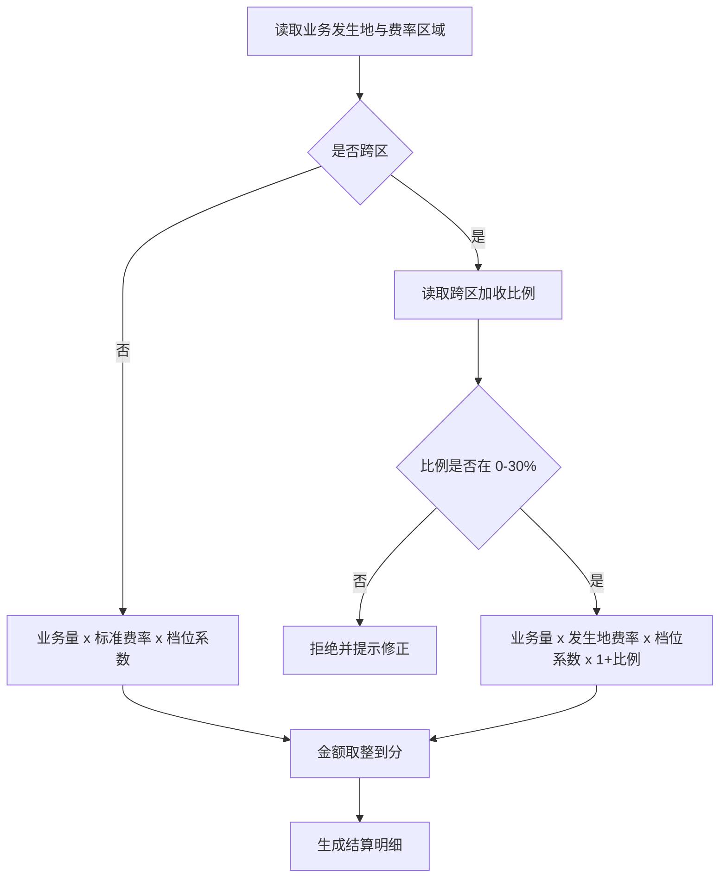

# 区域费率实施细则（长篇样例）

> 本文为**样例文档**，仅用于业务知识库功能验证（切块、分页、检索），不含任何真实业务数据、真实地区编码或真实费率。文中数字均为演示值。

## 1 适用范围

本细则适用于配置管理平台中「区域费率」（REGION_TARIFF）配置域的全部维护动作，包括新增费率版本、调整费率档位、跨区结算加收、历史版本回溯与费率发布。适用的使用方包括：区域运营、项目实施、财务结算与配置管理员。

本细则不适用于项目环境（PROJECT_ENV）、告警阈值（ALARM_THRESHOLD）与项目成员（PROJECT_MEMBER）三个域；这些域的口径见各自的样例文档。

### 1.1 生效边界

费率以「生效日期 + 区域编码 + 币种」三元组确定唯一有效版本。三元组完全相同而存在两条记录时，属于数据质量问题，必须由配置管理员在发布前修正，不能靠"后发布的覆盖先发布的"来兜底。

### 1.2 与旧口径的关系

旧口径按「区域 + 费率档位」定位，不含币种；新口径增加币种维度后，旧数据在迁移时统一补默认币种 CNY。迁移期间新旧口径并行一个发布周期，冲突时以新口径为准，并在发布说明中注明迁移批次。

## 2 术语与口径

### 2.1 标准费率

标准费率为区域内默认档位的费率，是其它档位计算的基准。标准费率变更必须走完整审批（见第 5 章），不得通过"新增一条同三元组记录"的方式绕过审批。

### 2.2 基准费率

基准费率是标准费率的同义口头叫法，二者在系统里是同一个字段 `base_rate`。检索、讨论与工单里出现"基准费率"时，一律按标准费率理解。

### 2.3 档位

档位是同一区域内按业务量或客户等级划分的费率层级，常见档位为 A/B/C 三档。档位编码必须来自 `TARIFF_LEVEL` 配置定义，不允许在费率表中自造档位编码。

### 2.4 跨区结算

当业务发生地与费率所属区域不一致时，按「业务发生地费率 + 跨区加收比例」计算。跨区加收比例是区域级参数，最小 0%，最大 30%，步长 0.5%。

## 3 费率分类

| 分类编码 | 分类名称 | 是否含跨区加收 | 默认档位 | 说明 |
| --- | --- | --- | --- | --- |
| STD | 标准业务 | 是 | A | 默认分类，覆盖大多数场景 |
| ENT | 企业专线 | 是 | B | 需要项目成员角色校验 |
| TMP | 临时业务 | 否 | C | 有效期不超过 30 天 |
| INT | 内部结算 | 否 | A | 仅限内部项目，不对外结算 |

费率分类编码来自 `TARIFF_CATEGORY` 定义，新增分类必须先发布定义，再发布费率数据。

## 4 计算规则

### 4.1 标准计算

单条业务量的应收金额 = 业务量 × 标准费率 × 档位系数。档位系数：A = 1.00，B = 1.05，C = 1.10。金额保留两位小数，采用四舍五入。

示例：业务量 120，标准费率 3.40，档位 B ⇒ 120 × 3.40 × 1.05 = 428.40。

### 4.2 跨区结算

跨区应收金额 = 业务发生地标准费率 × 业务量 × 档位系数 ×（1 + 跨区加收比例）。跨区加收比例按业务发生地所属区域读取，不按费率所属区域读取——这是历史上最容易搞反的一处，排障时优先核对。

示例：业务发生地费率 2.80，业务量 100，档位 A，加收比例 5% ⇒ 2.80 × 100 × 1.00 × 1.05 = 294.00。

### 4.3 边界与取整

1. 费率小于 0 一律拒绝发布；
2. 费率大于 9999.99 需要二次确认；
3. 中间计算不取整，只在最终金额取整到分；
4. 跨区加收比例超过 30% 时拒绝保存，不做静默截断；
5. 生效日期早于当前日期 90 天以上的补录，需要财务负责人复核。

### 4.4 计算流程图



流程图中的判断分支与 4.3 的边界规则一一对应；修改任一分支必须同步修改 4.3，否则文档与实现会分叉。

## 5 审批流程

1. 区域运营提交费率变更单，填写区域、币种、生效日期与变更原因；
2. 项目实施核对受影响的项目清单，确认无未结项项目；
3. 财务结算核对跨区加收比例与历史结算差异；
4. 配置管理员在配置管理平台创建导出任务，导出当前费率快照留档；
5. 配置管理员导入新费率，执行预检查；
6. 预检查通过后发布，发布作业完成前不得重复发起；
7. 发布完成后由区域运营抽检三个档位的计算结果；
8. 抽检通过后在变更单上回填发布作业编号，流程关闭。

以上八步缺一不可。任何"先发布后补审批"的做法都视为违规操作，需要在操作审计中登记。

## 6 变更与版本

### 6.1 版本号

费率版本采用「YYYY.MM.N」格式，N 为当月序号。版本号只在发布成功后生成，草稿不占用版本号。

### 6.2 回滚

发布后 24 小时内发现问题，可以回滚到上一个版本；超过 24 小时的回滚按新变更处理，需要重新走审批。回滚不是删除：旧版本保留在历史表中，只把"当前有效版本"指针指回去。

### 6.3 多版本并存

同一区域允许存在多个未来生效版本，但同一生效日期只允许一个版本。版本冲突时，发布预检查会给出冲突清单，不允许强制发布。

## 7 常见问题（FAQ）

**Q1：标准费率改了，历史结算会变吗？**
不会。结算明细在生成时固化当时费率，后续费率变更不影响已生成的结算明细。

**Q2：跨区加收比例可以按项目单独设置吗？**
不可以。它是区域级参数；项目级的差异通过档位系数体现。

**Q3：为什么导入时提示"档位编码不存在"？**
档位编码必须来自 `TARIFF_LEVEL` 定义。先确认定义已发布，再检查导入文件中的档位编码是否有多余空格。

**Q4：费率发布后可以删除吗？**
不可以删除，只能新增版本覆盖。删除会破坏历史结算的可追溯性。

**Q5：临时业务到期后费率还在吗？**
临时业务分类的费率记录保留，但状态置为失效；查询时默认只显示有效记录。

**Q6：一个区域可以没有标准费率吗？**
不可以。每个区域至少有一个 A 档标准费率；缺失时预检查会直接失败。

**Q7：跨区加收比例为 0 与"不跨区"有区别吗？**
计算金额相同，但结算明细中的分类不同，报表口径也不同。不要用 0 比例代替"不跨区"标记。

## 8 附：字段与代码

```json
{
  "defCode": "REGION_TARIFF",
  "fields": [
    {"code": "region_code", "label": "区域编码", "type": "STRING", "required": true, "key": true},
    {"code": "currency", "label": "币种", "type": "STRING", "required": true, "key": true},
    {"code": "level", "label": "档位", "type": "STRING", "required": true, "key": true},
    {"code": "base_rate", "label": "标准费率", "type": "DECIMAL", "required": true},
    {"code": "cross_ratio", "label": "跨区加收比例", "type": "DECIMAL", "required": false}
  ]
}
```

字段 `base_rate` 即标准费率，`cross_ratio` 即跨区加收比例。字段编码发布后不可改名，只能新增字段并逐步下线旧字段。

## 9 附录：发布前检查清单

- [ ] 区域编码来自已发布的 `REGION` 定义；
- [ ] 币种来自已发布的 `CURRENCY` 定义；
- [ ] 档位来自已发布的 `TARIFF_LEVEL` 定义；
- [ ] 每个区域至少一条 A 档标准费率；
- [ ] 跨区加收比例在 0%–30% 之间且为 0.5% 的整数倍；
- [ ] 生效日期不与既有版本冲突；
- [ ] 受影响项目清单已核对；
- [ ] 当前费率快照已导出留档；
- [ ] 预检查通过且无未处理告警；
- [ ] 发布窗口内没有其它费率发布作业在途。

## 10 附录：术语对照

| 口头叫法 | 正式名称 | 字段 |
| --- | --- | --- |
| 基准费率 | 标准费率 | base_rate |
| 费率表 | 区域费率 | REGION_TARIFF |
| 加收比例 | 跨区加收比例 | cross_ratio |
| 档位系数 | 档位系数 | level_factor |
| 区域价格 | 区域费率 | REGION_TARIFF |

术语对照用于检索召回：用户说"费率表"时，实际想查的是区域费率配置；用户说"加收比例"时，对应字段是 `cross_ratio`。

## 11 附录：典型错误与处置

### 11.1 导入失败：主键冲突

原因：同一「区域 + 币种 + 档位 + 生效日期」已存在记录。
处置：先导出当前版本核对，再决定是覆盖还是新增版本；不要删除既有记录。

### 11.2 预检查失败：跨区比例越界

原因：比例大于 30% 或不是 0.5% 的整数倍。
处置：修正导入文件；系统不做静默截断，避免"看起来成功、实际口径已变"。

### 11.3 发布作业长时间未完成

原因：可能有其它作业占用同一配置域，或作业被实例重启中断。
处置：先在作业列表查看状态；不要重复发起发布，避免双写。

### 11.4 结算金额与手工计算不一致

原因：常见为档位系数取错、跨区比例按费率所属区域读取、或中间步骤提前取整。
处置：按 4.1–4.3 逐步复算，核对结算明细中固化的费率与系数。

## 12 附录：口径变更记录（样例）

| 日期 | 版本 | 变更内容 | 影响范围 |
| --- | --- | --- | --- |
| 2026-01-15 | 2026.01.1 | 新增币种维度 | 全部区域 |
| 2026-03-02 | 2026.03.1 | 跨区加收比例上限由 20% 调整为 30% | 跨区业务 |
| 2026-05-20 | 2026.05.1 | 临时业务默认档位由 B 调整为 C | 临时业务 |
| 2026-07-08 | 2026.07.1 | 档位系数 B 由 1.03 调整为 1.05 | 全部区域 |
| 2026-09-01 | 2026.09.1 | 明确金额只在最终步骤取整 | 全部区域 |

变更记录用于"冲突以 updated_at 新者为准"的裁决：当两篇文档对同一口径描述不一致时，以变更记录中较新的版本为准，并在回答中说明存在历史版本。

## 13 附录：与其他配置域的联动

区域费率与以下配置域存在联动，排障时需要一并核对：

1. **CURRENCY（币种）**：费率的币种必须存在于币种定义中，且状态为有效；
2. **REGION（区域）**：区域编码必须存在，停用区域不允许新增费率；
3. **PROJECT_ENV（项目环境）**：项目环境引用的区域决定其默认费率；
4. **ALARM_THRESHOLD（告警阈值）**：费率异常波动会触发结算类告警，阈值口径见对应文档；
5. **PROJECT_MEMBER（项目成员）**：企业专线分类需要校验项目成员角色。

联动核对顺序建议：先定义（CURRENCY/REGION），再主数据（PROJECT_ENV/PROJECT_MEMBER），最后业务数据（REGION_TARIFF）。

## 14 附录：批量维护建议

批量维护优先使用"导出 → 离线修改 → 导入 → 预检查 → 发布"的链路，不建议逐条手工修改。导出时选择完整字段，避免离线修改后导入缺列。导入文件建议保留原始编码列，便于失败时定位到具体行。

批量修改跨区加收比例时，先在测试区域验证一轮，再推广到全部区域。每次批量修改都要记录变更单编号，便于审计回溯。

> 本文为样例文档，仅用于知识库功能验证，不含真实业务数据。文档长度约 9000 字符，用于验证切块、分页与 offset 连续性。

## 15 附录：结算对账口径

每月结算完成后，区域运营需要在三个工作日内完成对账。对账的最小口径是：按区域汇总的业务量、按档位汇总的金额、按分类汇总的跨区加收金额，三者都要与结算报表一致。

对账差异按以下顺序定位：

1. 先核对结算周期内是否有费率版本切换；版本切换日按"生效日期当天零点"切分，不按发布时刻切分；
2. 再核对跨区业务是否按业务发生地读取加收比例；
3. 然后核对档位系数是否按结算当时固化的值计算；
4. 最后核对是否存在手工调整金额；手工调整必须带审批单号，否则视为异常；
5. 差异超过千分之三时，升级到财务负责人复核，不允许区域自行调账。

对账结果记录在月度对账表中，保存期限不少于二十四个月。对账表本身不进入配置库，只作为审计附件归档。

## 16 附录：异常场景处置

### 16.1 发布中断

发布作业中断时，系统保留已写入的暂存数据，不自动回滚。处置步骤：确认作业状态为失败 → 查看错误明细 → 修正数据 → 重新发起发布。重新发起前必须先清理未完成的暂存批次，否则会出现重复记录。

### 16.2 并发修改

两个管理员同时修改同一区域费率时，后保存的一方会收到版本冲突提示。此时不允许强制覆盖，必须重新加载最新版本后再改。强制覆盖会导致前一位管理员的变化被静默丢弃，属于严重操作事故。

### 16.3 定义变更

区域、币种、档位等定义发生变更时，费率不会自动跟随。定义停用后，引用该定义的费率记录仍然存在，但发布预检查会提示"引用已停用定义"。处置：要么恢复定义，要么先把费率迁移到新定义，再停用旧定义。

### 16.4 时钟与生效日期

服务器时钟与业务时区不一致时，可能出现"刚发布就生效"或"发布后迟迟不生效"。系统统一按业务时区的日期比较，不使用服务器本地时间。排障时先确认业务时区配置，再核对生效日期字段。

## 17 附录：权限与审计

费率维护权限分为查看、编辑、发布三级。查看权限可以导出；编辑权限可以创建草稿与预检查；发布权限只能由配置管理员持有。任何一级权限都不包含"删除历史版本"的能力。

审计记录至少包含：操作人、操作时间、操作类型、目标区域与币种、变更前后摘要、关联变更单号、发布作业编号。审计记录只追加不修改，保存期限不少于三十六个月。

审计查询按"区域 + 时间范围"检索；跨区域查询需要财务负责人授权。审计记录不包含完整费率明细，只包含变更摘要与差异行数，完整明细通过导出快照回溯。

## 18 附录：培训与交接要点

新成员上手费率维护，建议按以下顺序学习：

1. 先读本文第 1–4 章，理解三元组、档位与跨区口径；
2. 再用测试区域完成一次"导出 → 修改 → 导入 → 预检查"的完整演练；
3. 然后在有发布权限的同事陪同下完成一次真实发布；
4. 最后学习第 15–17 章的对账、异常与审计口径。

交接时必须交付：当前有效版本清单、未来生效版本清单、未关闭的变更单、最近一次对账差异说明。缺少任何一项都视为交接未完成。

## 19 附录：常见指标定义

| 指标 | 定义 | 口径说明 |
| --- | --- | --- |
| 费率覆盖率 | 有标准费率的区域数 / 全部有效区域数 | 目标 100% |
| 跨区业务占比 | 跨区结算金额 / 总结算金额 | 按区域分别统计 |
| 版本切换次数 | 单月发布的费率版本数 | 不含回滚 |
| 预检查失败率 | 预检查失败次数 / 预检查总次数 | 按变更单统计 |
| 对账差异率 | 对账差异金额 / 结算金额 | 超过 0.3% 需升级 |

指标只用于运营观察，不作为个人考核依据；指标异常时先排查数据与口径，再讨论流程问题。

> 本文为样例文档，仅用于知识库功能验证，不含真实业务数据。文档长度约 9000 字符，用于验证切块、分页与 offset 连续性。

## 20 附录：问答补遗

**Q8：费率版本号可以手工指定吗？**
不可以。版本号由发布成功时刻自动生成，手工指定会破坏版本序列的唯一性。

**Q9：同一区域可以有多个币种吗？**
可以。同一区域的每个币种各自维护档位与费率，互不影响；跨币种结算需要先折算，折算汇率不在本配置域维护。

**Q10：导入文件里多出一列会怎样？**
预检查会提示"未知字段"，默认拒绝导入。确实需要新增字段时，先发布字段定义，再重新导出模板，不要依赖系统忽略多余列。

**Q11：预检查通过但发布失败，需要重新预检查吗？**
需要。预检查结果有有效期，发布前数据或定义发生变化时结果即失效；重新预检查是最低成本的安全动作。

**Q12：回滚会不会影响已经开始的发布作业？**
会。回滚前必须确认没有在途发布作业；有在途作业时回滚会被拒绝，避免版本指针与作业写入交叉。

**Q13：为什么两个区域的同名档位金额不同？**
档位只是层级标识，金额由各区域的标准费率与档位系数共同决定；同名档位不代表同价。

## 21 附录：文档维护约定

本文由区域运营与配置管理员共同维护。涉及计算规则（第 4 章）的修改必须由财务结算会签；涉及权限与审计（第 17 章）的修改必须由安全负责人会签。修改后在文末更新 `updated_at`，并同步更新 manifest 的 sha 与 updated_at，否则增量刷新不会重建该文档。

文档中的表格如果超过屏幕宽度，允许横向滚动，不要求拆表；索引时表格作为一个整体块处理，检索命中后通过章节定位回原文。代码块与流程图按原样保留，不要为了排版把 mermaid 改成图片，图片无法被检索。

> 本文为样例文档，仅用于知识库功能验证，不含真实业务数据。文档长度约 8400 字符，用于验证切块、分页与 offset 连续性。

补充约定：本文所有示例数字仅用于演示取整与比例规则，不构成任何区域的实际费率承诺；如需引用具体数值，请以配置库中的当前有效版本为准。
