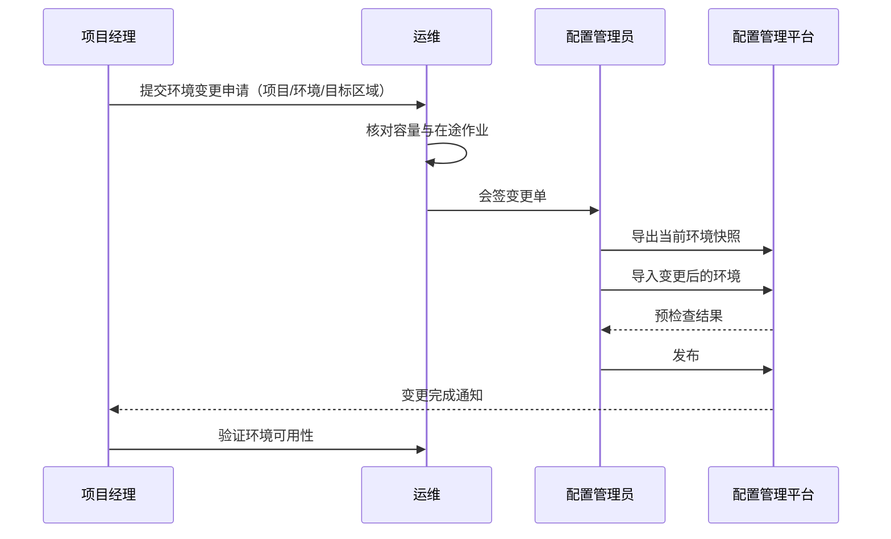

# 项目环境变更流程（样例）

> 本文为**样例文档**，仅用于知识库功能验证，不含真实业务数据。

## 1 流程图

## 2 流程说明

1. 项目经理提交变更申请，说明变更原因与期望完成时间；
2. 运维核对目标区域的容量与在途作业，有在途作业时不得变更；
3. 配置管理员导出当前环境快照留档，再导入变更后的环境；
4. 预检查必须通过，失败时按提示修正后重新导入；
5. 发布完成后由项目经理验证环境可用性，验证不通过可以回滚。

## 3 时限

| 阶段 | 时限 | 超时处理 |
| --- | --- | --- |
| 运维核对 | 1 个工作日 | 升级到运维负责人 |
| 会签 | 2 个工作日 | 变更单挂起并通知 |
| 发布 | 1 个工作日 | 顺延到下一个发布窗口 |
| 验证 | 2 个工作日 | 视为验证不通过，触发回滚评估 |

## 4 禁止事项

- 禁止跳过预检查直接发布；
- 禁止在变更窗口外发布；
- 禁止用"删除再新建"代替环境变更；
- 禁止在验证未完成时关闭变更单。

## 5 回滚

验证不通过时，用变更前导出的快照回滚。回滚后重新执行预检查与发布，并记录回滚原因。回滚不需要重新走会签，但必须在变更单中注明。

> 本文为样例文档，仅用于知识库功能验证，不含真实业务数据。
