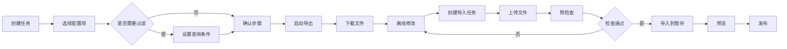

# 配置导入导出流程（样例）

> 本文为**样例文档**，仅用于知识库功能验证，不含真实业务数据。

## 1 全流程图



## 2 导出

1. 在任务中心创建导出任务；
2. 勾选要导出的配置项（可多选）；
3. 按需设置查询条件（范围 + 字段过滤）；
4. 确认步骤后启动导出；
5. 导出完成后下载 xlsx 文件。

导出是只读操作，不改变配置数据。导出文件是快照，后续配置变更不会回写文件。

## 3 导入

1. 创建导入任务并上传文件；
2. 预检查校验格式、类型、主键与引用关系；
3. 预检查失败时按错误明细修正文件，不要跳过；
4. 预检查通过后导入到暂存区；
5. 预览暂存数据，确认无误后发布。

导入写入暂存区，发布才写入正式库。未发布的暂存数据可以丢弃，不会影响正式数据。

## 4 查询条件

范围条件按 `scopeKeys` 过滤，字段条件按 `fields` 过滤，多条字段条件之间是 AND 关系。条件为空表示不过滤。

```json
{
  "scopeKeys": ["R-NORTH"],
  "fields": [
    {"fieldCode": "level", "operator": "EQ", "value": "A"}
  ]
}
```

## 5 常见问题

**问：可以先导入再补预检查吗？**
答：不可以。预检查是导入的前置条件，跳过会写入脏数据。

**问：导出文件可以改名吗？**
答：可以，但不要修改扩展名与表头结构。

**问：发布后可以撤销吗？**
答：发布是终态操作，不能撤销；需要更正时走新的变更流程。

> 本文为样例文档，仅用于知识库功能验证，不含真实业务数据。
