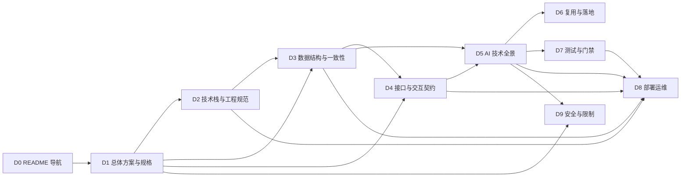

# 规划 — 核心技术文档体系与编写大纲（九份核心文档施工总纲）

> **用途**：把「九份核心技术文档」的**清单、结构、章节大纲、信息归属、写法、门禁与排期固定下来**，作为代码任务全部完成之后的**施工总纲**。后续按本件即可直接并行开工，不需要再问方向。
> **件性质**：规划件（`docs/research/` 入库）＝**固定方案，不是讨论稿**，全文**不给多选项、不留待裁点**。本件**零代码改动**：不创建 `docs/delivery/`、不写九份正文、不动代码 / 测试 / 配置 / 其它 agent 的工作面。
> **口径基线**：成文 2026-10-24，`main @ f2931f5`；成文时工作树含并行未提交改动（`ContextBuilder.java` / `stub-upstream.mjs` 等），故本件**不把任何"当前行为"当事实**——所有行为陈述一律要求在写稿时按 §9 现场实测并登记 baseline。
> **修订记录（fix round 1，2026-10-24）**：按独立评审 C1/C2 + I1~I13 + Minor 逐条修复 —— ①顶层包 **11 个（10 业务 + `ai`）** 并单列补丁命名空间；②§4 改为"全量体唯一归属 + **允许的派生形态**"，消除 D1/D2/D5/D7/D8 在拓扑/版本/端口命令/CI 门禁/工具表/一致性/最小化上的互斥；③AI 能力清单由 18 组扩为 **21 组**（新增 `C-A19` 用户反馈与 `ExcerptGuard`、`C-A20` AI 消息渲染、`C-A21` 多页签与会话隔离/前端状态），同步分层图、§2.5、§3 矩阵、归属与验收；④术语/状态机/枚举归属、复用注意条数、证据等价形态、D6 模式 B/C 小节与 11 步列、D7/D8 分工、`LIM-xx` 编号定义、抽查口径、入库状态与开工闸（`git cat-file` 校验）同批收口。
> **修订记录（fix round 2，2026-10-24）**：按复验报告 A1~A6 + 11 条 Minor 逐条修复 —— **A1** 派生表验收不再用"重叠列/行 = 0"（**连接键允许**：名称 / 端口 / 键前缀 / job 名；真正禁止的是复制对方**独有全量列**与**判据/阻断面/阈值表**），并修 D8 验收段重复编号；**A2** D2-§9.2 删"耗时目标"、改引 `D7-§8.1`；**A3** `LIM-xx`（限制，`D9-§5`）与出域判据（`D9-§3`）引用分列，D9 限制表统一 **7 列** + "七缺一不得入表"；**A4** 状态机"定义处唯一"改述为**唯一在 D5**（run/outcome 在 `§1.3`，卡/表单/预览各在 `§2.9`/`§2.8`/`§2.15`），跨册只许索引；**A5** B3 硬约束改 **`C-A11`/`C-A12` 边界同人写**（保留 A09/A10 规则）；**A6** `C-A19` 后端证据改点 `AiControllerFeedbackTest`，前端明确"不适用：无独立 spec，写稿时补"；Minor 11 条同批落（含 `C-A21` 补 `r166b-fixes.spec.ts`、索引 67 独立补登注明、§11.4 三连注记、看板标题改"落盘待提交"）。
> **修订记录（fix round 3，2026-10-24；两份审计落地）**：①**维度扩容**：新增 **`M-xx` 机制总账（10 主题）** 与 **`CFG-xx` 配置总账（10 类别）** 两个维度，与 `C-A/C-B` 并列；§3 覆盖矩阵改**三轴**（能力 / 机制 / 配置）各自可证全量。②**能力追加**：AI 编号**只追加不改号**，`C-A01~C-A21` 不动，新增 `C-A22` 可视可操作、`C-A23` 输入闸、`C-A24` 韧性预算、`C-A25` 作业异步与轮询、`C-A26` 用量与可观测、`C-A27` 会话生命周期/消息操作/建议 ⇒ **27 组**；`C-B` 补 `B11` 任务中心、`B12` 发布（暂存→发布）、`B13` 种子与初始化。③**规格追踪**：D1 新增 FR/NFR 全量追踪（需求 / 当前实现 / 偏离 / 裁决或 supersede / 证据），显式处理 FR-5.1 TTL、FR-5.3 确认门超时、FR-5.6 使用数据留存三处冲突。④**配置唯一存值处**：D2-§8.5 建 `CFG-xx` 总账（11 字段 + 类别附加字段 + 两处"代码缺省 vs yml 现值"反例），D1/D5/D8 只引 id。⑤**反臃肿**：删"每端点 8 小节"（改 **1 张全量端点总表 + 12 个核心端点 × 4 字段**）、D5 改 **6 簇 + 27 点**（只 6 点深写、其余紧凑卡）、图**全部 Mermaid 且 ≤20** 并由 D0 建图登记表、正文只留结论与引用、真实报文移附录。⑥**业界对比进各册**：统一 10 字段模板（P0 满填 / P1 六列 / P2 一句结论），AI 报告 S1~S6 官方源纳入来源清单，禁止"业界普遍"。⑦**审计具体问题**：`UiPrimitiveGuard` 归 `ai/tool`、`C-A19` 补 GET + `AiFeedbackView`、`C-A21` 拆"ui 区域执行"与"页签所有权"、D8 的 `app.ai.config.source` 标【计划】、profile 按"工作树已出现 `application-cluster.yml`"如实写、D3 键族补 `kb:/chat:/job:`、状态面扩到 **9+**、补降级矩阵/队列线程池/调度定时/轮询可见性/缓存失效/作业治理/E2E 配置矩阵/可观测字段字典。
> **状态**：本件与三份登记文件 **✅ 已入库并固定（文档 commit `3fe55e9`，2026-10-24；笔名「docs: 核心技术文档体系与编写大纲落盘」）**；`git cat-file -e HEAD:<本件路径>` 已通过（§10.5）。**历史 📤 记录按过程留痕保留、不篡改**。九份正文仍未开工（待代码任务完成后按 B0~B6 施工）；本件内容如需变更，走"修订 → 审校 → 新 commit"。
> **修订记录（fix round 4，2026-10-24；终验 C1~C5 + I1~I6 + 9 Minor）**：①**D5 锚点统一**为 `D5-§2.<簇>.<序>`（A01=§2.1.1 … A27=§2.6.9），§3.2 全 27 行、§3.1 列义、§2.5.1 八字段编号 `2.<簇>.<序>.1~.8`、§2.5.3/§2.5.6 同步为"27 张卡 / 6 簇"；②**CFG 唯一存值**落实：D3 键族表与生命周期表 TTL 列改 `CFG` id、§8.1 改"给 `CFG` id"、D8 §2.1 缺省列改"引 `CFG` id"、§4-15 增"D3 只允许 `CFG` id"及 D1-§6.4 唯一例外；③**图预算重排**：D1 2 / D2 2 / D3 3 / D4 3 / D5 5 / D6 2 / D7 1 / D8 1 / D9 1 = **20**，D1 六流程改为"内容齐全、图 ≤2"，D3 ER 固定 2 张，D8 生产/依赖拓扑合一；④**§13.4 补 URL 与核验日期**（S1~S6 六条，核验 2026-10-24）并删掉 §13.4 之后的孤儿 6/7 条；⑤**开工闸**改 `C-A01`~`C-A27`（含 `C-B01`~`C-B13` 与锚点格式）；⑥**I1~I6**：纪律三拆"AI 面→D5 / 业务状态→`D1-§5`"、FR 三冲突给可定位锚（`docs/决策看板.md` 10-20 / 10-21 具体行，无编号时写【待裁】）、`C-A27` 证据改 `AiControllerHistoryDeleteTest`、`C-A26` 补 `ai/run/UsageDetails.java` 与 health `usage` 段、`C-A22` 改"consequential 拒执且**不进入确认门**"；⑦Minor：D5 分层图补 A22/A26/A27、业界对照补 D2/D7 落点、四轴与六轴表述统一、快照改"当时复验"并更新 294/122、M 族编号规则写明、`ai-regions.spec.ts` 与 `SpToolCallingManagerToolTimeoutTest` 全名。
> **修订记录（fix round 5 + 入库回写，2026-10-24）**：①**fix round 5（定点复验收口）** = D1 图清单统一为同一组 2 张（模块 DAG + "部署/业务主链/导入导出"合一图，§5/必备图/验收三处一致，无第三张）；D3 §4.6 缓存层表改 `TTL（CFG id）` 并并入 §4-15 禁令；D5 `C-A26` 入口改点 `ai/run/UsageDetails.java`；Minor 4 条（样板改"四级小节"、§13.2 纪律行 286→292→294 / 117→120→122、FR 锚改"组+行号+行标题"、`C-A27` 卡补 `AiControllerHistoryDeleteTest`）。②**入库状态回写** = 本件与索引 + 两看板随 **commit `3fe55e9`** 入库（「docs: 核心技术文档体系与编写大纲落盘」）⇒ 状态由 📤 改 **✅ 已入库并固定**；看板计数 **任务 138 = ✅130 + 📤0 + 📋6 + 🔧1 + ❌1**、**决策 171 = ✅132 + 📤0 + 🏛️25 + 📌7 + ⏳1 + ⏸️3 + ❌2 + 🔧1**；此前各轮 📤 表述按过程留痕保留、不篡改。
> **脱敏**：本件不含本机绝对路径、不含任何密钥；仓库指代统一 `<REPO_ROOT>`，用户目录 `<USER>`（DC-08）。

---

## 0. 本件是什么、怎么用

### 0.1 一句话

九份核心文档 = **一套可交付、可复用、可验收的技术资产**（不是交接报告合集）；本件是这套资产**唯一的施工图**：写哪九份、每份写什么、写到哪里、彼此边界在哪、怎么算写完、按什么顺序并行写。

### 0.2 交付物边界

| 类别 | 本件做什么 | 本件不做什么 |
| --- | --- | --- |
| 计划 | 固定九份清单、章节大纲、覆盖矩阵、批次与验收 | — |
| 正文 | **不写**九份正文的任何章节内容 | 不写总体技术方案的叙述、不写接口示例的真实报文、不写 AI 能力点的链路细节 |
| 仓结构 | **不创建** `docs/delivery/` 目录 | 不预置占位文件、不建 README 导航文件 |
| 代码与门禁 | 只**读**、只引用既有路径与命令 | 不改代码 / 测试 / 配置 / CI，不新增脚本 |
| 看板 | 登记本件入库一行 + 索引补登 | 不改其它任务状态、不合并到既有挂账 |

### 0.3 三种读者的使用路径

| 你要做的事 | 读这里 |
| --- | --- |
| 我要写第 N 份文档 | §2.N 的「章节大纲 + 覆盖点 + 必备图表 + 事实来源 + 验收标准」→ §3 追踪矩阵行 → §9 登记 baseline → §10.4 DoR/DoD |
| 我要审第 N 份文档 | §11.2 交叉审校 12 条 + §2.N 验收标准 + §4 唯一归属矩阵（查是否越界重复）+ §7 标注规则（查是否把计划写成现状） |
| 我要把本仓能力搬到新项目 | §2.6（D6 大纲）+ §3.2 能力清单 + §6.3 复用项的「复用注意」字段 |

### 0.4 与既有文档的分工（本体系不替代任何现行件）

- **不替代**：`docs/02-需求设计文档-v2.2-冻结版.md`（需求口径）、`docs/03-技术方案文档-v2.1.md`（技术方案）、`docs/adr/`（决策）、`docs/s4/`（施工级规格）、`docs/evidence/`（证据）。
- **关系**：九份核心文档是**面向"交付与复用"的再组织**——把散落在 02/03/adr/s4/evidence/research 的事实，按"读者任务"重排为九本可独立阅读的书；**冲突时优先级不变**（决策 > 现行基线 02/03 > 规格 s4 > 证据 evidence，见 `docs/README.md`）。
- **research 目录件**：是九份文档的**事实来源之一**（尤其设计稿与排查报告），但**不是**九份正文的替代；research 件的"结论不构成施工承诺"口径**随内容迁入时必须保留标注**（见 §7.3）。

---

## 1. 文档体系总览

### 1.1 九份固定清单（数量与主题不可改；文件名只允许调整标点以符合仓规）

| 编号 | 文件名（`docs/delivery/` 下） | 主题 | 优先级 | 上游依赖 | 被谁依赖 | 预估正文（不含附录） | 主读者 | 施工批次 |
| --- | --- | --- | --- | --- | --- | --- | --- | --- |
| D0 | `README.md` | **导航件**：九份的读法、版本、状态、交叉引用表 + **AI 横向索引** + **图登记表** | P0 | D1 | 全体 | ≤ 160 行 | 全部 | B0 |
| D1 | `01-总体技术方案与规格说明书.md` | 系统是什么、边界、模块、关键流程、**FR/NFR 全量规格追踪**、**机制总账 `M-xx`** | **P0** | 02/03/adr/s4 | D2~D9（术语与模块口径） | 800~1000 行 | 新接手工程师 / 架构评审 / 甲方技术对接 | B1 |
| D2 | `02-技术栈与工程规范.md` | 版本矩阵、工程结构、编码与配置规范、**配置总账 `CFG-xx`**、构建与 CI | **P0** | D1 | D3/D4/D7/D8 | 650~850 行 | 开发 / 构建维护者 | B1（与 D1 并行） |
| D3 | `03-数据结构与一致性设计.md` | 表 / 键 / 文件三面数据 + 一致性模型 + 作业治理与缓存失效 | **P0** | D1/D2 | D4/D5/D8/D9 | 650~850 行 | 后端开发 / DBA / 迁移实施 | B2 |
| D4 | `04-接口与交互契约手册.md` | **全量端点总表 + 12 个核心端点深写** + SSE 帧 + 工具契约 + 前端交互判据 | **P0** | D1/D3 | D5/D6/D7/D8 | 800~1000 行 | 前后端开发 / 联调 / 自动化测试 | B2（与 D3 并行；代码侧帧类型集**已冻结**，D4 只负责成文） |
| D5 | `05-AI技术全景设计与实现.md` | **6 主题簇 × 27 能力点** + 链路 + 业界对照 + 证据（配置只引 `CFG`） | **P0** | D1/D3/D4 | D6/D7/D8/D9 | 1200~1600 行（可拆上下册，但仍是**一份**、同一编号） | AI 方向工程师 / 复用方 | B3 |
| D6 | `06-新项目复用与落地指南.md` | 三种复用模式 + 映射 + 剥离 + 11 步实施 | **P0** | D1~D5 | 新项目团队 | 600~800 行 | 新项目负责人 / 迁移实施者 | B4 |
| D7 | `07-测试验证与质量门禁.md` | 分层、规范、门禁、红测、覆盖追踪 | **P1** | D1/D4/D5 | D8（上线前验收） | 500~700 行 | 测试 / QA / CI 维护者 | B4（与 D6 并行） |
| D8 | `08-部署运维与生产迁移手册.md` | 拓扑、配置、上线、迁移、多实例、Runbook | **P1** | D2/D3/D4/D5/D7 | 运维 / 交付 | 500~700 行 | 运维 / 交付实施 | B5 |
| D9 | `09-安全边界已知限制与决策追溯.md` | 威胁模型、控制面、已知限制、决策索引 | **P1** | D1~D5 | 甲方安全评审 / 后续维护 | 400~550 行 | 安全评审 / 架构 / 长期维护者 | B5（与 D8 并行） |

**排序依据（固定，不讨论）**：`D1 → D2 → D3/D4 → D5 → D6/D7 → D8/D9`。理由：D1 定术语与模块口径（否则九份各说各话）、D2 定版本与命令（否则示例不可复现）、D3/D4 定数据与契约（D5 的能力点必须引用它们而不重写）、D6/D7 是"消费方"（复用与验收），D8/D9 是"对外面"（上线与安全），必须最后写且在 D5 之后，否则会把未定型的能力写进上线手册。

### 1.2 依赖 DAG



**硬边（不可并行）**：`D1→D3/D4`、`D3/D4→D5`、`D5→D6/D7/D8/D9`、`D7→D8`（D8 的上线检查单与 Go/No-Go 判据消费 D7 的门禁口径）。
**软边（可并行、合并时对账）**：`D1∥D2`、`D3∥D4`（D4 的帧字典与 D3 的键族互不重叠，但必须共用 §5 状态机口径）、`D6∥D7`、`D8∥D9`。

### 1.3 每份文档的统一物理结构（八段，缺一不算完成）

| 段 | 名称 | 必备内容 | 长度占比 |
| --- | --- | --- | --- |
| ① | 元信息头 | §1.4 的 12 字段表 | ≤ 20 行 |
| ② | 导读 | 本册解决什么问题 / 不解决什么 / 建议阅读顺序 / 与其他册的边界一句话 | ≤ 40 行 |
| ③ | 正文 | §2 给定的大纲结构 | 主体 |
| ④ | 附录 | 全量表（工具表 / 配置键表 / 错误码表 / 键族表 / 命令表）——同类表**只在本册出现一次** | 10~20% |
| ⑤ | 覆盖追踪 | 本册章节 ↔ `C-*` 能力点 ↔ 代码入口 ↔ 测试证据（§3.1 的 **10 列**格式，只列本册负责的行） | 5~10% |
| ⑥ | 验收自查 | §2 该册「验收标准」逐条打勾 + 实测命令与输出摘要 | ≤ 30 行 |
| ⑦ | 变更记录 | 版本 / 日期 / 变更面 / baseline commit / 审校人 | 追加式 |
| ⑧ | 引用清单 | 全部 `path:line` 形式的事实来源，去重排序 | 附录末 |

> **D0 豁免**：导航件 `README.md` 只要求 ①②⑦ 三段（元信息头 / 导读 / 变更记录）+ 九册状态总表；③④⑤⑥⑧ 不适用。其余 D1~D9 **八段缺一不算完成**。

### 1.4 元信息头 12 字段（固定表头，逐份照抄）

| 字段 | 取值要求 |
| --- | --- |
| `doc_id` | `D1`…`D9`（D0 为导航件不设） |
| `title` | 与文件名一致的中文标题 |
| `version` | `v1.0` 起；每次实质变更 +0.1，重写 +1.0 |
| `status` | `草案` / `待审` / `已审` / `冻结` 四值（本体系不引入第五值） |
| `priority` | `P0` / `P1`（见 §1.1） |
| `baseline_commit` | 写作时 `git rev-parse HEAD` 的短哈希（§9.1） |
| `baseline_worktree` | `clean` 或列出未提交文件（不得写"大致干净"） |
| `gate_snapshot` | 门禁实测值（§9.2），形如 `backend=…/…，frontend=…/…，check-docs=6/6` |
| `upstream` | 依赖的上游册编号与**冻结版本号**（此处的"冻结版本号"指上游册的 `version` 字段值，如 `D3=v1.0`；**技术栈组件版本号只在 D2 出现**，见 §4 第 4 行） |
| `downstream` | 依赖本册的下游册编号 |
| `owner` / `reviewers` | 角色名（不写个人隐私信息） |
| `last_reviewed` | 最近一次交叉审校日期 |

### 1.5 编号与引用语法（全体系统一，禁止自造）

| 语法 | 含义 | 示例 |
| --- | --- | --- |
| `D5-§7.3` | 跨册引用章节 | 见 `D3-§4.1` 键族表 |
| `C-A11` | **能力点编号**（AI 面，§3.2 固定 **27 组**：`C-A01`~`C-A27`，只追加不改号） | `C-A11` = lease/epoch/fencing/幂等 |
| `C-B07` | 非 AI 面能力点编号（§3.3，**`C-B01`~`C-B13`**） | `C-B03` = 导入预检 |
| `M-06-03` | **机制编号**：`M-<主题两位数>-<序号两位数>`，主题 `01`~`10` 固定（见 D1-§6.3）；每族必须有"归属册章节 + 代码入口 + 配置入口（`CFG` id）+ 证据 + 状态" | `M-06-02` = 模型调用重试 |
| `CFG-xxx` | **配置编号**：`CFG-<类别号>-<序号>`（类别 C1~C10 见 D2-§8.5）；**全体系唯一存值处**，别册只引 id 不写数值 | `CFG-1-014` = `app.ai.resume.on-startup` |
| `FIG-xx-nn` | **图编号**：册号 + 序号（如 `FIG-D5-03`），登记在 D0 图登记表 | `FIG-D1-01` = 逻辑部署形态 |
| `FR-x.y` / `NFR-xx` | 沿用需求文档编号，**不重编**；D1-§6.4 追踪表按此逐条列 | `FR-5.3` |
| `E-…` | 证据编号（指向测试类 / E2E 用例 / 证据件），**必须在 §2 各册「事实来源」里可解析** | `E-FrameTypeSetFrozenTest` |
| `LIM-01` | **D9 局部限制编号**（`D9-§5` 限制表专用，两位数字、册内连续）；**每条 `LIM-xx` 必须同时给出 `L-*` 跟踪号**（无跟踪号者不得入表）；正文其他册只引 `LIM-xx`，不复制限制描述 | `LIM-01 → L-138` |
| `R-…` / `L-…` / `DC-…` / `ADR-…` | 沿用仓库既有编号，**不重编、不改写** | `L-138`、`DC-16` |
| `【实现】/【计划】/【限制】` | 事实状态标注（§7） | `【限制】单实例…` |

### 1.6 四个维度与体量纪律（**写稿前先读这一节**）

用户要求"规格 / 机制 / 配置 / AI 细节都不能遗漏 + 业界对比 + 层次清晰不堆字"。这四件事靠**四个并列维度**落地，任何一个维度缺失都不能声称"全量"：

| 维度 | 编号体系 | 唯一归属 | 总量锚（写稿时重测） | 证明方式 |
| --- | --- | --- | --- | --- |
| **能力** | `C-A01~A27` / `C-B01~B13` | D5（AI）/ D1（业务） | 27 + 13 | §3.2 / §3.3 矩阵逐行 |
| **机制** | `M-01-01~M-10-nn` | D1-§6.3（总账）+ 各机制正文按主题落 D1/D2/D3/D4/D5/D8/D9 | 10 主题、约 80 机制族 | §3.4 机制轴 + D1-§6.3 总表 |
| **配置** | `CFG-1-001~CFG-10-nnn` | **D2-§8.5（唯一存值处）** | 10 类别、全命名空间 | §3.4 配置轴 + D2-§8.5 总表 |
| **规格** | `FR-x.y` / `NFR-xx` | D1-§6.4（追踪表） | 现行需求文档全量 | §3.4 规格轴 + D1-§6.4 |

**主次与篇幅原则（硬约束，防止"每点一样长"导致 2000+ 行）**

1. **深写 / 紧凑卡 / 只索引** 三档：每册先声明"深写集合"（P0 核心机制）与"紧凑集合"；紧凑项**不得少于**深写项字段数的一半，但每条 ≤ 12 行。
   - D5：深写 `C-A03/A09/A10/A11/A12/A15`（6 点，每点 ≤ 70 行）；其余 21 点用**紧凑能力卡**（8 字段各 1~2 行，≤ 25 行/点）。
   - D4：深写 12 个核心端点（每端点 4 字段）；其余端点进总表（1 行/端点）。
   - D1：六条业务流程压缩为 **2 张图**（模块 DAG + 部署/主链/导入导出合一；AI/HITL 引 D5），其余以表代图。
2. **一事实一处**：数值只在 `CFG`；帧字段只在 D4；键族只在 D3；工具契约只在 D4；错误码只在 D4。别册一律"结论一句 + 引 id"。
3. **正文 vs 附录**：正文写"结论 + 判据 + 引用"；**全量表、真实报文、帧序列原文、键快照**进各册附录或 `docs/delivery/evidence/`（附录不计入篇幅上限，但计入**附录验收**：条目数、可解析率、与正文引用一一对应）。
4. **图预算 ≤ 20 张**，全部 Mermaid（§6.1）；D0 建**图登记表**（`FIG` id / 类型 / 归属 / 用途 / 来源 / 状态），未登记不得画；同构图只留一处。
5. **禁止三件事**：① ASCII / 空格 / 制表符拼的示意图；② "业界普遍…"式空话（必须给具体家/协议 + 证据）；③ 为凑"全量"给 80 个机制各开长章（机制用总账 + 主题章）。

### 1.7 机制与配置的主题骨架（**紧凑总表，不逐族开章**）

**机制 10 主题（`M-01`~`M-10`；每主题下按"族"列，写稿时在 D1-§6.3 展开为一行一族）**

| 主题 | 名称 | 含哪些机制族（写作清单） |
| --- | --- | --- |
| `M-01` | 业务规格与能力 | 定位/角色/边界/非目标；三条主链；四类作业；任务中心；主数据；配置定义与依赖；暂存→发布；需求追踪 |
| `M-02` | 工程基线与运行形态 | 技术栈矩阵；包结构；构建/CI；端口与环境变量；单/多实例；数据目录与生成物 |
| `M-03` | 数据与存储 | 表与迁移；**键族四命名空间**；**同槽键族与 hash tag 口径**（何族带 tag / 何族刻意不带）；**整窗原子覆盖**（staging → `RENAME`，失败不先删旧值）与兼容回退读；文件面；KB 索引；一致性（串行/租约/幂等/乐观锁）；**条件写入（CAS）**；事务与崩溃点；生命周期；**缓存失效**；**种子与初始化** |
| `M-04` | 接口与交互契约 | 端点；16 帧；工具；前端四层；交互判据；**不可撤销动作的确认位与回执**（勾选才放行 + 取消回执文案）；错误码与分类；兼容矩阵 |
| `M-05` | AI 编排与能力 | 27 个 `C-A` 能力（一一映射到 `M-05-nn`，不另起机制叙事）；**回答语言口径**（本轮语言段与主提示规则的关系，属 `C-A02`/`C-A17` 交叉面） |
| `M-06` | 时间面 | 超时；预算；重试；退避/抖动；**定时**；**轮询**；TTL；**TTL 派生**（由上限配置派生协调键 TTL，不写死）；心跳；**活动锚点**（业务活动 vs 心跳，僵尸判据取二者较大值）；限流；熔断；看门狗 |
| `M-07` | 并发、状态与分布式 | 线程池/队列；五类锁；lease/epoch/fence（**per-run 取号 + 与占用同一原子步**）；幂等去重；**原子认领（ACQUIRE 三态）**；**9 个状态面**；取消（含"未知不等于取消"）；恢复（**多实例下不杀活 runner**）；多实例（**runner-active 共享闸 / 注册失败不开跑 / 本机死键启动清理**）；**加锁顺序**（task → child）；事件总线 |
| `M-08` | 韧性与降级 | 失败分类；**降级矩阵**；**读侧 degraded 终态**（宁可空回也不回错窗）；**状态不可用即 fail-closed**（不把"查不到"当"可删/可取消"）；**UNKNOWN 对账**（未知先对账、不当失败也不当取消）；SSE 重连；刷新恢复；容量饱和；错误面与观测 |
| `M-09` | 安全与治理 | 信任边界；输入；工具闸；输出；资源；密钥；最小化；审计；**不可撤销动作的代价披露**；运维面 |
| `M-10` | 质量与运维 | 七层测试；**E2E 设施**；**真集群/目标版本冒烟网**（拓扑与版本须与生产同构）；两级门禁；可观测；容量；发布回滚；Runbook；备份恢复 |

**配置 10 类别（`C1`~`C10`；行数在 D2-§8.5 展开为 `CFG` 行）**

| 类 | 类别 | 典型载体/键（示例，不是全量） |
| --- | --- | --- |
| C1 | 后端运行配置 | `server.*`、`spring.*`、`app.ai.*`、`app.task/job/file.*`、`logging.*` |
| C2 | 代码缺省配置 | `@ConfigurationProperties` 初值、常量（含两处"缺省≠现值"反例） |
| C3 | 环境变量与启动参数 | `AI_*`、`VITE_*`、`E2E_*`、`--server.port` |
| C4 | 数据库运行配置 | `ai_provider`/`ai_model`/`ai_setting`/`ai_config_audit` |
| C5 | Redis 协调配置 | `ai:cfg:ver`、`kb:cache:*`、锁/租/限流/取消/幂等键 |
| C6 | 文件型配置 | `ai/tools.yaml`、`messages_*.properties`、`locales/*.json`、KB 样例、`stub-routes.json` |
| C7 | 前端运行时 | `localStorage cm.locale`、`sessionStorage ai-*`、Web Locks、BroadcastChannel |
| C8 | 测试与 CI | 9 个 playwright config、harness、端口矩阵、`gate --tier`、选择测试表 |
| C9 | 部署与拓扑 | 单/多实例、H2 路径、`data/*`、Redis 拓扑、端口、CORS |
| C10 | 安全与密钥 | KEK、`key_ref`、`allow-private-endpoints`、CSP/CORS、上传与输入上限、sheet 开关 |

> **写法约束**：机制**不逐族开章**（10 主题各一章 + D1-§6.3 总表）；配置**不逐键写正文**（`CFG` 总表 + 附录）。这样既能证明"全量"，又不把九册写爆。
> **编号规则**：上表"含哪些机制族"**即全量族清单**——写稿时在 `D1-§6.3` 按主题逐族编号（`M-<主题>-<两位序>`，序在该主题内从 `01` 起连续），**本件不预生成族号**，避免与写稿时的拆分/合并冲突；"全量"以 **D1 成稿的总账行数 = 本表族清单条数** 为准。

---

## 2. 分册大纲（D1~D9）

> 每册固定六块：**元信息 → 章节大纲（≥ 二级，关键处到三级）→ 覆盖点 → 必备表格/图示/示例 → 事实来源 → 验收标准**。
> 「事实来源」只列**仓内相对路径**；`path:line` 精确锚点在写稿时现场取（行号随码位移，不在本件固化）。
> 「目的 / 读者 / 优先级 / 依赖」四项在 §2.0 总表一次给全（每册正文 §1 首段须把"目的"再展开为 3~5 句，不得只留一句话）。

### 2.0 九册元信息总表（目的 / 读者 / 优先级 / 依赖）

| 编号 | 目的（一句话；正文须展开为 3~5 句） | 主读者 | 优先级 | 依赖 | 批次 |
| --- | --- | --- | --- | --- | --- |
| D1 | 让不熟悉本仓的人在一天内建立"系统是什么、边界在哪、关键流程怎么走"的完整心智模型 | 新接手工程师 / 架构评审 / 甲方技术对接 | P0 | 02 v2.2、03 v2.1、`docs/adr/`、`docs/s4/` | B1 |
| D2 | 把"用什么版本、怎么组织代码、怎么配置、怎么构建"钉成**唯一事实源**，杜绝版本与命令漂移 | 开发 / 构建维护者 | P0 | D1 | B1 |
| D3 | 讲清数据存在哪、**谁是真相源**、崩溃与并发下如何保持一致 | 后端开发 / DBA / 迁移实施 | P0 | D1、D2 | B2 |
| D4 | 让前后端与测试在**同一份契约**上协作：**全量端点总表 + 12 核心端点**、帧、工具、交互判据 | 前后端开发 / 联调 / 自动化测试 | P0 | D1、D3 | B2 |
| D5 | 把 AI 能力按 **6 簇 × 27 点**讲透（链路 / 数据 / 降级 / 配置 / 证据 / 业界对照），既当实现说明也当复用底稿 | AI 方向工程师 / 复用方 | P0 | D1、D3、D4 | B3 |
| D6 | 让新项目按 **11 步**把"能用的 AI 能力"搬过去，并清楚哪些必须改、哪些绝不能抄 | 新项目负责人 / 迁移实施者 | P0 | D1~D5 | B4 |
| D7 | 让"每条承诺都有可执行证据"成为体系：分层、规范、门禁、红测、覆盖追踪 | 测试 / QA / CI 维护者 | P1 | D1、D4、D5 | B4 |
| D8 | 让运维与交付能把系统**起起来、升上去、扛住多实例**，故障时按 Runbook 处置 | 运维 / 交付实施 | P1 | D2、D3、D4、D5 | B5 |
| D9 | 把**安全边界、已知限制与决策来龙去脉**一次讲清，供安全评审与长期维护 | 安全评审 / 架构 / 长期维护者 | P1 | D1~D5 | B5 |

### 2.1 D1 — 总体技术方案与规格说明书

**元信息**：`doc_id=D1`｜优先级 **P0**｜依赖：02 v2.2 / 03 v2.1 / `docs/adr/` / `docs/s4/`｜被 D2~D9 依赖｜批次 **B1**｜读者：新接手工程师、架构评审、甲方技术对接。

**章节大纲**

```
1  文档定位与阅读路径
   1.1 本册回答的五个问题
   1.2 与其他八册的边界（一句话各自负责什么）
2  业务与产品口径（只写现行口径）
   2.1 三条主业务链：配置定义 / 业务数据 / 导出导入
   2.2 角色与典型使用场景（终端用户视角，非开发者视角）
   2.3 需求编号映射（FR-x.y → 本册章节）
3  范围与非目标
   3.1 范围内能力清单（指向 C-B* 编号）
   3.2 明确不做（每条给：不做的理由 + 决策/挂账编号）
4  系统总览
   4.1 部署形态（浏览器 SPA + 单体后端 + 关系库 + Redis + 文件存储）——只画**一张逻辑部署形态图**；生产拓扑、依赖拓扑与目标拓扑版本归 D8-§1
   4.2 模块地图（后端 **11 个顶层包**＝10 个业务包 + `ai`：职责 / 对外接口 / 依赖方向）
       4.2.1 业务侧 10 包：definition / data / task / masterdata / excel / file / job / seed / config / common
       4.2.2 AI 侧：`ai` 及其 15 个子包（config/context/exec/feedback/form/gate/kb/memory/observe/resultview/run/session/tool/tools/web）
       4.2.3 补丁命名空间（**非业务包**）：`org/springframework/ai/openai/`（仅 `ReasoningAwareOpenAiChatModel` 一个上游补丁类）；
             本节明确写"11 个业务顶层包 + 1 个补丁命名空间"，**不计入包数**、不参与业务依赖图
   4.3 运行时视图：一次用户请求 → 会话 → 轮次 → 工具 → 帧 → 落库/落缓存
   4.4 技术栈一句话索引（详表在 D2，本册不写组件版本号）
5  关键流程（**六条内容齐全；流程图合并进 §2.1 的"部署 + 业务主链 + 导入导出"合一图**，
   本册不再单独出第三张图；AI/HITL 链引 `D5-§4`；每条流程仍写"正常路径 + 失败路径"文字）
   5.1 配置定义创建与发布
   5.2 导入：预检 → 确认 → 执行 → 终态
   5.3 导出：同上（差异点单独列）
   5.4 AI 对话一轮（含工具循环、流式、终帧）
   5.5 HITL 确认门与续跑（含刷新恢复）
   5.6 多实例接管与跨实例续跑（只给总览，细节指向 D8-§6）
6  规格与机制总账
   6.1 功能规格（S-xx：编号 / 陈述 / 验收方式 / 实现落点 / 状态标注）
   6.2 非功能规格（**只列 CFG id 清单 + 引 `D2-§8.5`**，本册不写数值；每组给"有无实测"标记）
   6.3 **机制总账 `M-01-01`~`M-10-nn`**（10 主题，见下；**只做总表，不每族开长章**：
       列 = 机制 id / 名称 / 主题 / 唯一归属册§ / 代码入口 / 配置入口（`CFG` id）/ 证据 / 状态）
       6.3.1 T1 业务规格与能力    6.3.2 T2 工程基线与运行形态   6.3.3 T3 数据与存储
       6.3.4 T4 接口与交互契约    6.3.5 T5 AI 编排与能力      6.3.6 T6 时间面（超时/重试/退避/定时/轮询/TTL/心跳/限流/熔断/看门狗）
       6.3.7 T7 并发状态与分布式  6.3.8 T8 韧性与降级          6.3.9 T9 安全与治理
       6.3.10 T10 质量与运维
   6.4 **规格追踪表（FR/NFR 全量）**：列 = 需求编号 / 原文要点 / 当前实现 / 是否偏离 / 裁决或 supersede / 证据
       6.4.1 **三处已知冲突的显式处理**（本册必须给结论，不许两边照抄；"裁决"列必须是**可定位锚**）
             · **FR-5.1（会话 TTL 6h → 24h 滑动）**：实现为 24h 滑动（键引 `D2-§8.5`）⇒ 标 **supersede**；
               锚 = `docs/决策看板.md` **`## 10-20` 组 · 行 100**〔用户直裁 2026-10-20：会话 TTL 24h 滑动、无绝对上限〕
               + **`## 10-21` 组 · 行 68**〔24h 严格共亡裁决〕；理由 = 与 🏛️「AI 对话数据不落库」同源
             · **FR-5.3（确认门超时：自动取消 → 无超时）**：⇒ 标 **supersede**；
               锚 = `docs/决策看板.md` **`## 10-20` 组 · 行 99**〔用户直裁 2026-10-20：审批卡 / 表单卡不做超时限制（去超时裁决）〕；
               附注 = WCAG 2.2.1（`S5`）的 "turn off" 形态
             · **FR-5.6（使用数据留存：入库 → 24h 后归零）**：⇒ 标 **【限制】+ 偏离**；
               锚 = `docs/决策看板.md` **`## 10-21` 组 · 行 66**〔🏛️ AI 对话数据不落库〕+ D9 对应 `LIM-xx`（写稿时登记）；
               给"不落库红线"与"可观测替代面（`D5-§2.6.8`）"两条结论
             · **锚的写法**：一律"**组 + 行号 + 行标题**"三件齐（行号漂移时以标题 grep 为准），例：`## 10-20` 组 · 行 100 ·〔会话 TTL 24h 滑动〕
             · **无正式编号的情形**：一律写「**【待裁】** + owner + 触发条件"，**不得假装有 DC/ADR 号**
   6.5 **偏离与 supersede 登记表**（全体系一张：偏离 id / 需求或主流做法 / 本仓做法 / 理由与裁决号 / 代价 / 复核触发）
7  质量属性
   7.1 性能（有实测的给实测值 + 出处；无实测的写【限制】并给量化计划）
   7.2 可用性与恢复（重启恢复、僵尸回收、断线重挂的承诺边界）
   7.3 可维护性（模块耦合、测试覆盖口径指向 D7）
   7.4 可移植性（哪些是本仓特化、哪些可复用，指向 D6）
8  一致性总纲（**原则清单，一句一条** + 每条引 D3-§6 的对应小节；不写机制原理、不复制约束表）
9  安全总纲（只写边界声明，细节指向 D9）
10 术语与状态机索引（**索引行 + 指向**：术语表体在 D5-§1.3、工具结局枚举在 D4-§5.4、
   运行态一致性约束在 D3-§6.2；本册只列索引与"禁止同义词"，不复制表体）
11 附录
   11.1 需求 → 设计 → 实现 → 证据 四段追踪表（与 6.4 同源、互为索引）
   11.2 模块—文件—责任人对账表（角色名，不写个人）
```

**覆盖点**：系统边界与逻辑部署形态；11 个业务顶层包 + 1 个补丁命名空间的职责与依赖方向；**三条业务主链的流程（图压缩为 2 张，其余以表代图）**；**FR/NFR 全量追踪与三处冲突的 supersede**；**机制总账 10 主题**；质量属性的"实测 vs 未实测"分界；明确不做的理由链；一致性与安全只到"原则 + 引用"。

**必备表格 / 图示 / 示例**
- 图（**恰好 2 张，不再有第三张**）：① **模块 DAG**（`graph LR`）；② **一张"逻辑部署形态 + 业务主链 + 导入导出"合一图**（`graph TB`，只画角色/存储/主链主干；六条流程的文字全覆盖，**导入导出作为该图内的两条支线**，不另成图；AI+HITL 链引 `D5-§4`）。
- 表（核心 4 张 + 附录）：模块地图表（11 行 + 补丁 1 行）、**机制总账表（10 主题分组，一行一机制）**、**规格追踪表（FR/NFR 全量）**、**偏离/supersede 表**。
- 示例（1 组）：一条完整业务请求的追踪记录（正文）；其余报文进附录。

**事实来源**：`docs/02-需求设计文档-v2.2-冻结版.md`（FR/NFR 原文与 §117/§120/§121 三处）、`docs/03-技术方案文档-v2.1.md`、`docs/adr/DECISION-REGISTER.md`、`docs/adr/DECISION-CARDS.md`、`docs/s4/`、`backend/src/main/java/com/example/configmgr/`（**11 个顶层包**）、`backend/src/main/java/org/springframework/ai/openai/`（补丁命名空间）、`backend/src/main/resources/application.yml`（只取键名）、`docs/evidence/` 中的行为基线件、`docs/research/` 索引中与规格/机制相关的件、`docs/决策看板.md`（FR 冲突裁决锚）。

**验收标准**
1. 模块地图覆盖后端 **11 个顶层包**（10 业务 + `ai`）与 `ai` 的 15 个子包，**零遗漏**、每个包三列齐；补丁命名空间单列且不计入 11。（核对：`find … -mindepth 1 -maxdepth 1 -type d | wc -l` = **11**）
2. 六条流程**内容齐全，全书恰 2 张图**（模块 DAG + 部署/业务主链/导入导出合一图，**无第三张**；允许表代图）；每条流程仍有"正常路径 + ≥2 条失败路径（含终态与用户可见表现）"。
3. **机制总账**：10 主题齐全、机制 id 连续、每行五个字段（归属§ / 入口 / `CFG` / 证据 / 状态）非空；覆盖率抽查 = 从 `M-*` 随机抽 10 条，逐条能找到正文与入口。
4. **规格追踪**：FR/NFR **逐条**有行；三处冲突（FR-5.1 / FR-5.3 / FR-5.6）**各有明确结论**（supersede 或【限制】+ 理由 + 裁决号），**不得两处写不同口径**。
5. §6.2 不写具体数值（只列 `CFG` id）；技术栈组件版本号不在本册出现（唯一 D2-§1）；帧字段名不在本册出现（唯一 D4-§4）。
6. 明确不做清单每条都有决策/挂账编号。
7. §8/§9 为"一句一条 + 引用"，不得出现机制原理段落或约束表。
8. **附录验收**：附录条目与正文引用一一对应（正文引 `E-*`/报文 id 必须能在附录找到），可解析率 100%。

---

### 2.2 D2 — 技术栈与工程规范

**元信息**：`doc_id=D2`｜优先级 **P0**｜依赖：D1｜被 D3/D4/D7/D8 依赖｜批次 **B1（与 D1 并行）**｜读者：开发、构建维护者。

**章节大纲**

```
1  运行时与工具链矩阵（全体系唯一的版本事实源）
   1.1 后端（JDK / 构建工具 / 框架 / 数据访问 / 迁移 / Redis 客户端 / Excel / 检索）
   1.2 前端（Node / 包管理 / 框架 / 构建 / 类型 / 样式 / 渲染链 / 表格 / 压缩）
   1.3 测试与 CI 侧（JUnit / Vitest / Playwright / 浏览器 / Redis 镜像）
   1.4 钉版位置与升级策略（每行必须给"钉在哪 + 谁改 + 改时同步什么"）
2  后端技术栈详解
   2.1 Spring Boot 基线用法（配置绑定 / 异常 / 校验 / 线程池）
   2.2 Spring AI 使用面（模型接入 / 工具回调 / 观测）
   2.3 数据访问（JPA 使用边界 / Flyway 迁移纪律）
   2.4 Redis 使用（客户端 / 序列化 / 键命名）
   2.5 文件与 Excel（存储目录 / 读写库）
3  前端技术栈详解
   3.1 框架与状态（组件 / 路由 / store 职责边界）
   3.2 渲染链（Markdown → 净化 → 高亮 → 图表，逐环节责任与安全默认值）
   3.3 表格（SpreadJS 封装层与"唯一适配器"纪律）
   3.4 i18n 与文案分层（用户面 / 模型面 / 双受众）
4  工程结构规范
   4.1 后端包结构与分层（controller / service / repository / config / ai.*）
   4.2 前端目录结构与组件粒度（面板 / 渲染器 / utils / store 的归属判据）
   4.3 新增文件放哪：判定流程图（flowchart）
5  编码规范
   5.1 命名（类 / 方法 / 常量 / 配置键 / Redis 键 / 错误码 / testid）
   5.2 异常与错误码（稳定码 + 本地化文案 + HTTP 映射）
   5.3 日志（级别 / 结构化字段 / 禁止打印内容）
   5.4 注释与文档注释（什么时候必须写）
   5.5 明确禁止（虚拟线程、手写样式、裸字符串错误码、在文档里编造键…）
6  依赖治理
   6.1 新增依赖判据（先查类路径事实，再谈"该复用却手搓"）
   6.2 许可与安全（许可口径 / 扫描 / 已知风险）
   6.3 锁文件与可复现构建
   6.4 **执行器与队列总表**（全体系唯一；D5/D8 只引）：线程池名 / 核心×最大 / 队列容量 / 拒绝策略 /
       拒绝后的用户可见结果 / 是否存在守护线程 / 归属模块
       （典型项：Web 异步池、AI 挂起池、SSE 投递池、弹性写出池、续跑触发池、各定时器单线程）
7  构建与本地开发
   7.1 命令表（安装 / 构建 / 测试 / 起服务 / E2E）
   7.2 **端口矩阵**（不是"四个端口"）：后端 8081 / 双实例对照端口 / 前端 dev / H2 console /
       E2E 各域端口段（183xx、187xx、189xx、191xx…）/ Redis 及 Cluster 节点端口；
       列 = 端口 / 用途 / 归属载体 / 默认值 / 可改性 / 唯一事实源
   7.3 环境变量与 profile：**按实测写**——现状 = `application.yml` + 工作树中的
       `application-cluster.yml`（`spring.config.activate.on-profile: cluster`，B23L1 批①，**提交状态以当时 git 为准**）；
       **不得写"仓内无 profile"**，也不得写"有多套 profile"；环境变量按 C3 类别列（引 `D2-§8.5`）
8  配置规范
   8.1 配置分层（配置文件 / 数据库 / 远端文件 / 环境变量）与优先级
   8.2 键命名与分组（`app.ai.*` 等）
   8.3 数值纪律（每个数值必须给"依据"，同值不同义禁止共键）
   8.4 退役键处理（写进文件不报错但不生效的键必须登记）
   8.5 **配置总账 `CFG-1-001`~`CFG-10-nnn`（全体系唯一存值处）**
       8.5.1 十类别与编号段（C1 后端运行 / C2 代码缺省 / C3 环境变量与启动参数 / C4 数据库运行配置 /
             C5 Redis 协调配置 / C6 文件型配置 / C7 前端运行时 / C8 测试与 CI / C9 部署拓扑 / C10 安全与密钥）
       8.5.2 **通用 11 字段**（每条必填）：标识 / 类别 / 代码默认值 / 仓库当前值 / 覆盖来源 / 生效范围与是否重启 /
             取值域与启动校验 / 变更影响面 / 主流对照（含出处与依据类型）/ 验证方式 / 状态标签
       8.5.3 类别附加字段：C3 必填性·缺失行为·是否进日志·轮换；C4 写者·版本号·审计·并发写；
             C5 TTL·续期者·可丢性·Cluster 约束；C6 版本·校验·热更·回滚；C7 清理时机·多页签语义；
             C8 是否阻断·耗时·本地可复现；C9 灰度·回滚；C10 暴露面·审计·轮换
       8.5.4 **两处必须收录的"缺省 vs 现值"反例**（写进模板，防误抄）：
             · `app.ai.resume.on-startup`：代码缺省 `false`，yml 现值 `true` ⇒ 复用方照抄代码默认会静默关掉续跑
             · `app.ai.sse.write-timeout`：代码常量 15000ms 与 yml `15s` 同值但**两条路径**（后者有 fail-fast 守卫）
       8.5.5 **【计划】键区**：当前代码不存在的键（如 `app.ai.config.source`）一律入此区并标【计划】，
             **禁止**写入"当前值"列；整章按 §7 三标签标注
9  CI 与门禁（**只写定义与命令**；判据 / 阻断面 / required checks / 选择性测试归 D7-§8）
   9.1 CI job 定义（名称 / 触发条件 / 变更集判断 / 超时 / 每个 job 实际执行的构建命令）
   9.2 本机两级门禁的**命令形态**（`gate.mjs --tier commit|merge` 各自调什么；**耗时目标引 `D7-§8.1`，本册不写数值**）
   9.3 与 D7 的分工边界（本册不写判据与阈值，只写"怎么跑"）
10 附录
   10.1 版本升级检查单（12 条）
   10.2 死配置 / 死依赖清理记录表
   10.3 **CFG 全量附录表**（按 C1~C10 分段；正文 §8.5 只放总表索引与反例）
```

**覆盖点**：版本矩阵与钉版位置；框架使用边界；目录与分层判据；编码 / 错误码 / 日志规范；依赖判据；**执行器与队列总表**；**端口矩阵**；命令唯一源；**配置十类别全量总账（唯一存值处）**；profile 事实；CI job 定义与命令形态（**判据不在本册**）。

**必备表格 / 图示 / 示例**
- 表（核心 6 张）：**全量版本矩阵**、**全量端口矩阵**、**全量命令表**、CI job 定义表、**执行器与队列表**、**`CFG` 总表（索引 + 反例 + 【计划】区）**。
- 图（**≤ 2 张**）：新增文件落位判定 `flowchart TD`；配置优先级 `graph BT`。
- 示例（1 组）：一个"新增一个配置键"的完整改动样例（yml + 绑定类 + 默认值依据 + `CFG` 行 + 文档同步点 + 测试）。

**事实来源**：`backend/pom.xml`、`frontend/package.json`、`frontend/yarn.lock`、`frontend/vite.config.ts`、`backend/src/main/resources/application.yml`、`backend/src/main/resources/application-cluster.yml`（若在提交树中存在）、`backend/src/main/java/com/example/configmgr/config/AppProperties.java`、`ai/config/AiProperties.java`（代码缺省值）、`config/AsyncConfig.java`、`ai/exec/AiExecutorConfig.java`、`.github/workflows/ci.yml`、`scripts/ci/check-docs.mjs`（断言②④）、`scripts/ci/gate.mjs`、`scripts/githooks/README.md`。

**验收标准**
1. 版本矩阵每行可映射到唯一钉版位置，且与 `pom.xml` / `package.json` **逐值一致**（改后门禁断言②仍绿）。
2. 命令表每条**现场跑过**（或标"未验证"并给原因）。
3. **端口矩阵**覆盖后端 / 前端 / H2 / E2E 各域 / Redis（含 Cluster），并给唯一事实源；与 `application.yml` / `vite.config.ts` 对齐（门禁断言④）。
4. 明确禁止项每条给"为什么禁 + 反例文件"。
5. **`CFG` 总账**：C1~C10 **十类齐全**；每条 11 个通用字段非空（类别附加字段按类必填）；两条反例（`resume.on-startup`、`sse.write-timeout`）**逐字段分开写"代码缺省 / 仓库现值"**；`app.ai.config.source` 类不在代码中的键**只能出现在 8.5.5【计划】区**。
6. `CFG` 的每个数值都有依据（实测 / 业界 / 决策号）；**别册不得复制数值**（D1/D5/D8 只出现 `CFG` id）。
7. §9 不含判据/阻断面/阈值/required checks/选择性测试；job 名可作对齐键，"重复判据行数" = 0。
8. **附录验收**：`CFG` 附录行数与 §8.5 索引条数一致；正文每个 `CFG` 引用都能在附录找到（可解析率 100%）。

---

### 2.3 D3 — 数据结构与一致性设计

**元信息**：`doc_id=D3`｜优先级 **P0**｜依赖：D1、D2｜被 D4/D5/D8/D9 依赖｜批次 **B2**｜读者：后端开发、DBA、迁移实施者。

**章节大纲**

```
1  数据总览
   1.1 三类存储的职责与"真相源"划分（关系库 / Redis / 文件）
   1.2 一份数据只允许一个真相源：对照表（数据对象 → 真相源 → 副本 → 允许的偏差窗口）
   1.3 明确不落库的数据（AI 对话数据的边界声明，指向 D9）
2  关系模型
   2.1 ER 图（**2 张**：业务域 / AI 与配置域；只画键与外键，细节用表）
   2.2 表清单（表名 / 域 / 行量级 / 写入者 / 迁移文件 / 备注）
   2.3 业务表规格（逐表：列 / 类型 / 可空 / 默认 / 索引 / 约束 / 语义 / 谁写谁读）
   2.4 AI 配置域表规格（provider / model / setting / audit 四表：字段语义 + 密钥材料字段的"只写不读"约束）
   2.5 反馈域与迁移历史表
3  迁移、种子与初始化
   3.1 迁移文件命名与幂等要求
   3.2 每个迁移的前置/后置校验（怎么证明它跑过且只跑一次）
   3.3 数据回填规则（幂等 / 可重入 / 不动用户行）
   3.4 **种子与初始化顺序**（Flyway `baseline-on-migrate` → 业务种子 → AI 配置种子 → KB 样例 → 运行时懒加载；
       每步给：幂等判据 / 强制覆盖开关 / 冲突兜底 / 失败后果）
4  键值面（Redis）
   4.1 键族总表（前缀 / 结构 / **TTL 列写 `CFG` id（不写数值）** / 写入者 / 读取者 / 跨实例语义 / 是否可丢）——
       **必须覆盖四个命名空间**：`ai:` / `kb:` / `chat:` / `job:`（写稿时按 `grep` 实测前缀逐条并集，附命令）
   4.2 每个键族的字段级说明（含"哪些字段进模型载荷、哪些不进"）
   4.3 键族 ↔ 业务动作映射（一次对话会产生哪些键、何时过期）
   4.4 集合类结构（事件流 / 台账 / 索引）的容量与裁剪策略
   4.5 Cluster 语义（slot / hash tag / 多键操作约束 / 版本差集）—— 只给结论与约束，迁移步骤在 D8
   4.6 **缓存层次与失效协议**（全体系唯一）：本地/进程内缓存 → 分布式缓存 → 源；
       每层给：键或对象 / **TTL（`CFG` id，不写数值）** / 失效触发（版本号 / 轮询 / 主动清）/ 一致性窗口 / 失效失败的表现
       （典型项：模型目录缓存、KB 清单与版本、AI 配置快照与版本号、Redis 可用性正负缓存）
5  文件面
   5.1 存储目录与命名规则（含 `data/` 下 H2 文件、`files/`、KB 源与索引目录；只写目录与命名，不写绝对路径）
   5.2 上传 / 下载 / 附件 / 导出的生命周期
   5.3 文件与库内记录的引用完整性（sha256 + size 为锚）
6  一致性模型（本册核心）
   6.1 会话串行：锁的粒度、获取顺序、超时、失败表现
   6.2 运行态与**状态面清单**（**枚举值不在本册**：定义见 `D5`；本册只写允许迁移的**一致性后果**、
       终态单调的保证方式、非法迁移的拒绝点与恢复路径）。**至少 9 个状态面**：
       run / 工具结局 / 人工决策卡 / 生成式表单 / 表格预览档位 / **Job** / **Task** / **发布（暂存→发布）** / **页签所有权**（其余如任务项状态按实测补）
   6.3 租约与 fencing：epoch 单调、续租、写回校验、抢不到租约的行为
   6.4 幂等：业务幂等键、重复请求的结果复用、去重窗口
   6.5 乐观锁与冲突（存在则写，不存在则明确写"无"；含发布基版本比对）
   6.6 跨存储一致性：写入顺序、补偿、允许的不一致窗口、崩溃点分析
7  事务、并发与作业治理
   7.1 必须同事务的清单
   7.2 允许最终一致的清单（各自的对账手段）
   7.3 崩溃点矩阵（在哪个点崩溃 → 重启后看到什么 → 自愈还是人工）
   7.4 **作业执行、心跳与恢复**（C-B05 正文落点）：状态机与心跳登记 / 看门狗判死窗与绝对上限 /
       取消标志与分片边界 / 重启后 FAILED 的判定 / **不自动重排队**的后果 / 任务回写与终态聚合
8  数据生命周期
   8.1 TTL 与清理（**每项给 `CFG` id + 依据；数值只在 `D2-§8.5`**；统一一张"表/键/文件 × TTL〔`CFG` id〕× 续期者 × 可丢性 × 清理者"总表）
   8.2 保留期三段（热 / 温 / 归档）
   8.3 归档与删除的触发条件
9  业界对照与选型理由（存储/检索/缓存/一致性）——统一 10 字段；P0 满填、P1 六列、P2 一句结论
   9.1 检索：BM25 vs 向量 vs 全量注入（引 research #47~#50）；结论 = 不引向量库
   9.2 存储：H2 文件 / 关系库事务边界 / Redis 事务与 Cluster（引 `S4`）；结论 = 不用 MULTI/管道
   9.3 缓存：本地 vs 分布式 vs 源（SWR / 版本号 / 轮询）；结论 = 版本号优先、轮询兜底
   9.4 生命周期：TTL 与保留期区间（引 `CFG` 行）；结论与代价
10 附录
   10.1 表 ↔ 键 ↔ 文件 三向索引
   10.2 一致性自检清单（可当 code review checklist 用）
   10.3 键族全量附录（按四命名空间分段，正文只放总表与结论）
```

**覆盖点**：真相源划分；表级规格与索引；**迁移 / 种子 / 初始化顺序**；键族全量（**四命名空间**，含不可丢/可丢判定）；**缓存层次与失效协议**；文件面与生命周期；五类一致性机制 + **9 个状态面的一致性约束**；**作业治理**；崩溃点矩阵；TTL 与保留期。

**必备表格 / 图示 / 示例**
- 图（**≤ 3 张**）：**2 张 `erDiagram`**（业务域 / AI 与配置域）；**运行态"一致性视角"迁移图** `stateDiagram-v2`（只标终态单调/归一路径/非法迁移拒绝点；枚举引 `D5`）。作业心跳/判死用**表**而非图（避免与 D3 配额和 D8 时序重复）。
- 表：键族总表（9 列，四命名空间；**TTL 列 = `CFG` id**）、**缓存层次表**、崩溃点矩阵、**生命周期总表**（表/键/文件 × TTL〔`CFG` id〕× 续期者 × 可丢性 × 清理者）、状态面清单（9 行）。
- 示例（1 组）：一段真实键快照（脱敏）；其余键快照进附录。

**事实来源**：`backend/src/main/resources/db/migration/`（`V1`~`V5`）、`data/entity/`、`ai/config/db/`、`ai/run/`（`RunStore` / `LeaseKeys` / `LeaseService` / `RedisFrameStore` / `SessionKeyRegistry`）、`ai/context/ContextStateStore.java`、`ai/memory/RedisChatMemoryRepository.java`、`ai/kb/`（`KbCache` / `KbCacheStore`）、`job/`（心跳/看门狗/取消/恢复/任务回写）、`task/`、`seed/`（`DataSeedRunner` / `GlmSeedService`）、`file/`、`ai/tool/SheetAudit.java`、`application.yml`（只取键名）、测试替身（`ai/conformance/InMemoryRunStore.java` / `ai/run/FakeLeaseRedis.java` / `FakeFrameRedis.java`）。

**验收标准**
1. 每个数据对象都能回答"真相源在哪"，且没有两个对象互相做真相源。
2. 键族总表**零遗漏**：对照 `grep -rn '"\(ai\|kb\|chat\|job\):'` 的实测前缀并集逐条核对（**四个命名空间都要**），允许同族合并但必须给合并说明。
3. **种子与初始化**：给出完整顺序、每步幂等判据与失败后果；"强制覆盖"开关只影响其声明范围。
4. **缓存失效**：每层给失效触发与一致性窗口；存在"版本号 + 轮询 + 主动清"三机制时必须写清优先级。
5. 每个 TTL / 保留期数值都有依据（引 `CFG` id）；无依据者标【限制】。
6. 崩溃点矩阵覆盖：进程被杀 / Redis 不可用 / 库连接失败 / 客户端断线四类，每类给"重启后状态 + 自愈路径"。
7. **状态面 ≥ 9**（含 Job / Task / 发布 / 页签），且 §6.2 不定义枚举（只引 `D5`）。
8. Cluster 约束列出"哪些操作在目标拓扑下不可用/降级"，指向 D8 上线步骤与 `D9-§5` 的 `LIM-xx`。
9. **附录验收**：键族附录行数与正文总表一致，可解析率 100%。

---

### 2.4 D4 — 接口与交互契约手册

**元信息**：`doc_id=D4`｜优先级 **P0**｜依赖：D1、D3｜被 D5/D6/D7/D8 依赖｜批次 **B2（与 D3 并行；代码侧帧类型集已冻结，D4 只负责成文）**｜读者：前后端开发、联调、自动化测试。

**章节大纲**

```
1  契约总则
   1.1 风格与命名（路径 / 动词 / 资源 / 分页 / 幂等）
   1.2 错误体形态（状态码 + 稳定错误码 + 本地化文案 + 追踪字段）
   1.3 内容协商与 i18n 兜底
   1.4 版本与兼容（additive 优先 / 未知值降级 / 什么算破坏性变更）
2  **全量端点总表**（按域分组，一行一端点；列 = 方法 / 路径 / 域 / 鉴权 / 幂等 / 主要错误码 / 是否核心深写）
3  **12 个核心端点深写**（每端点固定 **4 字段**：请求要点 / 响应要点 / 错误 / 幂等与重复调用；
   核心集 = AI chat（流式）/ events（含 `?lastSeq`）/ confirm / frontend-tool-result / cancel / resume /
   `/api/ai/health` / feedback（`POST` + `GET`）/ 导入 / 导出 / 发布 / 文件读写）
   3.1~3.12 每个核心端点一节；其余端点只出现在 §2 总表，**不再逐端点开小节**
4  SSE 帧契约（全体系唯一的帧字段事实源；代码侧类型集已冻结）
   4.1 帧字典总表（帧名 / 方向 / 必填 / 可选 / 顺序约束 / 前端消费点）
   4.2 **16 帧的完整条件链**（每帧：谁在什么条件下发 / 依赖哪些前置帧 / 缺失或越序时前端怎么降级 /
       终态与挂起态下的特殊规则；`context/retry/suspended/heartbeat` 四帧必须写全，不许只列帧名）
   4.3 序号与回放（seq 生成规则 / 断线续传 / 跨实例补帧）
   4.4 帧预算与截断（帧大小 / 结果截断 / 截断标记）
   4.5 冻结纪律（新增帧 vs additive 键的判据；谁有权改）
5  工具契约（**风险档 / scope / 披露条件 / 参数 schema 的唯一归属**）
   5.1 工具注册与声明（名称 / 描述 / 参数 schema / 风险档 / scope / 披露条件）
   5.2 后端工具清单（全量表：名称 / 类别 / 风险 / 副作用 / 幂等 / 典型耗时；**37 个工具全覆盖**）
   5.3 前端工具清单（同上 + 挂起与回灌语义；含 `ui_*` 与文件通道）
   5.4 结果信封（字段 / 结局枚举 / 可重试位 / 目标与证据字段）
   5.5 结构化视图（视图种类 / 数据引用 vs 内联 / 版本与降级）
6  前端契约
   6.1 API 层职责（超时 / 重试 / 取消 / 错误归一）
   6.2 状态层职责（会话 / 页签 / 轮次 / 挂起 / 预览 / 上下文的归属边界）
       6.2.1 多页签与会话隔离契约（每页签独立的键、广播通道、锁语义、越权读写判据）
       6.2.2 前端 store 的公开成员面（谁可写、谁只读、跨页签是否共享）
       6.2.3 **浏览器持久化字段清单**（localStorage / sessionStorage / Web Locks / BroadcastChannel：
       键名 · 写入时机 · 清理时机 · 多页签语义 · 丢失后果）
   6.3 组件契约（面板 / 渲染器 / 表单 / 表格预览的输入输出）
   6.4 渲染管线契约（结构化段 → Markdown → 净化 → 高亮 → 图表 → DOM 的逐环节责任与降级）
7  交互契约（用户可见行为，每条给可断言判据）
   7.1 流式与终帧
   7.2 停止与取消
   7.3 刷新恢复与重挂
   7.4 确认门与回执只读态
   7.5 生成式表单（步进 / 校验 / 提交 / 取消）
   7.6 表格预览与应用
   7.7 消息渲染行为（代码块 / 表格 / 图表 / 复制 / 降级）——**行为判据**，实现细节归 D2-§3.2
   7.8 错误与空态文案触发条件
8  兼容与演进
   8.1 变更影响面判定表（改什么 → 必须同步改哪里）
   8.2 契约测试与帧冻结的关系（指向 D7-§6）
   8.3 **兼容矩阵**（API / 帧 / DB 迁移 / Redis 版本 / 前端前向帧 / 退役键：
       列 = 变更类型 / 兼容策略 / 破坏性判定 / 灰度或回退 / 验证）
9  业界对照与选型理由（契约/交互）——统一 10 字段；P0 满填、P1 六列、P2 一句结论
   9.1 工具契约：MCP `outputSchema`/`structuredContent`（`S1`）vs 本仓 `resultView`；结论 = additive 演进
   9.2 中断/恢复：AG-UI（`S2`）与 LangChain（`S3`）vs 本仓"同 run 续跑 + 整批全或无"；偏离入 D5-§5.2
   9.3 交互判据：WCAG 2.2.1（`S5`）对"无超时/预警/延长"的要求；结论 = 无超时合规
10 附录
   10.1 错误码总表（码 / 含义 / HTTP / 文案键 / 触发点；**90 码全量**）
   10.2 端点—帧—工具 三向索引
   10.3 **错误分类矩阵**（可重试 / 用户可见文案级别 / 日志级别 / 降级动作 / 是否告警）
   10.4 真实报文附录（核心域每域 1 组 + 流式 1 段帧序列原文）
```

**覆盖点**：**全量端点（一张总表）+ 12 核心端点深写**；错误体与错误码单一源（+ 错误分类矩阵）；**SSE 16 帧与完整条件链**；工具契约（37 工具，风险/scope/披露唯一归属）；结构化视图；前端 API/状态/组件/渲染四层 + **浏览器持久化字段**；八类交互的可断言判据；**兼容矩阵**。

**必备表格 / 图示 / 示例**
- 表（核心 6 张）：**全量端点总表**、帧字典总表、工具全量表、错误码总表 + 错误分类矩阵、**兼容矩阵**、页签隔离判据表。
- 图（**≤ 3 张**）：一次对话 `sequenceDiagram`（浏览器 ↔ 后端 ↔ 模型 ↔ Redis，标 seq 与断线点）；**帧时序合一图**（正常 / 挂起 / 重连用 `alt` 分块，不画三张）；渲染管线 `flowchart LR`。
- 示例：**正文 3 组**（流式端点 1 段帧序列原文 + 确认门 1 组 + 错误体 1 组）；**其余域报文进 §9.4 附录**（每域 1 组），正文只留结论与引用。

**事实来源**：`ai/web/`（`AiController.java` 含 `POST`/`GET /api/ai/feedback`、`AiConfigController`、`AiToolsController`、`GenerativeFormAttachmentController`、`dto/`）、`ai/run/SseChatEmitter.java`、`ai/tool/ToolResultEnvelope.java` / `TruncationContract.java`、`ai/resultview/`、`ai/feedback/`、`common/ErrorCodes.java` / `GlobalExceptionHandler.java`、`messages_zh/en.properties`、`frontend/src/api/`、`frontend/src/types/sse.ts`、`frontend/src/utils/frontend-tools.ts` / `resultview.ts` / `blocks.ts` / `parts.ts` / `markdown.ts`、`frontend/src/stores/ai.ts`、`frontend/src/views/AiFeedbackView.vue`、`backend/src/test/java/com/example/configmgr/ai/conformance/`、`docs/evidence/` 中的帧协议与 E2E 证据件。

**验收标准**
1. **全量端点总表**与代码实际暴露端点逐条对齐（给核对命令/注解清单），无遗漏、无幽灵端点；**核心 12 个**有 4 字段深写，其余只允许出现在总表。
2. 帧字典与冻结测试一致（`FrameTypeSetFrozenTest` 绿）；**16 帧各有完整条件链**（条件/前置帧/降级），无消费者的帧标【限制】或"保留帧"理由。
3. 错误码总表 90 码全量，且**每条有分类矩阵行**（可重试/文案级别/日志级别/降级动作）。
4. 八类交互契约每条**可断言**（能直接翻译成 D7 用例），禁止"应尽快响应"。
5. 示例标注来源，**正文 3 组 + 附录覆盖全部 10 域**；附录可解析率 100%。
6. 工具全量表**37 工具**全覆盖且是全体系唯一（含风险/scope/披露）；D5 只允许"名称/能力点/产出帧"三列映射。
7. **兼容矩阵**覆盖 API/帧/DB/Redis/前端/退役键六类，每类给破坏性判据与回退方式。

---

### 2.5 D5 — AI 技术全景设计与实现

**元信息**：`doc_id=D5`｜优先级 **P0**｜依赖：D1、D3、D4｜被 D6/D7/D8/D9 依赖｜批次 **B3**｜读者：AI 方向工程师、复用方｜篇幅可拆上下册装订，但**仍是同一份文档、同一套编号**。

#### 2.5.1 章节大纲

```
1  全景与读法
   1.1 一张分层图：接入层 / 编排层 / 工具层 / **展示与交互层** / 状态与存储层 / 观测层
       （展示与交互层承载 **A19 反馈 / A20 渲染与消息操作 / A21 页签所有权 / A22 `ui_*` 执行 / A26 观测展示 / A27 会话与建议**，
        以及 A06/A07 的前端半段；观测层承载 A26 的探针与字段）
   1.2 一轮对话的生命周期（从请求到终帧，含挂起与续跑两条分支）
   1.3 术语与状态机口径（本册是全体系的术语唯一归属，D4/D7/D8 引用本册）
   1.4 能力清单总表（**C-A01~C-A27**：能力 / 簇 / 状态【实现|计划|限制】 / 本册章节 / 证据编号）
   1.5 模板说明（**深写 6 点 / 紧凑卡 21 点**；两档都必须含 8 字段，见 §2.5.2）
   1.6 **非目标清单**（多模态输入 / 向量库 / prompt registry / eval 平台 / 像素级 UI / 长期对话持久化：
       每条给"不做 + 理由 + 复核触发"）
2  **六簇能力分述**（编号不变，按层归位；**每能力一节，节号 = `2.<簇>.<簇内序>`**）
   2.1 第 I 簇 接入与配置
       2.1.1 `C-A01` 模型接入与密钥
       2.1.2 `C-A02` 提示词与定界（含版本/前缀稳定）
   2.2 第 II 簇 上下文与记忆
       2.2.1 `C-A03` 上下文预算与压缩（**深写**）
       2.2.2 `C-A13` 记忆与思考回填
   2.3 第 III 簇 工具与结果
       2.3.1 `C-A04` 定义注册披露     2.3.2 `C-A05` 工具循环与批策略
       2.3.3 `C-A06` 前后端工具与回灌 2.3.4 `C-A07` 结果信封/截断/视图
       2.3.5 `C-A15` 表格工具（**深写**） 2.3.6 `C-A22` 可视可操作
       2.3.7 `C-A25` 作业异步与轮询
   2.4 第 IV 簇 交互与人工介入
       2.4.1 `C-A08` 生成式表单   2.4.2 `C-A09` HITL 确认门（**深写**）
       2.4.3 `C-A23` 输入闸与不可信字段
   2.5 第 V 簇 运行与分布式
       2.5.1 `C-A10` 运行态与恢复（**深写**） 2.5.2 `C-A11` 租约/幂等（**深写**）
       2.5.3 `C-A12` SSE 与回放（**深写**）   2.5.4 `C-A24` 韧性与预算
   2.6 第 VI 簇 治理·展示·验证
       2.6.1 `C-A14` 知识库             2.6.2 `C-A16` 限流降级与错误面
       2.6.3 `C-A17` 最小化/双受众/i18n 2.6.4 `C-A18` 验证与评测
       2.6.5 `C-A19` 反馈               2.6.6 `C-A20` 渲染与消息操作
       2.6.7 `C-A21` 页签所有权与前端状态 2.6.8 `C-A26` 用量与可观测
       2.6.9 `C-A27` 会话生命周期/历史/建议
   2.<簇>.<序>.1~.8  每个能力点的 8 个四级小节（深写点每节 3~8 行；紧凑卡每节 1~2 行）：
       ① 目的（解决/不解决） ② 入口（代码 + `CFG` id + 用户入口） ③ 链路（3 步以内 + 跨进程/跨实例边界）
       ④ 数据（表/键/帧，只引 id） ⑤ 异常与降级（固定 4 类） ⑥ 配置（只引 `CFG` id，不写数值）
       ⑦ 测试证据（类名 + 命令 + 判据） ⑧ 复用注意（固定 3 条，引 D6-§4）
3  **横切机制**（只写"跨能力"的部分；单能力已写的此处只引）
   3.1 线程模型与执行器（引 `D2-§6.4` 总表；只写"AI 面为什么这样用"）
   3.2 时间面八组：传输层 / 机器预算 / 等人面 / 租约与锁 / 上游调用 / 压缩熔断 / 限流 / 前端
       （**不再写"三层关系"**；每组的键引 `CFG`，行为引 §2 对应能力点）
   3.3 重试 · 退避 · 熔断（四层：模型调用 / 流式段 / 前端重连 / 作业；层间**互不感知**是已知设计，
       逐层给次数/退避/抖动/上限/失败后行为 + 引 `CFG`）
   3.4 调度与定时（7 类定时器：配置版本比对 / 看门狗扫描 / 会话续锁 / 租约续租 / KB 刷新 / 启动延迟续跑 /
       上下文摘要重试；每类给周期、幂等、错过一次会怎样）
   3.5 轮询与可见性纪律（前端轮询点全表：间隔 / 预算 / hidden 停表 / 错峰 / 撞在途 dirty / 终态以快照为准）
   3.6 日志与追踪（关联 id 三件套 + 结构化事件字段字典的**索引**，字段表在 D8-§7.2）
   3.7 错误面与用户文案（稳定码 → 人话；分类矩阵引 `D4-§9.3`）
   3.8 限流与背压（维度、窗口、超限表现，引 `CFG`）
   3.9 降级面（AI 侧"谁挂了 → 哪几项退化 → 用户看到什么"；**矩阵本体在 `D9-§2.4`，此处只列 AI 项并引**）
   3.10 前端运行时（模块单例 / 页签生命周期 / 存储面：与 `C-A21` 分工）
4  **端到端走查（2 条，帧级视角；业务视角在 D1，不重复）**
   4.1 纯文本问答（含流式收尾 + 上下文计量帧）
   4.2 确认门 → 挂起断线 → 刷新 → 决策 → 续跑（含跨实例）
5  **业界对照 · 偏离登记 · 非目标**
   5.1 对照总表（统一 10 字段：主流具体做法 / 权威证据 / 当前实现 / 差距 / 遗漏 / 优势 / 选型理由与裁决号 / 代价 / 验证 / 改或不改）
       5.1.1 分级填写：**P0 满填 10 列；P1 填 6 列（主流/证据/现状/差距/理由/验证）；P2 只写"主流一句 + 做/不做"**
       5.1.2 同源合并：A08+A09（HITL）、A11+A12（租约与事件流）、A17+A23（输入与最小化）**共用一行**
       5.1.3 权威源白名单：`S1` MCP Tools / `S2` AG-UI Interrupts / `S3` LangChain HITL /
             `S4` Redis XRANGE / `S5` WCAG 2.2.1 / `S6` OTel GenAI semconv（URL 见 §13.4），
             其余用仓内 research 索引号（**禁止"业界普遍"**）
   5.2 **偏离登记表**（主流做法 / 本仓做法 / 理由与裁决号 / 代价 / 复核触发）——首批 8 行：
       HITL 窄决策集、确认门无超时、同 run 续跑、16 帧冻结、无向量库、提示词不外置、无会话列表、per-turn 参数未暴露
   5.3 能力 × 状态 × 证据矩阵 + 已知缺口（只引编号）
6  附录
   6.1 **能力点 ↔ 工具映射**（名称 / 所属能力点 / 产出帧；风险档 / scope / 披露在 D4-§5）
   6.2 **能力 → `CFG` id 映射**（不再抄配置值；每能力列其相关 `CFG` id）
   6.3 能力 → 帧映射（只到帧名，字段见 D4-§4.1）
   6.4 能力点 ↔ 源码目录 对照表
   6.5 长附录：压缩前后对照、真实上下文摘要、渲染降级记录（正文只留结论）
```

#### 2.5.2 二十七个能力点（六簇；**编号只追加不改号**）

> 「入口锚」只给目录/类名级；`path:line` 写稿时现场取。**深写 6 点**（A03/A09/A10/A11/A12/A15，每点 ≤70 行）；其余 **21 点用紧凑能力卡**（8 字段各 1~2 行，≤25 行/点）。两档都必须含全部 8 字段——紧凑不等于省略。
> 簇划分：I 接入与配置（A01/A02）｜II 上下文与记忆（A03/A13）｜III 工具与结果（A04/A05/A06/A07/A15/A22/A25）｜IV 交互与人工介入（A08/A09/A23）｜V 运行与分布式（A10/A11/A12/A24）｜VI 治理·展示·验证（A14/A16/A17/A18/A19/A20/A21/A26/A27）。

| 簇 | 编号 | 能力 | 目的（一句） | 入口锚（仓内相对路径） |
| --- | --- | --- | --- | --- |
| I | `C-A01` | provider / model / 密钥 | 模型接入可运行时配置且密钥不可明文回读（含 per-turn `modelId`/`params` 现状） | `ai/config/`（`AiConfigService`/`AiKeyCipher`/`AiProviderRegistry`/`AiModelCatalog`/`AiAvailability`/`AiConfigSeeder`/`AiEndpointGuard`/`db/`）、`ai/web/AiConfigController.java`、`ai/web/AiChatRequest.java`、`db/migration/V4`/`V5`、`frontend/src/api/aiConfig.ts`、`views/AiSettingsView.vue` |
| I | `C-A02` | 提示词与不可信数据定界（含版本/前缀稳定） | 数据与指令结构可分、外部文本不能越界定 | `ai/run/ResilientChatService.java`（`SYSTEM_PROMPT`）、`ai/tool/ContextBuilder.java`、`ai/gate/ContextFieldGate.java`、`ai/kb/KbPromptSection.java`、`ai/tool/OverriddenToolCallback.java`（工具描述影响 prompt 缓存） |
| II | `C-A03` ★ | 上下文估算/预算/压缩/清理 | 有限窗口内可持续，用量可解释、可回退 | `ai/context/`（`ContextEstimator`/`ContextMeter`/`ContextLimitResolver`/`ContextBreakdownService`/`ContextTrigger`/`ContextCompactor`/`ToolResultClearing`/`HardTrim`/`RollingSummarizer`/`CompactionFuse`/`ContextSummaryClient`/`MemoryWindow`/`ConversationTurns`/`ContextStateStore`/`ContextOverflow`）、`components/AiPanel/ContextPill.vue`/`ContextPopover.vue`、`utils/context-usage.ts` |
| II | `C-A13` | 记忆 TTL / reasoningContent 三路径与回填 | 服务端可续，思考按供应商要求回填 | `ai/memory/`（`RedisChatMemoryRepository`/`MessageJsonCodec`）、`ai/run/ResilientChatService.java`（`REASONING_METADATA_KEY` 三路径） |
| III | `C-A04` | 工具定义/注册/schema/scope/披露 | 模型只见该见的工具，描述可治理 | `ai/tool/`（`ToolRegistry`/`ToolDefinitionSource`/`YamlToolDefinitionSource`/`ToolDefinitionOverride`/`ToolSchemaNormalizer`/`ToolSchemaReconciler`/`ToolScope`/`ToolMeta`/`ToolCategory`/`ToolChannel`/`ToolRisk`/`ToolSnapshot`/`ToolSchemaReconciler`）、`resources/ai/tools.yaml`、`ai/web/AiToolsController.java`、`types/tools.ts` |
| III | `C-A05` | 官方工具循环 + **批策略** | 用框架循环，批内停走规则可解释 | `ai/tools/AiTools.java`、`ai/gate/SpToolCallingManager.java`、`ai/tool/OverriddenToolCallback.java`、`PlainTextToolResultConverter.java`（批策略：R/H/U/F 继续、W/J/P 停批并补 `SKIPPED`） |
| III | `C-A06` | 前后端工具与回灌（含附件/文件通道） | 浏览器内动作成为工具，回灌路径唯一 | `ai/run/SseChatEmitter.java`、`ai/web/FrontendToolResultRequest.java`、`ai/tool/FrontendToolGuard.java`、`ai/form/FormAttachmentStore.java`、`ai/form/GenerativeFormAttachmentController.java`、`utils/frontend-tools.ts`、`stores/ai.ts`、`components/AiPanel/UploadHandoffCard.vue` |
| III | `C-A07` | 结果信封 / 截断 / 结构化视图 | 结果形状稳定、长度有界、可渲染 | `ai/tool/`（`ToolResultEnvelope`/`ToolResultLimiter`/`TruncationContract`）、`ai/run/FrameSizeLimiter.java`、`ai/resultview/`、`utils/resultview.ts`、`components/AiPanel/resultview/` |
| III | `C-A15` ★ | 表格工具 / 读写闸 / 采样 / 撤销 | AI 能读写在线表格，出域与落盘有闸 | `ai/tool/`（`SheetAudit`/`SheetSwitches`/`SheetWriteGuard`）、`utils/sheet-tools.ts`/`spreadjs.ts`、`components/SpreadGrid.vue`、`components/AiPanel/SheetPreviewCard.vue` |
| III | `C-A22` | **可视可操作（`ui_*` 7 原语 + 区域注册）** | 让 AI 在**已注册区域**内看与做；按风险档分流：`read` / `mutate-local` **免确认**、`consequential` **一律拒执且不进入确认门**（不是"绕过"）；区域围栏与风险档见 `D9-§2.2` | `ai/tools/AiTools.java`（`ui_snapshot`/`ui_click`/`ui_fill`/`ui_select`/`ui_scroll`/`ui_highlight`/`ui_request_upload`）、`ai/tool/UiPrimitiveGuard.java`、`utils/ai-regions.ts`/`ai-dom-tools.ts`、`components/AiPanel/UploadHandoffCard.vue`、`tests/ai-dom-*.spec.ts`/`ai-region-*.spec.ts`、`e2e/05-visop.spec.ts`/`12a`/`12b` |
| III | `C-A25` | **作业型工具的异步推进与轮询** | `start_*` 之后生命周期跨出工具循环，仍要能看到终态 | `ai/tools/AiTools.java`（`start_*`/`check_job_status`）、`utils/job-watch.ts`/`polling.ts`、`stores/ai.ts`、`tests/ai-start-job-sync.spec.ts`、`e2e/11a`/`11b` |
| IV | `C-A08` | 生成式表单（GF） | 结构化提问/采集，与确认门严格区分 | `ai/form/`（`GenerativeFormRules`/`GenerativeFormGuard`/`FormOptionSourceRegistry`/`FormIssueCodes`/`RedisFormAttachmentStore`）、`components/AiPanel/FormRenderer.vue`、`utils/form-scope.ts`/`form-draft.ts`、`types/form-schema.ts` |
| IV | `C-A09` ★ | HITL 风险档 / 确认卡 / 回执 | 有后果的动作必须有人点，且留可读痕迹 | `ai/gate/`（`ConfirmGate`/`ToolPreflightService`/`ToolTargetResolver`/`ToolResourceLocks`/`ToolUnknownReconciler`）、`ai/run/PendingToolCall.java`、`ai/run/SseChatEmitter.java`（确认帧族）、`utils/confirm-irreversible.ts`/`ui-receipt.ts`、`components/AiPanel/AiPanel.vue` |
| IV | `C-A23` | **输入闸与不可信字段治理** | 长输入/畸形字符/越界字段在入口被拦或归一，且失败可解释 | `ai/gate/InputSanitizer.java`、`ai/gate/ContextFieldGate.java`、`ai/gate/AiRateLimiter.java`、`ai/web/AiChatRequest.java`、`tests/InputSanitizerTest`/`ContextFieldGateTest`/`AiRateLimiterTest` |
| V | `C-A10` ★ | 运行态 / 串行 / 取消 / 续跑 / 恢复 / 僵尸 | 抖动、取消、刷新后只有一种真相 | `ai/run/`（`RunSnapshot`/`RunStore`/`ResilientChatService`/`ResumeService`/`StartupResumeRunner`/`RunLiveness`/`CancellationRegistry`/`StreamWatchdog`/`RunRegistry`/`SessionKeyRegistry`）、`ai/session/`（`AiSessionService`/`SessionGate`） |
| V | `C-A11` ★ | lease / epoch / fencing / 幂等 | 多实例下只有一个人在做，旧持有者写不进 | `ai/run/`（`LeaseService`/`LeaseKeys`/`RunStore`）、`ai/gate/ToolResourceLocks.java`、`scripts/b23l1-dual-instance.ps1` |
| V | `C-A12` ★ | SSE 全帧 / seq / 事件流 / 回放 / 跨实例唤醒 | 帧是可重放事件日志，连接只是视图 | `ai/run/`（`SseChatEmitter`/`FrameStore`/`RedisFrameStore`/`RunStoreFrameStore`/`FrameWakeBus`/`RedisFrameWakeBus`/`FrameWakeListener`）、`api/sse.ts`、`types/sse.ts` |
| V | `C-A24` | **上游韧性与预算** | 有界重试 + 退避抖动 + 预算收缩 + 看门狗，失败可判可退 | `ai/run/RetryBackoff.java`、`ai/config/AiRetryConfig.java`/`AiRetryDefaults.java`、`ai/run/StreamWatchdog.java`、`ai/run/ToolActivityBeacon.java`、`ai/gate/SpToolCallingManager.java`（步数/工具超时） |
| VI | `C-A14` | 知识库 BM25 + agentic 检索 + 缓存 | 仓内知识可检索，不引向量库（**citation 未实现→【限制】**） | `ai/kb/`（`KbService`/`KbCache`/`KbCacheStore`/`CachedKbSource`/`HttpKbSource`/`KbSampleSeeder`/`KbText`/`KbSearchResult`/`KbReadResult`/`KbLookupResult`）、`ai/kb/AiKbController.java` |
| VI | `C-A16` | 限流 / 降级 / 错误码 / 日志审计 | 失败可解释可定位，不靠组件堆叠 | `ai/gate/AiRateLimiter.java`、`ai/config/`（`AiAvailability`/`RedisAvailability`/`AiUnavailableException`/`AiRetiredKeysWarner`）、`common/`（`ErrorCodes`/`GlobalExceptionHandler`/`ErrorBodyFactory`）、`ai/observe/`、`ai/run/SecurityEvents.java`、`messages_*.properties`、`config/SecurityHeadersFilter.java` |
| VI | `C-A17` | 数据最小化 / 双受众 / i18n | 进模型的量与给用户看的字各自有闸 | `frontend/src/locales/`、`constants/ai-settings-copy.ts`、`messages_*.properties`、`ai/tool/ToolMeta.java`、`ai/tool/SheetAudit.java`、`docs/evidence/授权-D2表格采样-2026-10-22.md` |
| VI | `C-A18` | 验证与评测（七层 + eval 计划） | 每条承诺有可执行证据；eval 未落地要显式说 | `backend/src/test/.../ai/`（含 `conformance/`）、`frontend/tests/`、`frontend/e2e/`、`scripts/verify-e2e.ps1`、`scripts/b23l1-dual-instance.ps1`、`scripts/ci/stub-upstream.mjs`、`scripts/ci/stub-routes.json`、`scripts/chat-panel-smoke.mjs` |
| VI | `C-A19` | 用户反馈 + 摘录守卫（POST **与 GET**） | 赞踩可统计，上报片段最小化 | `ai/feedback/`（`AiFeedback`/`AiFeedbackRepository`/`ExcerptGuard`）、`ai/web/AiController.java`（`POST /api/ai/feedback` + `GET /api/ai/feedback`）、`db/migration/V3__ai_feedback.sql`、`views/AiFeedbackView.vue`、`components/AiPanel/AiPanel.vue`（赞踩行）、`api/ai.ts` |
| VI | `C-A20` | AI 消息渲染 + 消息操作 + 可访问性 | 流式增量安全渲染，长内容/失败有降级 | `utils/blocks.ts`/`parts.ts`/`markdown.ts`/`tool-summaries.ts`、`components/AiPanel/AiPanel.vue`（复制/编辑/继续/停止标识）、`types/sse.ts`、`tests/ai-panel-parts-render.spec.ts`、`e2e/14a-mdxy-md.spec.ts` |
| VI | `C-A21` | **页签所有权与前端状态模型**（不含 `ui_*` 执行） | 多页签不抢会话、不互相污染，刷新/锁屏可恢复 | `frontend/src/App.vue`、`router/index.ts`（pageId）、`stores/ai.ts`（`ai-tab-page-id`/`ai-session-<id>` Web Locks/`ai-session-ownership`）、`stores/workspace.ts`、`types/workspace.ts`、`tests/r166b-fixes.spec.ts`、`e2e/17-unlock.spec.ts` |
| VI | `C-A26` | **用量与可观测** | 用量真值与轨迹可查，且不越"不落库"红线 | `ai/observe/`（`AiTrace`/`AiMdcTaskDecorator`）、**`backend/src/main/java/com/example/configmgr/ai/run/UsageDetails.java`**（用量明细，实测存在）、`ai/run/SecurityEvents.java`、`application.yml` 的 `logging.pattern`（引 `CFG`）、**`/api/ai/health` 的 `usage` 段**（保留） |
| VI | `C-A27` | **会话生命周期 / 历史面 / 建议** | 新建与清空、历史读取与删除、建议可发现且可解释 | `components/AiPanel/AiPanel.vue`（`newChat()` 与操作行）、`ai/web/AiController.java`（`GET/DELETE /history/{sessionId}`、`/runs/current`、`/pending/{runId}`）、`utils/ai-suggestions.ts`、`stores/ai.ts`、**`backend/src/test/java/com/example/configmgr/ai/web/AiControllerHistoryDeleteTest`**（+ `AiControllerHistoryPayloadTest`）、`e2e/08-session.spec.ts`/`17-unlock` |

**深写 / 紧凑 的写法差别（同一套 8 字段，深度不同）**

| 字段 | 深写 6 点（A03/A09/A10/A11/A12/A15） | 紧凑卡 21 点 |
| --- | --- | --- |
| ①目的 | 一段（含"不解决什么"） | 一句 |
| ②入口 | 代码 + `CFG` id + 用户入口三类齐 | 代码入口 + 相关 `CFG` id |
| ③链路 | 逐步编号 + 跨进程/跨实例边界 | 3 步以内 + 一条边界 |
| ④数据 | 表/键/帧（引 id） | 一行"读/写/产出帧" |
| ⑤异常降级 | 固定 4 类 × 4 要素 | 4 类各一句 |
| ⑥配置 | `CFG` id + 收紧方向 | 列 `CFG` id |
| ⑦证据 | 类名 + 命令 + 判据（含等价形态标签） | 类名 + 命令 |
| ⑧复用注意 | 固定 3 条（引 D6-§4） | 固定 3 条（可极简） |

**强制要求（八字段，逐点逐条）**

1. **目的**：写清"解决什么 / 不解决什么"；紧凑卡可一句，但"不解决什么"必须指到另一个能力点或非目标条目。
2. **入口**：**代码入口必须有 `path:line`**；**配置入口只写 `CFG` id**（不写数值、不写默认值）；用户入口写界面位置或 API 路径。
3. **链路**：标出**跨进程**（浏览器 ↔ 后端）、**跨实例**（实例 A ↔ 实例 B）、**跨存储**（库 ↔ Redis ↔ 文件）三类边界；每跨点写"失败会发生什么"。
4. **数据**：只列"读了什么 / 写了什么 / 产出了哪几个帧字段"，表体、键族体、帧字段表**一律不复制**（引 D3-§2/§4、D4-§4）。
5. **异常与降级**：固定 4 类（上游超时 / 存储不可用 / 用户取消 / 非法输入），每类给：可判定信号 → 用户可见表现 → 是否可重试 → 兜底动作。
6. **配置**：**只列 `CFG` id + "只能收紧 / 可双向调"**；依据（实测/业界/决策号）在 `D2-§8.5` 的对应行，本册不重复。
7. **测试证据**：① ≥1 个单元/契约测试；② 按能力性质取**等价形态**（不强制每点都有跨进程证据）：
   - 编排/交互类（**A06/A07/A08/A09/A10/A12/A15/A19/A20/A21/A22/A25/A27**）：须有 1 个跨进程证据（E2E 或前端集成）；**示例非穷尽**——凡"成败只在浏览器可见"一律归此类；
   - 纯原语/存储类（A11/A13 编解码部分）：允许"**单元 + 双实例集成**"作为等价，写明为何不适用跨进程；
   - 配置/静态类（A01/A04/A23/A24 的常量面）：允许"单元 + 契约 + 启动冒烟"。
   两档都必须给**怎么跑**（命令）与**判据**（看什么算过）。
8. **复用注意**：**固定 3 条**，每条指向 `D6-§4` 条目编号；第 4 条及以后写进 D6-§4。

**四级小节示例（`2.<簇>.<序>.1~.8`，以 `C-A11` 为例，深写样板；紧凑卡按同 8 字段各 1~2 行）**

```
2.5.2  C-A11（第 V 簇）lease / epoch / fencing / 幂等
       ① 目的       避免多实例重复执行；不解决"业务幂等键怎么定"（→ 引 D6-§4）
       ② 入口       LeaseService#acquire/renew/release、LeaseKeys 键构造、RunStore 写回校验；
                    配置只列 CFG id（租约 TTL / 续租间隔 / 抢租退避 / 资源锁 TTL）
       ③ 链路       抢租（SET NX PX）→ 续租（TTL/3）→ 写回前校验 epoch → 失锁行为分支；
                    跨实例点：A 持有 / B 抢租失败 ⇒ B 只落决策不执行
       ④ 数据       租约键 / epoch 键 / 运行快照键（引 D3-§4.2）
       ⑤ 异常与降级 抢不到 / 续租失败 / Redis 不可用 / 时钟漂移
       ⑥ 配置       只写 CFG id（不写数值）
       ⑦ 证据       单元：LeaseServiceTest / LeaseServiceTriStateTest / LeaseResourceTtlTest / LeaseKeysTest
                    集成（等价）：scripts/b23l1-dual-instance.ps1
       ⑧ 复用注意   3 条：业务幂等键由业务定；epoch 与存储同源；fencing 只在"写回"生效
```

#### 2.5.3 覆盖点

- **全量性**：**27 张能力卡分落 6 簇**，节号 `2.<簇>.<序>` 连续可追（A01=2.1.1 … A27=2.6.9），可被 §3.2 矩阵逐行引用；**不允许用"排除表"替代能力点**。
- **主次分明**：6 点深写（A03/A09/A10/A11/A12/A15）+ 21 点紧凑卡；两档都不缺 8 字段。
- **可核对性**：每点入口可 grep；配置只以 `CFG` id 出现（可与 `D2-§8.5` 双向解析）；证据可执行。
- **边界诚实**：未实现/部分实现标 `【计划】`/`【限制】`（A14 citation、A26 metrics/spans、A18 eval 均须显式标注）。
- **不重复**：表体/键族/帧字段/工具全表/配置值只在 D3/D4/D2 出现；D5 只做引用与映射。

#### 2.5.4 必备表格 / 图示 / 示例

| 类别 | 必须有什么 | 数量（**上限，不是下限堆量**） |
| --- | --- | --- |
| 图 | **只保留 5 张**：分层能力地图 `graph TB`（六层 + 六簇，含 A22/A26/A27）、一轮对话 `sequenceDiagram`、工具循环+批策略 `flowchart TD`、`ui_*` 风险梯 `flowchart TD`、页签所有权 `stateDiagram-v2`（韧性时间轴与观测关系**改为表**，避免同构） | **≤ 5** |
| 表 | 能力清单（**27 行**）、能力↔工具映射、**能力→`CFG` id 映射**、能力→帧映射、能力↔目录、**业界对照总表**、**偏离登记表**、能力矩阵 | 8 |
| 示例 | 正文 **2 组**（一段压缩前后对照 + 一份确认卡→回执）；其余（渲染降级、长上下文、用量快照）进 §6.5 附录 | 正文 2 + 附录 3 |

#### 2.5.5 事实来源

`backend/src/main/java/com/example/configmgr/ai/**`（15 子包逐包读）、`ai/config/AiProperties.java`（代码缺省值）、`resources/ai/tools.yaml`、`application.yml`（只取键名 → `CFG`）、`db/migration/`、`backend/src/test/.../ai/**`（含 `conformance/`）、`frontend/src/components/AiPanel/**`、`views/AiSettingsView.vue`/`AiFeedbackView.vue`、`stores/ai.ts`/`workspace.ts`、`router/index.ts`、`App.vue`、`api/sse.ts`、`utils/`（`frontend-tools`/`sheet-tools`/`resultview`/`blocks`/`parts`/`markdown`/`tool-summaries`/`ui-receipt`/`ai-dom-tools`/`ai-regions`/`job-watch`/`polling`/`ai-suggestions`）、`frontend/e2e/**`、`docs/s4/S4.2-AI-Runtime-合流规格.md`、`docs/research/` 索引件（**只取结论与编号**）、`docs/evidence/`（含 `授权-D2表格采样-2026-10-22.md`）、**外部权威源 `S1`~`S6`**（见 §13.4）。

#### 2.5.6 验收标准

1. `C-A01`~`C-A27` **27 张能力卡齐全、分落 6 簇**（节号 `2.<簇>.<序>` 与 §3.2 锚点逐行一致），6 点深写 + 21 点紧凑卡，**两档 8 字段都不缺**；缺卡/缺字段判未完成。
2. 每个能力点"入口"≥1 个 `path:line` 且 grep 命中（抽 10 点，命中率 100%）。
3. 每个能力点"配置"**只出现 `CFG` id**（出现裸数值即判违规；抽查 10 点，逐条与 `D2-§8.5` 对账）。
4. 每个能力点证据按等价形态标类型（`单元+跨进程`/`单元+双实例`/`单元+契约+冒烟`），**抽 4 条现场跑**。
5. 两条走查引用的帧名/字段/错误码与 D4 **逐字一致**（脚本对账 `snake_case` 标识符差集）。
6. **业界对照**：对照总表覆盖 27 点（同源合并后 ≥20 行）；P0 满 10 列、P1 六列、P2 一句结论；**每行结论只能是"改/不改/不做"**；无"业界普遍"字样。
7. **偏离登记表 ≥8 行**，每行有裁决编号与复核触发；正文不再重复解释偏离。
8. 工具/帧边界：工具表只 3 列（名称/能力点/帧）；帧只到帧名。
9. 复用注意每点恰 3 条并带 D6-§4 编号。
10. **反臃肿**：本册图 ≤7、正文示例 ≤2；超限即判未完成（附录不计）。

---

### 2.6 D6 — 新项目复用与落地指南

**元信息**：`doc_id=D6`｜优先级 **P0**｜依赖：D1~D5｜批次 **B4**｜读者：新项目负责人、迁移实施者。

#### 2.6.1 章节大纲

```
1  本册的定位与承诺边界
   1.1 「参考实现」≠「零耦合框架」：本仓是业务仓，不是产品化框架（**必须原句保留**）
   1.2 复用的三种模式与选择判据（决策树）
   1.3 只能"照做"不能"照抄"的清单（指向 §4）
2  三种复用模式（固定三种，不增不减）
   2.1 模式 A：整体骨架复用（整仓起步，改业务）
       2.1.1 适用场景与反例
       2.1.2 前置条件（环境 / 依赖 / 数据）
       2.1.3 保留面 / 改造面 / 删除面（三张表）
       2.1.4 验收：最小可用业务闭环
   2.2 模式 B：AI Runtime 复用（只搬 ai 包 + 相关前端）
       2.2.1 适用场景与反例
       2.2.2 前置条件（目标项目必须先具备的环境 / 依赖 / 存储）
       2.2.3 依赖收敛：ai 包对外依赖清单（必须一并搬的最小集）
       2.2.4 接口面：新项目必须实现的 5 个扩展点
       2.2.5 保留面 / 改造面 / 删除面（三张表；与 2.1.3 同列口径）
       2.2.6 验收：对话 + 1 只读工具 + 1 走确认门的写工具
   2.3 模式 C：单项机制复用（只搬一个机制）
       2.3.1 适用场景与反例（表格里给"机制 → 最小文件集"）
       2.3.2 前置条件（该机制依赖的存储 / 配置 / 相邻机制）
       2.3.3 单项机制的"三件套"要求（协议 + 存储 + 测试）
       2.3.4 接入面：目标项目要改的 3 处（装配点 / 配置键 / 调用点）
       2.3.5 验收：该项机制在原仓测试等价通过 + 目标项目一条冒烟
3  源到目标映射表（复用主表）
   3.1 映射表列定义与填写规则
   3.2 逐资产映射（后端包 / 前端目录 / 配置 / 迁移 / 脚本 / 文档）
   3.3 依赖倒置点：哪些地方必须"目标项目先提供能力，源资产才能落"
4  业务耦合剥离清单
   4.1 必须删（业务语义硬编码）
   4.2 必须改（默认值 / 文案 / 风险档 / 权限）
   4.3 可保留（纯基础设施）
   4.4 剥离检查：grep 清单（给出可执行的搜索词表）
5  禁止照抄清单
   5.1 数据与密钥类
   5.2 配置与默认值类
   5.3 测试与证据类（含"别把本仓的证据当你的证据"）
   5.4 文档类（含"别把 research 的结论当你的决策"）
6  实施步骤（11 步，每步固定 **6 列**：来源 / 目标落点 / 改动 / 验证命令〔可复制〕/ 人工判据〔不可复制时〕/ 完成判据〔布尔〕）
   6.1 步骤 0：能力选择与模式判定
   6.2 步骤 1：基线建立
   6.3 步骤 2：最小垂直闭环（对话 + **一个只读工具 + 一个走确认门的写工具** + 一条 SSE）
   6.4 步骤 3：业务适配
   6.5 步骤 4：模型 / 数据库 / Redis 接入
   6.6 步骤 5：后端工具接入
   6.7 步骤 6：前端面板与前端工具接入
   6.8 步骤 7：确认 / 取消 / 刷新 / 重挂
   6.9 步骤 8：记忆、幂等与多实例
   6.10 步骤 9：测试验收
   6.11 步骤 10：Cluster 上线
7  最小垂直闭环的定义（可验收）
   7.1 四条判据（对话能回 / **一个只读工具能跑** / 一条 SSE 能到 / **一个走确认门的写工具能拦住并放行**）
   7.2 反例：什么不算闭环
8  常见失败模式（≥ 10 条，每条：现象 / 根因 / 正确做法）
9  附录
   9.1 复用开工检查单（可打印）
   9.2 剥离 grep 词表
   9.3 交付物清单模板
```

#### 2.6.2 固定 11 步（**6 个内容列 + 步/步骤**，写稿时逐格填实）

> 列义：6 个内容列 = 来源 / 目标落点 / 改动 / 验证命令 / 人工判据 / 完成判据；另加「步」与「步骤」两个序列表头，故物理表头共 8 列。「验证命令」= **可复制执行**的命令（必须有）；「人工判据」= 确实无法脚本化时写在此列，且**同一行的"完成判据"必须给出布尔条件**，否则该步不算完成（I13）。

| 步 | 步骤 | 来源（源资产） | 目标落点（新项目） | 改动（做什么/不改什么） | 验证命令（可复制） | 人工判据（不可复制时） | 完成判据（布尔） |
| --- | --- | --- | --- | --- | --- | --- | --- |
| 0 | **能力选择** | D5-§1.4 能力表（**27 组**）+ `M-xx` 机制清单（10 主题）；本册 §2 三模式判据 | 新项目的能力/机制清单（勾选式） | 只选"必须有"的能力与机制；未选者对应文件**不搬** | `grep -c '^- \[x\]' 清单.md`；`grep -o 'C-A[0-9][0-9]' 清单.md \| sort -u \| wc -l`；`git ls-files \| wc -l` | 清单评审签字（负责人 + 架构） | 勾选数 = 去重能力数 = 评审通过数；每行有 `C-Axx` 或 `M-xx` 且无"以后可能要"项 |
| 1 | **基线** | 本册 §6.2；D2 版本矩阵 | 新项目仓库 + 构建可跑 | 先建可编译可测试的空壳，再搬代码（顺序不可颠倒） | `mvn -B -q test`（或项目等价命令）+ `npm test -- --run` 或 `yarn test` | — | 构建退出码 0；测试套可执行（0 例也算） |
| 2 | **最小垂直闭环** | 本册 §7 定义；**`D4-§3.1`（chat 流式）/`§4`（帧）/`§5`（工具契约）** | 一条端到端可用链路 | **只做**：对话能回 / **一个只读工具**能跑 / **一个走审批的写工具**能拦住并放行 / 一条 SSE 帧能到前端 | 一条自动化用例：`<项目测试命令> --grep "vertical-slice"`；一次手工 `curl` 流式端点（贴命令） | 对四条判据逐条打勾（对话/只读工具/写工具确认/SSE 到达） | 四条判据全过；任一失败则不得进入步骤 3 |
| 3 | **业务适配** | 本册 §4 剥离清单 | 业务模型 / 文案 / 权限 / 风险档 | 替换业务语义；**不改**运行时骨架的时序与存储模型 | `bash <剥离词表脚本> <目标仓路径>`（§9.2 给出）；回归步骤 2 的用例 | — | 剥离词表 0 命中；步骤 2 用例仍绿 |
| 4 | **模型 / 数据库 / Redis** | D5-`C-A01`/`C-A11`/`C-A13`；D3-§2/§4 | 新项目的 provider 配置、表结构、键族 | 只改配置与连接，不改代码里的默认值语义；密钥走项目自己的密钥面 | `curl <base>/health`；`redis-cli --scan --pattern "<旧前缀>*" | head`（应为空）；一条读写用例 | 配置项逐项对照表（D2 键表）打勾 | 健康端点返回可用；旧键前缀 0 命中；读写用例绿 |
| 5 | **后端工具接入** | D5-`C-A04`/`C-A05`/`C-A07` | 新项目的工具集 | 逐个工具定：名称 / 参数 / 风险档 / 幂等 / 结果上限 | 工具单测：`<项目测试命令> --grep "tool-"`；`curl <base>/api/ai/tools \| jq '.tools \| length'`（数量）；**`curl <base>/api/ai/tools \| jq '[.tools[] \| select((.risk==null) or (.resultLimit==null))] \| length'`（应为 0，校验风险档与结果上限齐备）** | 抽 1 个工具真实调用并核对回执 | 工具数 = 设计清单数；**缺风险档或结果上限的工具数 = 0**；抽检回执与预期一致 |
| 6 | **前端面板与前端工具** | D5-`C-A06`/`A15`/`A19`/`A20`/`A21`/`A22`/`A27`；D4-§6 | 新项目面板 | 面板骨架可搬；业务组件（表格/表单/渲染/UI 原语）按目标技术栈重写 | 组件测试：`<前端测试命令> --grep "panel|render|dom"`；手工走查脚本（CDP/Playwright 一条） | 走查：流式渲染、前端工具回灌、页签隔离、UI 原语拒执各一次 | 组件测试绿；回灌成功 1 次；两页签不互相污染；`ui_*` consequential 零执行 |
| 7 | **确认 / 取消 / 刷新 / 重挂** | D5-`C-A09`/`C-A10`/`C-A12` | 新项目的四条韧性路径 | 四条路径逐条实现并各自有断言 | 四组用例（每条路径 1 条自动化）：`<测试命令> --grep "confirm|cancel|refresh|reattach"` | 人工复核刷新后卡面与状态一致 | 四条路径各有 ≥1 条自动化断言；刷新不丢卡、取消有终态 |
| 8 | **记忆、幂等与多实例** | D5-`C-A11`/`C-A13` | 分布式记忆与租约 | 业务幂等键由业务定义；租约与 epoch 与存储同源 | 双实例脚本（仓内形态 `scripts/b23l1-dual-instance.ps1`，目标项目给等价物）；重复提交用例 | — | 同一请求重复提交只执行一次；双实例不重复执行 |
| 9 | **测试验收** | D5-`C-A18`（证据索引）+ 本册 §7；**D7 定稿后回填命令**（D6/D7 在 B4 并行，命令以 D7 终稿为准） | 新项目测试体系 | 分层照搬（单测 / 契约 / 桩 / E2E）；**证据必须自产** | `node <门禁脚本> --tier merge` 或 D7-§11.1 的等价命令 | — | 门禁全绿；覆盖率与用例数由新项目自报，不引用本仓数字 |
| 10 | **Cluster 上线** | D8-§6；D9-§5 限制表（`LIM-xx`） | 生产拓扑 | 按 D8 的上线检查单逐项过；已知限制逐条认领 | D8 的上线检查单脚本/命令（逐项）+ 冒烟 `curl <base>/health` | Go/No-Go 会议决议 | 检查单全过；每条已知限制有"接受/规避"结论与责任人 |

> **步骤顺序不可交换的硬理由**（写稿时必须原文保留）：步骤 2 未过就做步骤 3，会把"业务问题"与"骨架问题"混成同一个 bug；步骤 8 早于步骤 7，会在没有终态语义的前提下讨论幂等，结论不可验证；步骤 10 早于步骤 9，等于用生产环境当测试环境。

#### 2.6.3 覆盖点

- 三种复用模式的适用/反例/前置/三张表，且**只给三种**（不新增"混合模式"这种说不清的第四种）。
- 映射表：源 → 目标，逐资产（包 / 目录 / 配置 / 迁移 / 脚本 / 文档），并标"依赖倒置点"。
- 剥离清单 + 可执行 grep 词表（不是"注意清理"这种空话）。
- 禁止照抄清单覆盖数据、密钥、配置、测试证据、文档结论五类。
- 11 步全表；每步有**可复制命令**或**不可复制时的人工判据 + 布尔完成判据**。
- "参考实现 ≠ 零耦合框架"作为**独立小节且置于最前**，防止复用方误判成本。

#### 2.6.4 必备表格 / 图示 / 示例

- 图（**≤ 2 张**）：模式选择决策树 `flowchart TD`；11 步实施路线 `flowchart LR`（标回退点）。依赖倒置用**表**。
- 表：三模式对照表（成本 / 周期 / 风险 / 适用）、源到目标映射表（≥ 8 列）、剥离清单三张表、禁止照抄五类表、11 步表（6 列）。
- 示例：一个**虚构但完整**的"新项目 X"走完 11 步的记录（每步贴实际命令与输出摘要，注明"示例项目，非本仓数据"）。

#### 2.6.5 事实来源

`backend/src/main/java/com/example/configmgr/ai/**`（作为"可搬资产"清单的来源）、`frontend/src/components/AiPanel/**`、`frontend/src/utils/**`、`frontend/src/api/**`、`frontend/src/stores/**`、`backend/src/main/resources/ai/tools.yaml`、`backend/src/main/resources/db/migration/**`、`scripts/`（可搬的测试设施）、`docs/s4/**`、D1~D5 冻结版、`docs/adr/DECISION-REGISTER.md`（哪些决策是"本仓特有"、搬走即失效）。

#### 2.6.6 验收标准

1. 三种模式各有规定小节：A = 适用/反例 + 前置 + **保留/改造/删除三张表** + 验收闭环；B = 适用/反例 + 前置 + 依赖收敛 + 5 个扩展点 + **三张表** + 验收闭环；C = 适用/反例 + 前置 + 最小文件集 + **三件套** + 3 处接入面 + 等价测试验收。**没有第四种模式**，也没有缺小节的模式。
2. 映射表覆盖：后端 `ai` 全子包、前端 AI 相关目录、配置、迁移、脚本、文档六类，每类至少 1 行，且"搬什么/不搬什么"明确。
3. 剥离清单的 grep 词表**可直接执行**（给出命令形态），且列出"命中即必须改"的判据。
4. 11 步表每行的「验证命令」为可复制命令，**或**该行有人工判据且「完成判据」为布尔条件；抽查 6 行，人工判据行必须同时具备布尔判据。
5. §1.1「参考实现 ≠ 零耦合框架」必须包含：本仓特化点清单（≥ 5 条）+ 复用方必须自建的清单（≥ 5 条）。
6. 全文没有"照这个抄就行"这类表述；每处搬运都带"必须改"提示。

---

### 2.7 D7 — 测试验证与质量门禁

**元信息**：`doc_id=D7`｜优先级 **P1**｜依赖：D1、D4、D5｜批次 **B4（与 D6 并行）**｜读者：测试、QA、CI 维护者。

#### 2.7.1 章节大纲

```
1  测试体系总览
   1.1 分层与职责（单测 / 契约 / 集成 / E2E 桩 / E2E 真模型 / 多实例 / 故障注入）
   1.2 每层"能发现什么 / 发现不了什么"（这是本册最重要的一张表）
   1.3 基线数字的取法与登记（必须现场实测，禁止抄旧数）
2  后端测试规范
   2.1 命名与目录
   2.2 夹具与替身（哪些必须用替身、哪些必须用真设施）
   2.3 时敏用例的写法（等待判据而非 sleep）
   2.4 全局状态与隔离（含 locale / 时区 / 静态可变状态）
3  前端测试规范
   3.1 jsdom 边界（哪些行为结构上不可在此层验证）
   3.2 testid 与断言强度分级（A/B/C 三级）
   3.3 flake 治理（判据 / 隔离 / 复跑规则）
4  端到端测试规范
   4.1 桩模式（桩能力清单 + 起停纪律 + 端口纪律）
   4.2 真模型模式（密钥 / 采样 / 成本 / 非确定性断言）
   4.3 证据落盘（trace / 帧日志 / 报文）
   4.4 用例编号与域划分
   4.5 **E2E 设施配置矩阵**（全体系唯一）：9 个 playwright config × 域 × 端口段 × Redis DB ×
       `@stub/@real` 过滤 × 桩路由表 × 私有输出目录；每行给"本地可复现命令 / 典型耗时 / 是否阻断"
5  契约测试与冻结面
   5.1 帧类型集冻结
   5.2 工具契约与 schema 对账
   5.3 错误码与文案对账
6  多实例与拓扑验证
   6.1 双实例对照
   6.2 Cluster 语义与版本差集
   6.3 跨实例唤醒与续跑
7  故障注入
   7.1 注入点目录（在哪注入、注入什么）
   7.2 必测故障清单
   7.3 断言写法（注入了必须变红）
8  门禁体系（**本册是门禁判据的唯一归属**；D2-§9 只给 job 定义与命令）
   8.1 本机两级门禁的**判据**（commit / merge：各自阻断什么、阈值、耗时目标）
   8.2 CI job 的**阻断面**（哪个 job 红即阻断 / 哪个只报告；与 D2-§9.1 的 job 名逐字对齐）
   8.3 required checks 口径
   8.4 变更集与选择性测试的边界（哪些情况强制全量）
9  红测纪律
   9.1 先红后绿的取证方式
   9.2 回滚复跑（证明"只被自己那条用例盯着"）
10 覆盖追踪与验收
   10.1 用例 ↔ 能力点 映射（覆盖 **`C-A01`~`C-A27`** 与 **`C-B01`~`C-B13`**；评测/eval 未落地者标【计划】）
   10.2 缺口登记（有缺口必须留编号，不许"后续补"）
11 附录
   11.1 **命令 → 判据 → 典型耗时**清单（**构建/测试命令本体见 `D2-§7.1`，门禁命令本体见 `D2-§9.2`**；本册只加"看什么算过"与耗时）
   11.2 证据模板（一份可复制的取证清单）
```

#### 2.7.2 覆盖点

- 七层测试的职责边界与"发现不了什么"。
- 基线数字的实测口径（含后端双 locale、前端文件/例数）。
- 替身与真设施的取舍判据。
- 桩能力、端口纪律（**端口值引 D2-§7.2，本册只看纪律**）、证据落盘。
- 冻结面三类契约测试。
- 多实例 / Cluster / 故障注入。
- 两级门禁**判据**与 CI 阻断面；选择性测试何时必须全量。
- 红测与回滚复跑的取证方法。

#### 2.7.3 必备表格 / 图示 / 示例

- 表：七层职责表（层 / 能发现 / 发现不了 / 典型耗时 / 触发时机）、**门禁判据表**（层 / 命令〔引 D2〕/ 判据 / 阻断 / 阈值）、桩能力表、故障清单表、覆盖追踪表。
- 图（**≤ 1 张**）：测试金字塔改造版 `flowchart TD`（按"进程边界"而非"粒度"分层）；E2E 时间线改用**表**（步骤/耗时/产物）。
- 示例：一份**真实**的失败取证（红 → 定位 → 修 → 绿的完整记录），与一份**回滚复跑**记录（回滚哪一处 → 哪条用例变红）。

#### 2.7.4 事实来源

`backend/src/test/java/com/example/configmgr/**`、`frontend/tests/**`、`frontend/e2e/**`（含 `support/`）、`scripts/verify-e2e.ps1`、`scripts/b23l1-dual-instance.ps1`、`scripts/chat-panel-smoke.mjs`、`scripts/ci/`（`stub-upstream.mjs` / `stub-routes.json` / `gate.mjs` / `select-tests.mjs` / `frontend-related.mjs` / `changed-files.mjs` / `check-docs.mjs`）、`.github/workflows/ci.yml`、`docs/research/设计-AI对话E2E用例全集-2026-10-22.md`、`docs/research/设计-真机E2E用例全集-2026-10-23.md`、`docs/research/设计-选择性测试落地方案-2026-10-23.md`、`docs/evidence/` 中的门禁与红修证据件。

#### 2.7.5 验收标准

1. 七层表每层都有"发现不了什么"一句，且不与其它层重复。
2. 基线数字全部来自**本次实测**，命令与输出摘要并列；禁止出现无法复现的数字。
3. 每个桩能力都对应一个 `scripts/ci/stub-upstream.mjs` 里的开关名（逐条对账）。
4. 端口纪律写成硬约束（哪些端口绝不许占），并说明违规后果；**端口数值不在此列**（引 D2-§7.2）。
5. 红测与回滚复跑各至少 1 个完整示例，含命令、现象、结论。
6. 门禁表与 `.github/workflows/ci.yml` 的 job 名**逐字一致**（改 CI 必须同批改本册）；且 §8 是**判据的唯一归属**——**job 名作为对齐键允许两册同时出现**，禁止的是 D2-§9 出现**判据 / 阻断面 / 阈值列**；抽查口径 = "**重复判据行数 = 0**"（不是"行名不重叠"）。

---

### 2.8 D8 — 部署运维与生产迁移手册

**元信息**：`doc_id=D8`｜优先级 **P1**｜依赖：D2、D3、D4、D5、**D7**（上线前验收判据）｜批次 **B5（与 D9 并行）**｜读者：运维、交付实施。

#### 2.8.1 章节大纲

```
1  部署形态与拓扑（**生产拓扑与依赖拓扑的唯一归属**；D1 只有一张逻辑部署形态图）
   1.1 单实例形态（开发 / 演示）
   1.2 多实例形态（生产）
   1.3 依赖拓扑（应用 / 关系库 / Redis 拓扑 / 文件存储 / 上游模型 / 知识源）——**与 1.2 合入同一张图**
       （全体系唯一；滚动升级与跨实例唤醒用表/文字，不再单独成图）
   1.4 目标拓扑的前提条件（版本、槽位、连接数、网络）
2  环境与配置
   2.1 必需配置项（逐项：键 / 语义 / **缺省 → 引 `CFG` id（不复制默认值）** / 生产建议值 / 依据）
   2.2 密钥与凭据（放哪、怎么注入、怎么轮换、禁止放哪）
   2.3 配置来源模式（本地配置 / 数据库 / 远端文件）与切换方式
   2.4 启动期校验（fail-fast 项清单：不满足就不许起）
3  首次部署（步骤化）
   3.1 前置检查单
   3.2 步骤（每条：命令 / 期望输出 / 失败怎么办）
   3.3 验收（健康检查 / 冒烟 / 数据初始化）
4  升级与回滚
   4.1 数据库迁移（顺序、幂等、失败回滚）
   4.2 配置热更（哪些能热、哪些必须重启）
   4.3 应用滚动升级（多实例下的顺序与停机窗口）
   4.4 回滚决策树
5  生产"无表形态"（配置与知识库远程文件化）——**整章标【计划】**
   > 依据：`docs/research/方案-AI配置与KB远程文件化-2026-10-22.md`（四项待裁未决）；代码中**不存在**
   > `app.ai.config.source` 键（写稿时须实测确认），故本章**只能**作为【计划】写，不得写成现状、不得给"默认值"。
   5.1 迁移数据清单（逐字段：从哪张表/哪个文件 → 到哪个文件字段；标"已实现/待实现"）
   5.2 **计划中的两个开关**（语义 + 拟定默认值 + 当前状态 = 不存在；引 `CFG` 的【计划】区）
   5.3 拟定的加载与热更机制（懒加载 / 快照 / 探测 / 失败回退）——每条标【计划】与前置裁决
   5.4 拟定的只读面与审计面
   5.5 风险与前置（未实测项 + 未裁项，逐条给触发条件）
6  多实例上线
   6.1 会话串行与实例亲和（有没有、要不要）
   6.2 租约 / epoch / fencing 的部署含义
   6.3 事件日志与跨实例唤醒（谁写、谁读、断了怎么办）
   6.4 **上线矩阵**（拓扑 × 版本 × 键族约束 × 已知限制 × 冒烟项）：
       行 = 单实例/双实例/Cluster（5.0.14 与门禁 7.2.16 分列）；列 = 需改键族/需关的功能/必须跑的用例/放行判据
   6.5 多实例验收用例（成对跑什么）
7  可观测性与日常运维
   7.1 健康端点各指标段（含义 / 正常范围 / 异常含义）
   7.2 **日志与可观测字段字典**（全体系唯一）：字段名 / 类型 / 取值域 / 出现在哪类日志 / 是否敏感 /
       采集建议；至少覆盖 `runId`/`sessionId`/`instanceId`/`turnNo`/`toolCallId`/`jobId`/`event`/`scope`/`usage.*`
   7.3 审计与安全事件面
   7.4 告警建议阈值（每条给依据）
8  容量与性能
   8.1 执行器 / 连接池 / SSE 投递池（**引 `D2-§6.4` 总表**，本册只写"超限表现与处置"）
   8.2 限流与背压
   8.3 预算与超时（**八组，引 `D5-§3.2`**；不再写"三层关系"）
9  故障处置 Runbook
   9.1 症状表（症状 / 判据 / 最可能原因 / 处置 / 是否需回滚）
   9.2 五类典型故障逐条：应用起不来 / 模型不可用 / Redis 不可用 / 库迁移失败 / 挂起卡不推进
   9.3 **业界对照与选型理由**（运维面）：健康检查（K8s probe 三参）/ 作业判死（Hangfire `InvisibilityTimeout`、
       TIBCO ≈3.5×）/ 租约与恢复（Camunda job lease）/ 集群拓扑（Redis Cluster 5.0 vs 7.x）——统一 10 字段；
       P0 满填、P1 六列、P2 一句结论；每条给"改/不改/不做"
10 备份与恢复
   10.1 关系库备份与恢复演练
   10.2 文件存储备份
   10.3 Redis 数据可丢性判定（哪些丢得起、哪些丢不起）
11 上线检查单（go / no-go；**判据引 D7-§8**，本册只做勾选项与责任人）
12 附录
   12.1 **运维端口速查**（端口 / 用途 / 可改性 / 引 `D2-§7.2`；**全量端口与唯一事实源在 D2，本册不复制口径说明**）
   12.2 键族速查（只列运维相关：可删 / 不可删 / 过期判定；**结构与 TTL 全表在 D3-§4**）
   12.3 **命令速查**（运维命令 → 用途；安装/构建/测试全表在 D2-§7.1）
```

#### 2.8.2 覆盖点

- 两种部署形态与依赖拓扑；目标拓扑前提（**运行环境与目标拓扑版本、槽、网络**；技术栈组件版本引 D2-§1）。
- 配置与密钥的注入与轮换；配置来源三模式切换。
- 首次部署、升级、回滚的步骤化路径。
- **无表形态（`【计划】`）**的迁移清单、拟定开关与未实测风险的**显式标注**；不得写成现状。
- 多实例的部署含义、**上线矩阵**与验收用例。
- 可观测面（含**字段字典**）与告警阈值（带依据）。
- Runbook（症状可判定）、备份恢复、上线检查单（判据引 D7）。

#### 2.8.3 必备表格 / 图示 / 示例

- 图（**≤ 1 张**）：**生产 + 依赖合一拓扑** `graph TB`（全体系唯一；滚动升级与跨实例唤醒用**表/文字**，避免与 D5 时序同构）。
- 表：配置项表（只列**运维必需子集** + `CFG` id）、启动 fail-fast 表、迁移字段映射表、Runbook 症状表、告警阈值表、上线检查单、运维端口速查表、**上线矩阵**、**可观测字段字典**。
- 示例（正文 ≤2）：一次完整升级的命令流水；一次故障处置时间线。其余进附录。

#### 2.8.4 事实来源

`backend/src/main/resources/application.yml`、`backend/src/main/resources/application-cluster.yml`（若在提交树）、`db/migration/**`、`ai/run/StartupResumeRunner.java` / `RunLiveness.java` / `RedisFrameStore.java` / `FrameWakeListener.java`、`ai/config/`（`AiConfigSeeder` / `AiRetiredKeysWarner` / `RedisAvailability`）、`ai/observe/AiMdcTaskDecorator.java`、`job/`（看门狗/恢复）、`config/SecurityHeadersFilter.java`、`.github/workflows/ci.yml`（镜像版本 = 门禁版本事实）、`scripts/verify-e2e.ps1`、`scripts/b23l1-dual-instance.ps1`、`docs/research/` 四件（`方案-AI配置与KB远程文件化`、`排查-A4-Cluster…`、`排查-A1A4A6-多实例…`、`盘点-AI对话超时面全量`）。

#### 2.8.5 验收标准

1. 每个步骤都是"命令 + 期望输出 + 失败处置"三件套，**没有"配置好即可"这种空步**。
2. 生产建议值都带依据（引 `CFG` 行）；无依据者标【限制】。
3. 目标拓扑（**运行环境版本 / 槽 / 主从数**）在开头显式声明并与"门禁拓扑"分列；组件版本只引 `D2-§1`。
4. **§5 整章为【计划】**：不得出现"当前值/默认值"；`app.ai.config.source` 类**代码不存在**的键只能出现在【计划】区（写稿时以 `grep` 实测确认）。
5. **上线矩阵**覆盖 单实例/双实例/Cluster（5.0.14 vs 7.2.16 分列），每格给"需改键族 / 须关功能 / 必跑用例 / 放行判据"。
6. **字段字典** ≥9 个字段（含 `runId`/`sessionId`/`instanceId`/`event`/`usage.*`），每项给敏感性与采集建议。
7. §12 三张速查表为派生形态（连接键允许，独有全量列禁止；列集合须为对方真子集）。
8. Runbook 每条症状可被"一个可执行检查"判定；上线检查单为布尔项。

---

### 2.9 D9 — 安全边界、已知限制与决策追溯

**元信息**：`doc_id=D9`｜优先级 **P1**｜依赖：D1~D5｜批次 **B5（与 D8 并行）**｜读者：安全评审、架构、长期维护者。

#### 2.9.1 章节大纲

```
1  威胁模型与信任边界
   1.1 资产清单（数据 / 凭据 / 能力）
   1.2 信任边界图（浏览器 / 应用 / 存储 / 上游模型 / 知识源 / 运维面）
   1.3 攻击面排序（哪条最危险，给理由而非直觉）
2  控制面
   2.1 输入面（长度 / 形态 / 归一 / 定界 / 注入面排序）
   2.2 工具面（风险档 / scope / 目标资源校验 / 并发互斥 / 预检 / `ui_*` 区域围栏）
   2.3 输出面（渲染白名单 / 外链 / 结构化视图的转义）
   2.4 资源面 + **降级矩阵**（全体系唯一）：行 = 依赖/资源（Redis / 模型上游 / 存储 / 线程池 / 限流器 / 租约），
       列 = 不可用时的退化行为 / 用户可见表现 / 是否 fail-closed / 恢复判据 / 观测信号；
       **AI 面只写"引 `D5-§3.9`"，矩阵本体在此**
   2.5 运维面（健康端点暴露什么、日志能看出什么）
3  数据最小化与出域
   3.1 判定规则（什么数据可以进模型、什么必须不出域；**规则编号 `R1`~`R9` 与 `LIM-xx` 分开**）
   3.2 逐通道盘点（用户输入 / 工具结果 / 表格采样 / 知识库 / 记忆）
   3.3 授权与台账（谁批、批了什么、怎么留痕）
4  密钥与凭据
   4.1 存储形态（加密 / 信封 / 只写不读）
   4.2 使用路径（谁解密、什么条件下）
   4.3 轮换与失效（fail-closed 行为）
5  已知限制（本册最核心的一张表）
   5.1 限制表：编号（`LIM-01` 起，册内连续）/ 现象 / 影响面 / 触发条件 / 现有规避 /
       **跟踪编号（`L-*`，必填）** / 分级
   5.2 分级规则（阻断上线 / 可接受 / 观察）
   5.3 复现方式（可执行的检查）
   5.4 **需求冲突类限制**：FR-5.1（TTL）/ FR-5.3（确认门超时）/ FR-5.6（使用数据留存）
       三条各给 `LIM-xx` 行，并在"现象"列写明"需求原文 vs 当前实现"，**结论以 `D1-§6.4` 的 supersede 为准**（本册不另立口径）
6  决策追溯
   6.1 决策索引（ADR / DC 编号 → 一句话结论 → 落点）
   6.2 已被推翻或改判的决策（保留历史、标 supersede）
   6.3 仍然开放的问题（指向挂账编号，不复制正文）
7  变更触发复核
   7.1 什么变更必须重审安全面（清单）
   7.2 复核清单（可勾选）
   7.3 **业界对照与选型理由**（安全面）：MCP 服务端 MUST/客户端 SHOULD（`S1`）、AG-UI/LangChain 的确认与恢复（`S2`/`S3`）、
       WCAG 2.2.1（`S5`）、OTel 脱敏与字段（`S6`）——统一 10 字段；P0 满填、P1 六列、P2 一句结论
8  附录
   8.1 安全自检清单（发布前）
   8.2 术语与缩写
```

#### 2.9.2 覆盖点

- 资产与信任边界；攻击面排序（工具结果 / 系统提示拼接 / 用户输入 的相对危险度必须给依据）。
- 五类控制面（输入 / 工具 / 输出 / 资源 / 运维）。
- 数据最小化规则与逐通道盘点；授权台账。
- 密钥的存储与使用路径。
- **已知限制表**（编号化、可分级、可复现）。
- 决策索引与开放问题（只引用编号，不复制挂账正文）。
- 变更触发复核清单。

#### 2.9.3 必备表格 / 图示 / 示例

- 图（**≤ 1 张**）：信任边界图 `graph TB`（标出跨边界数据流与方向）；"一次写操作的四道闸"改用**表**（闸门/判据/失败表现）。
- 表：资产表、攻击面排序表（含依据列）、限制表（**7 列**：编号 / 现象 / 影响面 / 触发条件 / 现有规避 / 跟踪编号 / 分级，本册核心）、决策索引表（4 列）、变更触发表。
- 示例：一条**真实的安全短板**的完整记录（现象 / 复现 / 影响 / 规避 / 跟踪编号），脱敏后逐字保留；一条**已修复**项的留痕（修前/修后对照）。

#### 2.9.4 事实来源

`ai/gate/`（`ToolPreflightService` / `ToolTargetResolver` / `ToolResourceLocks` / `ContextFieldGate`）、**`ai/tool/UiPrimitiveGuard.java`**（**不在 `ai/gate/`**，写稿时按实测）、`ai/tool/`（`SheetWriteGuard` / `SheetSwitches` / `SheetAudit`）、`ai/config/`（`AiKeyCipher` / `AiEndpointGuard` / `AiAvailability` / `RedisAvailability`）、`ai/run/SecurityEvents.java`、`config/SecurityHeadersFilter.java`、`common/ErrorCodes.java`、`docs/adr/DECISION-REGISTER.md`、`docs/adr/DECISION-CARDS.md`、`docs/research/` 四件（`调研-AI输入输出安全防护…` / `调研-AI上下文数据最小化…` / `排查-A3-AI提示词审查…` / `排查-A10-用户提示文案…`）、`docs/evidence/授权-D2表格采样-2026-10-22.md`、`docs/任务看板.md`（只取编号）。

#### 2.9.5 验收标准

1. 限制表每条都有 **7 项**：`LIM-xx` 编号、现象、影响面、触发条件、现有规避、`L-*` 跟踪编号、分级——**七缺一不得入表**；"现有规避"写"无可规避"或具体手段（不得留空），"触发条件"可复现。
2. 每条控制措施都指向一个代码入口；找不到入口的标【计划】。
3. 攻击面排序给依据（研究结论或实测），禁止凭直觉。
4. **降级矩阵**覆盖 ≥6 类资源，每格有"用户可见表现 + 是否 fail-closed + 观测信号"。
5. **FR 冲突类限制**（FR-5.1/5.3/5.6）各有 `LIM-xx` 行，且结论与 `D1-§6.4` **一致**（不得两处不同口径）。
6. 决策索引覆盖 `docs/adr/` 全部现行条目，被推翻的保留并标 supersede。
7. 不复制挂账正文（只到编号级）；发布前自检清单为布尔项。
8. **业界对照**（安全面）：P0 项（输入/工具/输出）满 10 列并给结论"改/不改/不做"；引用 `S1`（MCP）与 `S5`（WCAG）等外部源时须与 §13.4 对齐。

---

## 3. 全量覆盖追踪矩阵

### 3.1 矩阵行格式（十列，固定）

| 列 | 名称 | 填写规则 |
| --- | --- | --- |
| 1 | `C-*` 编号 | 能力点编号（`C-A01`~`C-A27` 固定；`C-B01`~`C-B13` 由 D1 定义后冻结） |
| 2 | 能力名 | 与 §2.5.2 / D1 表一致，**逐字一致** |
| 3 | **唯一归属册** | 该能力的**正文**在哪一册（**一册唯一**，见 §4） |
| 4 | 章节锚 | `D5-§2.<簇>.<能力序>`（AI 面，如 `D5-§2.5.2` = 第 V 簇第 2 个能力 `C-A11`）；其他册用 `Dx-§a.b` |
| 5 | **引用落点** | 其他册里"只引不写"的位置（可多册；无则写 `—`）；此列**不代表第二归属** |
| 6 | 代码入口 | 至少 1 个 `path:line`（主入口），多的用逗号分隔 |
| 7 | 配置入口 | 键名（无则写 `—`） |
| 8 | 测试证据 | 至少 1 个测试类 / E2E 用例编号 / 证据件；无则写 `不适用：<理由>` |
| 9 | 状态 | `【实现】` / `【计划】` / `【限制】`（§7） |
| 10 | 复核人 | 交叉审校时填角色，不填个人隐私 |

**自洽判据（四条，机器可核）**

1. 每个 `C-*` 至少 1 行，且**全部出现在某一册的「覆盖追踪」段**（第 5 段）——不许只在本册出现。
2. 第 3 列**一册唯一**：同一 `C-*` 的第 3 列不得出现两个册号（"索引+方法"式双写禁止）；第二册只能进第 5 列。
3. 第 6 列非空率 = 100%（要么给入口，要么给"不适用 + 理由"）。
4. 第 8 列非空率 = 100%（同上口径）；`不适用` 条目必须逐条登记理由，理由不得重复使用同一句话。

### 3.2 AI 面能力 → 文档 / 入口 / 证据（**27 行，必须全量落地**）

| # | 编号 | 能力 | 归属（正文） | 章节锚 | 引用落点 | 主入口（目录/类级） | 测试证据（级） |
| --- | --- | --- | --- | --- | --- | --- | --- |
| 1 | `C-A01` | provider/model/密钥 | D5 | `D5-§2.1.1` | `D2-§8.5`（`CFG` 键）/ `D9-§4`（密钥面） | `ai/config/`、`ai/web/AiConfigController.java` | `backend/src/test/java/com/example/configmgr/ai/config/`（逐类落位） |
| 2 | `C-A02` | 提示词与定界 | D5 | `D5-§2.1.2` | `D9-§2.1`（注入面） | `ai/run/ResilientChatService.java`、`ai/tool/ContextBuilder.java` | `backend/src/test/java/com/example/configmgr/ai/tool/`（含 `ContextBuilder*` 族） |
| 3 | `C-A03` | 上下文估算/预算/压缩 | D5 | `D5-§2.2.1` | `D3-§4`（键）/ `D4-§4`（context 帧） | `ai/context/` | `.../ai/context/`、`ContextFrameWiringTest`、`MemoryWindowWiringTest` |
| 4 | `C-A04` | 工具定义/注册/scope/披露 | D5 | `D5-§2.3.1` | `D4-§5`（契约表） | `ai/tool/ToolRegistry.java`、`resources/ai/tools.yaml` | `.../ai/tool/`（注册表与 schema 族）、`ai-navigate-idempotent.spec.ts` |
| 5 | `C-A05` | 官方工具循环 | D5 | `D5-§2.3.2` | `D4-§3.1`（chat 流式）/`D4-§4`（帧） | `ai/tools/AiTools.java`、`ai/gate/SpToolCallingManager.java` | `.../ai/tools/`、`ToolFrameSequenceConformanceTest` |
| 6 | `C-A06` | 前后端工具与回灌 | D5 | `D5-§2.3.3` | `D4-§3.4`（frontend-tool-result）/ `D4-§6.3` | `ai/run/SseChatEmitter.java`、`frontend/src/utils/frontend-tools.ts` | `.../ai/web/`（回灌请求族）、`frontend/tests/ai-dom-*.spec.ts` |
| 7 | `C-A07` | 结果信封/截断/结构化视图 | D5 | `D5-§2.3.4` | `D4-§5.4`/`§5.5` | `ai/tool/ToolResultEnvelope.java`、`ai/resultview/`、`frontend/src/utils/resultview.ts` | `.../ai/resultview/`、`.../ai/tool/`（截断族） |
| 8 | `C-A08` | 生成式表单 | D5 | `D5-§2.4.1` | `D4-§7.5` | `ai/form/`、`frontend/src/components/AiPanel/FormRenderer.vue` | `.../ai/form/`、`frontend/e2e/04-form.spec.ts` |
| 9 | `C-A09` | HITL 风险档/确认卡/回执 | D5 | `D5-§2.4.2` | `D4-§7.4`/`D9-§2.2` | `ai/gate/ConfirmGate.java`、`ai/run/PendingToolCall.java` | `.../ai/gate/`、`frontend/e2e/03-hitl.spec.ts` |
| 10 | `C-A10` | run 状态机/串行/取消/恢复 | D5 | `D5-§2.5.1` | `D3-§6.2`（一致性约束） | `ai/run/`、`ai/session/SessionGate.java` | `.../ai/run/`（Resume 族）、`frontend/e2e/02-reload-stop.spec.ts` |
| 11 | `C-A11` | lease/epoch/fencing/幂等 | D5 | `D5-§2.5.2` | `D3-§6.3`/`§6.4` | `ai/run/LeaseService.java`、`ai/run/LeaseKeys.java` | 单元：`LeaseServiceTest`/`LeaseServiceTriStateTest`/`LeaseResourceTtlTest`/`LeaseKeysTest`；集成：`scripts/b23l1-dual-instance.ps1` |
| 12 | `C-A12` | SSE 帧/seq/回放/唤醒 | D5 | `D5-§2.5.3` | `D4-§4`（帧字典）/`D3-§4.4` | `ai/run/RedisFrameStore.java`、`ai/run/RedisFrameWakeBus.java`、`frontend/src/api/sse.ts` | `.../ai/conformance/`（帧集冻结 / 帧序 / 重挂）、`RedisFrameStoreTest`、`FrameWakeListenerTest` |
| 13 | `C-A13` | 记忆 TTL / reasoningContent 三路径 | D5 | `D5-§2.2.2` | `D3-§4`（记忆键） | `ai/memory/RedisChatMemoryRepository.java`、`ai/run/ResilientChatService.java` | `ReasoningMemoryConvergenceTest`、`ReasoningContentUpstreamProbeTest`、`.../ai/memory/` |
| 14 | `C-A14` | KB BM25 + agentic 检索 + 缓存 | D5 | `D5-§2.6.1` | `D4-§2`（端点总表）/`D8-§5`（KB 源，`【计划】`） | `ai/kb/` | `.../ai/kb/`、`frontend/e2e/16-kqc*.spec.ts` |
| 15 | `C-A15` | 表格工具/读写闸/采样/撤销 | D5 | `D5-§2.3.5` | `D9-§3`（出域）/`D4-§7.6` | `ai/tool/SheetWriteGuard.java`、`frontend/src/utils/sheet-tools.ts` | `frontend/tests/sheet-tools-*`（按目录实测）、`frontend/e2e/06-sheet.spec.ts` |
| 16 | `C-A16` | 限流/降级/错误码/日志审计 | D5 | `D5-§2.6.2` | `D4-§10.1`（错误码表）/`D2-§5.2` | `ai/gate/AiRateLimiter.java`、`common/ErrorCodes.java`、`ai/observe/` | `.../ai/gate/`、`.../ai/observe/`、`frontend/e2e/07-empty-error.spec.ts` |
| 17 | `C-A17` | 数据最小化/双受众/i18n | D5 | `D5-§2.6.3` | `D9-§3`（判据）/`D2-§3.4`（文案分层） | `frontend/src/locales/`、`resources/messages_*.properties`、`ai/tool/SheetAudit.java` | `scripts/ci/check-i18n-residue.mjs`（`--strict`）、`frontend/tests/`（locale 族） |
| 18 | `C-A18` | 验证面（七层） | **D5** | `D5-§2.6.4` | **`D7-§1`~`§11`（方法学与门禁判据的唯一归属）** | `scripts/verify-e2e.ps1`、`scripts/b23l1-dual-instance.ps1`、`scripts/ci/` | 各层门禁命令（见 D7-§11.1） |
| 19 | `C-A19` | 用户反馈与摘录守卫 | D5 | `D5-§2.6.5` | `D3-§2.5`（`ai_feedback` 表）/`D4-§3.8`（`POST`+`GET /api/ai/feedback`） | `ai/feedback/`（`AiFeedback` / `AiFeedbackRepository` / `ExcerptGuard`）、`ai/web/AiController.java`（`POST` **与** `GET`）、`db/migration/V3__ai_feedback.sql`、`views/AiFeedbackView.vue` | 后端：`backend/src/test/java/com/example/configmgr/ai/web/AiControllerFeedbackTest.java`；前端：**`不适用：无独立前端反馈 spec`**（赞踩操作行与 `AiFeedbackView` 只在交互面被间接覆盖，**写稿时补**一条 `frontend/tests/` 用例，或按 §3.1 第 8 列登记理由） |
| 20 | `C-A20` | AI 消息渲染 | D5 | `D5-§2.6.6` | `D2-§3.2`（渲染链技术面）/`D4-§6.4`/`§7.7`（契约与行为判据） | `frontend/src/utils/blocks.ts`、`parts.ts`、`markdown.ts`、`components/AiPanel/AiPanel.vue` | `frontend/tests/ai-panel-parts-render.spec.ts`、`frontend/tests/`（markdown 族）、`frontend/e2e/14a-mdxy-md.spec.ts` |
| 21 | `C-A21` | 页签所有权与前端状态 | D5 | `D5-§2.6.7` | `D4-§6.2`（隔离契约） | `frontend/src/App.vue`、`router/index.ts`、`stores/ai.ts`、`stores/workspace.ts` | `frontend/tests/r166b-fixes.spec.ts`（多页签所有权）、`frontend/tests/`（restore 族）；`e2e/17-unlock`/`17b`（解锁/预算面，补充） |
| 22 | `C-A22` | 可视可操作（`ui_*`） | D5 | `D5-§2.3.6` | `D4-§5`（工具契约）/`D9-§2.2`/`D9-§3` | `ai/tools/AiTools.java`（7 原语）、`ai/tool/UiPrimitiveGuard.java`、`utils/ai-regions.ts`/`ai-dom-tools.ts` | `frontend/tests/ai-dom-*.spec.ts`、`frontend/tests/ai-region-*.spec.ts`（含 `ai-regions.spec.ts` 与 `ai-region-audit*.spec.ts`）、`e2e/05-visop.spec.ts`/`12a`/`12b`、`SystemPromptUiSnapshotRulesTest` |
| 23 | `C-A23` | 输入闸与不可信字段 | D5 | `D5-§2.4.3` | `D9-§2.1`（注入面）/`D4-§10.1`（码） | `ai/gate/InputSanitizer.java`、`ContextFieldGate.java`、`AiRateLimiter.java` | `InputSanitizerTest`、`ContextFieldGateTest`、`AiRateLimiterTest` |
| 24 | `C-A24` | 上游韧性与预算 | D5 | `D5-§2.5.4` | `D5-§3.2`/`§3.3`（时间面与重试）/`D9-§5`（Cluster 限制） | `ai/run/RetryBackoff.java`、`ai/config/AiRetryConfig.java`、`StreamWatchdog.java`、`ToolActivityBeacon.java` | `RetryBackoffTest`、`StreamWatchdogSegmentBudgetTest`、`SpToolCallingManagerStepLimitTest`、`SpToolCallingManagerToolTimeoutTest` |
| 25 | `C-A25` | 作业异步与轮询 | D5 | `D5-§2.3.7` | `D4-§7`（交互）/`D3-§7.4`（作业治理） | `ai/tools/AiTools.java`（`start_*`/`check_job_status`）、`utils/job-watch.ts`/`polling.ts` | `frontend/tests/ai-start-job-sync.spec.ts`、`e2e/11a`/`11b` |
| 26 | `C-A26` | 用量与可观测 | D5 | `D5-§2.6.8` | `D8-§7.2`（字段字典）/`D4-§3.7`（health） | `ai/observe/`（`AiTrace` / `AiMdcTaskDecorator`）、**`ai/run/UsageDetails.java`**（用量明细）、`ai/run/SecurityEvents.java` | `.../ai/observe/`（按目录实测）、`/api/ai/health` 的 `available`/`redis`/`usage` 段冒烟（命令 + 期望字段） |
| 27 | `C-A27` | 会话生命周期/消息操作/建议 | D5 | `D5-§2.6.9` | `D4-§2`（history/runs/pending **只在总表**）/`D4-§7`（交互契约） | `components/AiPanel/AiPanel.vue`、`ai/web/AiController.java`、`utils/ai-suggestions.ts` | `AiControllerHistoryPayloadTest`、**`AiControllerHistoryDeleteTest`**、`ai-followup-suggestions.spec.ts`、`e2e/08-session.spec.ts` |

> **填写纪律**：本表是 §3.1 十列格式的**摘要视图**（8 列：省略"配置入口 / 状态 / 复核人"，这三列在随稿迁入各册「覆盖追踪」段时补全）。"测试证据"只到**目录/类名级**；写稿时必须逐行落到**具体测试类或用例编号**（一个 `C-*` 至少 1 个可执行断言来源）。
> **判据作用域**：§3.1 的四条自洽判据（"第 3 列一册唯一 / 第 6 列入口非空 / 第 8 列证据非空"等）作用于**十列正式矩阵**（随稿落到各册「覆盖追踪」段的那一版），**不作用于本摘要表**；本摘要表只保证"编号连续 + 归属一册 + 引用落点非空"。
> **归属纪律**：第 4 列（归属）**只能一册**；`C-A18` 的正文在 D5（能力点），方法学与门禁判据在 D7（列于"引用落点"）。**不存在"双归属"**。

### 3.2b 本批（2026-10-24）机制增量 → 能力 / 入口 / 证据（**写稿时并入 §3.1 十列，本节只是摘要视图**）

> **状态口径（必读，2026-10-24 事实回写）**：本节各行所载机制**代码已入库** —— 后端 `c2f8b2f`、脚本 `882e6c5` / `b38a95a` / `03dbb84`，**前端 `74ef046`（git log 实读）**。**证据分档写清楚，不得混写**：①**本机已验** = 后端全量 **2036/2036 BUILD SUCCESS**（其后仅 `JobService` 小改 ⇒ 最终定向 16/16、49/49、25/25、关键 5/5）、前端 **124 文件 · 1497/1497** + `build` 成功、ps1 **166/166**、Playwright 主栈 **106 passed / 2 skipped**、VL **28**、NFEZUI **48**、迁移工具 **52/52**、Cluster 守卫自证通过、`check-docs` 6/6；②**单测/替身级** = 各行「证据」列的类名（**不执行生产 Lua**）；③**环境级** = 真实 Cluster **环境级已通过**（run `40097120796`，`completed/success`，headSha `c2f8b2f`：**PASS 73 / FAIL 0 / KNOWN-LIMIT 1 / SKIP 3**；Ubuntu + Docker `redis:5.0.14` 临时 3 主 3 从）——**不等于生产连接、不等于产品 `available`/503、不等于迁移工具真集群执行**（产品 `available` 一条在网内明确 SKIP；迁移工具本网不跑）；④**已出结果** = 最终 CI run `40099230125`（headSha `784f0ce`）completed/success、全部 job 绿（含 backend / frontend build / E2E / scan-history；扫描面未缩小，4m26s）；E2E 合计 = ps1 **r2 166/166 exit 0** + Playwright **268 passed / 0 failed / 2 skipped**（KQC 23 已随 `a5af053` 转绿；MDXY 先前两棒红是测试环境 `AI_SECRET_KEK` 未透传、r3 确定性 KEK **31/31**，**不是产品缺陷**）。⑤**未闭环 P1** = **间歇性 SSE 帧交付竞态**（`W-01` 挂起帧与订阅者关闭同毫秒、`GF1`/`GF3` 缺 `done` 帧；r2 与 CI 绿不构成消失证据）⇒ 登记 `docs/任务看板.md` **L-143（待施工/待排查，下一棒优先）**；另有一批环境级未验证项见 §13.5。`path:line` 与测试类名取自**工作树快照**（基准见 §13.5），写稿时须按 §9.1 的 `baseline_commit` 重取。

| # | 机制（本批新增/强化） | 能力归属（唯一） | 入口（`path:line` 快照） | 证据（测试类 / 脚本；级别） |
| --- | --- | --- | --- | --- |
| 1 | **Cluster 同槽键族**：run 级 13 键全部带 `{run:<runId>}` tag；帧 Store 三族键同 tag；记忆 staging/final 共享 `{<conversationId>}` tag（`RENAME` 同槽）；索引键 `chat:mem:__ids__` **刻意不带 tag** | `C-A11`（正文）/ 引 `C-A12`、`C-A13` | `ai/run/RunStore.java:429`、`ai/run/RedisFrameStore.java:34`、`ai/memory/RedisChatMemoryRepository.java:39`、`ai/run/SessionKeyRegistry.java`（tag 口径声明） | `ClusterSlotTest`、`RedisChatMemoryRepositoryClusterSafetyTest`、`ClusterProfileConfigTest`（单测）；`scripts/ci/forbid-redis-cluster-unsafe.mjs`（grep 守卫，含 `--self-check`） |
| 2 | **同槽多键 Lua**：`FENCED_SET`（快照+fence）/ `IDEM_PUSH`（台账+索引）/ `ACQUIRE`（租约+计数器+fence）/ `deleteRun` 13 键 `DEL` | `C-A11` | `ai/run/RunStore.java:256`、`ai/run/LeaseService.java:154` | `RunStoreFencedWriteTest`、`RunStoreClaimEpochTest`、`RunStoreClaimFenceTest`（替身级，**不执行生产 Lua**） |
| 3 | **per-run epoch + 原子 ACQUIRE**：取号键 = `ai:lease:epoch:{run:<runId>}`，`INCR` 与 `SET` 同一原子步；owner 维度区分同键不同持有者 | `C-A11` | `ai/run/LeaseService.java:107`、`:154`、`:188`、`:215` | `LeaseEpochPerRunTest`、`LeaseServiceTriStateTest`、`LeaseServiceDistinctOwnerTest` |
| 4 | **帧活性锚点 + 僵尸门槛**：`ai:activity` 只记非心跳业务活动，判据取 `max(lastActivity, lastBeat)`；僵尸门槛 `app.ai.resume.zombie-age` | `C-A10` | `ai/run/RunStore.java:94`、`:329`、`resources/application.yml:243` | `RunStoreActivityAnchorTest`、`SseChatEmitterBusinessActivityTest`、`ResumeServiceZombieThresholdTest`、`AiResumeZombieAgeConfigTest`/`AiResumeZombieAgeGuardTest` |
| 5 | **UNKNOWN ≠ 取消/失败**：`UNKNOWN` 恒 `retryable=false`（先对账再结算）；`CancelState.UNKNOWN` 是"副作用前最后一道门"，拒绝执行但**不是用户取消**；**可重试面仍按既有条件**（"改数据后可重试"的 FAILED 码与 `RESOURCE_LOCKED`），不写成"失败一律不可重试" | `C-A05` | `ai/tool/ToolOutcome.java:40`、`:170`、`ai/gate/SpToolCallingManager.java:207`、`:750-756`、`ai/gate/ToolUnknownReconciler.java:69` | `ai/gate/` 对账族（`SpToolCallingManagerTraceFallbackTest` 等）、`CancellationRegistryFailClosedTest` |
| 6 | **degraded 回读终态**：tail/末号探测失败 ⇒ `ReadResult.degraded`、**宁可空也不回错窗**；末号探测失败**不得折成 0** | `C-A12` | `ai/run/RedisFrameStore.java:280`、`:334`、`:396` | `RedisFrameStoreTest`、`FrameCompatReadTest`、`RunStoreReadFailureFailClosedTest` |
| 7 | **回答语言（4B）**：`ReplyLanguage` 由请求 locale 派生，注入"回答语言（本轮）"段；与主提示规则 1 同源裁决 | `C-A02`（引 `C-A17`） | `ai/run/ReplyLanguage.java:31`、`:48`、`:62`、`ai/run/ResilientChatService.java:348` | `LanguageDirectiveWiringTest`、`LanguagePolicyTest`、`AiControllerPreStreamLocaleTest`、`MessageSourceI18nSpringTest` |
| 8 | **发布确认（不可撤销）**：REPLACE 才需勾选确认、MERGE 免确认；AI 侧确认卡叠加复选框（未勾选禁用"批准"），拒绝回执写明"未启动" | `C-A09`（引 `C-B12`） | `ai/gate/SpToolCallingManager.java:1499`、`ai/run/PendingToolCall.java:222`、`frontend/src/utils/confirm-irreversible.ts:81`、`frontend/src/views/ImportWizardView.vue:1033`、`frontend/src/stores/workspace.ts:541`、`frontend/src/components/AiPanel/AiPanel.vue:557` | `frontend/tests/confirm-irreversible.spec.ts`、`import-publish-confirm.spec.ts`、`workspace-run-job-publish-confirm.spec.ts`、`irreversible-lifecycle.spec.ts`；`frontend/e2e/03-hitl.spec.ts` |
| 9 | **Job 条件写入（CAS）**：开工/终态/取消/进度/结果摘要五类条件 `UPDATE`，以**影响行数**判胜负 | `C-B05` | `job/repo/JobRepository.java:54`、`:65`、`:77`、`:90`、`:105` | `JobTerminalStateCasTest`、`JobTerminalWriterTest`、`JobTerminalWriterLateCompletionTest`、`JobProgressServiceTerminalGuardTest` |
| 10 | **runner 登记 = 创建事务内硬闸**：`beginRunner` 在事务内、commit 前完成，`job:runner-active:<jobId>` 写不进 ⇒ **回滚 + 409 `JOB_ALREADY_RUNNING`、不落 PENDING 作业**；创建前另有旧 runner 存活守卫（`assertNoRunnerInFlight`）；只有 `execute` 被线程池拒绝才由 `JobTerminalWriter` 收敛 FAILED；删除闸门读共享态（Redis 不可读则 fail-closed 409） | `C-B05`（引 `C-B11`） | `job/service/JobHeartbeatRegistry.java:60`、`:166`、`:207`、`job/service/JobService.java:179` | `RunnerActiveMultiInstanceTest`、`RunnerActiveTtlConfigTest`、`TaskDeleteRunnerLivenessTest` |
| 11 | **runner TTL 派生 + 本机死键清理**：TTL = **`maxExecutionTime × 2 + 5m`**（由上限配置派生、不写死，超限配置启动即失败）；启动先清本机死 PID 键，再跑僵尸恢复 | `C-B05` | `job/service/JobHeartbeatRegistry.java:125`、`job/service/RunnerActiveKeyCleanupRunner.java:20`、`:34` | `RunnerActiveTtlConfigTest`、`StaleJobRecoveryMultiInstanceTest` |
| 12 | **多实例恢复不杀活 runner**：恢复前逐作业读共享活跃态，活跃则跳过；读失败同样跳过（fail-closed） | `C-B05` | `job/service/StaleJobRecoveryRunner.java:68`、`:76`、`:80` | `StaleJobRecoveryMultiInstanceTest` |
| 13 | **删除在途任务 409 + 锁序（task → child）**：`selectDefs` 入口先取 task 行锁；删除与建作业共用同一互斥点；物理文件在事务提交后删 | `C-B11`（引 `C-B05`、`C-B06`） | `task/service/TaskService.java:131`、`:390`、`:412`、`:441`、`:452` | `TaskSelectDefsDeleteConcurrencyTest`、`TaskDeleteInFlightGuardTest`、`TaskDeleteJobCreateConcurrencyTest`、`TaskDeleteRunnerLivenessTest` |
| 14 | **记忆整窗写（RENAME 原子覆盖）**：非空 `saveAll` = staging `RPUSH`+`PEXPIRE` → `RENAME`；失败只清 staging，**绝不先删旧历史**；索引后置、下次保存自愈 | `C-A13` | `ai/memory/RedisChatMemoryRepository.java:53`、`:72`、`:87` | `RedisChatMemoryRepositorySaveAllEmptyTest`、`RedisChatMemoryRepositoryDeleteTest`、`ResilientChatServiceMemoryWriteTest`、`RedisChatMemoryRepositoryClusterSafetyTest` |
| 15 | **Redis 5.0.14 / Cluster 版本面**：`XRANGE` 下限改**闭区间 `from+1`**（排他区间仅 6.2+）；cluster profile 种子节点漏配即启动失败 | `C-A12`（引 `C-B09`） | `ai/run/RedisFrameStore.java:52`、`:355`、`config/RedisClusterTopologyGuard.java`、`resources/application-cluster.yml` | `RedisFrameStoreTest`、`ClusterProfileConfigTest`；`scripts/redis5-cluster-smoke.sh`（**真集群环境级已通过**：run `40097120796` = 73 PASS / 0 FAIL / 1 KNOWN-LIMIT / 3 SKIP；历史两跑留痕见 §13.5）、`scripts/redis-run-migration.mjs`（`--dry-run` 默认；**用例 52/52**，**未做真集群执行**） |

> **写稿处置**：①上表并入 §3.1 十列时，第 7 列填**键名**（本批涉及的协调键：`app.job.runner-active-store`、`app.job.watchdog.*`、`app.job.max-execution-time`、`app.ai.resume.zombie-age` / `zombie-margin`、`app.ai.lease.*`），**不写裸数值**（数值归属 `D1-§6.4` 例外条款与 `CFG` 账）；②第 8 列按"证据级别"如实分档（**单测/替身级** vs **真环境级**），本批**无一行达到真集群级**；③本批**不新增 `C-A`/`C-B` 编号**（`C-A01`~`C-A27`、`C-B01`~`C-B13` 冻结口径不变），新增内容全部**挂在既有编号下**。

### 3.3 非 AI 面能力点（`C-B*`，由 D1 定义后冻结）

建议初始集合（写 D1 时落定，之后只增不改号）。**本表是 5 列种子视图**；冻结（D1 定稿）时必须落成 §3.1 的**十列**矩阵（补"章节锚 / 代码入口 / 配置入口 / 测试证据 / 状态 / 复核人"六列）。

| 编号 | 能力 | 归属（正文，一册唯一） | 引用落点 | 主入口 |
| --- | --- | --- | --- | --- |
| `C-B01` | 配置定义（建模 / 校验） | D1 | `D4-§2`（端点总表）、D3 | `definition/` |
| `C-B02` | 业务数据维护与主数据 | D1 | D3、`D4-§2` | `data/`、`masterdata/` |
| `C-B03` | 导入（预检 → 确认 → 执行） | D1 | `D4-§3.9`（导入）、D3 | `task/`、`excel/` |
| `C-B04` | 导出（同上 + 文件下载） | D1 | `D4-§3.10`（导出）、`§3.12`（文件） | `task/`、`file/` |
| `C-B05` | 作业治理（心跳 / 看门狗 / 取消 / 恢复） | D3 | D8-§6/§7 | `job/` |
| `C-B06` | 文件存储与附件 | D3 | D8 | `file/`、`data/files` 目录 |
| `C-B07` | 统一错误与 i18n 兜底 | D4 | D2-§3.4 | `common/`、`messages_*.properties` |
| `C-B08` | 构建与 CI 门禁 | D2 | D7-§8（判据） | `pom.xml`、`package.json`、`.github/workflows/ci.yml`、`scripts/ci/` |
| `C-B09` | 部署与拓扑 | D8 | D2/D3 | `application.yml`、迁移、拓扑前提 |
| `C-B10` | 安全边界与已知限制 | D9 | `D4-§2`（端点）/`§4`（帧）、D5 | `ai/gate/`、`config/`、`docs/adr/` |
| `C-B11` | **任务中心**（任务 4 态 / overview / 选择定义 / 步骤 / 导入模式 / 文件 / 任务项） | D1 | D3-§2（表）、`D4-§2`（端点总表） | `task/`（`TaskController` / `TaskService` / `TaskFile`）、`ai/run/`（任务回写） |
| `C-B12` | **发布（暂存 → 发布）** | D1 | D3-§6.5（基版本比对）、`D4-§3.11`（发布） | `definition/`、`job/service/PublishJobRunner.java`、`db/migration/V2__staging_base_version.sql` |
| `C-B13` | **种子与初始化** | D3 | D2-§8.5（种子开关 `CFG`）、D8-§3（首次部署顺序） | `seed/`（`DataSeedRunner` / `GlmSeedService`）、`ai/kb/KbSampleSeeder`、`ai/config/AiConfigSeeder` |

> 同 §3.2：**"归属"一册唯一**，"引用落点"列只是引用，不构成第二归属。

### 3.4 覆盖率的"可核形式"（**四轴**：能力 / 机制 / 配置 / 规格）

写稿完成后必须能回答下列问题，且答案可复核；抽查口径按"能力面 + 基础设施类"分开：

1. **代码面 → 文档（能力轴）**：抽取范围限于 §3.2/§3.3 各能力点主入口目录（`ai/**`、`frontend/src/{api,stores,utils,components/AiPanel,views}/**`、`definition|data|task|masterdata|excel|file|job|seed|config|common`）。抽 20 个文件，逐个能找到**册 + 章节锚**。
   - **基础设施类豁免**：`ConfigMgrApplication`、纯 DTO/常量/工具类等，登记"基础设施类（一句理由）"即算命中，不要求 `C-*` 行。
2. **文档 → 代码**：抽全部 `path:line`，逐条 `test -f`；行号 ±20 行内能找到对应符号。
3. **承诺 → 证据**：抽 10 条 `【实现】`，逐条跑对应测试并核判据。
4. **机制轴**（`M-xx`）：`D1-§6.3` 总账行数 = 各册正文出现的机制 id 去重数；抽 10 个 `M-*`，逐个能找到"归属§ + 入口 + `CFG`/证据"。**判定**：任一行缺五要素之一 ⇒ 不通过。
5. **配置轴**（`CFG-xx`）：`D2-§8.5` 索引条数 = §10.3 附录行数；抽 15 个 `CFG`，逐条核"11 字段 + 类别附加字段 + 状态标签"，并与代码/yml 现状对账（**反例两处必须逐字段分开写**）。
6. **规格轴**（`FR/NFR`）：抽 10 条需求，逐条能在 `D1-§6.4` 找到"当前实现 + 是否偏离 + 裁决/supersede + 证据"；三处已知冲突（FR-5.1/5.3/5.6）必须各有唯一结论。

任一项抽查**不通过率 > 0**（第 1 项按"未命中且未登记"计），该册**不得进 `已审`**。

---

## 4. 九文档信息唯一归属矩阵

> **规则**：同一事实**只允许在一册写正文（全量表 / 全量矩阵 / 生产拓扑 / Runbook 的唯一归属）**；其余册只允许写**本表第 4 列列出的派生形态**（受限列的子集表、逻辑示意图、单点结论句），并带引用。**超出生效派生形态**才算违规（不再用"别册出现 X 就违规"的绝对措辞）。
> **判定顺序**：① 是否属于该类的**全量体**？② 若是，是否只在归属册？③ 若在别册，是否**严格等于**第 4 列允许的派生形态且带引用？三条都过 = 合规。

| # | 信息类别 | 全量体唯一归属 | **允许的派生形态（别册可写）** | 判据（怎么发现**越界**） |
| --- | --- | --- | --- | --- |
| 1 | 需求条目与编号（FR / 业务口径） | D1 | 别册可写"一句话需求摘要 + 引 `D1-§2.3`"，不得重编 FR 号 | 别册出现完整 FR 条目表 ⇒ 越界 |
| 2 | 模块职责与依赖方向 | D1 | 别册可写"涉及哪些包 + 引 `D1-§4.2`"，不得复制职责表 | 别册出现三列（职责/接口/依赖）包表 ⇒ 越界 |
| 3 | 关键业务流程的**业务视角**叙述 | D1 | 别册可画**本册视角**的时序图（如 D8 的部署时序、D7 的测试时序），但不得重画 D1 的业务流程六图 | 与 D1 六图之一**同参与者同步骤** ⇒ 越界 |
| 4 | **技术栈组件版本** / 工具链 / 依赖清单 | **D2** | ① D8-§1.4、D9-§5 可写**运行环境与目标拓扑版本**（Redis/OS/JDK 等）并与门禁拓扑对比，**不得复制 D2 版本矩阵**；② 各册可写"上游册冻结版本号"（`D3=v1.0` 这类**文档版本**，非组件版本） | 别册出现**组件版本 → 钉版位置**的矩阵行 ⇒ 越界；把文档版本当组件版本写 ⇒ 语义越界 |
| 5 | **全量命令 / 端口 / 环境变量表** | **D2** | ① D8-§12.1 写**运维端口速查**（端口/用途/可改性 + 引 `D2-§7.2`）；② D7-§11.1 写**命令 → 判据 → 耗时**（命令本体引 `D2-§7.1`）；③ 各册正文可内联**单条命令**用于说明（如"跑 `node scripts/ci/check-docs.mjs`"） | 别册出现**端口全表**或**安装/构建/测试命令全表** ⇒ 越界 |
| 6 | 表结构 / 列语义 / 索引 | **D3** | 别册可写"用到哪张表 / 哪几个字段（≤5 个）+ 引 `D3-§2.3`" | 别册出现完整列清单 ⇒ 越界 |
| 7 | Redis 键族 / 结构 / TTL | **D3** | D8-§12.2 可写**运维速查**（键前缀 / 可删性 / 过期判定），不写字段级结构与 TTL 全表 | 别册出现字段级键结构表 ⇒ 越界 |
| 8 | 一致性机制的**原理与约束**（串行 / fencing / 幂等） | **D3-§6** | D1-§8 写**原则清单（一句一条 + 引 D3-§6.x）**；D5 的 A10/A11 写"AI 面怎么用"（链路 + 失败分支，不重述原理）；D7 写"怎么验证" | 两册出现同一段原理文字（>3 行连续同义）⇒ 越界 |
| 9 | HTTP 端点清单与报文 | **D4** | 别册可写"调哪个端点 + 一句语义 + 引 `D4-§3.x`"，不得贴完整报文 | 别册出现完整请求/响应样例 ⇒ 越界 |
| 10 | SSE 帧字典与字段 | **D4** | D5-§6.3 只做**能力 → 帧名**映射（无字段列）；别册可写"用到哪些帧" | 别册出现字段全表或逐帧字段说明 ⇒ 越界 |
| 11 | 工具清单（名称 / 风险 / scope / 披露） | **D4-§5** | D5-§6.1 只做**能力点 ↔ 工具映射**（名称 / 能力点 / 产出帧）；别册可写"某工具的风险档是 X（引 `D4-§5.2`）" | 两册同时出现**含风险列**的全量工具表 ⇒ 越界 |
| 12 | 错误码表 | **D4-§9.1**（码 / HTTP / 文案键 / 触发点） | D2-§5.2 写**码的命名规范**（不含全量表）；别册只引码值 | 三册都列全表 ⇒ 越界 |
| 13 | 状态机**枚举值**（run / 工具结局 / 卡 / 表单 / 预览 / 页签） | **AI 面：D5（跨能力节唯一册）**：run/outcome → `D5-§1.3`；表单 → `§2.4.1`；卡 → `§2.4.2`；预览 → `§2.3.5`；页签 → `§2.6.7`。**业务面：Job/Task/发布 → `D1-§5.1`~`§5.3`** | D4-§5.4 可列**工具结局枚举**（契约需要，与 `D5-§1.3` 同源同值）；D3-§6.2 只写一致性约束并引 D5/D1；D1-§10 只做索引 | 同一枚举在**第三册**被"定义式列举"（非引用）⇒ 越界；把 5 类 AI 枚举硬塞进 `D5-§1.3` 也算越界；把 Job/Task/发布塞进 D5 同样越界 |
| 14 | 术语定义与"禁止同义词" | **D5-§1.3（术语总表）** | D3/D4 可定义**领域术语**（如"租约/序号/回灌"）但**必须在 `D5-§1.3` 有索引行**，且定义不得与总表冲突；D4-§4 可定义"帧/seq"的**契约含义**（索引行在总表） | 同一术语在两处有**不同定义** ⇒ 严重越界 |
| 15 | 配置键语义与默认值（**数值唯一存值处**） | **`D2-§8.5`（`CFG` 总账）+ §10.3 附录** | D5-§6.2 只做"能力 → `CFG` id"映射；D8-§2.1 只列运维子集 + 引 id（**缺省列必须写成 `CFG` id**）；**D3 键族表 / 生命周期表 / §4.6 缓存层表** 的 TTL 列**只允许 `CFG` id**，另加"可丢性/续期者/清理者"；**任何别册不得出现数值**。**唯一例外**：`D1-§6.4` 的 supersede 叙述可用"旧值 → 新值"说明偏离，但**必须同行引 `CFG` 行**，且不得被当作默认值口径引用 | 同一 `CFG` 出现**两个默认值**，或别册（**除 D1-§6.4 例外**）出现裸数值（含 D3 三张表的 TTL/保留期数字）⇒ 严重越界 |
| 16 | 数据最小化**判据**（出域规则） | **D9-§3** | D5 的 A15/A17 只写"闸在哪 + 引 `D9-§3` 的**规则编号**"，涉限制时引 `D9-§5` 的 `LIM-xx`（带 `L-*`）；D6 引规则编号 | 别册自造或改写判据 ⇒ 越界；**把出域判据写成 `LIM-xx`（或反之）⇒ 引用错位** |
| 17 | 已知限制 | **D9-§5** | 别册只引 `LIM-xx`（并保留其 `L-*` 映射） | 别册出现限制描述段 ⇒ 越界 |
| 18 | 决策与裁决（ADR / DC） | `docs/adr/`（现行事实源）+ **D9-§6 索引** | 全体引编号；可写一句结论（≤45 字）且与 adr 原文同义 | 别册改写决策结论措辞 ⇒ 越界 |
| 19 | **测试分层 / 门禁判据 / required checks / 选择性测试** | **D7-§8** | D2-§9 只写 **CI job 定义 + 构建命令 + 两级门禁的命令形态**（无判据列、无阈值）；D1/D5 只引"验证见 D7-§x"；D8-§11 的上线检查单只做**勾选项**并引 `D7-§8` | 别册出现**判据/阈值/阻断面**列 ⇒ 越界 |
| 20 | 复用步骤与剥离清单 | **D6-§4/§6** | D5 的"复用注意"**固定 3 条**并引 D6-§4 条目编号；别册可写"该能力在复用时的 1 条最大风险 + 引 D6" | 别册出现 11 步表或第 4 条复用注意 ⇒ 越界 |
| 21 | **生产拓扑 / 依赖拓扑 / Runbook / 上线检查单** | **D8-§1/§9/§11** | D1-§4.1 只有**一张逻辑部署形态图**（角色与存储关系，无实例数/无拓扑版本）；D3/D5 只引 | 别册出现生产实例数、槽位、拓扑版本 ⇒ 越界 |
| 22 | 文档自身的版本 / 状态 / baseline | 各册元信息头 | D0 汇总表 | 两处写同一册不同版本号 ⇒ 越界 |
| 23 | **机制总账 `M-xx`** | **D1-§6.3**（全量体） | 各机制正文按"唯一归属册§"落在 D2/D3/D4/D5/D8/D9；别册可写"本能力涉及 `M-06-02`" | 出现**第二张机制全量表**或机制 id 未在总账登记 ⇒ 越界 |
| 24 | **配置总账 `CFG-xx`（含数值）** | **D2-§8.5 + §10.3 附录** | 别册只引 `CFG` id；D8 可写"运维建议值"列但**不得改默认值口径**；D5 只做能力→`CFG` 映射 | 别册出现**键的数值/默认值**（非引用）⇒ 越界 |
| 25 | **规格追踪（FR/NFR）** | **D1-§6.4** | D9 可写"该需求冲突 → `LIM-xx`"；D7 可写"该需求的验收证据" | 别册重列 FR 全表或给出不同 supersede 结论 ⇒ 越界 |
| 26 | **业界对照与选型理由** | 各主题**唯一归属册**的"业界对照"节（AI → `D5-§5`；存储/一致性 → `D3-§9`；契约/交互 → `D4-§9`；运维 → `D8-§9.3`；安全 → `D9-§7.3`）；**技术栈选型类**对比落 `D2-§6.1`（依赖判据 = 选型对比），**测试方法类**对比落 `D5-§2.6.4`（`C-A18`） | 别册可写"3 行摘要 + 引对照表行"；**同源合并**（A08+A09、A11+A12、A17+A23 共用一行） | 同一主题出现两份完整对照表，或出现"业界普遍"式无证据句 ⇒ 越界 |
| 27 | **图（Mermaid）与图登记表** | **D0 图登记表**（id/类型/归属/用途/来源/状态）+ 各册自己的图 | 别册只能用**引用**（`见 FIG-D5-03`），不得重画同一拓扑/时序 | 同一拓扑/同一参与者同步骤出现两图 ⇒ 越界；出现非 Mermaid 图 ⇒ 违规 |

---

## 5. 统一术语与状态机口径

### 5.1 术语表（写稿前先冻结；之后只增不改义）

| 术语 | 定义（一句话） | 唯一归属 | 明令禁止的同义词 |
| --- | --- | --- | --- |
| **会话（session）** | 用户与 AI 的一段连续上下文容器，有独立标识与有效期 | `D5-§1.3` | 对话、聊天（作名词指容器时） |
| **轮次（turn）** | 会话内的一次"用户输入 → 助手回应"闭合单元 | `D5-§1.3` | 回合、消息（消息是轮次内的片段） |
| **运行（run）** | 一次被调度执行的轮次实例，有状态机与唯一标识 | `D5-§1.3` | 任务、作业（作业专指后端异步 job） |
| **工具调用（tool call）** | 模型提议的一次工具执行请求，有唯一标识 | `D5-§1.3` | 函数调用、动作 |
| **后端工具 / 前端工具** | 在服务端执行 / 在浏览器执行并由回灌返回结果的工具 | `D5-§1.3` | 服务端工具、客户端工具（英文缩写除代码外不用） |
| **回灌（feed back）** | 前端把工具执行结果交回服务端以继续该运行 | `D5-§1.3` | 回传、上报（上报专指反馈） |
| **闸门（gate）** | 执行前必须通过的检查点（预检 / 确认 / 资源锁 / 快照） | `D5-§1.3` | 关卡、卡点 |
| **挂起（suspend）** | 运行因等待人工决策或前端结果而暂停并让出连接 | `D5-§1.3` | 暂停、阻塞 |
| **回执（receipt）** | 人工决策后留在界面上的可读结果痕迹 | `D5-§1.3` | 小票、凭证 |
| **只读态（read-only state）** | 已决策的卡在原位转成的不可再操作形态 | `D5-§1.3` | 禁用态（禁用态指不可交互但仍"未决"） |
| **帧（frame）** | SSE 流中的一个事件单元，有类型与序号 | `D5-§1.3`（索引行）→ 契约含义在 `D4-§4` | 消息、事件（proto 语境除外） |
| **序号（seq）** | 帧在单个运行事件流中的单调序号，是回放锚 | `D5-§1.3`（索引行）→ 契约含义在 `D4-§4.3` | 偏移、index |
| **租约（lease）** | 授予某实例在某段时间内独占执行权的凭据 | `D5-§1.3`（索引行）→ 机制在 `D3-§6.3` | 锁（锁是更泛的机制，资源锁另称"资源互斥锁"） |
| **纪元（epoch）** | 租约持有代的单调计数，用于 fencing 写入校验 | `D5-§1.3`（索引行）→ 机制在 `D3-§6.3` | 版本号（版本号专指数据行版本） |
| **范围（scope）** | 工具可作用的边界：页面 / 区域 / 元素 / 资源集合 | `D5-§2.3.1` | 权限（权限是人的概念） |
| **披露（disclosure）** | 按当前上下文决定"这次给模型看哪些工具" | `D5-§2.3.1` | 暴露、下发 |
| **采样（sample）** | 从大集合中按上限取少量真实数据（非全量） | `D5-§2.3.5` | 抽样（抽样含统计含义，不用） |
| **投影（projection）** | 只保留被允许的列 | `D5-§2.3.5` | 裁剪 |
| **双受众文案** | 同一语义同时存在"给模型看的"与"给人看的"两份，且不得互相迁移 | `D5-§2.6.3` | 双语（双语指 i18n locale） |
| **预检（preflight）** | 确认门之前做的可行性/影响面检查 | `D5-§2.4.2` | 前置校验 |
| **终态（terminal）** | 不再变化的运行结局（含拒绝归一） | `D5-§1.3` | 结束态 |

**冻结规则**：术语表版本随 D5 元信息走；新增术语必须同时给出"归属章节"与"禁止同义词"，否则不批。**术语总表唯一在 `D5-§1.3`**；D3/D4 可定义领域术语，但必须在总表有索引行且定义不得冲突（见 §4 第 14 行）。

### 5.2 状态机口径（**四台图 + 五个表格化状态面 = 9 个状态面** + 三条纪律）

**纪律一：枚举值的唯一事实源是代码。** 文档侧的枚举**必须逐值照抄代码**（含大小写），并在写稿时贴出取数命令；**禁止凭记忆填写、禁止文档自造第三态**。文档与代码不一致时，**先修文档**；若判定代码该改，走正常决策流程，不在文档里"预期"。

**纪律二：状态机图必须含"非法迁移"** —— 只画正常路径的图视为未完成；每张图必须标注：非法迁移的处置（拒绝 / 归一 / 报错码）。

**纪律三（归属分两类）**：
① **AI 面枚举**的定义处唯一在 **D5**——run / 工具结局在 `D5-§1.3`；卡 / 表单 / 预览 / 页签在各自能力节（`D5-§2.4.2` / `§2.4.1` / `§2.3.5` / `§2.6.7`）；`D4-§5.4` 只可列工具结局枚举（契约需要，同源同值）；
② **业务状态**（Job / Task / 发布）是**业务面**，定义处在 **`D1-§5.1`~`§5.3`**（对应业务流程），不在 D5；
③ `D3-§6.2` 只写一致性约束、`D1-§10` 只做索引。**任何跨册"定义式列举"即越界**；同册内不得两节重复定义同一枚举。

| # | 状态面 | 归属（定义 / 约束） | 逐值核对位置 | 形态 |
| --- | --- | --- | --- | --- |
| 1 | 运行态（run） | 定义 `D5-§1.3` / 约束 `D3-§6.2` | `ai/run/RunSnapshot.java` | `stateDiagram-v2`（终态单调 + 取消/失败归一） |
| 2 | 工具结局（outcome） | 定义 `D5-§1.3` / 契约 `D4-§5.4` | `ai/tool/ToolOutcome.java` | 表格（枚举 → 线路值 → 用户可见表现） |
| 3 | 人工决策卡 | 定义 `D5-§2.4.2` | `ConfirmGate.java` + `PendingToolCall.java` + 前端确认帧消费 | `stateDiagram-v2`（含取消/刷新恢复/过期语义） |
| 4 | 生成式表单 | 定义 `D5-§2.4.1` | `GenerativeFormRules.java` + `FormIssueCodes.java` + `FormRenderer.vue` | `stateDiagram-v2`（含校验失败与取消） |
| 5 | 表格预览与应用 | 定义 `D5-§2.3.5` | `sheet-tools.ts` + `SheetWriteGuard.java` | 表格（档位 → 上限 → 二次确认 → 拒绝） |
| 6 | **作业（Job）** | 定义 `D1-§5.2/§5.3` / 约束 `D3-§7.4` | `job/entity/Job`（状态常量）+ `JobWatchdog` + `StaleJobRecoveryRunner` | `stateDiagram-v2`（含判死 → FAILED、不自动重排队） |
| 7 | **任务（Task）** | 定义 `D1-§5.2` / 约束 `D3-§7.4` | `task/entity/Task` + `TaskService.applyJobOutcome` | 表格（4 态 + 与 Job 终态的映射） |
| 8 | **发布（暂存 → 发布）** | 定义 `D1-§5.1` / 约束 `D3-§6.5` | `PublishJobRunner` + `ConfigStagingRow` + `baseVersion` | 表格（暂存态 → 校验 → 发布 / 冲突） |
| 9 | **页签所有权** | 定义 `D5-§2.6.7` | `stores/ai.ts`（`ai-session-ownership` / Web Locks）+ `router/index.ts`（pageId） | `stateDiagram-v2`（unknown/owner/duplicate/unsupported + 接管） |

> 本件**只钉口径，不抄枚举值**：写稿时从上述文件取并贴"取数记录"（命令 + 输出）。

---

## 6. 图表与真实示例规范

### 6.1 图规范（**一律 Mermaid**，全体系 ≤ 20 张）

| 类型 | 用途 | 约束 |
| --- | --- | --- |
| `flowchart`（`TD`/`LR`） | 判定流程、闸门顺序 | 节点文案 ≤ 12 字；分支必须有判据 |
| `sequenceDiagram` | 跨进程/跨实例时序 | 参与者 ≤ 6；`alt` ≤ 2；必须标失败分支 |
| `stateDiagram-v2` | 状态机 | 必须含非法迁移处置 |
| `erDiagram` | 数据模型 | 只画键与外键 |
| `graph`（`LR`/`TB`/`BT`） | 依赖/拓扑 | 边必须有方向语义 |

**硬规则（五条）**

1. **只许 Mermaid**：禁止截图、外部图片、手绘 SVG、**ASCII / 空格 / 制表符拼的示意图**、把表格硬画成图、把图当表格用。
2. **全体系图预算 ≤ 20 张，且按册上限之和恰为 20**（D0 0 / **D1 2 / D2 2 / D3 3 / D4 3 / D5 5 / D6 2 / D7 1 / D8 1 / D9 1**）——**单册不得超其配额，全体系不得超 20**；允许空闲不用满。
3. **D0 建图登记表**：`FIG id / 类型 / 归属册 / 用途 / 来源锚 / 状态`；**未登记不得画**；同一拓扑/同一参与者同步骤只允许一处。
4. **每图三件套**：一句话结论 + 来源锚（`path:line` 或 `CFG`/`M` id）+ 登记行。
5. **删同构**：D1 业务流程图 ≤2 张（模块 DAG + 部署/主链/导入导出合一；AI/HITL 引 D5）；D5 只保留帧级视角 2 张走查图；D8 的部署时序与 D5 的跨实例图**不同视角**才允许并存（否则删一）。

### 6.2 表格规范

- 表头必须自解释（不许出现"值 1 / 值 2"）。
- 数值列必须带单位或明确"无单位"；时间必须带时区口径（统一 `Asia/Shanghai`，除非该处是 UTC 语义并明示）。
- 空值统一写 `—`；"不适用"写 `不适用` 并**在同一表下方给一句理由**；禁止留空、禁止 `N/A` 与 `-` 混用。
- 枚举值、键名、码值**加反引号**，与叙述文字区分。
- 每张表上方一行说明"这张表回答什么问题"。
- **表可以多**（用户只限制图）：但同一事实只允许一张表，派生表必须在表头标"派生自 `X-§y`"。

### 6.3 真实示例规范（正文薄、附录厚）

1. **来源必须可追**：① 测试类 + 用例名 ② 证据件 `path` ③ 手工取证命令（贴原文）。
2. **逐字节**：报文/帧/日志照抄，不改字段名与大小写，不"美化结构"（可缩进、不可增删键）。
3. **脱敏按 DC-08**：`<REPO_ROOT>`/`<USER>`/`仓外/…`、密钥 `***`；脱敏后必须仍能说明问题。
4. **禁止编造**：不许"示例输出（略）"式假样例；设计稿的"预期报文"必须标 `【计划】`。
5. **正文 vs 附录**：**正文每组 ≤1 个示例**（只保留"最能说明问题"的那一个）；全量报文/帧序列/键快照进**各册附录或 `docs/delivery/evidence/`**，正文用 id 引用。
6. **数量口径（不再按 39 组堆量）**：
   - 正文示例上限：D1 1~2、D2 1、D3 1、D4 3、D5 2、D6 3（含 1 个虚构并明示）、D7 2、D8 2、D9 2；
   - 附录示例下限（**可核**）：**每个域 ≥1 组**（D4 10 域、AI 面 6 主题、运维 5 类故障），附录不计篇幅。
7. **可解析率**：正文引用的每个示例 id 必须在附录存在；附录每条必须被正文引用至少一次（双向 100%）。

### 6.4 代码块规范

- 语言标注必填（`java` / `ts` / `yaml` / `json` / `sql` / `bash` / `powershell` / `text`）。
- 引代码 ≤ 30 行；超过则改为"符号 + `path:line` + 关键 3 行摘要"。
- 引用必须给 `path:line`，且行号在**写作时点**有效（baseline commit 已登记）。

---

## 7. 标注规则：当前实现 / 计划能力 / 已知限制

### 7.1 三标签语法（全文唯一）

| 标签 | 含义 | 必须附带 | 反例（禁止） |
| --- | --- | --- | --- |
| `【实现】` | 代码里存在，且有测试证据 | 入口 `path:line` + 测试证据 | 只有代码没有测试 ⇒ 不得标【实现】 |
| `【计划】` | 已裁决/已设计，**尚未实现** | 依据（决策/挂账编号）+ 计划落点 + 触发条件 | "将支持…"（无编号、无落点） |
| `【限制】` | 已知做不到 / 只做到部分 / 有已知缺陷 | 现象 + 影响面 + 规避 + 跟踪编号 | "暂不支持"（不写影响、不给跟踪号） |

**默认规则**：**未标注 = 不成立**。审校时对无标注的肯定句一律按"未验证"处理；作者必须补标或改写。

### 7.2 判定流程（三步，不许跳）

1. **能不能 grep 到**：能否在 `backend/src` / `frontend/src` 找到实现入口（含配置驱动的间接实现）。找不到 ⇒ 只能 `【计划】`。
2. **有没有测试证据**：能跑通的测试类 / E2E 用例。没有 ⇒ 降为 `【限制】`（"有实现、无证据"必须显式说出来）。
3. **边界在哪**：能被哪些输入破坏？写进同段或引 `D9-§5` 的 `LIM-xx`。

### 7.3 迁移 research 结论时的保真要求

- research 件里的"结论不构成施工承诺"**必须随之保留**（原句或等价句），不得因为搬进正式文档就变成承诺。
- research 件的设计稿段落迁入时，只能迁"已裁决部分"；未裁项**不迁**（否则会把讨论稿洗成规格）。
- 迁入后**必须**在段末给出来源：`来源：docs/research/<件名>（索引第 N 件）`。

---

## 8. 写作禁令

| # | 禁令 | 具体判据 | 为什么 |
| --- | --- | --- | --- |
| 1 | **禁密钥** | 全文不得出现任何形如 `sk-`、`Bearer `、`api_key=` 的实值；示例一律 `***` | 文档会被传阅、入库、进 CI |
| 2 | **禁本机绝对路径** | 不得出现盘符形式的绝对路径与家目录绝对路径；统一 `<REPO_ROOT>` / `<USER>` / `<TMP>` / `仓外/…` | 与 DC-08 一致；且路径会随机器失效 |
| 3 | **禁历史交接复述** | 不写"上一棒交代…""本批由某会话完成…"；不写批次流水、会话编号、耗时抱怨 | 交接信息对读者零价值，且会过期 |
| 4 | **禁旧方案堆砌** | 不把"曾考虑过 A/B/C 最后选 D"写成正文；如需追溯，只在 D9 决策索引给一句 + 编号 | 讨论过程属 research 与看板，不属交付文档 |
| 5 | **禁未验证承诺** | 不写"已支持 / 完全兼容 / 生产可用"，除非有测试证据与实测记录 | 承诺会被当验收依据 |
| 6 | **禁自造契约** | 不得新造帧名、错误码、配置键、键前缀；引用不到的必须标【计划】并先落代码 | 文档造契约 = 制造第二个事实源 |
| 7 | **禁复制成文** | 单册与任一既有件重复段落 ≤ 3 行；重复必须改为"结论一句 + 引用" | 防漂移（§4 的执法手段） |
| 8 | **禁模糊词** | "大概 / 应该 / 目前基本 / 差不多"一律不写；改写成数值 + 依据，或标【限制】 | 无法验收 |
| 9 | **禁未标注的现状陈述** | 见 §7.1 默认规则 | 同上 |
| 10 | **禁跨册重复表** | 见 §4；同一张表只出现一次 | 同上 |
| 11 | **禁把内部实现细节当用户行为** | 面向用户的章节不写类名/键名（放在"实现注记"折叠段） | 读者分层（终端用户 vs 开发者） |
| 12 | **禁无依据数值** | 任何阈值 / 超时 / 上限必须带依据（DC-16）；数值只在 `CFG` 出现 | 数值纪律 |
| 13 | **禁非 Mermaid 图与未登记图** | 图必须是 Mermaid 且出现在 D0 图登记表；同一事实不得两处成图 | 用户要求"图一律 Mermaid"；防重复 |
| 14 | **禁"业界普遍"式空话** | 对比必须给具体家/协议 + 证据；结论只能是"改/不改/不做" | 业界对比可核 |

---

## 9. 施工纪律：baseline 与门禁实测值

### 9.1 `baseline_commit` 填写规则

| 项 | 规则 |
| --- | --- |
| commit | 写作**开工时**的 `git rev-parse HEAD` 短哈希；中途若主线前进，**不改**，在变更记录里追加"写作期间主线前进至 `<sha>`（未重取行号）" |
| 工作树 | `clean` 或逐文件列出未提交改动（`git status --porcelain` 原文），**禁止写"基本干净"** |
| 依赖锁 | 后端 `pom.xml` 的版本属性；前端 `yarn.lock` 的哈希（`sha256sum frontend/yarn.lock`） |
| 环境 | JDK / Node / Maven / Redis 版本（**只写版本，不写机器路径**） |
| 行号基准 | 全部 `path:line` 以该 commit 为准；主线前进后**不追改**，由下一次修订统一刷 |

### 9.2 门禁实测值填写规则

1. **必须现场跑**，不许抄历史数字；每册"验收自查"段贴：命令 + 关键输出行（≤ 5 行）+ 结论。
2. 必跑项（按册）：
   - 全体：`node scripts/ci/check-docs.mjs`（**改文档前后各一次**）。
   - D2/D7/D8：`node scripts/ci/gate.mjs --tier commit`（或 `--tier merge`，注明用哪级）。
   - D5/D7：后端与前端全量命令（按 `README.md` 与 `frontend/package.json` 的现行脚本），**双 locale 口径**必须写清跑了几跑。
   - D7/D8：涉及多实例的章节须跑一次双实例脚本（若环境不具备，标【限制】+ 原因）。
3. 数字写法：`后端 <用例数>/<类数>（0F/0E/0S，locale=<x>）｜前端 <文件数>·<用例数>（0 failed）｜check-docs 6/6`。
4. 任一红：**不得**写"应为绿"；如实登记失败项与影响，并把该册状态置 `草案`。
5. 门禁数字出现分歧（如两处测得不同）：**以"先清构建产物再跑"的那次为准**，并在变更记录里写明分歧与结论。

### 9.3 数字纪律（DC-16 落地到文档）

- 每个数值型规格（超时 / 重试 / 退避 / 轮询 / 池 / 分页 / 缓冲 / 心跳 / TTL / 阈值）必须在**首次出现处**给依据：`实测` / `业界出处（带名字）` / `决策编号`。
- 用户可感知且跨层共享的数字必须写"配置键名"，不写裸数字。
- 同值不同义**禁止**共用一个键；发现共用必须先登记再改。

---

## 10. 并行编写批次与依赖

### 10.1 开工闸（代码任务完成的判据）

文档施工**只在前置条件全部成立时开**，任一不成立则只做 B0：

1. 主线无在途代码改动：`git status --porcelain` 除文档外为空（或明确的、与文档无关的产物目录）。
2. 全量门禁可跑绿：后端全量 + 前端全量 + `check-docs`（数字现场实测）。
3. 帧字典与工具清单已冻结（新增工具/帧的批次已合流；无"明天还要加一个工具"的已知在途项）。
4. **本件与索引已在 HEAD 中**（不是"工作树里能看到"就算）：
   - `git cat-file -e HEAD:"docs/research/规划-核心技术文档体系与编写大纲-2026-10-24.md"` 退出码 0；
   - `git cat-file -p HEAD:docs/research/README.md | grep -c "规划-核心技术文档体系与编写大纲"` ≥ 1；
   - **禁止**用"工作树里已写了索引行"冒充已入库——未提交的索引行不构成开工依据（见 §10.5 状态口径）。
5. §2 大纲未被改号（**`C-A01`~`C-A27`**、`C-B01`~`C-B13`、D1~D9 编号与本次修订一致；`D5` 锚点格式 = `2.<簇>.<序>`）。

### 10.2 批次表

| 批次 | 内容 | 并行度 | 前置 | 产出 | 出口判据 |
| --- | --- | --- | --- | --- | --- |
| **B0** | 建目录 + D0 导航骨架（**含 AI 横向索引 27×9 + 图登记表 + 附录清单**）+ 各册元信息头（仅头，不写正文） | 1 人 | 开工闸（§10.1） | `docs/delivery/README.md` + 9 个空壳（元信息头与目录） | D0 三张表（横向索引/图登记/附录清单）齐；9 份元信息头齐全；`check-docs` 绿 |
| **B1** | D1 + D2 | 2 人并行 | B0 | D1、D2 全文 | 各册 §2 验收标准全过；交叉审校（§11.2）通过 |
| **B2** | D3 + D4 | 2 人并行 | B1 冻结（术语、模块口径、版本、命令） | D3、D4 全文 | 同上；且 D4 的帧字典与冻结测试一致 |
| **B3** | D5 | 1~2 人（按 `C-A01~A13` / `C-A14~A27` 分区；A11/A12 边界同人写） | B2 冻结（数据与契约） | D5 全文 | **27 点** 8 字段齐全（6 深写 + 21 紧凑卡）；抽 10 点入口 grep 100% 命中 |
| **B4** | D6 + D7 | 2 人并行 | B3 冻结（能力清单与证据） | D6、D7 全文 | 11 步表 6 列齐全；七层表 + 门禁判据表与 CI 逐字一致 |
| **B5** | D8 + D9 | 2 人并行 | B4 冻结（验收口径） | D8、D9 全文 | 上线检查单可勾选；限制表含 `LIM-xx → L-*` 映射 |
| **B6** | 全体系交叉对账 + 收口 | 1 人（主编） | B1~B5 全绿 | 修订记录 + D0 终版 | **§11.2 十二条 + §11.5 六条全过**；`check-docs` 改前改后各一次 |

**并行度硬约束**

- **同一册不许两人同时改**（避免段落级冲突）。
- **B2 的两册不得同时改 `D4-§4`（帧字典）与 `D3-§4`（键族）里的同一个标识符**；改名必须先由主编在 D0 记一条"命名变更单"。
- **B3 拆两区时**（现分区 = `C-A01~A13` / `C-A14~A27`）：**`C-A11`（租约/epoch/fencing）与 `C-A12`（SSE 跨实例唤醒/补帧）之间的边界段落由同一人写**——两者共享"跨实例状态"语义，且**恰好落在新分区的边界两侧**（A11 属一区、A12 属二区），最易写出互相矛盾的描述；**若把 `C-A09`（确认门）与 `C-A10`（运行态）拆到不同人，仍按原规则同人写边界**（该规则保留）。
- **B4/B5 期间不允许再改 B1~B3 的正文**；发现上游错误走"勘误单"（记在 D0 的变更记录里），由主编统一改，避免边写边改导致版本错乱。

### 10.3 文件级互斥清单（并行时谁都不许碰）

| 文件 | 为什么 | 谁可以动 |
| --- | --- | --- |
| `docs/delivery/README.md` | 全体系导航与版本表 | 仅主编 |
| 各册元信息头的 `version` / `status` / `baseline_commit` | 版本口径唯一 | 仅主编 |
| `docs/research/README.md` 索引 | 已有既定格式与计数 | 仅登记本件者（本笔） |
| `docs/任务看板.md` / `docs/决策看板.md` | 计数口径强耦合 | 按批次由一人登记 |

### 10.4 单册 DoR / DoD

**DoR（开工前必须成立）**

1. 上游册已 `已审`（或 `冻结`），且本册引用的上游章节号存在。
2. 本册 §2 大纲的章节编号未被改动；如需改，先在 D0 记"大纲变更"。
3. 已登记 `baseline_commit` 与工作树状态。
4. 已列"本册要用的表/图/示例"清单（对应 §2 的"必备"要求），并确认都能取到真实材料。

**DoD（完成时逐条打勾）**

1. 章节齐全（与 §2 大纲逐节对应，缺节需在变更记录说明）。
2. 元信息头 12 字段齐全且 `status` 已按实际填。
3. 覆盖追踪段齐全（本册负责的 `C-*` 行全部出现）。
4. 验收标准逐条打勾 + 实测命令与输出摘要。
5. 交叉审校 12 条（§11.2）全过。
6. `check-docs` 绿（附两次运行结论）。
7. 无 §8 的 **14 条**禁令命中（自查命令见 §11.4）。

### 10.5 状态口径（📤 与 ✅ 的界线）

| 阶段 | 看板状态 | 本件/索引的写法 | 允许的开工依据 |
| --- | --- | --- | --- |
| 已改文件、**未提交** | **📤 完成待提交** | "已完成待提交（由主会话提交）"；**不得写"已入库"** | ❌ 不构成开工依据 |
| 已提交、HEAD 可见 | ✅ 已闭环 | "已入库（笔 `<sha>`）" | ✅ 构成开工依据（§10.1 第 4 条） |
| 评审未过 | 🔧 / 📋（按看板图例） | 如实标"待返修" | ❌ |

**硬规则**：任何"已入库 / 已登记"表述必须带**落点**（文件 + 行号或去向行号）且**该落点在 HEAD 中存在**；只用工作树里的索引行冒充已入库的，按"未登记"处理。

> **本件当前状态（2026-10-24 回写）**：本件与索引 + 两看板已随 **commit `3fe55e9`** 入库 ⇒ 落在本表第 2 行「✅ 已闭环」，`git cat-file -e HEAD:<本件路径>` 已通过；历史上的 📤 记录作为**过程留痕**保留在本件各轮修订记录与两看板补记中，**不篡改**。

---

## 11. 交叉审校与 check-docs 验收清单

### 11.1 审校角色与顺序（固定三方，可兼任但不得同一人连任两轮）

| 轮 | 角色 | 看什么 | 产出 |
| --- | --- | --- | --- |
| R1 | **作者自检** | §10.4 DoD 全表 + §11.2 的 1~6 条 | 自检表（勾选 + 证据） |
| R2 | **交叉审（同批或相邻批次的另一册作者；单册批次〔B0/B3/B6〕由主编指定审校人）** | §11.2 的 7~12 条 + 事实抽查（抽 10 个 `path:line`） | 审校意见（按"必修 / 建议 / 提问"三档） |
| R3 | **主编汇总** | 归属矩阵（§4）与术语一致性（§5）+ 全局编号 | 定稿结论（通过 / 返修 / 打回） |

### 11.2 交叉审校 12 条（逐条可判）

| # | 检查项 | 判据 |
| --- | --- | --- |
| 1 | 大纲符合度 | 章节与 §2 大纲逐节对应（允许合并小节，不允许缺主题） |
| 2 | 必填块齐全 | 元信息 / 覆盖追踪 / 验收自查 / 变更记录 / 引用清单 五块齐 |
| 3 | 事实来源可解析 | 随机抽 10 个 `path:line`，全部 `test -f` 通过且符号在 ±20 行内 |
| 4 | 标注合规 | 每个能力点/关键结论有 `【实现】/【计划】/【限制】` 之一 |
| 5 | 示例真实性 | 随机抽 5 个示例，全部能追到测试/证据/命令 |
| 6 | 数值有依据 | 每个数值首次出现处有依据；无裸数字作规格 |
| 7 | **不越界** | 对照 §4 唯一归属矩阵，无"别册的事"写成正文 |
| 8 | **不重复** | 与既有件重复段落 ≤ 3 行；同一张表未在别册出现 |
| 9 | 术语一致 | 用 §5.1 术语；无禁用的同义词；无自造术语 |
| 10 | 状态机一致 | 枚举值与代码一致；状态图含非法迁移处置 |
| 11 | 可执行性 | 所有命令可复制执行；所有判据是布尔可判 |
| 12 | 禁令合规 | §8 的 **14 条**逐条过（其中 1/2/5/9 为硬红线；13 = 图必须 Mermaid 且已登记） |

### 11.3 check-docs 与本体系的接口

`scripts/ci/check-docs.mjs` 的六条断言（①导航文档无盘符绝对路径 ②技术栈版本与 `pom.xml`/`package.json` 一致 ③导航文档引用的仓内文件存在 ④端口表三方一致 ⑤命名纪律按 `git ls-files` 全量 ⑥探针不参与构建）**当前扫描范围是四个导航文档的显式清单**（`README.md`、`docs/README.md`、`scripts/README.md`、`scripts/githooks/README.md`）。因此：

1. **本体系自身不受 ①②③④ 直接覆盖**（不在 `NAV_DOCS` 清单内）⇒ 必须靠 §11.2 人工兜底，**不能假定门禁会拦住**。
2. **⑤ 按 `git ls-files` 全量**⇒ 九份文档一旦入库就受命名纪律约束（含历史证据文档同口径）；新增文件在 `git add` 之前**门禁扫不到**，故写法上必须自证合规。
3. 若将来要把 `docs/delivery/` 纳入 `NAV_DOCS`，属**门禁变更**（需改 `scripts/ci/check-docs.mjs`），本件**不预设**、也不建议在文档施工期同时改门禁——两者同批会互相掩盖问题。

### 11.4 验收命令清单（逐条照跑）

```bash
# 1) 文档一致性门禁（本体系必跑；改文档前后各一次）
node scripts/ci/check-docs.mjs

# 2) 本机两级门禁（commit 级；需要时改 --tier merge）
node scripts/ci/gate.mjs --tier commit

# 3) i18n 残留（涉及文案章节时）
node scripts/ci/check-i18n-residue.mjs --strict

# 4) 命名纪律 / 密钥 / 本机路径三面自查（对未跟踪文件人工兜底）
#    复用仓内既有扫描引擎，不在本文档里复写禁则正则（避免文档自身携带匹配源，同 scan-lib.sh 的自指规避口径）
bash scripts/githooks/scan-history.sh --help    # 看用法；**全历史复查**用它（SECRET / PATH / USER 三规则）
#    单件 / 工作树口径 = 复用 scripts/githooks/scan-lib.sh 的同三条规则逐件过（该库被 pre-commit 与 scan-history 共用）

# 5) 跨册重复表自查（同一张表的表头不应在两册同时出现；表头以实际成稿为准）
#    §3.2 的实际表头是「| # | 编号 | 能力 | 归属（正文） | …」，故按列名柔性匹配，不写死首列：
grep -rnE '^\|\s*#?\s*\|\s*编号\s*\|\s*能力\s*\|' docs/delivery   # 期望仅 1 处
#    同时检查 §4 归属矩阵的表头重复：
grep -rn '允许的派生形态' docs/delivery   # 期望仅 1 处（只在 D0 或主编的对账附录）
```

> 说明一（**门禁覆盖面**）：以上命令的**可执行性与输出形态以写稿时环境为准**；第 4~5 条是**人工兜底**，不是门禁承诺。凡依赖 `xargs` 的命令在 Windows shell 下可能不适用，写稿时应改为等价形态并如实记录。**本文档不复写命名纪律的禁则正则原文**（理由：该禁则本身要求全仓不含其匹配源，文档里贴出来等于自带一份）。
> 说明二（**"改前 / 改后各一次"的真实口径**）：本轮（fix round 2）的文档与看板是**一次改完**的，因此"改前那一跑"在时间上**不可复得**；实际执行为**改后连跑 3 次均 6/6（exit 0）**，且该门禁的扫描面（4 个 `NAV_DOCS` + `git ls-files` 已跟踪文件）**不覆盖未跟踪的新件与看板正文**，故"改前/改后"结果**等价**。后续正式施工仍按 §9.2 执行"改前一次 + 改后一次"，并要求把两次的退出码与末行结论贴进该册「验收自查」段。

### 11.5 收口判据（B6 出口）

1. 九册 `status = 已审`（或 `冻结`），D0 汇总表与各册元信息一致；D0 的 **AI 横向索引（27×9）/ 图登记表 / 附录清单** 三表齐全。
2. §3.4 **四轴抽查**（能力 / 机制 / 配置 / 规格）**＋ 代码与证据两向抽查**全部通过（不通过率 = 0）。
3. §11.2 十二条在每册都有记录（含意见与处置）。
4. `check-docs` 改前/改后各一次均绿。
5. §8 的硬红线（1/2/5/9/13）逐册 0 命中（13 = 非 Mermaid 图）。
6. **图预算**：全体系 ≤20 且每图已在 D0 登记；**无 ASCII 示意图**。
7. **`CFG` 唯一性**：抽 15 条配置，别册均只出现 id（裸数值 0 命中）。
8. **机制/配置/规格三账自洽**：`M-xx` 总账行数 = 正文去重数；`CFG` 索引 = 附录行数；FR/NFR 逐条有结论。
9. 本件的 §2 大纲与实际成稿的偏差清单（若有）已登记在 D0 变更记录。

---

## 12. 明确不写的内容

| # | 不写什么 | 理由 | 替代落点 |
| --- | --- | --- | --- |
| 1 | 历史交接复述（谁交给谁、哪一棒、几轮对话） | 对读者零价值、必然过期 | 不写；过程留痕在 `docs/evidence/` |
| 2 | 批次流水与提交清单 | 看板已承载，重复即漂移 | `docs/任务看板.md` |
| 3 | 旧方案堆砌与"曾考虑 A/B/C" | 讨论过程不是规格 | 一句话 + 决策编号（D9-§6） |
| 4 | 未验证的承诺（"已生产验证""完全兼容"） | 会被当验收标准 | `【限制】` + 验证计划 |
| 5 | 大段源码转载 | 会与代码脱钩 | `path:line` + ≤ 30 行关键段 |
| 6 | 截图与像素级 UI 说明 | 不可 diff、会过期 | 结构描述 + 可断言判据（D4-§7） |
| 7 | 个人与组织敏感信息（真实姓名、内部 URL、工号） | 合规 | `<USER>` 等占位符 |
| 8 | 本仓专属的临时设施与一次性脚本细节 | 非复用资产 | 只写"有这样一个设施 + 用途"，细节留仓内 |
| 9 | 未来的排期承诺（"下季度做 X"） | 不可控、易失真 | `【计划】` + 触发条件 |
| 10 | 与九册无关的其它产品/项目对比 | 超出交付范围 | 需要时进 research |
| 11 | 挂账条目的正文复制 | 双源漂移 | 只引 `L-xx` / `A-xx` 编号 |
| 12 | "仅供参考""不保证正确"式免责堆砌 | 削弱文档权威性且无信息量 | 用 `【限制】` 精确标注 |

---

## 13. 附录

### 13.1 本件（规划件）的文件清单

| 类型 | 路径 | 说明 |
| --- | --- | --- |
| 新建 | `docs/research/规划-核心技术文档体系与编写大纲-2026-10-24.md` | 本件（索引第 **67** 件）；fix round 1~5 后于 2026-10-24 **✅ 已入库，commit `3fe55e9`** |
| 修改 | `docs/research/README.md` | 追加第 67 件索引行 + 收录计数 66 → **67**；同批 **✅ 已入库** |
| 修改 | `docs/任务看板.md` | 10-24 区新增 1 行（**✅ 已入库 `3fe55e9`**）+ 计数行（批次笔行 **138 = ✅130 + 📤0 + 📋6 + 🔧1 + ❌1**） |
| 修改 | `docs/决策看板.md` | 10-24 组新增 1 行（**✅ 已入库 `3fe55e9`**）+ 计数（**171 = ✅132 + 📤0 + 🏛️25 + 📌7 + ⏳1 + ⏸️3 + ❌2 + 🔧1**；批流 148） |
| **不创建** | `docs/delivery/`、九份正文、`docs/delivery/README.md` | 按指令，正文与目录在 B0 之后才建 |
| **修改（2026-10-24 规格回写批；文档待主会话提交）** | 本件 §1.7 / §3.2b / §13.5；`docs/任务看板.md`、`docs/决策看板.md`、`docs/03-技术方案文档-v2.1.md`、`scripts/README.md` | 只做**机制增补与过时口径勘误**，不写九册正文；**代码已入库（后端 `c2f8b2f` + 脚本 `882e6c5`/`b38a95a`/`03dbb84` + 前端 `74ef046`）**（详见 §13.5 与本批补记） |

> **状态口径（2026-10-24 回写）**：以上四份已随 **commit `3fe55e9`** 入库，`git cat-file -e HEAD:<path>` 均通过 ⇒ 状态为 **✅ 已入库并固定**（§10.5 第 2 行）。**历史 📤 记录（fix round 1~5 各轮补记）按过程留痕保留、不篡改**；"已入库"三个字只用于 HEAD 可见的状态，本行现在满足该条件。

### 13.2 本件成文时的实测锚（快照，仅供写稿起手对账；**不得当验收值**）

| 项 | 命令 | 成文时实测 |
| --- | --- | --- |
| 主线 | `git rev-parse --short HEAD` | `f2931f5` |
| 工作树 | `git status --porcelain` | 含未提交改动（`ContextBuilder.java` 等），**非 clean** |
| research 索引件数 | 索引表行数 | **67**（本件入库后） |
| 后端测试文件数 | `find backend/src/test -name "*.java" \| wc -l` | 成文 286 → **当时复验 292 → 本次复测 294**（在途改动致漂移） |
| 前端 spec 数 | `find frontend/tests -name "*.spec.ts" \| wc -l` | 成文 117 → **当时复验 120 → 本次复测 122** |
| 证据件数 | `ls docs/evidence \| wc -l` | 442 |
| **工具数** | 后端 `@Tool` 计数（`AiTools` + `KbTools`） | **37**（34 + 3） |
| **帧类型数** | `types/sse.ts` / conformance 白名单 | **16** |
| 端点 / 错误码 | 路由注解 / `ErrorCodes` | **71** / **90**（复验口径，写稿时重测） |
| 键命名空间 | `grep -rhoE '"(ai\|kb\|chat\|job):'` | **4 个**（`ai:`32 / `kb:`4 / `chat:`2 / `job:`2 字面前缀） |
| 工具结局枚举 | `ai/tool/ToolOutcome.java` | 8 值（`OK`/`FAILED`/`REJECTED`/`BLOCKED`/`TIMEOUT`/`CANCELLED`/`UNKNOWN`/`SKIPPED`） |
| 运行态状态 | `ai/run/RunSnapshot.java` | `RUNNING`/`SUSPENDED`/`DONE`/`FAILED`/`CANCELLED`（含 `REJECTED` 归一） |

> **纪律**：上表是**成文时点**快照。九册正文里的任何数字都必须**重新实测**（§9.2），不得直接抄本表；三列给出漂移的项（**后端 286→292→294、前端 spec 117→120→122**）**本身就是"必须重测"的证据**。

### 13.3 本件未做的事（如实登记）

1. **未创建** `docs/delivery/` 与九份正文（按指令）。
2. **未跑**后端/前端全量门禁（本件零代码改动；工作树有在途改动）。仅跑 `scripts/ci/check-docs.mjs`。
3. **未逐条核实**所有 `C-Axx`/`M-xx`/`CFG-xx` 的测试类与代码锚：只给到目录/类级，逐点落具体 `path:line` 在写稿时做。
4. **未固化枚举值**（除 §13.2 取样）：避免本件成为第二事实源。
5. **未改** `docs/README.md` 的「一张表」——待 B0 建目录后同批加行。
6. **仍未闭环**：`C-A19`~`C-A27` 与 `M-xx`/`CFG-xx` 的证据只到目录级；决策看板"22 DC + 批流 ≠ 总数"漂移按裁决不追改。
7. **状态**：本件**已入库并固定（commit `3fe55e9`，2026-10-24）**，不再处于"未提交/待冻结"状态；**内容如需变更**，走"修订 → 审校 → 新 commit"，并在修订记录追加一节（不回溯改写历史轮次）。九份正文仍未开工 —— 该部分不在本件交付面内。

### 13.4 外部权威源清单（`S1`~`S6`，供各册"业界对照"引用；**只列已核到的一手页**）

**核验日期：2026-10-24**（核验方式 = 打开原页核对下列要点；未核到的不写）

| 编号 | 源 | URL | 可支撑的结论（写稿时按原页复核） |
| --- | --- | --- | --- |
| `S1` | MCP Tools 规范（2025-06-18） | `https://modelcontextprotocol.io/specification/2025-06-18/server/tools` | 工具含 `name/title/description/inputSchema/outputSchema/annotations` 与 `structuredContent`；服务端 MUST 校验输入/限流/净化输出，客户端 SHOULD 确认敏感操作/设超时/记审计 |
| `S2` | AG-UI Interrupts | `https://docs.ag-ui.com/concepts/interrupts` | 中断结束 run → **同 thread 新 run** 携 `resume[]`；字段含 `id/reason/message/toolCallId/responseSchema/expiresAt/metadata`；必须覆盖全部未决中断 |
| `S3` | LangChain HITL | `https://docs.langchain.com/oss/python/langchain/human-in-the-loop` | 四决策 `approve/edit/reject/respond`；`batched` 与 `per_call`；每中断带 `response_schema`；恢复会重跑至暂停点 ⇒ 前置中间件不得有副作用 |
| `S4` | Redis `XRANGE` | `https://redis.io/docs/latest/commands/xrange/` | 区间默认闭区间；**`(` 排他区间仅 6.2+** ⇒ 5.0.14 需应用侧把最后 ID `+1` |
| `S5` | WCAG 2.2.1 Timing Adjustable | `https://www.w3.org/WAI/WCAG22/Understanding/timing-adjustable.html` | 时间限制须可关闭/可延至 10 倍/到期前 20s 预警；>20h 可豁免 ⇒ "无超时"是最强合规形态 |
| `S6` | OpenTelemetry GenAI semconv（独立仓库） | `https://github.com/open-telemetry/semantic-conventions-genai` | 约定仍在演进、Schema URL 为 `TODO`；`gen_ai.*` 必须收在一层映射，不得散进业务日志 |

> 引用纪律：**URL + 核验日期 + "可支撑结论"三件必须成对出现**；不得用二手博客替代；核不到的不写（如 AI SDK HITL 页 404 已弃用）。仓内可复用的调研件以 `docs/research/README.md` 索引号为引用键（如 #31/#34/#45/#46/#60/#61/#66）。

### 13.5 本批（2026-10-24 规格回写批）锚点基准与键名台账

> **性质**：本节**不是新正文**，只给写稿起手用的**基准 + 键名清单 + 未覆盖项**；机制明细表在 §3.2b（不在此重复，避免同表两处）。

**基准（只此一次，写稿时按 §9.1 重取）**

| 项 | 值 |
| --- | --- |
| 主线 commit | **`784f0ce`**（扫描性能收口；2026-10-24 22:00 实测）· 本批其余笔 = 后端 `c2f8b2f`、前端 `74ef046`、文档 `1916449`、C12 测试 `a5af053`、扫描性能 `904cd20`/`784f0ce`、脚本 `882e6c5`/`b38a95a`/`03dbb84` |
| 工作树 | **非 clean**：只有**本笔 5 件文档**与若干未跟踪运行产物（`data/`、`test-results/`、`_b3e-*.log`）；代码与脚本树干净（后端/脚本/前端均已入库）。**具体计数不写死**（随提交变动，写稿时以 `git status --porcelain` 原文为准） |
| 行号基准 | 本件 §3.2b / §13.5 与两看板中所有 `path:line` 均以**该工作树**为准；提交后行号会位移，**写稿时必须重取**（本件不承诺行号稳定） |
| 提交与验证声明 | 本批代码与文档**均已入库**（笔见上行）。凡"已验"只写跑过的证据：**CI** run `40099230125`（`784f0ce`）success、全部 job 绿；**E2E** ps1 **r2 166/166 exit 0** + Playwright **268 passed / 0 failed / 2 skipped**（主栈 106/2skip、VL 28、GF2 1、unlock 3、NFEZUI 48、MDXY 31、MDO 22、KQC 23、special 2、compact 4）；后端本地 **2036/2036** + 最终定向 16/16、49/49、25/25、关键 5/5（最终类编译 BUILD SUCCESS）；前端 **1497/1497** + build 成功；迁移 52/52；守卫自证；check-docs 6/6；Cluster run `40097120796` 73/0/1/3。**仍未闭环**：**L-143 间歇 SSE 帧交付竞态（P1）**、真实产品 `available`/503、真集群迁移执行、双 JVM runner 删除/恢复、assistant 文本截断历史持久化、物理文件回收、`jobs.task_id` 无 FK、@real 真模型 —— **一律不得写成通过** |

**本批涉及的配置键名台账（`CFG` 候选；只登记键名、不在此写数值——数值归 `D1-§6.4` 例外条款与 `D2-§8.5`）**

| 类 | 键名 |
| --- | --- |
| C1 后端运行配置 | `app.job.max-execution-time`、`app.job.heartbeat-interval`、`app.job.watchdog.scan-period`、`app.job.watchdog.dead-multiplier`、`app.job.runner-active-store`、`app.ai.resume.zombie-age`、`app.ai.resume.zombie-margin`、`app.ai.resume.max-on-startup`、`app.ai.lease.renew-interval`、`app.ai.session-ttl` |
| C2 代码缺省配置 | `JobHeartbeatRegistry#runnerActiveTtlFor`（协调键 TTL **由上限配置派生**，不在 yml 写死）、`JobHeartbeatRegistry#RUNNER_ACTIVE_TTL_MARGIN`、`LeaseService#EPOCH_PREFIX` / `#EPOCH_KEY`（后者**不参与 fencing**） |
| C5 Redis 协调配置 | run 级 13 键族 + 取号键（`{run:<runId>}` 同槽族）、`chat:mem:<id>` 与 `chat:mem:__ids__`（索引**刻意不带 tag**）、`job:runner-active:<jobId>`、`ai:session:lock:<sessionId>`、`ai:activity` / `ai:beat`（裸前缀，单键） |
| C8 测试与 CI | `.github/workflows/redis-5-smoke.yml`、`scripts/redis5-cluster-smoke.sh`（真集群 / `--static`）、`scripts/ci/forbid-redis-cluster-unsafe.mjs`（`--self-check`）、`scripts/redis-run-migration.mjs`（默认 dry-run）、`scripts/b23l1-dual-instance.ps1` |
| C9 部署与拓扑 | `spring.profiles.active=cluster`、`spring.data.redis.cluster.nodes`（无默认占位符 ⇒ 漏配即启动失败）、`AI_REDIS_CLUSTER_NODES` |

**本批明确没有的东西（写稿不得写成已有）**

1. **真 Cluster / 5.0.14 = 环境级已通过、范围有限**：run `40097120796`（`completed/success`，headSha `c2f8b2f`）在 **GitHub Actions Ubuntu + Docker `redis:5.0.14` 临时 3 主 3 从**上跑出 **PASS 73 / FAIL 0 / KNOWN-LIMIT 1 / SKIP 3**。**不得外推**：①不是生产连接验证；②不是产品 `RedisAvailability.available` / 503 的证明（网内该条 SKIP，且网内不启动后端、`SMOKE_BACKEND_LOG` 未提供 ⇒ 后端日志扫描亦 SKIP）；③不是迁移工具的真集群执行证明（迁移只有离线用例 52/52）。同槽与版本面的**代码级**结论来源仍是源码 + 替身单测 + 静态守卫；`--static` 只做静态检查。历史留痕（非当前状态）：`03dbb84` 环境 72 PASS + 旧后端产品门 1 FAIL（`XRANGE`）、`40096255321` 集群创建失败。
2. **JUnit 不执行生产 Lua**：`ACQUIRE` / `FENCED_SET` / `IDEM_PUSH` 的原子性由**脚本文本 + 替身分派**证明，不是真 Redis 执行证明。
3. **CI 镜像与生产不同构**：仓库 Redis 镜像仍为 7.2.16 ⇒ **5.0 差集零覆盖**是登记事实，不是待办猜测。
4. **全量数字有边界**：后端全量 **2036/2036** 早于最后一处 `JobService` 小改（该改后仅定向复跑 16/16、49/49、25/25、5/5，最终类已编译成功）；前端 **124 文件 · 1497/1497** 与 `build` 早于前端提交；**Playwright 268 passed 是十个域分别跑的结果之和**，不等于单次全量一跑；**CI 绿也不覆盖 L-143 间歇竞态**。引用时必须带这层限定，不得写"全项目全绿/已全部完成"。

### 13.6 2026-10-26 基准刷新（**追加节**；§13.2 / §13.5 的历史值一律不回改）

> **性质**：本节按本件「修订 → 审校 → 新 commit，并在修订记录追加一节，不回溯改写历史轮次」的纪律**只追加**。它给写稿起手一个**更近的基准**，**不替代** §9.1 / §9.2 的"写稿时必须现场重取"，也不构成任何新增施工承诺。
> **与旧节的关系**：§13.2（成文时 `f2931f5`，后端 286→294 文件级、前端 spec 117→122）与 §13.5（`784f0ce`，后端 2036/2036、前端 124 文件 / 1497 用例）均为**当时快照，原值保留**；本节只记录两次漂移之后的最新一次实测。

**基准（2026-10-26 实测；行号与计数以该基准为准，写稿时重取）**

| 项 | 命令 / 取数口 | 实测值 |
| --- | --- | --- |
| 主线 commit | `git rev-parse HEAD` | **`61de820`**（「test(frontend): 固定英文面板用例的Pinia实例」）；`HEAD == origin/main`、无未推送提交、无 stash |
| 工作树 | `git status --porcelain` | 本批**只改 `docs/`**；产品代码 / 测试 / 工作流**零改动** |
| 后端全量 | nightly job 日志（`Tests run:` 汇总行） | **2889/2889**，`Failures 0 / Errors 0 / Skipped 0`；默认 locale + en-US 各跑一遍，**三次 run 同数**（`40256321755` / `40257551220` / `40258703173`） |
| 前端全量 | nightly job 日志（`Test Files` / `Tests` 行） | **145 个文件 / 1672 用例** 全绿 |
| 文档一致性 | `node scripts/ci/check-docs.mjs` | **6/6** |
| 真实三实例 | `cluster-3node` 三次 | **PASS 16 / FAIL 0**（`40256321742` / `40256956378` / `40257579571`；含 `suspend-cross-instance`、`idempotency-cross-instance`、kill 接管） |
| Redis 5.0.14 环境级 | `redis-5-smoke` 三次 | **PASS 73 / FAIL 0 / KNOWN-LIMIT 1 / SKIP 3**（`40256321631` / `40256402773` / `40256512660`） |
| 真机 E2E（桩 + 真模型） | `e2e-real` 三次 | **两 job 每次均实际执行**：桩 **268 passed + 2 skipped**、真模型 **9 passed**（`40256960524` / `40258550325` / `40260513930`）；`sample=10` 由真模型 job 日志 `E2E_REAL_SAMPLING: 10` 留证（**输入值 REST 不可回查**） |
| 主 CI | `ci.yml` run `40255993044` | attempt 1 `success`（E2E 166/166）→ attempt 2 `failure`（165/1）⇒ **run 级 failure**；仅 2 次尝试 |
| research 索引件数 | 索引表行数 | **75**（本批 68 → 75） |

**唯一例外：`AIE2E-Q-08`（必须写清，不得四舍五入成"全绿"）**

- 唯一失败用例 = `AIE2E-Q-08 [P1] 点即发与 409 的交互：历史条数不变（无幻影气泡）`，失败行 `并发点发 HTTP 200，期望 409`。
- **定性 = 测试前提 / 时序竞态**：用例在 `scripts/verify-e2e.ps1:3993-4008` 断言第二次请求必 409（`:4003`），而挂起（park）后驱动线程 `finally` 已 `sessionGate.release` + `runRegistry.close`（`AiController.java:480-484`；409 唯一来源 = `:412` 取门失败后的 `:443-444`），`SessionGate` 类注释把"park 后由续跑方用同一 runId 重新取门"写成设计意图 ⇒ **"挂起"≠"占会话门"**。第二请求落在 `finally` 前后决定 409 / 200。
- **未修、未裁**：两份源文件在 `636dd78` 之后无 Q-08 相关改动；两种处置（按现行语义改测试 / 改产品跨 park 持锁）**待用户选路**。
- **写稿纪律**：AI 册涉及"会话串行 / 取消续跑"的章节，必须把这一条写成**已知例外 + 未裁**，不得写成"已修"或"测试过时已忽略"。

**本节明确没有的东西（写稿不得写成已有）**

1. **H2 ≠ 生产 PostgreSQL**：本基准的所有后端/E2E 证据均在 H2（含 H2-TCP 共享形态）上取得；真实 PG 的迁移、锁、`jobs.task_id` 无 FK 面**未验**。
2. **Redis 5.0.14 冒烟 = 环境级**：网内不启动后端（`SMOKE_BACKEND_LOG` 未提供 ⇒ 后端日志扫描 SKIP），**不证明**产品 `available` / 503，也不证明迁移工具在真集群执行。
3. **真机采样是概率口径**：`@real` 的 `≥9/10`、`≥7/10` 通过不等于每次都会通过，**不构成模型服从率**；真 key 由 Environment 提供、无硬成本上限。
4. **真实 Lettuce / Redis 中断形态未验**：租约健康分类的判据来自用例复刻的 cause 链，容器 stop/kill ≠ 生产网络分区与主从切换期间的客户端行为。
5. **多实例墓碑 / 1s 探针 / 取消风暴池饱和**：仍未验（`L-150` 的三条安全反例**不在** `cluster-3node` 的 16 例内）。
6. **`L-143` 间歇 SSE 帧交付竞态未闭环**：本基准三次绿**不构成**"竞态已消失"的证据。
7. **九册正文零启动**：`docs/delivery/` 不存在、`01`~`09` 未建；启动前置含"五工作流验收完成"，当前为 4/5 ⇒ **未满足**，且用户已明确"等指令、不自动写正文"。本节**不写任何九册正文**。

**引用边界**：本节数字只对 `61de820` 成立；引用时必须带 commit 与 run 号。三处漂移（§13.2 文件级 286→294、§13.5 后端 2036、本节后端 2889）本身就是"必须现场重测"的证据。
