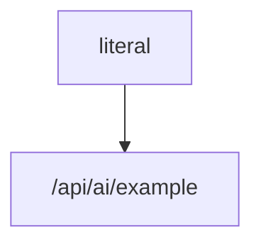

# AI 对话独立复测清单（2026-11-05）

> 目的：覆盖近几日审查发现的问题与本轮协议、恢复、性能修改。只使用独立脚本、HTTP 接口和 Kimi Code Desktop 内置浏览器，不使用 CU，不修改 `backend/src/test`、`frontend/tests`、`frontend/e2e`。
>
> 重复要求：**普通场景至少独立执行 2 次；异步、HITL、刷新恢复、作业、表格等复杂场景至少独立执行 3 次**。每次使用新会话；复杂场景另换任务/作业，不能只看同一现场。
>
> 补充执行前提：独立上游桩与第二后端实例只能使用隔离 Redis、隔离任务和小样本 fixture，**不得读取或修改生产数据**；故障注入脚本与桩日志只能写到仓库外，不得修改仓库现有测试。大数据场景统一改为“小样本边界 + 计数断言”，不实际生成 100000 行。每项必须同时保留输入示例（模式、URL、请求体或浏览器 init script）和结果证据（响应/帧、计数、文件内容、界面截图或仓外日志），只有场景名称不得计为已覆盖。

## 1. 执行记录模板

每个场景记录：场景 ID、代码 HEAD、执行轮次、操作步骤、预期、实际结果、PASS/FAIL、截图或接口输出路径、失败复现步骤。

### 导出指令标准工作流（C-09～C-12 引用）

**共同逐步验收点**

1. 新建独立会话并只发送一次指定指令：直接出现 `create_task` HITL；批准前任务数、作业数均不增加。
2. 批准创建：只创建 1 个任务，未经启动批准不产生作业；系统在同一原始指令下自动完成配置选择、条件收集和步骤推进，不要求用户再次发送启动指令。
3. 同一轮流程继续出现 `start_export` HITL，按钮固定为“拒绝/批准”；批准后才启动且只产生 1 个作业。启动确认属于同一轮，不是新的用户意图。
4. 作业运行中不可下载，完成后才开放并下载正确文件；最终不得出现“状态未确认”，不得要求用户在输入框继续下一轮来完成本可一轮完成的流程。
5. 任一处拒绝创建或启动：卡片如实显示用户拒绝，任务和作业不增加。普通导出不强加高危复选框；用户拒绝/取消后不自动重试或再次询问。

**A｜“导出cny货币字典（新建任务）”——已知配置项、已知条件**

- 创建入参必须为 `type=EXPORT`、`defCodes=[CURRENCY]`，且 `conditions` 为 `code EQ CNY`：`CURRENCY` 是配置定义，`CNY` 是用户明确给出的筛选值，导出结果只包含 CNY。
- 全流程只能出现 **创建任务、开始导出** 两张用户操作卡；**不得出现选择配置项或筛选条件询问卡**。创建批准后由系统静默完成配置选择、条件写入和步骤推进，再于同一轮展示启动确认；启动批准后才执行和下载。

**B｜“导出货币字典（新建任务）”——已知配置项、未知条件**

- 中文名“货币字典”直接映射 `defCodes=[CURRENCY]`，不得因缺少英文编码而多问配置或类型；条件未知时创建入参 `conditions={}`，不得自行补条件。
- 全流程只能出现 **创建任务、筛选条件、开始导出** 三张用户操作卡；**不得出现选择配置项询问卡**。创建批准后系统静默选择 CURRENCY，由宿主提供一次非必填筛选条件卡，用户可填写或留空，再到同一轮启动确认。留空时导出全部货币记录。

**C｜“创建导出任务”——未知配置项、未知条件**

- 创建入参只明确 `type=EXPORT`、`conditions={}`，省略 `defCodes`；直接出现创建确认，不得先文字追问，也不得以 `list_config_defs` 代替 `create_task`。
- 全流程依次出现 **创建任务、选择配置项、筛选条件、开始导出** 四张用户操作卡。创建批准后只创建 1 个空导出任务并打开选择配置步骤；由宿主提供平铺配置选择表单，无层级选项、无额外知情摘要；随后提供一次非必填筛选条件卡，可填写或留空，再到同一轮启动确认，批准后才执行和下载。

**证据要求**：每种指令至少 3 轮独立浏览器复测，逐轮保存唯一一条用户消息、工具调用序列、创建入参、任务/作业计数、HITL 与向导截图、启动确认、下载文件及最终状态。工具序列中不得出现把 `list_config_defs` 作为创建前置的调用；`create_task` 与 `start_export` 必须在同一原始指令下依次触发，启动批准前不得有作业副作用。

| 场景 ID | 场景与可复用步骤 | 预期 | 次数 |
|---|---|---|---|
| C-01 | 新建会话，发送普通纯文本问题，等待完成 | 流式正文完整，无“状态未确认”，赞/踩/复制可用 | 2 |
| C-02 | 同会话再发一轮普通问题，再新建会话重复 | 两轮顺序正确，无重复消息、无 UNKNOWN 误报 | 2 |
| C-03 | 发送含表格、代码块、Mermaid 的长回答，输出约 2–3 秒时刷新，完成后再次刷新 | 不显示 Markdown 原文；表格/代码/Mermaid/正文顺序完整；不丢正文、不只显示“继续” | 3 |
| C-04 | 单行用户消息后收起并展开 AI 面板 | 不出现多余“展开/收起”，消息顺序和滚动位置正常 | 2 |
| C-05 | 连续执行“新建对话→确认清空” | 每次新会话可用，无初始化失败、无旧会话内容 | 3 |
| C-06 | 普通完成后刷新；有“重新载入”时点击 | last-good 正文不丢，不能把成功轮封成断流 | 3 |
| C-07 | 产生成功、失败、UNKNOWN、取消、停止、截断现场后分别刷新 | outcome/code/unconfirmed/errorCardKey 与卡面一致，不只依赖末条镜像 | 3 |
| C-08 | 历史超过一页后点“加载更早”，再刷新 | latest/before 游标稳定，无重复/跳页，用户/assistant/tool 顺序不变 | 2；无分页控件时如实记未覆盖 |
| C-09 | 按“导出指令标准工作流”A 输入“导出cny货币字典（新建任务）”并逐步验收 | 已知配置项和条件；入参 `type=EXPORT`、`defCodes=[CURRENCY]`、`conditions.code EQ CNY`；仅创建任务、开始导出两张卡，不得出现选择配置项/筛选条件卡；系统静默推进，完成后只导出 CNY，无状态未确认 | 3 |
| C-10 | 按“导出指令标准工作流”B 输入“导出货币字典（新建任务）”并逐步验收；另做拒绝创建 | 已知配置项、未知条件；仅创建任务、筛选条件、开始导出三张卡，不得出现选择配置项卡；条件可留空，完整走通创建、启动与下载；拒绝后任务和作业均不增加 | 完整流程 3；拒绝至少 1 |
| C-11 | 按“导出指令标准工作流”C 输入“创建导出任务”并逐步验收；另做拒绝创建 | 未知配置项和条件；依次出现创建任务、选择配置项、筛选条件、开始导出四张卡；配置平铺选择、条件可留空，完整走通启动与下载；拒绝后任务和作业均不增加 | 完整流程 3；拒绝至少 1 |
| C-12 | 创建任务后批准启动导出，观察作业与下载入口 | 未完成前不直接下载；完成后才允许下载；任务/作业仅一份 | 3 |
| C-13 | HITL 提交中、排队中、同步中、批准、拒绝、失败、失效 | 卡头/卡体/后端状态一致；无重复提示、无重复执行 | 3 |
| C-14 | 上传取消后重试、换会话、卸载组件；再模拟 unsupported | 取消可重试；迟到结果不串会话；unsupported 才禁用 | 2 |
| C-15 | 触发表单提交中/排队中/同步中 | 在途仅按钮忙碌并禁用，卡头保持“待操作”；受理后直接进入“已提交”；排队/同步不伪造已提交、不产生重复卡或重复提交 | 2 |
| C-16 | 开流前失败、HITL 失败/失效/同步耗尽、模型向表格校验失败 | 单一主错误面；卡内有反馈；内部原文/配置键只进诊断 | 2 |
| C-17 | 工作区回执、顶部通知、错误提示检查 | 可关闭或轮末清；error 不被 info 覆盖；无内部术语直出 | 2 |
| C-18 | AI 设置独立加载、dirty、重复保存、模型操作、刷新失败 | 写成功不误报保存失败；重复写有互斥；各区域独立加载 | 2；不改真实密钥 |
| C-19 | 同任务多作业、错误恢复、issues、dispose、hidden/visible、取消 | watcher 不串任务、不错误中止；取消终态一致；共享 SSE 晚订阅也能刷新 | 3 |
| C-20 | 表格选区、跨选区主键、聚合、sample/full/count | 数据与主键一致，计数/聚合正确，不错配 toolCallId | 3 |
| C-21 | 表格异步编辑、取消、部分写入、撤销、100000 上限 | 超上限拒绝；停止/会话才取消；部分写入计数和撤销准确 | 3 |
| C-22 | 配置保存、KB reload | 保存生效；reload 不重复回源、不回滚版本、无重复 Lucene 重建 | 2 |
| C-23 | 删除会话并刷新/重进，重复删除 | 历史不复活；删除幂等；无 purge 后 transcript 写回 | 3 |
| C-24 | 运行中观察请求字段、监听器、缓存和 watcher | 无无界增长；ai:creq 仅清理超窗 DONE，RUN/UNKNOWN/CANCELLED 保留 | 2；以接口/日志证据为准 |
| C-25 | 分别构造普通文字、表格、代码块、Mermaid 的流式回答；每种在输出中刷新，等待完成后再次刷新 | 四类现场分别验证：last-good 不丢已出内容、不乱序、不重复；使用对应渲染结果，不出现 Markdown 原文 | 3；每类均独立执行 |
| C-26 | 构造“用户提问→思考→工具或表单→正文→后续文字”的完整链路，先观察实时输出，再刷新并打开历史 | 实时与历史均为同一顺序；思考位于工具/表单前，正文位于其后，后续文字仍在最后；工具卡、表单和正文不互换、不消失 | 3 |
| C-27 | 长回答流式中刷新，关闭后重连，继续加载更早；再复制页签并分别重连、查看历史与工具卡 | 流式、刷新、重连、加载更早和跨页签合并不重复消息、工具卡或工具执行；同一内容只出现一次，工具只执行一次 | 3 |
| C-28 | 分别输入单行与长文，反复收起/展开面板并拖拽调宽，再检查输入区、消息区和滚动位置 | 输入框不被顶起或遮挡；不多出收起/展开等控件；长文布局不跳动，宽度、展开状态、滚动位置与消息状态不错位 | 3 |
| C-29 | 打开 Mermaid 预览，检查预览区；进入全屏缩放并平移后退出，再收起/展开面板和预览 | 预览无滚动条，内容居中；全屏缩放/平移可用；退出及收起/展开后恢复默认适配，无旧缩放、画布、遮罩或监听器残留 | 3 |
| C-30 | 分别复制普通正文、Markdown 表格、代码块和工具卡，粘贴到纯文本编辑器检查 | 只复制用户可见内容；表格/代码结构可读；不含 JSON、内部参数、机器诊断、runId/toolCallId 或隐藏状态 | 2 |
| C-31 | 生成中在输入框持续编辑并按 Enter；随后手动停止，修改文字后按 Enter 发送 | 生成中可编辑且 Enter 不发送、不排队误发；停止形成终态后可发送新轮，新轮只发送一次且不与旧轮串流 | 3 |
| C-32 | 分别观察普通生成、工具执行、HITL 待批和表单待填；记录工作中/等待中、呼吸样式及轮末日期时间 | 普通生成与工具执行显示工作中，HITL/表单显示等待中；呼吸只出现在工作状态；无相互矛盾状态，轮末日期时间为真实完成时刻且不错位 | 3 |
| C-33 | 发起带思考过程的问题，观察思考开始、持续和结束；再检查思考区域 | 思考中显示“思考中”并持续计时；结束后显示“思考过程 + 实际耗时”；不显示字数，不要求点击展开才能看到结论 | 3 |
| C-34 | 流式长文期间上下滚动阅读，观察光标位置和遮挡情况 | 输出光标不固定悬浮在底部，或完全不显示；不遮挡正文、不改变阅读位置、不妨碍复制和滚动 | 2 |
| C-35 | 分别在已有任务和没有可用任务的会话启动导出，检查任务选择路径 | 已有任务可被选择，也允许新建任务；不得强制只能使用已有任务；两条路径均经过对应创建/启动确认且只产生一份任务 | 3 |
| C-36 | 打开导出配置项与启动确认，检查层级选项、知情摘要和复选框 | 不出现无必要的层级选项或额外知情摘要；只有高危/不可逆操作显示确认复选框，普通导出不被强加复选框 | 3 |
| C-37 | 批准启动导出，作业运行中和完成后分别检查下载入口 | 启动不等于直接下载；运行中无可用下载，完成后才出现且能下载正确产物；不重复启动作业或生成重复文件 | 3 |
| C-38 | 新建页签并新建会话，快速切换页签和会话，观察提示与各页签内容 | 静默完成，不出现“已在新页签开始新会话”等心智负担提示；页签的会话、草稿、消息、HITL 和运行状态互相隔离 | 3 |
| C-39 | 新会话先发送短消息观察上下文，再逐步接近阈值；分别验证已知上限与上限 UNKNOWN 的模型 | 开始时不误压缩；按真实阈值触发，已用/比例/UNKNOWN 展示一致；上限 UNKNOWN 不伪造百分比，不出现“已到 100% 却不压缩”的假现象 | 3 |
| C-40 | 分别在未达阈值与达到真实截断阈值时输出，再刷新和重连 | 未达阈值无截断标记；真实截断才有且只有对应标记；刷新/重连不新增截断事实、不重复提示、不把普通完成改成截断完成 | 3 |
| C-41 | 分别在正文流式输出中、工具执行中、HITL 等待中执行停止，并继续观察后续事件 | 三种停止都进入取消终态；停止后无继续生成、无工具执行或迟到成功，HITL 不再可执行；后续只允许用户显式发起新轮 | 3 |
| C-42 | 表单填写到一半刷新；在提交排队和提交中分别刷新/重连，再检查草稿和卡片 | 草稿不丢；恢复后仍是同一表单和填写内容；在途仅按钮忙碌，卡头保持“待操作”；不得恢复出提交中/排队中等卡头业务状态，不伪造已提交、不重复提交或产生新卡 | 3 |
| C-43 | 分别构造失败、UNKNOWN、用户取消、手动停止、真实截断，完成后刷新并重连 | 五类结局不混淆：失败有错误面，UNKNOWN 保持不可知，取消/停止不可继续，截断如实标记；刷新后动作与结局一致，不伪造成功或提供错误操作 | 3 |
| C-44 | 在可证明的多实例环境下重复提交同一 HITL，并在 UI 双击批准/提交；观察执行台账与业务副作用 | 多实例与双击均只接受一次有效决策，工具和业务副作用只执行一次；不能用 UI/日志证明多实例时标“未覆盖”，不得伪造 PASS | 3；无法证明多实例时标未覆盖 |
| C-45 | 构造普通长会话持续输入和流式输出，观察输入响应、帧处理、网络与 DB 调用 | 输入不卡顿；不逐帧全量序列化历史、不逐帧重复查询 DB、不做无效重载；长会话增长不造成明显逐帧退化 | 3 |
| C-46 | 同一任务启动多个作业并共享 SSE；作业进行中晚开订阅者，反复切换 hidden/visible | 晚订阅者也能实时收到后续状态，不靠全量重启；hidden/visible 不重复订阅、不重复事件、不误停共享 watcher，作业归属不串 | 3 |
| C-47 | 在设置保存、附件上传、表格异步编辑/提交进行中分别换会话或卸载相关组件，再让操作迟到完成 | 迟到结果只作用于原上下文或被忽略，不写入新会话/已卸载组件；不串数据、不复活旧状态、不误报当前操作成功 | 3 |
| C-48 | 复制页签后新建会话，再在旧身份工具/消息仍在途时删除旧会话并提交反馈，观察新会话与删除结果 | 复制页签、新会话、已删除会话之间互不收发旧身份工具结果、消息或反馈；旧身份迟到事件不串、不复活删除内容、不污染新会话 | 3 |

### 第一批针对性补充分场景

| 场景 ID | 独立浏览器/接口步骤与输入示例 | 预期与结果证据要求 | 次数 |
|---|---|---|---|
| C-61 | 构造严格的 `正文A → 工具卡 → 正文B → 表单卡 → 正文C` 单轮现场；流式中刷新一次，完成后连续刷新两次，并读取每次 history | 五段顺序、正文全文、entryId/toolCallId 和卡片状态实时与三次历史一致；卡片之间的正文B/C均不丢失、不合并到旧轮、不重复。保存实时与每次刷新后的parts和截图 | 3；每轮独立新会话 |
| C-62 | 分别构造连续多工具、连续多表单、同一assistant seq携带多工具，且每类前后都有正文；流式及完成后各刷新/重连 | 多卡不互相覆盖，同seq工具按toolCallId区分，前后正文完整；恢复不重复工具执行或表单提交。保存parts、entryId/toolCallId和业务副作用计数 | 3；每类独立执行 |
| C-63 | 分别覆盖空text占位、正文尚未开始、正文流式中、部分工具完成、表单半填、表单排队/提交中；每个现场连续刷新/重连两次 | 空占位不生成历史空消息；未开始正文恢复后仍可继续；半填草稿保留；部分工具结果不丢；排队/提交在途仅按钮忙碌且卡头保持“待操作”，不恢复提交中/排队中等卡头业务状态，不伪造已提交或重复提交 | 3；每阶段独立执行 |
| C-64 | B类导出表单留空提交，分别观察实时、刷新后history和后续EXPORT步骤；另做至少一次填写条件对照 | 真实POST受理后实时与历史均为 `outcome=ok`，留空 `{}` 不变成UNKNOWN、不停在QUERY_COND；留空导出全部记录，填写条件时仅导出符合条件记录 | 3 |
| C-65 | 用可恢复的暂时性终局写入异常或刷新竞态构造未确认内部状态，观察自动history对账全过程及同run DONE替换后的消息 | 自动有界对账期间不显示“继续”、不显示“状态未确认/结局未知/结果未同步，请重试”等横幅或chip；同run DONE后当前替换消息的内部unconfirmed/code也清除；真实失败仍保留真实错误卡，不伪造成功 | 3；无法真实构造异常时记未覆盖 |
| C-66 | 分别对通用 `download` 与 `download_export_files` 延迟前置准备及后台内容请求，验证前置准备与后台下载分离；随后分别注入后台 HTTP 失败 | 前置通过后立即返回“已发起下载”，不等待 HTTP 内容、保存框或落盘结果；后台成功才生成真实文件，后台失败只以用户侧轻量 toast 提示真实原因，不二次回灌 AI、不形成第二结局、不伪造成功。`download_export_files` 前置超时按确定 timeout 收口且未触发下载；不得出现“结局未知/结果未同步/请检查下载目录”等提示。保存请求时序、工具 outcome、toast、AI 回灌次数、下载事件计数及实际文件 | 每种工具各 3；无法真实延迟或注入失败时记未覆盖 |

### 第二批：刷新恢复与乱序竞态（本批新增场景，尚未执行）

| 场景 ID | 独立浏览器/接口步骤与输入示例 | 预期与结果证据要求 | 次数 |
|---|---|---|---|
| C-67 | 同一 run 构造多个 ASSISTANT：`正文A → 工具卡 → 正文B → 表单卡 → 正文C`，其中至少两条 ASSISTANT 的文字不是彼此前缀；流式中连续刷新 12 次并逐次读取 parts，再分别保留只含较早 ASSISTANT、只含中间 ASSISTANT 的历史对照 | 同 run 全部 ASSISTANT/part 均参与合并；任一未证明包含的镜像正文不得删除，A/B/C 与工具、表单顺序严格一致；**不得合并或覆盖后端持久化 ASSISTANT 条目，前端可将同 run 条目投影为一个有序 UI 助手**，不得重复或串到旧 run。保存每次刷新后的消息 ID、parts 顺序和全文 | 至少 3 轮独立新会话；每轮 12 次刷新 |
| C-68 | 分别在表单 `submitting`、后端已 accepted 但结局帧未到、`pendingAttachRunId` 建连中刷新；另在真实终态后刷新对照 | 三类窗口的镜像 `inFlight` 均参与恢复，表单值、卡片和前后正文不丢、不重复提交；真终态不误标在途，已取消表单不误标在途。保存 accepted 时序、镜像 `inFlight`、恢复后 parts 与 POST 次数 | 每类至少 3 次；覆盖至少 1 个完整 accepted 窗口 |
| C-69 | 同会话并发两次 latest 历史请求，使旧 revision 响应后返回；再换会话重放旧响应，并在流式/表单窗口执行 12 次循环刷新 | 仅最新 generation 可写 messages/last-good；旧 revision 不覆盖新现场，旧错误不写恢复缺口，session/run 隔离及 historyRevision 校验不被绕过。保存两次响应的 revision、generation、返回顺序和最终 parts | 至少 3 轮；每轮 12 次刷新 |
| C-70 | 通过公开创建任务流程和独立浏览器故障注入，让首次 `host-nav-<taskId>` 明确失败、第二次导航成功；另分别构造首次成功和连续两次失败对照 | 首次失败后宿主恰好接管一次且使用独立确定性 ID；首次成功不重复导航，连续两次失败后不再自动重试；待决导航不重复下发。保存导航 ID、outcome、调用次数、最终页面和后续配置/条件卡 | 3；每种对照独立执行，无法真实注入时记未覆盖 |
| C-71 | 分别让 `export.selectDefs`、`export.setConditions`、`import.selectDefs` 进入页面只读、目标越界和零变更分支，读取前端工具回灌并核对任务/草案 | 三类分支均不得产生 `outcome=ok`，不得伪称已选择/已设置；任务条目、条件和草案均不被意外改写。保存分支输入、结构化结局、回读业务状态及副作用计数 | 每个工具每种分支至少 3 次；无法通过公开路径构造时记未覆盖 |

### SSE 缓冲区上限专项（SSE-01～SSE-03）

以下均为独立脚本直接驱动现有 `SseChunkParser` 的单点用例，不修改仓库测试代码；保存输入分块、返回载荷或异常原文及流结束/重连轨迹。

| 场景 ID | 输入与步骤 | 预期与证据要求 | 次数 |
|---|---|---|---|
| SSE-01 | 不发送事件分隔符，执行 `parser.push('data:' + 'x'.repeat(256 * 1024))`，使单个未闭合事件超过 256 KiB | 必须抛出包含“SSE 协议错误”“单个事件超过 256 KiB 上限”的可读错误并结束当前流读取；不得返回载荷、静默丢弃或继续累积。若进入断流处理，只能沿用既有重连策略，保存异常原文和后续轨迹 | 1 |
| SSE-02 | 依次投喂 `'\ufeffdata: first\r'`、`'\ndata: second\r'`、`'\n\r\n'`，覆盖跨 chunk CRLF、BOM 和多行 data | 前两次不产帧，第三次恰好返回一个载荷 `'first\nsecond'`；不提前拆帧、不多出空事件，BOM 不进入载荷，随后 `flush()` 返回空数组 | 1 |
| SSE-03 | 仅投喂无空行结尾的 `data: {"type":"done"}`，随后执行 `flush()` | `push()` 不产帧，`flush()` 恰好返回 `'{"type":"done"}'` 一次；正常 EOF 尾帧不因上限校验被丢弃或重复 | 1 |

### 表格边界专项（TB-01～TB-16）

统一使用独立上游桩把下列原文放入同一 assistant text 段，不让模型改写；每轮使用新会话，保存原始 text、渲染 DOM 或截图及刷新前后 parts。每个场景至少独立执行 **3 轮**，不得只检查复制文本或以同一次现场重复计数。

**TB-01｜表格后含竖线的正文**

```text
Intro

| A | B |
|---|---|
| 1 | 2 |

After | must stay outside
```

每轮断言：只有一张两列表格且表体恰好一行；`Intro` 与 `After | must stay outside` 均在表外，后者不得成为第二条表体行，原文竖线保留。

**TB-02｜四空格缩进伪表格**

```text
    | A | B |
    |---|---|
    | 1 | 2 |
```

每轮断言：三行前导四空格不丢失，保持代码块；不得出现真实 `<table>`，不得把首行变成表头。

**TB-03｜键值前缀与竖线**

分别以 `title`、`answer`、`section`、`摘要` 替换下列首行键名，四种输入均独立执行 3 轮：

```text
title: | A | B |
|---|---|
| 1 | 2 |
```

每轮断言：键名、冒号、前导/尾部竖线均按原文保留，不得删除键名后把首行升级为表头；普通正文中的编号 `1) `、其他键值和空行也不得被投影改写。

**TB-04｜闭合代码围栏**

````text
Before

```md
| A | B |
|---|---|
| 1 | 2 |
```

After
````

每轮断言：围栏内始终为代码，不出现真实表格；`Before/After` 在代码块外且顺序不变，围栏、空行和缩进不丢失。

**TB-05｜流式半截表格分帧**

每轮按以下顺序向同一 text 段追加，并在每帧保存渲染结果：

1. `Intro\n\n| A | B |\n`
2. `|---|---|\n`
3. `| 1 | 2 |\n\nOutro\n`

每轮断言：分隔线到达前后不重复并表、不复用旧段落 HTML；最终只有一张两列表格和一行表体，`Intro/Outro` 均在表外，无旧表格或旧正文残留。

**TB-06｜完成后连续三次刷新**

每轮组合使用 TB-01 与 TB-04 输入，等待流式完成后连续刷新 **3 次**，每次重新读取 history 并保存渲染结果。三轮独立执行；每轮三次刷新都必须保持表格数、表体行数、代码块及前后正文完全一致，不重复、不串位、不把表外正文并入表格。

**TB-07｜协议内容回归**

每轮同时检查 `<knowledge_catalog>` 等内部声明及标签不上屏、既有 `<knowledge>` 展示口径不被扩大，并按 PD-08 的公开路径执行 `read_tool_result` 严格分页回读。断言普通正文保留不改变协议标签隐藏规则；分页仍严格使用响应 `nextOffset`，无重叠、跳段或越界，末页进度文案与 `originalChars/returnedChars` 一致。保存标签输入、分页参数、逐页结果及界面证据，至少 3 轮。

**TB-08｜反引号与波浪线代码围栏中的协议字面量**

分别输入两种围栏，每种至少 3 轮：

````text
```md
<knowledge>literal</knowledge>
app.ai.demo
/api/ai/example
```

~~~text
<tool_result>literal</tool_result>
~~~
````

每轮断言：围栏、协议字面量、API 前缀和换行全部原样保留为代码，不隐藏内容、不提取工具结果；前后普通正文中的真实协议仍按 TB-07 处理。

**TB-09｜行内代码中的协议字面量**

```text
说明 `<knowledge>literal</knowledge>` 与 `<tool_result>literal</tool_result>`。
`app.ai.demo`
`/api/ai/example`
`{"ok":true,"outcome":"ok","retryable":false,"message":"x","truncated":false,"originalChars":1,"returnedChars":1}`
```

每轮断言：所有内容保持行内代码，标签不消失，JSON 不投影为 `x`，API/配置字面量不删除；反引号数量及前后正文不变。

**TB-10｜Mermaid 源码中的协议字面量**

````text

````

每轮断言：Mermaid 源码不被协议投影截断，节点字面量保留；源码、复制结果和预览一致，不出现隐藏节点、错误工具卡或多余正文。

修复机制（TB-10）：保持 `securityLevel:'strict'`、`htmlLabels:false` 与 SVG 净化不变。渲染前只用现有 markdown-it inline token 识别 `<knowledge>`、`<knowledge_catalog>`、`<tool_result>` 的开闭标签并编码为文本实体，再交给 Mermaid 自带的 `sanitizeText` 和 SVG 文本渲染；不解析或改写图节点，不全局替换 `-->` 等语法。编码只用于本次渲染，原源码、复制源码、缓存键及源码卡均不变，XSS 不放宽。

复测补充：除上述输入外，至少包含一个普通 `A --> B` 流程图和一个带 `<br/>` 换行的标签，确认箭头、换行和非协议标签行为不变；另以脚本标签作对照，确认其仍按原安全规则处理，不因协议文本编码而执行。

构建记录（2026-11-05）：在 `frontend` 执行 `node scripts/build.mjs`，3273 个模块转换成功，Vite 生产构建通过。按要求未运行项目测试、未执行 git 命令。

**TB-11｜列表与块引用中的代码示例**

````text
- 行内 `<tool_result>literal</tool_result>`
  ```text
  <knowledge>literal</knowledge>
  ```
-     <tool_result>literal</tool_result>
> 行内 `<knowledge>literal</knowledge>`
>     app.ai.demo
>     /api/ai/example
````

每轮断言：列表/块引用结构不变，行内代码、围栏和缩进代码中的协议字面量均原样保留，不被当作真实协议或诊断行删除。

**TB-12｜四空格缩进代码中的协议与 JSON**

```text
    <knowledge>literal</knowledge>
    app.ai.demo
    /api/ai/example
    {"ok":true,"outcome":"ok","retryable":false,"message":"x","truncated":false,"originalChars":1,"returnedChars":1}
```

每轮断言：四空格及全部代码原文保留，不出现真实协议隐藏、API 行删除或 envelope 提取；JSON 仍显示完整代码而非只显示 `x`。

**TB-13｜API 与配置文档普通说明**

```text
接口文档
app.ai.demo
/api/ai/example

配置示例
app.ai.feature=true
```

每轮断言：普通说明中的行首 `app.ai.`、`/api/ai/` 及键值全部保留，不依赖代码围栏也不删除。每轮同时以 TB-07 的真实 `<knowledge>`、`<tool_result>` 和 `read_tool_result` 分页作对照，确认只有可证明的内部协议结构执行原投影规则。

**TB-14｜转义同形串与真实 code_inline 并存**

```text
转义同形串 \`escaped\`，真实 `<knowledge>literal</knowledge>`，尾部 After。
```

每轮断言：奇数反斜杠转义的反引号只按 Markdown 转义文本处理，不被当作真实 code_inline 起点；真实 code_inline 的起止及内容精确保留，`<knowledge>literal</knowledge>` 不被协议隐藏，`After` 不被并入代码保护区。至少 3 轮，保存原始 text 与渲染 DOM。

**TB-15｜未闭合 inline code 流式尾部**

按四行顺序向同一 text 段逐帧追加，每帧保留换行，最后一行首反引号为闭合符：

```text
Before `<knowledge>
 literal</knowledge>
/api/ai/example
` After
```

每轮断言：前三帧的最后一个未闭合、未转义反引号 run 到 inline 源块末尾均受保护，协议标签和 API 字面量不消失；第四帧闭合后按普通成对反引号处理，不误伤尾部，`After` 位于代码外且真实协议规则不扩张。每帧保存渲染结果，至少独立执行 3 轮。

**TB-16｜双反引号包裹单反引号及普通后续文本**

```text
`` `<knowledge>literal</knowledge>` `` After
```

每轮断言：双反引号 delimiter 与完整内容只构成一个合法 code_inline；内容中的两个单反引号 run 均被完整 code span 消费，不被误判为未闭合尾部。代码内协议字面量原样保留，闭合 delimiter 后的 `After` 保持普通正文且不被纳入代码保护区。至少独立执行 3 轮，保存原始 text、渲染 DOM 及代码/正文边界截图。

### C-49～C-60：独立桩、接口、故障注入与浏览器补充场景

| 场景 ID | 独立脚本/接口/浏览器步骤与输入示例 | 预期与结果证据要求 | 次数 |
|---|---|---|---|
| C-49 | 独立上游桩分别设置 `http_500`、`empty_200`、`timeout_60s`；每种模式用同一简单问题调用 `/api/ai/chat`，随后恢复正常桩并重发；浏览器分别查看错误卡和恢复过程 | 500 显示对应错误卡；空响应/超时不得伪造成功，UNKNOWN 保持 UNKNOWN 且可恢复；正常重发可完成且旧错误不残留。保存三类桩输入、原始响应/SSE、错误卡截图、恢复帧及仓外桩日志 | 3；每种故障独立执行 |
| C-50 | 桩返回仅一两段短文本（如 `短回复`），最后一个 SSE data 明确带 `finish_reason="length"`；调用 `/api/ai/chat` 后刷新并重连 | 短文本完整显示，done/历史均按真实 `length` 标截断，不因文本短而漏标；刷新不新增第二次截断或重复提示。保存原始 `finish_reason`、done 帧、history 条目和刷新前后截图 | 3 |
| C-51 | 在隔离模型配置中设较小 `max_context`（示例 16000）与本轮 `max_tokens=32`，短问题后连续发送 4 轮各约 1000 字的小样本；接口读取 `/api/ai/context/{sessionId}`、`/api/ai/history/{sessionId}`，浏览器观察压缩和输出 | 首轮短输入不误压缩；接近阈值后产生真实 L1+ 压缩事件，较小 max_tokens 产生真实截断。保存配置请求（不含密钥）、context 前后值、`history.events`、done/truncated 与刷新后一致的结果 | 3 |
| C-52 | 启动 A/B 两个后端实例（示例 18081/18082），共用隔离 Redis 与同一上游桩；桩产生同一 HITL 后，并发向两实例 `POST /api/ai/confirm` 提交完全相同的 `runId/toolCallId/approved=true`；浏览器检查卡片与业务结果 | 一个请求成功、另一个返回冲突（如 409），业务副作用和工具执行均只有一次。保存两实例 URL、并发响应、toolCallId、冲突码、`ai:ledger`/业务记录计数及卡片截图；无法启动第二实例时标未覆盖 | 3 |
| C-53 | 创建独立小任务并产生两个作业和小样本 issues（示例 2 条）；晚开任务 watcher，取消其中一个作业，dispose 另一个，反复 hidden/visible；浏览器记录任务页与 Network 中实际 watcher URL/事件 | 多作业和 issues 不串任务；晚订阅者仍实时收到后续状态；取消/dispose 终态正确；hidden/visible 不重复订阅、不重复事件、不误停 watcher。保存 taskId/jobIds、事件序列与订阅计数、issues 内容和仓外日志 | 3 |
| C-54 | 浏览器 init script 注入 `delete window.showOpenFilePicker; Object.defineProperty(navigator, 'locks', { value: undefined, configurable: true })`；随后上传一个小文本文件，并复制页签执行一个前端工具 | 移除文件选择 API 与 Web Locks 后页面不崩溃；上传走真实降级文件输入或明确 unsupported；无锁时不自动跨页签重复执行。保存 init script、控制台无 TypeError 的证据、上传/降级结果及两页签工具执行计数 | 3 |
| C-55 | 接口依次调用 `/api/ai/health`、`/api/ai/kb/status`、两次相同 `POST /api/ai/kb/reload`、两次相同 `/api/ai/history/{sessionId}?latest=20`；同步查看健康指标、仓外日志和有界 Redis 读取样本 | 无随历史条数增长的 N+1，无重复 DB 调用；相同 KB 内容不重复 Lucene 重建；Redis 读取有界且无全键空间扫描。保存健康 JSON、各接口计数、DB/Lucene 日志、Redis 命令样本和两次结果差异 | 2 |
| C-56 | 只在隔离 Redis 的会话 HASH 放小 fixture：`DONE:run-old:<已超窗时间>`、`DONE:run-new:<未超窗时间>`、`RUN:run-live`、`UNKNOWN:run-unknown`、`CANCELLED:run-cancelled`；触发下一次客户端请求 claim/cancel 清理后逐项回读 | 只回收超窗 DONE；未超窗 DONE、RUN、UNKNOWN、CANCELLED 全部保留，不误清运行态或未知态。保存 fixture、清理前后 HGET/HSCAN 结果、触发请求及仓外清理日志；不得使用生产键 | 3 |
| C-57 | 在隔离会话构造 7 条有序小样本 `e1..e7`；先请求 `/api/ai/history/{sid}?latest=3`，再按响应 `nextCursor` 请求 `before=<cursor>&limit=3` 直到无更多 | 页序为 `e5,e6,e7` → `e2,e3,e4` → `e1`；合并后 e1..e7 各出现一次，无重复、跳页或游标回绕。保存每页 URL、entryId、count/total/hasMore/nextCursor 和最终去重计数 | 2 |
| C-58 | 在隔离 provider 上使用 `key_ref=NONE`，仅提交 `displayName="verify-safe"`、默认模型、能力位和启停/排序修改，不提交 apiKey/keyCipher；先形成 dirty 再保存，并连续重复同一写操作和模型操作 | dirty 在保存成功后清除；重复写不串改、不误报保存失败，模型操作生效且不碰真实密钥。保存脱敏请求体、保存响应、配置版本/回读结果及界面 dirty 状态截图 | 3 |
| C-59 | 用仅 2 条数据的小任务完成导出，浏览器点击完成后下载，并用文本读取器打开实际文件 | 下载发生在完成后；文件非空且包含正确表头和恰好 2 条数据，内容与任务一致，不是只有按钮或空壳，也不含内部 JSON/诊断。保存 taskId/jobId、文件路径、大小、哈希和文件内容摘录 | 3 |
| C-60 | 独立故障注入（上游 500、上游超时、隔离 Redis 读失败任选一种）后恢复正常，连续用 3 个新会话执行发送→刷新/重连→普通完成；记录每轮 watcher 和输入区状态 | 三次恢复均独立完成，旧错误、loading、订阅、草稿、锁、UNKNOWN 或重复帧不残留到新会话。保存故障输入、3 个 sessionId、每轮错误/恢复响应、帧序列及仓外日志 | 3；连续恢复 3 次 |
**必须组合覆盖（不能用单项场景替代）**

| 组合 | 必须同时执行的操作 | 联合预期 | 次数 |
|---|---|---|---|
| 刷新 × 流式阶段 | 分别在正文、表格、代码、Mermaid、工具执行阶段刷新，完成后再次刷新 | 每个阶段都保留 last-good 与正确渲染，不丢段、不重段、不回到上一阶段 | 3；每阶段独立执行 |
| 刷新 × HITL | 在待批、提交中、批准、拒绝和失效阶段分别刷新/重连 | 卡片与后端决策一致，不重复提交、不重复执行，待批不被误放行 | 3 |
| 收起展开 × 长文/Mermaid | 长文与 Mermaid 分别全屏/预览后反复收起展开面板并调整宽度 | 内容布局恢复，默认适配，无残留缩放/遮罩/滚动条，输入区不错位 | 3 |
| 连续新建 × 快速发送 | 连续执行“新建对话→确认清空”并立即输入发送，反复切换新会话 | 首条消息只属于当前新会话，无跨会话串流、无重复发送、无初始化失败 | 3 |
| 停止 × 工具执行 | 在工具认领后、执行中、结果回写前分别停止 | 取消终态一致，停止后无继续执行或迟到成功，不重复工具副作用 | 3 |
| 换会话 × 在途上传/作业 | 上传附件或作业执行中换会话、卸载，再等待迟到完成并刷新 | 上传/作业结果不串会话，不复活旧现场，不重复订阅或重复执行 | 3 |

组合场景无法通过真实用户路径构造时，同样记“未覆盖”；不得拆成单项结果拼接成 PASS，也不得通过写库或内部接口伪造覆盖。

## 2. 独立接口脚本

脚本：`scripts/verification/ai-current-protocol-api.mjs`，定位为**通用协议与受控写回归**，不是 AI 可用性门禁，也不是只读脚本。

```bash
BASE_URL=http://127.0.0.1:8081 TENANT_ID=1 USER_ID=101 \
  EVAL_ISOLATED_ENV=true EVAL_ALLOW_WRITES=true \
  OUT_DIR=<仓外证据根绝对路径> \
  node scripts/verification/ai-current-protocol-api.mjs
```

`EVAL_ISOLATED_ENV=true` 和 `OUT_DIR` 为必填；非本机 `BASE_URL` 另需 `EVAL_CONFIRM_REMOTE=true`，所有请求禁止自动重定向。脚本会创建隔离 AI 会话、执行会话 DELETE 和 KB reload，因此必须显式设置 `EVAL_ALLOW_WRITES=true`，不得对生产数据执行。`OUT_DIR` 必须是仓外绝对路径；脚本先在 `mkdir` 后对仓库和输出目录执行 `realpath`，再次拒绝解析后位于仓内的位置，通过后才允许写证据。逐轮 JSON 仅保存代码 HEAD、PASS/FAIL、HTTP 状态、业务码和白名单安全标量/必要摘要：AI health 仅保留 `available/code/model/providerId` 非敏感子集，history/delete/reload 仅保留计数、状态和布尔结果；不得保存原始响应体、密钥、地址或内部信息。AI 可用性、浏览器和 Redis/多实例结论未另行执行时保持 NOT_RUN。

覆盖：就绪检查、字符串 sessionId、空会话历史读取与 latest 参数兼容、精确删除幂等、KB reload。空会话首次 history 必须精确为 0 条，该断言不宣称 latest 限制对非空分页生效。`/health/ready` 必须为 HTTP 200；`/api/ai/health` 接受 HTTP 200，或 HTTP 503 且业务码属于 `AI_UNAVAILABLE`、`AI_KEY_MISSING`、`AI_KEY_UNREADABLE`、`NO_MODEL_CONFIGURED`，两种情况均只保存上述白名单字段。两次 DELETE 除 HTTP 200 外，还必须满足 `complete===true` 且 `deferred/errors` 均为空数组；删除后 history 仍为 410 或 200 且精确 0 条。接受带有效 AI 语义码的 503 只表示健康协议可判定，不表示模型可用，不得据此放行聊天或模型验收。脚本不读密钥、不修改仓库测试、不创建业务任务。

## 3. 浏览器操作要求

- 只能使用内置浏览器的页面元素、截图、刷新和导航，不使用 CU。
- 每轮独立执行并保留文本/截图证据；失败可继续其他独立场景，但不得把未执行写成 PASS。
- 无法通过 UI 构造的场景标记“未覆盖”，不得用直接写库或直接调用内部接口伪造用户路径。
- 最终输出按场景 ID 汇总 PASS/FAIL、轮次和复用步骤；失败交回开发做最小修复后按相同次数复测。

## 4. 渐进式披露与 KB 评估（PD-01～PD-08）

统一执行口径见 `docs/verification/AI对话评估体系-2026-11-05.md`。以下场景均使用隔离后端、Redis、KB 小样本和模型配置，每轮新建会话并独立执行 **至少 3 轮**。必须显式设置 `BASE_URL` 与 `EVAL_ISOLATED_ENV=true`；默认 fixture 含 ACTION/MIXED，故还需 `EVAL_ALLOW_WRITES=true`，非本机地址另需 `EVAL_CONFIRM_REMOTE=true`。门禁不全时默认拒绝，随机 `sessionId` 不算隔离证据。可用下列命令生成逐案轨迹和人工评分模板，但脚本机械检查不等于语义 PASS：

```bash
BASE_URL=http://127.0.0.1:8081 EVAL_ISOLATED_ENV=true EVAL_ALLOW_WRITES=true \
  TENANT_ID=1 USER_ID=101 ROUNDS=3 QUERY_COND_TASK_ID=<隔离真实EXPORT任务ID> \
  node scripts/verification/ai-progressive-disclosure-eval.mjs
```

`QUERY_COND_TASK_ID` 是 PD-02/PD-06 的必填前置条件：执行者先创建隔离 EXPORT/CURRENCY 任务并进入 QUERY_COND，脚本再核对该 ID 存在、类型和步骤正确且含 CURRENCY 条目；未提供或校验失败只记 `NOT_RUN/fixture`，不请求模型，不硬编码 ID。`approval_required` 与 `confirm_rejected` 同列 `NOT_RUN/HITL`，确认必须同时满足 HTTP 200、`accepted=true` 和后续 `tool_result.outcome=ok`。HITL NOT_RUN 必须同时写案例顶层 `notRun` 和 `error.notRun`，所有分母只读顶层字段；即使 accepted 已受理，流结束仍无成功 tool_result 也记 `confirm_rejected`/结局未证明，不得仅凭 create_task 工具名通过，成功工具结果仍照常进入清理。

每轮保存请求体、`runId/sessionId`、相关 SSE 帧、工具参数与结果、答案、报告路径及人工评分。汇总同时检查 `metrics.raw/executable/modelEvaluable` 及 `notRunByCategory/realModelErrors`：raw 不删任何案例，executable 仅排除 NOT_RUN，modelEvaluable 再排除 infra 错误但保留真实模型失败，不得只挑高比例或把基础设施失败算成模型能力。报告还必须保留 `cleanup.jobs/tasks/trackingGaps/failures`：创建 ID 优先结构化 `createdTaskId/createdJobId`，正文仅 fallback 且记录 `idSource`；脚本在 `finally` 最佳努力取消本轮作业、删除本轮新任务，清理失败或 ID 无法识别时为 `incomplete` 并非零退出，不能写成已清理。PD-02/PD-06/PD-07 预先手工创建的上下文任务不属于脚本自动清理范围，执行者另按隔离环境流程清理并留证据。

PD-01 与 PD-03 各至少一轮通过隔离上游桩或公开流代理构造“最后一个 `done/error` 后没有空行”的 EOF 边界，保存原始流尾部和报告 `eof.reached/tail.parsed/frameType`，证明末帧进入同一解析逻辑；无法真实构造时记“未覆盖”。公开 SSE 不能证明 system prompt、规则包、完整披露工具集合或任务槽位字符预算。披露证据只接受同源 `/api/ai/tools` 的 JSON 且结构、披露字段和计数校验通过；其他 URL、HTML、健康检查或无关 JSON 即使 200 也只能 `unknown/invalid`，不得由实际工具调用反推。

| 场景 ID | 输入与独立步骤 | 预期与证据要求 | 次数 |
|---|---|---|---|
| PD-01 | 执行 fixture `direct-smalltalk`：`{"sessionId":"<新会话>","message":"你好，请用一句话介绍你自己。","context":null}`；另换普通事实问答做对照 | DIRECT 不被强制检索，`kb_search/kb_read_doc/kb_lookup_term` 均为 0 次；正文完整且无虚构引用。保存 `toolCalls=[]` 或完整调用清单、done/error、答案和人工正确性/忠实度；完整披露集合无法证明时记 `unknown` | 3；每轮新会话 |
| PD-02 | 先按 C-09～C-12 的公开标准工作流创建隔离 EXPORT/CURRENCY 任务并进入 QUERY_COND；把真实 ID 注入 `QUERY_COND_TASK_ID` 后执行 `query-cond-mixed`，或直接在相同浏览器页面上下文发送“请先查询区域费率，再将货币字典的筛选条件设置为 code EQ CNY” | 脚本先核验任务存在、EXPORT、当前 QUERY_COND 且含 CURRENCY，未满足时记 `NOT_RUN/fixture`，不得硬编码 ID。有效执行时实际调用 `kb_search` 并保留当前条件动作 `set_condition`；参数目标为 CURRENCY、条件为 `code EQ CNY`，不丢任务步骤。若公开披露证据可用，核对 `kb_search/kb_read_doc/kb_lookup_term` 与当前动作工具同时披露；否则披露全集记 `unknown`，实际调用证据不得冒充披露证明。保存真实 taskId 和任务步骤，不得提交服务端专用的 `extra.taskSlots` | 3；每轮新任务 |
| PD-03 | 执行 fixture `mixed-create-and-search`：“请先查询区域费率的正式口径，再创建导出任务；两件事分开做”；经公开 `/api/ai/confirm` 批准创建，另换同类 MIXED 指令复测 | 同一轮轨迹同时有 `kb_search` 与当前 `create_task`，KB 成功不得导致提前漏掉创建；创建前无业务副作用，批准后只创建 1 个任务，并在同一原始指令下继续配置和启动确认，未经启动批准不执行作业。保存两类工具参数/结果、确认请求与响应、任务/作业计数、答案及人工评分；逐轮核对 `cleanup.tasks/jobs` 的来源 runId/toolCallId、删除/取消响应和最终状态，`trackingGaps/incomplete` 必须作为清理失败保留 | 3；每轮新任务 |
| PD-04 | 执行 fixture `knowledge-no-match-rewrite`：先查不存在编号 `ZXQ-404-UNKNOWN`，无命中后只用一次同义词“未知费率规则”改写 | 第一次为原查询，第二次为指定同义词改写，合计恰好 2 次 `kb_search`；不得无休止改写或第三次扩查。两次真实结果均按协议记录，仍无命中时答案如实说明。保存有序工具参数、`no_match/unknown` 原始结果、调用数和人工答案核对；脚本 `minKbSearchCalls=2` 只是下限，是否“恰好一次改写”由逐案轨迹判定 | 3 |
| PD-05 | 执行 fixture `knowledge-approximate-title`：查询不存在的正式标题“区域收费细则”，隔离 KB 仅有可供提示的近似标题 | 协议结果不得伪装成精确命中；可返回 `no_match + 可参考的标题`，但答案必须区分建议标题与正式文档，不得据此生成已核实口径或有效引用。保存原始 `tool_result`、近似标题、答案来源和逐条引用 verdict；近似标题被当正式命中时记 `wrong_source` | 3 |
| PD-06 | 在与 PD-02 相同的真实隔离任务上注入 `QUERY_COND_TASK_ID`，通过前置校验后执行 fixture `query-cond-long-context`（含历史候选文字的消息 `repeat=24`）；另在隔离小样本中以真实长 Schema 表单/高级联动请求走公开 `/api/ai/chat`，不直接写库 | 长上下文中仍检索，不因旧候选省略当前步骤；长 Schema 下必填字段、附件白名单、校验和宿主表单提交流程不回归，高级联动只按需出现，不截断结构化字段。保存请求长度、真实 taskId/上下文、工具/表单参数、校验结果、截图及前后对照；披露 Schema 长度或规则包无法由接口证明时记 `unknown` | 3；长上下文与长 Schema 各至少 3 |
| PD-07 | 通过公开标准工作流和导出向导页面操作构造真实隔离任务：小样本多配置、多条件和历史候选，当前任务只留一个明确缺口；逐轮换用新任务、增加候选并交换候选顺序。不得直接提交或写入 `extra.taskSlots`，槽位只能由服务端从任务/页面权威值生成 | 当前任务、当前缺口和有效条件优先，历史候选不得挤掉当前缺口；稳定排序，不逐字截断字段，不重复询问已确定槽位。保存公开操作、真实 taskId/页面上下文、实际追问/工具参数和任务状态；若有公开披露证据，另核对任务槽位段总字符数不超过配置预算及排序结果，否则“预算/实际渲染内容”记 `unknown`，只能对可观察行为判结果 | 3；每种候选规模独立执行 |
| PD-08 | 在隔离环境用真实小样本产生被截断的非 KB 工具结果，经公开对话驱动 `read_tool_result(toolCallId, offset, maxChars)`：先 `offset=0,maxChars=64`，再严格使用响应 `nextOffset` 读到末尾；随后在另一 run 使用原 `toolCallId`，并换 `X-Tenant-Id/X-User-Id` 再试 | 每页有界，下一页 offset 与上一页 `nextOffset` 连续，无重叠/跳段，末页有明确结束；跨 run、跨租户/用户均拒绝且不泄露原文。保存原始截断证据、每次工具参数/结果、offset 序列、run/身份对照和拒绝 code；无法通过公开路径真实制造截断、驱动回读或证明隔离时，对应项记 `unknown/未覆盖`，不得直接写台账或伪造拒绝帧 | 3；正常、跨 run、跨身份各至少 3 |

PD-01～PD-08 的最终记录须分别列出机械结果、人工正确性/忠实度、引用 verdict 和披露证据状态。任一项未执行、语料不满足前提或接口无法证明时，不得合并其他轮次或其他证据写成 PASS。

## 5. 已执行运行时证据

### Markdown / SSE / 回读（DeepSeek，身份门禁通过）

执行者 `agent-301` 的运行时 `profile.bind` 与后续 `llm.request` 均证明 `modelAlias=DeepSeek/deepseek-flash`。所有脚本、截图、原始 SSE/history、DOM 和函数探针均在仓外，未修改仓库、未运行项目测试。

- `c7de1054`：TB-01、TB-04、TB-06、TB-08～TB-14、TB-16 各独立执行 3 轮通过；TB-07 协议隐藏及 XSS 安全对照通过；SSE-01～03 各执行 1 次通过。证据：`<仓外证据根>/rendering-readback-r2/evidence/`。
- 同批 TB-15 未闭合 inline code 3/3 失败：前三帧协议标签被当作 inline HTML 剥除，闭合后恢复。修复 `7e4bfdce` 首次复测仍失败，复测证明绝对坐标映射丢失 `unclosed`；第二版 `bc9aee62` 保留完整区间元数据。
- `bc9aee62`：函数探针确认三档未闭合输入均带 `unclosed=true`；TB-15 独立 3 轮通过，前三帧协议/API 字面量完整、第四帧正常 code span。TB-14、TB-16、TB-07、TB-08、TB-09、TB-12 与 XSS 对照各独立 3 轮通过，共 27 个新会话。证据：`<仓外证据根>/rendering-readback-bc9aee62/evidence/`，脚本位于同级 `harness/`。
- `read_tool_result` 正常截断分页仍未覆盖：公开路径所得非 KB 结果仅 544 字符，未形成真实截断，模型未发起回读。跨 run、跨身份各观察到 3 次 `RESOURCE_NOT_FOUND` 拒绝且无原文泄露，但缺少“已截断结果”前提，不拼接成 PD-08 PASS。证据：`<仓外证据根>/rendering-readback-r2/evidence/PD08/`。

### “创建导出任务”精确场景（DeepSeek 真实浏览器，身份门禁通过）

- 负例 `f1b037bd-24e3-40a3-bdc9-c1bf5ca8caf7` 的原始请求仅为 `{"sessionId":"1793881500863","message":"创建导出任务"}`；实际没有 `create_task`，而是 `get_workspace_state → list_config_defs → kb_search → navigate_to`，新增任务 0。正负运行对照证明根因是无显式页面上下文时渐进披露缺少 `create_task`，不是配置预填或表单渲染故障。
- 修复 `0674156f` 将 `create_task` 改为通用 `@ToolScope("*")`，不使用关键词、场景分支、固定工具序列或配置编码特判。
- DeepSeek `agent-297` 在该提交上以真实浏览器执行 3 个独立新会话，页面输入均只有“创建导出任务”。三轮均首屏出现创建确认，`create_task` 实参逐字为 `{"type":"EXPORT","conditions":{}}`；批准前任务数不变，批准后恰增加 1 个任务，`host-nav-3/4/5` 均真实 `outcome=ok`。
- 三轮分别出现唯一 `host-def-form-3/4/5`，Schema 为平铺 `defCodes/multi_select`，提交前条目为 0，不是文字追问、自动代选或直接 DONE。选择配置后均出现非必填条件表，留空推进到 EXPORT 和 `start_export` 待决卡；用户消息恒为 1，作业和下载均为 0。
- 总结果：**3/3 独立浏览器会话 PASS**。证据：`<仓外证据根>/create-export-browser-0674156f/`，含逐轮创建卡、配置表、条件表、留空后截图及 Network/SSE/history/tasks。

### 冻结版条件、取消、刷新与失败（`d5bac9db`，DeepSeek 身份门禁通过）

- 条件与取消共 **40 个独立浏览器会话，40/40 PASS**：B 留空 5 轮、C 留空 3 轮均恰好一次 `host-cond-next(step=EXPORT)`，写入 `{}` 后出现启动确认；B/C 填“无”和具体 CNY 条件共 12 轮全部语义及文件正确；条件取消连续 5 轮均为真实 `CANCELLED`，取消后无设置条件/推进/启动卡；配置取消、创建拒绝和启动拒绝均符合零副作用预期。取消后 15 次刷新均无二次模型驱动，取消终帧恰一条。证据：`<仓外证据根>/frozen-conditions-d5bac9db/`。
- 停止与刷新：创建/配置/条件/host-cond/start 待批停止均通过；各阶段刷新、host-cond 连续 12 次刷新、双击、双页签及重复恢复均通过，未重复 persist 或卡片。作业运行中停止因小样本窗口不可稳定构造而**未覆盖**。证据：`<仓外证据根>/frozen-lifecycle-d5bac9db/`。
- 披露：`check_job_status` 仅在任务中心/任务内；`create_task` 与 `generative_form` 空上下文可用；KB 禁用时三个 KB 工具不披露，启用后恢复。KB 禁用后的直接强制调用缺少公开执行入口，记**未覆盖**。
- 作业完成后上游失败：仓外状态化 OpenAI 桩在 `start_export` 成功结果后的下一请求返回缺 `reasoning_content` 的 HTTP 400，并延迟到作业完成。**3/3 PASS**：run 均为真实 `FAILED/UPSTREAM_REJECTED`，无 DONE、无 `unconfirmed`，`finalText` 为空且不含批准前“尚未启动任何导出作业”，作业和文件事实保留；无额外重试。证据：`<仓外证据根>/frozen-upstream-failure-d5bac9db/`。
- 冻结期间 HEAD 与工作区不变，未修改仓库、未运行项目测试；此前跨 HEAD 的生命周期结果不作为最终验收依据。

### `create_task(openWizard)` 默认续接与只创建例外（`0f25aa22`，DeepSeek 身份门禁通过）

- 前序 `99c5a409` 的真实浏览器复测中，只创建三种措辞及后续重新打开均通过，但原始“创建导出任务”完整流程仅 1/3 通过；另外两轮模型误传 `openWizard=false`，创建后直接 DONE，缺少配置选择、条件和启动确认。根因是模型可见描述没有明确“创建任务”名词本身不等于只创建。
- `0f25aa22` 仅统一提示词与工具定义的默认/例外语义：未明确限制后续配置、打开或启动时默认完整续接；只有用户明确限定创建后停止时才传 `false`。未增加中文关键词硬门、配置编码或场景特判，宿主归一化与导航契约不变。
- DeepSeek `agent-297` 在真实浏览器执行 **16/16 PASS**：C“创建导出任务”5/5，均省略 `openWizard`，配置表、条件表、启动确认依次出现且等待节点均为 SUSPENDED，批准后各 1 作业并导出 5 条；A“导出cny货币字典”3/3 仅含 CNY；B“导出货币字典”3/3 覆盖留空和填“无”，均为 5 条全量；create-only 三种措辞 3/3 均显式 `false` 且无自动导航、配置或启动；后续明确打开任务 2/2 可继续使用原配置入口。
- 所有实际执行轮均未出现 `PRECHECK_STALE` 或误报配置变更；本轮范围未覆盖项为空。证据：`<仓外证据根>/create-only-0f25aa22/summary.json` 及逐轮 SSE/history/run/task/job、截图和报告。
- 生产编译与打包成功，新增 `CreateTaskOpenWizardPromptContractTest` 的两个单点方法均因当前 HEAD 既有无关 `testCompile` 错误（缺失 `AiRateLimiter`、`ClientIpResolver`）而未进入 Surefire，不能记为测试通过；主控未重复执行测试，以上行为结论仅来自本轮真实浏览器证据。

## 6. 本轮独立补充场景（C-72～C-110，全部 NOT_RUN）

> 本节只追加验收场景，不改写前述 C-01～C-71、导出指令标准工作流或既有执行证据。所有场景的执行状态均为 **NOT_RUN**，不表示静态整改或动态测试已经通过。
>
> 独立执行时不得修改或复用前后端测试代码作为产品实现；序列化、反射、生命周期与故障注入探针放在仓外，HTTP/SSE/Redis/浏览器证据按既有模板保存。普通场景至少 2 次，异步、HITL、多实例、purge、资源释放和真实模型场景至少 3 次；无法建立真实前提时记“未覆盖”，不得以静态阅读、单元测试名称或 mock 结果拼成 PASS。

### 6.1 JSON、presence、集合、空值与 Lombok

| 场景 ID | 独立步骤与输入示例 | 预期与结果证据要求 | 次数 | 执行状态 |
|---|---|---|---|---|
| C-72 | 用仓外 Jackson 探针序列化/反序列化本轮 DTO、record 与实体，覆盖 `id/providerId/modelId/maxTokens/allowUserParams`；将反射得到的显式 `@JsonProperty` 名与既有公开 JSON 契约对照，并检查派生 getter、重复属性和字段计数 | 每个 JSON 属性都有显式且稳定的 `@JsonProperty` 名并与公开契约一致；不出现隐式别名、重复属性或派生字段漂移，序列化字段计数与契约白名单一致。保存注解反射清单、公开契约对照、实际 JSON 和字段计数 | 2 | NOT_RUN |
| C-73 | 对含 `long/Long` 的 `AiProvider.id`、`AiProviderModel.providerId` 和 defaults 的 `version/providerId` 输入 `{"id":"9007199254740993"}` 等字符串，读取 Java 值后再次序列化 | Java 侧仍为 `long/Long`，超过 JavaScript 安全整数的值不丢精度；JSON 输出仍为字符串，字符串→Long→字符串往返一致，不把 Java 字段改成 String。保存两方向 JSON 与 Java 值/类型 | 2 | NOT_RUN |
| C-74 | 分别输入 Long 字符串 `0`、`-1`、`9007199254740993`、`9223372036854775807`、显式 `null`，以及旧客户端数值字面量；另输入小数、非数字和溢出字符串 | 合法边界与 `null` 按声明语义往返；兼容读取旧数值时输出仍固定为字符串；非法、小数和溢出明确拒绝，不静默截断、不归零、不把 `null` 变成 0。保存逐值输入、输出和异常业务码 | 2 | NOT_RUN |
| C-75 | 对带 presence 的请求先输入完全缺失字段 `{}`，执行反序列化→业务读取→序列化；再与显式 `null` 请求并排对照 | 缺失保持“未提供”，不得被改成显式空值或默认值；缺失与显式 `null` 在读取、更新和回包中可区分，缺失字段不得意外清除原值。保存原始键集合、presence 状态、更新前后值和回包 | 2 | NOT_RUN |
| C-76 | 对各声明类型分别输入显式 `null` 和合法空值 `""`、`[]`、`{}`、`false`、`0`，逐一往返并在已有值对象上执行更新 | 显式 `null` 保持“有效空/明确清空”语义；合法空值按类型原样保留，不被当成缺失或非法；`false/0` 不因真值判断丢失。保存每种输入的 presence、值、更新结果和回包键集合 | 2 | NOT_RUN |
| C-77 | 对字符串、数组、对象、Boolean、Long 的 presence 字段分别输入类型不符的对象/数组、非法 Boolean、非法数字及溢出值，随后重放原对象 | 非法输入明确拒绝，不吞成缺失或 `null`，不部分更新已有对象；重放后原 presence 和值不变。保存非法请求、拒绝结果及更新前后对照 | 2 | NOT_RUN |
| C-78 | 对返回 List/Set/Map 的公开方法尝试 `add/remove/set/clear/put` 和迭代器删除；构造后修改原输入集合，再修改调用方持有的返回集合并回读内部状态 | 只读集合的修改操作抛 `UnsupportedOperationException`；内部状态不受后续输入修改或返回值修改影响，防御性副本/不可变副本有效；空结果为非 null 的空集合。保存操作异常、原输入/返回值/内部状态三方对照 | 2 | NOT_RUN |
| C-79 | 对 `List.of/copyOf`、`Set.of/copyOf`、`Map.of/copyOf` 和 `Map.entry` 分别注入 null 元素/key/value，另向 Set 传重复元素、向 Map 传重复 key；对照 `Collections.unmodifiable*` 原集合变更 | null 与重复 key 按 JDK 契约抛对应异常，不把 `Set.copyOf` 当重复检测器；不可变视图不被误当独立副本，底层变化不泄漏到需隔离的快照。保存输入、异常类型和视图/副本对照 | 2 | NOT_RUN |
| C-80 | 对 `Boolean` 字段依次赋 `TRUE/FALSE/null`，经过 JSON 往返、条件分支、三元表达式、业务默认值和回包；对 `Long` 包装值另做 null 比较/拆箱对照 | 不发生自动拆箱 NPE；true/false/null 的业务含义明确，null 不被静默伪装成确定事实；相等判断按值而非引用。保存三态输入、分支结果、回包及无异常证据 | 2 | NOT_RUN |
| C-81 | 用仓外反射检查本轮 Lombok 类型上的 `@Data/@Value/@EqualsAndHashCode` 及声明方法；构造两个字段完全相同的不同实例并调用 `equals/hashCode` | 不使用 Lombok 或 IDE 自动生成 `equals/hashCode`；无业务相等性要求时类不声明这两个方法，两个实例保持 Object 身份语义；确有业务相等性时只能看到一致的手写契约。保存注解清单、声明方法和实例比较结果 | 2 | NOT_RUN |

### 6.2 敏感 JSON、toString、日志与执行器装配

| 场景 ID | 独立步骤与输入示例 | 预期与结果证据要求 | 次数 | 执行状态 |
|---|---|---|---|---|
| C-82 | 给 provider/配置实体填入 `apiKey/keyCipher/keyFingerprint` 及完整密钥、连接凭据的金丝雀值，另准备 `completionsPath/modelsPath/keyLast4` 的可公开样本、含 userInfo/`access_token` 查询参数/fragment 凭证的 `baseUrl` 样本和非法 URI 样本，经 ObjectMapper、实际 `ProviderView` 配置查询接口及 `describeProviders` 序列化 | `apiKey/keyCipher/keyFingerprint` 及完整密钥、连接凭据不得进入 JSON；`completionsPath/modelsPath/keyLast4` 按 `ProviderView` 白名单可公开且内容正确；两个响应的公开 `baseUrl` 必须使用同一净化结果，仅保留 scheme/host/port/path，剥离 userInfo/query/fragment 且不含任何凭证，非法 URI 不得原样返回。保存脱敏请求、实际响应、净化前后公开字段值及字段白名单对照 | 2；不改真实密钥 | NOT_RUN |
| C-83 | 对同一含金丝雀敏感值的实体调用 `toString()`，并检查 Lombok `@ToString` 配置及继承/派生属性输出 | `toString` 采用显式安全字段白名单；只输出批准的安全标量，不包含 apiKey、baseUrl、密文、指纹、连接串、个人信息或其金丝雀值。保存 `toString()` 原文、白名单和敏感字段反查结果 | 2 | NOT_RUN |
| C-84 | 开启 DEBUG/TRACE，让实体参与正常、异常和重试日志路径；使用序列化即抛异常的仓外实体替身，并检索应用日志中的金丝雀值和实体 JSON | 所有级别都不得调用实体 `writeValueAsString/toJson/toJSONString` 或 `toString`；序列化异常不影响业务，日志只有白名单安全标量、ID、状态和数量，异常对象保留为最后 Throwable 参数。保存级别开关、调用计数、日志样本和业务结果 | 2 | NOT_RUN |
| C-85 | 仓外检查执行器声明、线程数、队列、keep-alive、拒绝策略和创建位置，再提交超过固定容量的小任务使池饱和 | 池为固定有界平台线程的组合委托，不继承线程池、不用虚拟线程、无静态共享池或普通方法内建池，不按 CPU/内存动态计算；队列和线程均有上限，饱和按既定策略快速拒绝。保存配置、线程转储、拒绝响应和任务计数 | 2 | NOT_RUN |
| C-86 | 在同类型多个执行器并存的 Spring 上下文中读取注入点与 Bean，逐一核对 `aiRunExecutor`、`aiStreamWatchdog`、`aiCancelPoll`、`aiResumeTrigger` 的名称、类型和实际用途 | 注入使用精确 Bean 名/`@Qualifier`，无类型歧义、错池或静默回退；运行、看门狗、取消轮询和轻量续跑分别落到指定 Bean。保存 Bean 定义、注入点、对象身份和线程名前缀对照 | 2 | NOT_RUN |
| C-87 | 分别关闭 Spring 容器和不走完整 Spring 生命周期的轻量装配实例；在待处理任务、空闲和重复 close 三种状态观察自建回退执行器 | 轻量回退创建的自建执行器随所有者销毁且有界等待，重复 close 幂等；Spring 托管共享池不被对象重复销毁，关闭后不再接受新任务。保存关闭前后线程、任务结局、close 调用次数和异常 | 3 | NOT_RUN |

### 6.3 KB、对话 TTL、purge 与有界容量

| 场景 ID | 独立步骤与输入示例 | 预期与结果证据要求 | 次数 | 执行状态 |
|---|---|---|---|---|
| C-88 | 在隔离 Redis 触发 KB manifest、文档、索引及相关缓存写入/刷新，立即读取各类键和 TTL，再执行一次相同内容 reload | KB 数据键均按场景设置约 30 分钟 TTL（`0<TTL≤1800` 秒），不存在永久键或 `PERSIST`；短锁继续使用自身更短 TTL，相同内容 reload 不制造无界键。保存键清单、类型、TTL、版本和前后计数 | 3 | NOT_RUN |
| C-89 | 建立含 transcript、run、事件、上下文、表单、待决状态、索引和关联缓存的会话，记录全部键 TTL；随后发起真实用户对话/确认操作并再次读取 | 每次真实用户活动将该会话现存全部关联数据续为最后活动起 24 小时，不能只有 transcript 续期；锁、租约和短期 fence 保持自身短 TTL，不机械延长。保存活动时刻、完整键清单及前后 TTL | 3 | NOT_RUN |
| C-90 | 让会话键 TTL 降至明显小于 24 小时，真实用户在浏览器打开历史并触发 `GET /api/ai/history/{sessionId}`；分页加载更早后再次读取全部键 | 真实用户历史 GET 属于会话活动，首页和有效分页均按同一规则续全部现存关联键至 24 小时；不复活已删除/已到期键。保存 URL、响应游标、逐键前后 TTL 和键集合 | 3 | NOT_RUN |
| C-91 | A 实例先执行历史 GET，60 秒窗口内把相同会话请求随机路由到 A/B 多次；窗口到期后再由另一实例执行真实活动，读取 Redis 节流键与数据键 TTL | 节流由带租户/会话边界的 Redis 原子键协调而非本地 Map；窗口内跨实例只产生一次整组续期，节流键 TTL 不超过 60 秒，窗口后活动及时再续 24 小时。保存路由序列、Redis 键/PTTL、EXPIRE 次数和实例日志 | 3 | NOT_RUN |
| C-92 | 在无真实用户活动期间运行启动恢复、runtime sweep、看门狗、健康/指标读取、purge 扫描及其他后台纯读，比较操作前后全部会话键 TTL | 后台纯读不冒充用户活动，不续对话 TTL、不新建续期节流键；正常到期不被后台任务阻止。保存后台任务轨迹、真实用户活动计数和逐键 TTL 对照 | 3 | NOT_RUN |
| C-93 | 两个租户使用相同 sessionId，并另建同租户不同会话及小业务 fixture；对其中一个会话执行 `DELETE /api/ai/session/{sessionId}`，含活跃 run、重复删除与部分删除失败对照 | purge 只删除目标身份、目标会话的 AI 数据；其他租户同名会话、同租户其他会话及业务数据不变。活跃 run 的延期键如实标记，重复删除幂等，不跨租户清理；`complete/deferred` 严格对应真实删除与活跃 run 延期结果，部分失败不得回包全部完成。保存前后键清单、业务计数和响应 | 3 | NOT_RUN |
| C-94 | 在 `SessionActivityRenewal` 续期中分别注入 transcript `dataKey` 的 `PEXPIRE=TRUE/FALSE/键缺失/异常`，核对整次续期结果、真实 TTL 与 60 秒节流键 | 只有 `dataKey` 的 `PEXPIRE=TRUE` 且其余必需续期成功时才返回 `RENEWED`；FALSE、键缺失或异常均为 `FAILED`，不得把其他键成功当作整组成功。失败时释放本次节流窗口，允许后续真实活动重试，不残留虚假已续期状态。保存 dataKey、PEXPIRE 结果、RENEWED/FAILED、逐键 TTL 和节流键前后状态 | 3 | NOT_RUN |
| C-95 | 在隔离环境为 `SessionActivityRenewal` 准备超过 128 个关联 run 的小索引，只执行一次会话活动续期并记录游标、处理 ID 和剩余量 | `SessionActivityRenewal` 单次续期最多枚举 128 个 run，第 129 个不得进入本批；后续只能通过有界游标/下轮继续，无全量无界扫描或重复续期。本上限不外推为启动恢复、清理或 purge 的上限。保存索引计数、实际处理数、游标和剩余清单 | 3 | NOT_RUN |
| C-96 | 构造超过 1024 个供 `SessionActivityRenewal` 发现的枚举成员小 fixture，只触发续期枚举并记录每页 COUNT、游标和总处理量 | `SessionActivityRenewal` 的续期枚举总预算上限为 1024，达到上限即停并保留真实续页/未处理状态；禁止无界 `KEYS/HSCAN/SCAN/SMEMBERS` 或把超限伪报为完整续期，本上限不外推为其他清理流程的上限。保存页大小、游标、总次数和剩余成员 | 3 | NOT_RUN |
| C-97 | 构造 4096 与 4097 个续期关联键两组 fixture，分别只执行 `SessionActivityRenewal` 续期，观察每批键数、同槽分组、错误和回包 | `SessionActivityRenewal` 单次续期最多处理 4096 个关联键；第 4097 个键只能走有界后续批次或明确失败，不能同批越界，也不能虚报全部续期成功，本上限不外推为 purge 上限。保存每批计数、失败位置、游标、真实剩余键和响应 | 3 | NOT_RUN |

### 6.4 多实例、Cluster、租户与资源释放

| 场景 ID | 独立步骤与输入示例 | 预期与结果证据要求 | 次数 | 执行状态 |
|---|---|---|---|---|
| C-98 | A/B/C 实例共用隔离 Redis，关闭会话亲和；创建、历史 GET、SSE reattach、HITL 确认、取消和 purge 随机路由到不同实例 | 任意后续请求落到任意实例都能读取同一权威状态并正确执行；本地 Map、锁、队列或订阅不是唯一事实源，不重复执行、不串会话。保存每步实际实例、路由、响应、Redis 状态和业务副作用计数 | 3；无法证明随机路由时记未覆盖 | NOT_RUN |
| C-99 | 在真实 Redis Cluster 对会话/run/续期/purge/Lua 所用键执行 `CLUSTER KEYSLOT`，并观察多键脚本、pipeline、MOVED/ASK 与部分失败 | 需要原子性的同组键使用合法 hash tag 且同 slot，无 `CROSSSLOT`；pipeline 不被当作跨键事务，失败不伪报原子完成，hash tag 不把全租户数据集中到少数热点。保存 keyslot 清单、脚本响应和故障轨迹 | 3；非真实 Cluster 记未覆盖 | NOT_RUN |
| C-100 | 租户 A/B 使用相同 sessionId、runId、clientRequestId 和业务标识，交错执行创建、确认、取消、去重、缓存读取和 purge | 标识只按租户内唯一处理，键、锁、幂等记录、索引和查询均含合法租户/必要用户边界；不跨租户去重、覆盖、读取或清理。保存双方身份、键名、响应、数据与副作用计数 | 3 | NOT_RUN |
| C-101 | 仓外故障注入使第一、第二和最后一个资源释放分别失败，并让业务体同时抛原始异常；覆盖锁、租约、订阅、执行器和上下文清理 | 前一释放失败不阻断后续释放，所有资源均恰好按所有权/fence 清理；原始业务异常保持主异常，后续释放异常作为 suppressed，不空吞。保存释放顺序、逐项调用计数和异常链 | 3 | NOT_RUN |
| C-102 | 在资源清理和池关闭中注入 `InterruptedException`，另让日志记录本身失败，观察后续清理和线程中断标记 | 中断标记正确恢复，日志失败不阻断其他释放；关闭有界等待，不无限挂起，不把中断误写成用户取消或漏释放。保存线程状态、中断标记、日志失败和清理结果 | 3 | NOT_RUN |

### 6.5 固定提示词、工具文案、HITL 与不可逆结果

| 场景 ID | 独立步骤与输入示例 | 预期与结果证据要求 | 次数 | 执行状态 |
|---|---|---|---|---|
| C-103 | 读取实际发送的固定系统提示词，并分别输入普通中/英文问题、明确要求 emoji 的回答、本身含 emoji/代码/专名的内容 | 未明确要求时不新增 emoji，原文既有符号不清理；语言严格按“显式语言要求＞当前实质请求主导语言＞短指令沿用上一条可判定实质请求＞UI locale＞zh-CN”，工具/代码/ID/原始值不改写。保存提示词版本、输入序列和回答原文 | 3；真实模型逐轮新会话 | NOT_RUN |
| C-104 | 通过同源工具定义与真实对话核对 `create_task/openWizard`、`start_export/start_precheck/start_import/start_publish`、编辑器、下载、向导和只读工具描述 | 工具文案明确具体前置、默认完整续接与 `openWizard=false` 例外、确认门、只读/写边界及真实结局；不把创建当启动、打开当保存、下载发起到落盘成功，不使用旧工具名。保存定义版本、实际 Schema/描述和调用轨迹 | 3 | NOT_RUN |
| C-105 | 分别发起创建、导出、预检查、导入和发布，检查 HITL 卡上的动作、任务、模式、影响范围、操作按钮及请求参数，再批准其中一个指定动作 | 按钮固定为“拒绝/批准”，不得显示“批准创建任务/批准启动……/不执行”；发布显示权威 MERGE/REPLACE 和不可逆后果，特别危险操作才显示确认复选框；`POST /api/ai/confirm` 只接受对应 runId/toolCallId，批准前无任务/作业副作用，批准后只执行该动作一次。保存卡片、请求、业务计数和执行台账 | 3 | NOT_RUN |
| C-106 | 对上述每类 HITL 分别执行拒绝、取消、停止和重复决策，另在批准提交中刷新/双击 | 未批准、拒绝、取消和停止均不执行工具，不产生任务/作业或业务写入；重复/迟到决策不重复执行、不复活卡片，状态如实显示未执行/拒绝/取消。保存决策序列、冲突响应、业务计数和最终卡片 | 3 | NOT_RUN |
| C-107 | 完成一次不可撤销发布后刷新、重连并再次打开历史，检查结果区按钮；尝试重复点击或重放旧确认 | 不可逆操作完成后使用简洁按钮与真实状态，不渲染可再次触发的普通批准按钮；清楚呈现已完成及不可撤销，重复点击或旧请求不会再次发布。保存发布前后按钮 DOM/截图、历史恢复和业务版本计数 | 3 | NOT_RUN |

### 6.6 中英 locale 与 ToC 页面

| 场景 ID | 独立步骤与输入示例 | 预期与结果证据要求 | 次数 | 执行状态 |
|---|---|---|---|---|
| C-108 | 使用 `zh-CN` 打开任务中心、导出、导入、配置定义、数据浏览和设置/AI，覆盖正常、等待、拒绝、失败、取消和不可逆结果 | 中文页面使用统一 i18n 业务文案，无裸 key、英文技术异常、runId/toolCallId、Redis、回灌、帧或内部配置键；危险后果、状态和操作完整可读。保存各页及状态截图、locale 请求头和文案键对照 | 3 | NOT_RUN |
| C-109 | 使用 `en-US` 重走 C-108，并另测 `en-GB` 归一、缺失/畸形 `Accept-Language` 回退及 SSE 与 REST 同头请求 | 英文页面语义与中文一致且无残留中文模板；`en-GB` 归一到英文，缺失/非法 locale 回退 zh-CN，SSE/REST 语言来源一致；技术标识保持原样。保存两种语言截图、请求头、响应和 SSE 文本 | 3 | NOT_RUN |
| C-110 | 在中英 locale 下分别检查 ToC 页面宽窄屏、长业务名、长错误、HITL、表单、上传、写表和简洁操作按钮，并用键盘完成主要操作 | 卡片状态与真实结果一致，操作位于滚动区外，危险后果不被截断，无横向溢出、不可翻译拼接或不可达按钮；键盘焦点和 ARIA 状态正确。保存两种语言、宽窄视口、键盘轨迹和截图 | 3 | NOT_RUN |

## 7. 一轮闭环与简洁交互专项（C-111～C-129，全部 NOT_RUN）

> 本节以用户最新裁决为准：**任何能一轮完成的操作都必须一轮完成，包括“创建导出任务”**。HITL/表单操作是同一轮流程的继续，不是新意图；不得要求用户在输入框再次发送“开始导出”等重复指令。
>
> 目标按钮基线：HITL 确认卡固定“拒绝/批准”；HITL 询问卡和生成式表单固定“取消/提交”；真实多步骤询问卡允许“上一步/下一步”，最后一步“提交”；预览为“取消/应用”；一般弹窗为“取消/确认”；只有特别危险或不可逆操作显示确认复选框。不得出现“批准 xxx”“不执行”“应用 N 格改动”“保留当前表格”“不再上传”等过度设计文案。
>
> 本节全部为施工后验收计划，当前一律 **NOT_RUN**。不得把既有静态审查、核心 27/27 或历史版本证据当作本节通过证据。

### 7.1 预定验证脚本与执行方式

**定向 API/SSE 脚本**：`scripts/verification/ai-one-turn-interaction-api.mjs`。

- 只调用公开 `/api/ai/chat`、`/api/ai/events/{runId}`、`/api/ai/confirm`、`/api/ai/frontend-tool-result`、`/api/ai/form/attachments`、`/api/ai/history/{sessionId}`、`/api/ai/runs/{runId}`、`/api/tasks`、`/api/tasks/{taskId}`、`/api/tasks/{taskId}/jobs`、`/api/jobs/{jobId}` 及向导页面实际使用的公开下载接口；下载 URL 以作业完成响应或页面 Network 中的真实地址为准并原文记录，不猜造端点。
- 不写数据库、不直接写 Redis、不调用内部方法、不伪造工具帧或业务结果；必须真实驱动模型、HITL、表单和作业。
- 每次只执行一个 `SCENARIO`，不批量循环测试用例；每轮使用新 session/clientRequestId，复杂场景另换新任务。
- 保存用户消息数、runId、完整有序帧、工具参数与结果、确认请求、任务/作业计数、历史和清理结果。

```bash
BASE_URL=http://127.0.0.1:8081 TENANT_ID=1 USER_ID=101 \
EVAL_ISOLATED_ENV=true EVAL_ALLOW_WRITES=true SCENARIO=C-111 \
OUT_DIR=<仓外证据根绝对路径> EXECUTOR_IDENTITY=<实际执行者模型身份> \
  node scripts/verification/ai-one-turn-interaction-api.mjs
```

**既有核心接口脚本**：`scripts/perf/ai-api/core-coverage.mjs`，用于施工后核心协议回归一次，不替代本节逐场景浏览器证据。

```bash
BASE_URL=http://127.0.0.1:8081 EVAL_MODEL_CONCURRENCY=1 \
EVAL_ENABLE_API_LOAD=false EVAL_ISOLATED_ENV=true EVAL_ALLOW_WRITES=true \
  node scripts/perf/ai-api/core-coverage.mjs
```

**既有通用协议与受控写脚本**：`scripts/verification/ai-current-protocol-api.mjs`，用于空会话历史与 latest 参数兼容、KB 和精确删除幂等回归，不创建业务任务，不宣称非空分页限制已覆盖。

**浏览器测试**：只使用 Kimi Code Desktop 内置浏览器，不使用 CU。按场景逐步执行元素点击、输入、刷新、键盘 Tab/Enter、截图和 Network 检查；中英文各使用独立会话。可用页面 init script 设置视口、采集 DOM 按钮文本、焦点计算样式与裁切矩形，但不得注入工具结果、修改应用状态或绕过用户操作。

**证据目录**：统一为 `<仓外证据根>/one-turn-interaction/<场景ID>/<独立轮次>/`，保存输入、截图、DOM/Network、SSE/history、任务与作业、实际下载文件、日志和清理证明。每次记录代码 HEAD、执行者模型身份、步骤、预期、实际、PASS/FAIL/NOT_RUN。

**定向脚本的补充证据门槛**：

- 脚本 `status=PASS` 只表示 `PUBLIC_API_SSE_ONLY` 断言通过，不等于浏览器交互或本节整项验收通过；`browserVerdict`、外部数据库/Redis 对照和 C-126 日志分析在未执行时保持 `NOT_RUN`。C-113 每次用 `CONDITION_VALUE` 选择一种输入，C-114 每次用 `TASK_PATH` 选择一条路径，C-115 每次用 `ACTION`/`DECISION`（发布另选 `PUBLISH_MODE`）选择一条路径，不得批量循环。
- 数据库只读对照必须遵守白名单：AI 数据除模型配置、用户赞同/反对反馈外，不得读取、写入、更新、删除或复用任何数据库表。业务任务、作业、配置定义/配置数据表只能用于核对本场景真实业务副作用，不得借作 AI 会话、run、HITL、表单、附件、pending/purge/guard 或恢复状态存储。脚本的清理不撤销发布/配置数据变更，批准前后必须由仓外只读快照对比业务行数、版本和内容。
- 父任务清理使用公开条件删除 `DELETE /api/tasks/{id}?expectedJobIds=<重复参数>`：`expectedJobIds` 必须携带 `pre.parentJobs` 中经严格校验的**当前全部作业 ID 集合**，不是只带本轮新增作业；非空集合逐个重复参数，空集合必须显式使用单个空参数 `expectedJobIds=`（后端将其解释为单个 null 元素并归一为空 Set），省略参数才表示不启用集合校验。后端在任务锁内重新读取并比较当前全部作业 ID 集合，不一致返回 409 `TASK_JOB_SET_CHANGED` 且不删除。这样即使 DELETE 前 GET 后又新增/删除作业，锁内集合也会与客户端期望不同，删除在级联前被原子拒绝，从而消除 GET→DELETE 竞态窗口。实时 DELETE 前校验仍须保留；409 或其他不支持响应一律 INCOMPLETE，不得重试强行删除或回退无参数旧路径。仅当父任务本已 404 时方可不发 DELETE，直接以 GET 404 证明已缺失。保存完整期望 ID、条件删除 URL、空集合显式参数标记、响应码/冲突码、未重试证据及删除后 GET/post-state。
- Redis 只读证据须保存本轮 transcript、run、events、pending、ledger、context、表单、附件及关联索引的真实键名、键类型、TTL/PTTL、前后计数和终态；不得由脚本直接写 Redis。会话关联数据以最后真实用户活动核对 24 小时滑动 TTL，锁、租约、短期 fence 和节流键保持各自更短 TTL；同时核对批准前无业务副作用、批准后无重复台账、拒绝后无自动重试以及清理后的 post 状态。禁止使用无界 `KEYS/SCAN` 代替定向证据。
- 可通过仓外 `BACKEND_LOG_FILE` 附加后端日志摘录，但仍须人工对照启动日志、本轮 HITL/表单/作业结局和清理日志：正常挂起不得出现 Aggregation Error、不可变集合异常或被掩盖的真实异常；客户端断流与真实故障须分别归类。只读 HTTP 200、日志零告警或脚本机械断言均不能单独把 C-111～C-129 判为 PASS。

### 7.2 一轮完整业务流程

| 场景 ID | 预先确定的逐步操作 | 通过条件与证据 | 次数 | 状态 |
|---|---|---|---|---|
| C-111 | 新建会话，只发送一次“创建导出任务”；拒绝/批准按钮核对后批准创建；选择 CURRENCY 等配置并提交；条件留空提交；同轮出现启动确认后批准；等待作业完成并下载 | 用户消息恰好 1 条；创建、选择配置、条件、启动确认在同一 run 连续完成；启动批准前无作业，批准后恰好 1 个作业和正确文件；不要求第二次聊天输入，不出现启动跳过卡 | 3；每轮新会话、新任务 | NOT_RUN |
| C-112 | 新建会话，只发送一次“导出cny货币字典”；批准创建；同轮批准启动；下载并读取文件 | 不出现选择配置或条件询问卡；`defCodes=[CURRENCY]`、`code EQ CNY`；同轮恰好 1 作业，文件只含 CNY；不要求第二次聊天输入，不重复调用启动工具或重复展示启动确认 | 3；每轮新会话、新任务 | NOT_RUN |
| C-113 | 分别发送“导出货币字典”，在浏览器条件输入框分别形成空字符串、一个半角空格、多个连续半角空格、单独换行、全角空格后提交；另通过公开表单结果请求构造字段值显式 `null`，并分别填写“无/不筛选/全部”和真实 `code=CNY` 对照 | 所有空白均按全量继续，界面与后端判断一致；不出现“非空文本未生成草案”、FORM_SLOTS_ALREADY_KNOWN、重复条件表或重复确认；真实条件仅导出 CNY。保存浏览器实际输入值或公开请求体、条件结果与最终文件 | 每种输入 3；每轮新任务 | NOT_RUN |
| C-114 | 先准备已有 EXPORT 任务，发送启动导出指令；另一会话无可用任务时发送同类指令 | 已有任务可直接启动，无可用任务可新建；均同轮经过对应确认且只产生一份目标任务和一次作业，不重复创建或启动 | 两条路径各 3 | NOT_RUN |

### 7.3 HITL、表单与全部操作文案

| 场景 ID | 预先确定的逐步操作 | 通过条件与证据 | 次数 | 状态 |
|---|---|---|---|---|
| C-115 | 分别发起创建、导出、预检查、导入、发布，读取 HITL 按钮与状态；每类先独立执行批准路径，再换新会话/任务执行拒绝路径；发布分别覆盖 MERGE/REPLACE | 全部确认卡按钮固定“拒绝/批准”；等待用户统一“待操作”，决策后固定“已批准/已拒绝”；高风险才显示复选框；批准前无副作用，批准后只执行一次；拒绝后不执行且不自动重试；不得出现“批准 xxx/不执行/未执行/执行中/已完成”等决策错位文案。保存两条路径的真实决策、静态卡面和业务计数 | 每类批准 3、拒绝 3；发布两种模式分别覆盖 | NOT_RUN |
| C-116 | 通过公开生成式表单流程触发单步 GENERAL_CLARIFY 询问，分别执行提交和取消；若产品存在真实多步骤询问卡，通过对应公开向导逐步填写、上一步、下一步、最终提交，并在中途取消；不存在时将该子项记未覆盖，不用多个独立表单冒充多步骤卡 | 单步询问为“取消/提交”；多步骤显示“上一步/下一步”，最后一步“提交”；等待用户统一“待操作”，受理后为“已提交/已取消”；草稿保留，取消后停止推进且无副作用，步骤和按钮状态一致。保存公开指令/Schema、每步操作和取消结果 | 单步提交 3、取消 3；多步骤提交 3、中途取消 3；无法构造时记未覆盖 | NOT_RUN |
| C-117 | 覆盖生成式文本、数字、布尔、日期、枚举、多选、附件表单，分别提交和取消；长多选另按 C-127 执行 | 全部固定“取消/提交”；无额外“批准”按钮；等待用户统一“待操作”；提交只受理一次并直接进入“已提交”，取消回灌 cancelled 且进入“已取消”后不继续推进 | 每类至少 3；提交与取消均覆盖 | NOT_RUN |
| C-118 | 检查表格预览、上传交接、新建对话、任务中心、导入导出、发布、AI 设置及不可逆弹窗的全部按钮和交互卡状态，执行对应动作 | 预览为“取消/应用”，等待用户为“待操作”，终态为“已应用/已取消”；上传终态为“已上传/已取消”；弹窗为“取消/确认”或明确业务动作；按钮不携带完整后果句、ID、标题或数量；取消作业与删除任务不混淆 | 每类 3 | NOT_RUN |
| C-119 | 检查中英文按钮、状态和错误恢复入口，覆盖继续、重试、重新载入、重试恢复、立即重试 | 同一动作只使用一种简洁文案；等待用户中文统一“待操作”、英文统一“Action required”；无近义词泛滥、无批准 xxx；动作与文字一致，中英文完整且无裸 key | 每种 locale 3 | NOT_RUN |

### 7.4 静默恢复、卡片和回复治理

| 场景 ID | 预先确定的逐步操作 | 通过条件与证据 | 次数 | 状态 |
|---|---|---|---|---|
| C-120 | 执行创建/导出完整流程，记录所有工具卡与最终回复，特别观察启动、list_config_defs、内部纠正和自动恢复 | 不展示内部跳过、未执行、参数纠正、重试或草案过程；不出现“启动导出作业已跳过”、list_config_defs 已跳过、内部工具名/错误码/defCode/下一批 | 3 | NOT_RUN |
| C-121 | 对同一创建/导出流程读取最终助手消息和任务状态，比较创建完成、启动确认、启动后各阶段文本 | 同一结果只表达一次，不重复任务号、配置项、条件、步骤和“请再告诉我开始导出”；不出现第二轮解释或道歉式内部规则说明 | 3 | NOT_RUN |
| C-122 | 分别拒绝创建、拒绝启动、取消条件表、取消附件、停止当前轮；刷新并观察后续 | 用户拒绝/取消如实终止，不自动重试、不再次询问、不伪造成功；无任务/作业新增；确认卡保留“已拒绝”，表单保留“已取消”，不得统一改成“未执行”；真实拒绝状态不属于应隐藏的内部跳过 | 每种 3 | NOT_RUN |
| C-123 | 通过公开表单重复提交空白条件；通过仓外公开上游流代理仅注入一次可重试工具参数偏差并保留原始输入/输出；另在公开条件框输入无法解析文本，并用独立上游桩返回 HTTP 500 或隔离 Redis 读失败制造真实执行失败 | 可恢复项由系统静默归一/恢复并继续；不可解析条件不得静默当全量，真实失败保留简洁可行动错误，不能用隐藏卡片冒充成功。保存公开请求、代理/桩配置、恢复轨迹、真实失败和副作用计数；禁止直接写库或伪造应用内帧 | 每类 3；无法真实注入时记未覆盖 | NOT_RUN |
| C-124 | 通过 C-111～C-114 的 API 证据检查同 run 的状态、任务、作业、历史和消息计数 | 创建、配置、启动确认、批准、作业、done/history 严格有序；同 run 完成，无新用户消息、无重复任务/作业、无提前 done、无未确认状态 | 每个主流程 3 | NOT_RUN |

### 7.5 聚焦光环、可访问性与服务日志

| 场景 ID | 预先确定的逐步操作 | 通过条件与证据 | 次数 | 状态 |
|---|---|---|---|---|
| C-125 | 在生成式表单逐字段使用鼠标和键盘聚焦，覆盖首/中/末字段、boolean、附件、长文本和滚动；调整窄屏并读取焦点矩形与容器裁切矩形 | 左/上/下/右光环完整可见，无轻微裁切；focus-visible 正确，无双滚动条、布局跳动或不可达控件；高对比度模式仍有可辨识焦点 | 每种输入方式 3；宽窄视口均覆盖 | NOT_RUN |
| C-126 | 执行 C-111～C-129 时持续收集后端日志，并对照真实 HITL、表单、取消、恢复和作业结局；本项是上述各独立场景的附着检查，不另设独立执行轮次 | 无正常挂起 Aggregation Error、无不可变集合异常、无被掩盖真实异常；客户端主动断流与真实故障分别记录；业务结果与日志一致，不以日志零告警替代场景验收 | 附着上述全部轮次；每类日志均覆盖，不单独计数 | NOT_RUN |

### 7.6 多选、卡头内容与静态交互状态专项

| 场景 ID | 预先确定的逐步操作 | 通过条件与证据 | 次数 | 状态 |
|---|---|---|---|---|
| C-127 | 通过公开生成式表单流程形成超过 6 项的多选：先选部分项，点击全选，再点击全选框清空；分别覆盖 `maxItems` 小于选项数、只读/禁用、动态选项加载失败与重试；必填为空时提交并观察首错聚焦 | 长多选显示三态全选和组内已选计数；部分选择点击后按当前选项顺序全选，全部选择点击后清空；`maxItems` 不足时不显示全选且不静默选前 N 项；只读/禁用/加载中无批量动作；失败不伪装成空选项；组标题、提示、错误与真实组关联，首错聚焦实际控件；批量写值复用同一草稿和级联路径，提交前无业务副作用 | 每类 3；全选/清空/部分选择均覆盖 | NOT_RUN |
| C-128 | 分别形成长任务名创建、既有任务启动、普通工具、表单提交、写表预览和上传卡；在中英文及 320/360/480px 容器核对卡头与卡体；当前轮批准后观察展开态，刷新并恢复已决卡 | 卡头仅有短动作/用途、一个真实状态和展开控件，默认无副标题；任务名、任务号、配置编码、条件、发布模式、文件名、写表范围和提交值在卡体完整展示一次；无 32 字重复标题、无 tooltip 唯一补偿；当前轮操作后不立即折叠，历史已决卡可折叠；恢复保留 arguments/preflight 和真实决定，不出现内容丢失 | 每类卡片 3；每种 locale/窄屏均覆盖 | NOT_RUN |
| C-129 | 分别操作 HITL、生成式表单、写表预览和上传卡；在请求在途、受理、未受理、后续执行中/完成/失败及刷新恢复时读取同一交互卡；执行结果另从执行卡、任务中心或最终回复核对 | 等待用户全部显示“待操作”；在途仅按钮忙碌禁用，不出现提交中/批准中等卡头状态；受理后直接到已批准/已拒绝、已提交/已取消、已应用/已取消、已上传/已取消；后续执行不得改写交互卡；启动工具成功只表示已启动，不冒充作业完成；恢复不得出现已批准却待操作且无按钮；真实执行失败和未知结局仍在执行结果中可见 | 每类卡片 3；每种执行结局均覆盖 | NOT_RUN |

### 7.7 执行顺序与完成门槛

1. 先执行 C-111～C-114，任何一轮仍要求第二次聊天输入即判 FAIL，停止宣称一轮闭环完成。
2. 再执行 C-115～C-119，按钮文案、等待/终态或动作不符即判 FAIL；不能只看截图，必须执行真实按钮动作。
3. 执行 C-120～C-124，内部跳过卡、技术黑话、重复回复、空白误判或提前终态均为 FAIL。
4. 执行 C-125～C-129 和既有核心接口/通用协议与受控写回归；保留真实 FAIL 和 NOT_RUN。
5. 每个失败场景修复后按原场景、原输入和原次数复测；不得降低断言、减少次数或用其他场景拼接通过。
6. 只有 C-111～C-129 全部达到各自次数，且没有遗留断轮、无效卡、错误按钮、技术黑话、重复回复、错误状态、动态内容丢失和真实终态错误，才可提交本轮施工验收结论。多实例、Cluster、真实故障注入和 API 负载按原清单另行判断，不因本节通过而自动通过。

## 8. 重复恢复、任意时机刷新与完整内容专项（C-130～C-139，全部 NOT_RUN）

> 来源：用户提供的“创建导出配置任务”真实界面样本，出现整轮重复、两个版本内容不一致、创建前反复追问、过程卡重复和技术文案上屏。调研与设计见 `docs/research/调研-AI对话重复恢复与导出内容治理-2026-11-08.md`、`docs/superpowers/specs/2026-11-08-ai-conversation-recovery-content-design.md`。
>
> 本节是补充矩阵，**不表示既有清单已完整覆盖全部 AI 对话场景，也不改变其他场景既有 NOT_RUN 状态**。每个 CASE 单独执行，复杂场景至少三个独立新会话；禁止在一个进程内批量循环 CASE。

### 8.1 统一内容证据与判定口径

每轮必须保存到仓外独立目录：实际 HEAD、执行者身份、用户原文、真实模型请求的工具披露与首次输出、完整有序 SSE、history/run、脱敏 sessionStorage 镜像、刷新前后 DOM、任务/作业/文件、后端日志和清理证据。需要 Redis 或业务数据库结论时，另做只读定向核对；未做则分别记 NOT_RUN。

每次刷新前后必须独立计算并比较：

- 用户消息数量与原文；同 run 的逻辑 UI 助手数量、完整正文、reasoning、parts 和顺序。
- 卡片稳定 ID、类型、数量、状态、按钮、动态字段和卡片间正文。
- DOM 实际可见文本与 history/run 的一致性；不得通过 trim、去空白、去重或只比较前缀掩盖重复。
- 任务、作业、工具调用和业务文件的真实数量及内容；批准、提交、刷新不得增加副作用。
- 清理后的 history、会话、任务和临时资源。任何缺证据、无法判定或内容差异均不得写 PASS。

“任意时机”采用**确定性事件边界 + 记录 seed 的随机时机**，不是用大量固定 sleep 冒充覆盖。可使用现有公开上游桩的 stall/帧顺序制造边界，但不得伪造应用内 SSE、直接写 AI Redis 或修改应用状态。

### 8.2 场景矩阵

| 场景 ID | 预先确定的逐步操作 | 通过条件与内容证据 | 次数 | 状态 |
|---|---|---|---|---|
| C-130 | 新建会话，只发送一次“创建导出配置任务”；读取首次模型输出和创建卡，批准后按宿主流程继续到启动确认 | 首次动作直接为 `create_task` 确认；创建前不文字追问配置项、筛选条件或标题；同一 run 完成导航、必要配置/条件收集和启动确认，不要求第二次聊天输入；任务最多 1 个，启动批准前作业为 0。保存模型实际输出、工具参数、全部卡片和业务计数 | 3；每轮新会话、新任务 | **PASS（2026-11-09，HEAD `7a44b74f`，3/3；证据 `<仓外证据根>/ai-recovery-deepseek-r3/`）** |
| C-131 | 分三个独立变体构造并刷新：A=`turn-interleave multi-card=2 reasoning=120 stall-frames=250`，使用现有空参工具披露形成 tool→tool→text；B=`gf-seven-types multi-card=2 stall-frames=250`，形成不同 toolCallId 的两张表单；C=新增独立上游桩标记 `timeline-nonprefix`，固定按 `正文A→list_config_defs→正文B→generative_form→正文C` 发出真实上游 chunk，三段正文分别固定为“甲段独立内容”“乙段不是甲段前缀”“丙段收尾且不同于前两段”。另以无 `seq` 的旧镜像构造非前缀正文、空白 ASSISTANT 和首帧即工具的空文本占位，再分别刷新 | 同 run 只形成一个有序 UI 时间线；不得出现两份完整流程或两个内容版本；未匹配镜像不得克隆插入；history 可用时以权威历史重建，暂不可用时只保留一份真实缓存和恢复状态。无 `seq` 的非前缀正文不得丢失，空白 ASSISTANT 不得拆出重复 `assistant-{runId}`，空文本占位不得误报恢复缺口。逐字段比较镜像、history、DOM。若现有桩不支持指定组合，该变体保持 NOT_RUN，不改应用状态或用真实模型偶然输出替代 | 每变体 3；每次只执行一个变体 | NOT_RUN |
| C-132 | 分别在发送后首帧前、正文前、reasoning 开始/结束、工具帧到达、HITL/表单刚出现、批准/提交在途、后端受理未终帧、工具结果后到后续正文前、DONE/history 交界刷新 | 每个事件边界恢复后正文、parts、卡片、pending、run 和副作用一致；不重复消息、不重复工具、不复活已决卡、不提前 DONE。逐边界保存事件序号、刷新时刻、四层内容和差异 | 每类边界 3；每次独立会话 | NOT_RUN |
| C-133 | 在同一流式/挂起/完成现场连续快速刷新，另执行关闭页面重开、重连和记录 seed 的随机时机刷新；history 暂不可用另做对照 | 重复刷新幂等，不产生新用户消息、新 run、重复助手或额外业务副作用；history 故障时不静默清空，也不叠加镜像；恢复成功后只保留一个权威版本。保存 seed、次数、顺序和最终内容 | 每类至少 3 轮；每轮含连续刷新 | NOT_RUN |
| C-134 | HITL 未操作、表单半填、多选部分选择、条件未提交、附件未提交时分别刷新；另在提交在途和受理未终帧时刷新 | 待操作仍为待操作，草稿和已选值保留；按钮与真实决策一致；不自动提交、不重复卡片、不丢字段、不伪造已批准/已提交。保存表单值、pending、POST 次数和刷新前后截图/DOM | 每类 3 | NOT_RUN |
| C-135 | 输入框分别输入单行、长文和带换行草稿但不发送，刷新；再恢复编辑并发送；生成中保持可编辑并刷新 | 未发送草稿不丢、不变成用户消息、不进入模型上下文；恢复后可继续编辑且只发送一次；助手历史重建不得清除草稿。保存输入值、消息计数和实际上游请求 | 每类 3 | NOT_RUN |
| C-136 | 分别触发创建、导出、预检查、导入、发布及配置选择/条件表；覆盖正常、空标题、空条件、未知行数、旧数据缺字段和中英文 | 用户侧使用“配置项”；无“宿主”“影响面暂不可估”“创建≠执行”“请填写以下信息”等话术；无空白字段和重复条件；相同条件紧凑表达；动态名称来自真实业务数据；中英文语义一致。逐字段保存实际文案，不只检查截图 | 每类文案/语言 3 | NOT_RUN |
| C-137 | 完整执行创建导出，记录导航、选择、confirm_step、正文汇总、启动 HITL 和最终结果 | 自动成功过程不弹额外提示；`navigate_to/select_definitions/confirm_step/set_condition` 各保留一张与 toolCallId 对应的真实工具卡，running→succeeded 后不删卡、不重复；启动确认只在 HITL 出现；任务号、配置项、条件和结果只表达一次；真实失败/拒绝/取消不得被隐藏。保存全部可见卡片和正文 | 3 | PARTIAL：空条件链改由宿主表单 + confirm_step 落地、`queryConditions={}`，不再要求 set_condition 卡（`tool-chain` zh/en 各 3 轮 PASS）；非空/已知条件变体 `tool-chain-known` 保留真实 set_condition 卡（zh/en 各 3 轮 PASS）；完整创建链仍需逐工具卡与业务计数证据复跑 |
| C-138 | 复用 C-131A/B/C 形成多工具、多表单和非前缀正文；通过仓外只读时序代理仅延迟 history 响应（第一请求延迟 800ms、第二请求 0ms，body 不改），使旧 revision 后返回；随后正常刷新做全量重放，并以公开 lastSeq 做增量续传 | 全量恢复替换同 run，普通 SSE 只应用 `seq > lastAppliedSeq`；旧 generation/revision 不覆盖新现场；toolCallId、`(entryId, segments[].seq)` 和既有压缩 eventId 重复不增加 parts 或副作用；正文 A/B/C、工具和表单顺序精确一致。代理只改延迟不改内容；无此代理时保持 NOT_RUN，不得手改应用状态 | 每变体 3；每次只执行一个变体 | PASS：`recovery-timing-proxy` 已参数化 `CONTENT_VARIANT=timeline/interleave/gf-seven`，A/B/C × `full/incremental` × zh/en 各 3 轮共 36 次独立进程全 PASS（代理首 history 800ms、其后 0ms；`?lastSeq` 回放严格递增且不含旧帧；full 重放内容一致）。B（gf-seven）的全量/增量内容核对排除活动/排队表单身份与 `done`（队列稳定性由 C-131B/C-163 单独跟踪），且 suspended 轮不强制终帧；A 的正文比较忽略产品首部空字符串 text 与瞬态 `seg` |
| C-139 | 对 C-130～C-138 **逐 CASE、逐独立轮次**读取有界白名单化的 SSE/history 摘要、DOM 与业务结果（含序号、字段、长度和哈希，不保存原始响应体），重算完整正文、消息数、parts、卡片数量与顺序及哈希；关联检查日志与清理 | 审查者不依赖施工 summary.status；任一实际内容重复、缺失、错序、技术文案、额外副作用或清理残留即 FAIL。抽样只能用于额外日志检查，不能替代全量内容对账。脚本 PASS 仅限其声明范围，浏览器、Redis、业务 DB、真实模型、多实例和 Cluster 未执行项分别保留 NOT_RUN | 附着全部场景，不单独计轮次 | 证据包已备（`docs/verification/C-139-独立证据审查包-2026-11-10.md`），待独立审查者重算 |

### 8.3 专项完成门槛

1. C-130～C-138 任一内容差异均为 FAIL，不得用接口 200、run=DONE、日志零告警或脚本退出码 0 抵消。
2. C-139 必须由独立审查者读取原始内容证据；只复核代码或施工报告不能标记完成。
3. 修复后按原场景、原输入、原次数复测，不得降低断言、减少刷新边界或改用另一流程拼接通过。
4. 本专项通过不代表全部 AI 对话场景通过；既有 C-111～C-129、真实多实例、Cluster、故障注入和真实供应商仍按各自证据独立判断。


## 9. 工具卡稳定展示与恢复提示收口专项（C-140～C-146、C-153，单点状态见 9.3/9.5）

> 本节对应 `docs/superpowers/specs/2026-11-09-ai-tool-card-recovery-notice-design.md`。独立脚本已完成语法检查和逐 CASE 单点验证，实际结果见 9.3 与 9.5；单点 PASS 不等于每种 locale 3 轮的完整门槛已经完成，未执行轮次仍为 NOT_RUN。不得用生产代码静态阅读、构建、普通测试或本清单其他场景的证据代替本节结果。
>
> 每个 `SCENARIO × LOCALE × 独立轮次` 都单独启动一个 Node 进程；禁止批量循环场景或把多轮合并为同一进程。每个复杂场景在 `zh-CN`、`en-US` 下各独立执行 **3 轮**，每轮使用新会话；需要业务 fixture 的场景另换新任务。每次进程内的两次连续刷新属于同一轮规定动作，不得拿来顶替独立轮次。

### 9.1 独立脚本、前置条件与命令

脚本：`scripts/verification/ai-tool-card-recovery-browser.mjs`。复用仓库既有零依赖 CDP 机制（Node ≥ 22 内置 `fetch/WebSocket`）、公开 AI/业务 API、既有上游桩的 `tool=<name>&args=<json>`、`multi-card=2`、`turn-text`、`timeline-nonprefix` 能力；表单通过真实页面输入和提交完成。不新增依赖，不读取或修改普通测试，不伪造应用内 SSE。

前置条件：隔离后端、前端、Redis 和上游已经由执行者分别启动并观察日志；另有一个专用于验收的 Chromium/CDP 端点。脚本只创建并最后关闭自己的 page target，不启动或停止上述服务，不操作用户浏览器，不使用 CU。`APP_URL` 必须指向该隔离前端，`BASE_URL` 必须指向同一隔离后端，`CDP_URL` 仅限 loopback；非本机 APP/BASE 另需 `EVAL_CONFIRM_REMOTE=true`。上游可以是既有桩或真实供应商，但二者证据不得互相外推。

单次执行示例（只演示 C-140 中文第 1 轮，其他场景必须替换为唯一一个 SCENARIO 后另起进程）：

```bash
SCENARIO=tool-navigate LOCALE=zh-CN \
APP_URL=http://127.0.0.1:5202 BASE_URL=http://127.0.0.1:8081 \
CDP_URL=http://127.0.0.1:9334 TENANT_ID=1 USER_ID=101 \
EVAL_ISOLATED_ENV=true EVAL_ALLOW_WRITES=true \
OUT_DIR=<仓外证据根绝对路径> EXECUTOR_IDENTITY=<实际执行者模型身份> \
  node scripts/verification/ai-tool-card-recovery-browser.mjs
```

`ROUNDS` 不接受大于 1 的值。脚本报告为 `summary.json`；每轮独立目录为 `<OUT_DIR>/ai-tool-card-recovery/<SCENARIO>/<LOCALE>/<UTC-UUID>/`。只有脚本声明范围内的断言、业务对照和清理均完成时才可为 PASS；`NOT_RUN` 退出码 2，`FAIL` 退出码 1。未实际执行某场景时，文档仍写 NOT_RUN，不能照抄脚本预期写成结果。

### 9.2 统一动态断言与证据边界

每轮必须实际完成并保存下列证据，不允许只做静态文本匹配：

- **DOM/状态轨迹**：页面内只读观察器以 5ms 采样和 MutationObserver 记录 toolCallId、running/succeeded、可见卡片及恢复提示变化；另保存每阶段 `dom-*.json` 和 `dom-*.png`。四类工具必须在同一样本同时抓到 store `status=running` 和可见 DOM `card.state=running`，随后同一 toolCallId 的 DOM `state=succeeded` 且只有一张卡；观察器/剪贴板 hook 报错也判 FAIL，不得以最终截图补写 running。
- **history**：每阶段通过公开 `GET /api/ai/history/{sessionId}?latest=100` 重新读取，不接受只读本地镜像。FRONTEND 类目标工具在 `toolCallStates` 中恰好一条 `FRONTEND_RESULT` 且有恰好一条对应 `toolResponses`；CONFIRM/后端执行类工具才按实际通道要求 `EXECUTED`，不得统一放宽。C-153 表单恰好一条 `FRONTEND_RESULT` 和对应响应，普通 skipped 恰好一条 `SKIPPED`。混合消息的每个非空正文段都必须在权威 ASSISTANT history 中出现。实时、history 重建和两次刷新后的消息数、entryId/runId、正文哈希、工具 ID/状态完全一致。history 故障只能记 `status=UNAVAILABLE`、HTTP status、安全错误名/业务码，不得改写成 `messages:[]` 或权威空历史。
- **复制**：真实点击该助手消息的复制按钮，捕获实际 `navigator.clipboard.writeText` 参数或 legacy `document.execCommand('copy')` 的 textarea 内容，并要求出现复制成功反馈。C-140～C-144 与 C-153 均在实时、history 重建、刷新 1、刷新 2 后各复制一次；剪贴板必须同时包含宿主消息的每个非空正文段和按目标 part 的 `name/args` 生成的完整可见 `toolSummary`，不得只匹配卡标题子串。C-144 还必须包含已批准创建卡完整摘要，整份复制精确等于“正文 + 可见摘要”；因同参数已批准/skipped 的摘要文案相同，扣除这一次可见摘要后，按 skipped part 自身生成的完整摘要——中文 `创建导出配置任务`、英文 `Create Export task`——增量必须精确为 0。不得借用已批准卡标题作为 skipped 摘要，或以 `requiredTitle=null`、空摘要、`<=1` 默认通过。
- **业务副作用**：公开任务/作业 API 在发送前、live、history 重建和每次刷新后重算有界事实。C-140 与 C-153 的全量业务指纹必须与发送前一致，任何新增任务/作业均 FAIL；其他场景同时阻断无关任务变化。草案与宿主续接分开断言：C-141 的 select_definitions 先形成 CURRENCY 草案，C-141/C-142 随后都必须真实提交一次宿主空白条件表，最终 CURRENCY 与 `{}` 落库并推进到 EXPORT、零作业；不得继续停在 QUERY_COND 等 loading。C-142 的 fixture 已经通过公开 API 选择 CURRENCY，目标 confirm_step 先推进一次 SELECT_DEFS→QUERY_COND，不宣称首次持久化选择。C-143 在目标 `status==='succeeded'` 的真实样本中只能有 CURRENCY 的 `code EQ CNY` 一条草案，running 或其他旧草案不得替代成功时状态、无额外草案且公开任务不变，刷新后只按公开任务重建语义核对。
- **恢复请求与提示**：C-145 必须恰好一次 history HTTP 503，随后至少一次原样继续的真实 history HTTP 200 且 `loadingFinished`，再等待自动恢复完成和无在途请求；之后两次刷新均无额外提示/重试。C-146 必须在自动预算耗尽后出现最终重试入口，且该阶段全部 history 请求均实际完成于 503、成功数和在途数均为 0；持久故障刷新及点击重试也分别产生新的实际 503 终态证据，不以固定 sleep 代替。关闭故障后的真实成功允许 `OBSERVED + HTTP200 + loadingFinished`，但必须另有 `FETCH_DISABLE_COMPLETED`、独立 `interceptionEnabled=false` 及请求时 `interceptionEnabledAtRequest=false` 共同证明拦截确已关闭，不能只凭 action 名称判断。最终失败最多一条简洁提示和一个“重试/Retry”，无技术标识和旧话术。
- **CDP 与清理**：CDP new、WebSocket open/close、命令和 target close 全部有界超时。关闭时保存 `page-close.json`：close HTTP 200、WebSocket closed、`/json/list` 回读 target 已消失，异常不得吞。先关闭页面，再记录 cancel HTTP/业务码并有界轮询 run 的真实 DONE/FAILED/CANCELLED；连续两次 DELETE AI 会话并回读 history 为 410 或精确 0 条；任务按当前完整作业 ID 集合公开条件删除，空集合显式 `expectedJobIds=`，409 不重试，最终 GET 404。缺任一证据均为 INCOMPLETE/FAIL。

脚本只读 Pinia 当前投影用于与真实 DOM 交叉核对，不调用 `handleFrame`、不写消息/parts、不直接提交工具结果；唯一动作例外是 C-158 显式调用现有公开 `loadContext()` 触发真实 `/context` 读取，仍不直接写 store。页面 init script 仅设置 locale、展开面板并观察状态/复制调用；发送消息、HITL 决策、表单填写与提交仍经真实输入、点击。刷新内容指纹不得包含客户端易变 `message.id`，改比较协议 messageId/runId、正文及带 toolCallId/seq/seg 的 parts；history 后补的 entryId 仍单独核对，不把后补元数据当正文变化，也不得掩盖正文、工具结果或状态的真实差异。恢复故障只在 CDP 网络边界对 `/api/ai/history/*` 返回 HTTP 503 或原样继续请求，C-158 另对 `/api/ai/context/*` 注入一次 503；**不修改 history/context 成功响应 body、不伪造 SSE、不代表后端内部故障已经注入**。恢复场景另以 5ms 观察器同时记录 Pinia 的 restoringRecovery/runPhase/contextUsage、逐消息 DOM 活动态/时间戳/终态标识/复制提示/操作组及完整刷新轨迹；C-143 每次采样深拷贝完整 workspace/queryConditions，事件日志最多 512 条，只保留 setQueryConditions/clearQueryConditions/enterPage/restoreExportTaskState 的顺序、白名单 ID 和 FNV 条件散列，不保存正文或敏感信息。

证据目录中的 history 只保存消息计数、白名单 ID/状态及正文长度/哈希；复制证据只保存机制、白名单摘要、长度和散列，不保存正文全文。业务证据只落 fixture/本场景创建任务的 ID、类型、步骤、状态、条件长度/哈希和作业白名单字段，其他任务仅保留总数与全量指纹，不枚举落盘无关任务 ID 或条件。恢复操作态另存 `operations-*.json`，只含 testId、disabled/visible、数量及状态散列。`historyRequests/contextRequests` 分别硬上限 512、`cdpErrors` 硬上限 64、`networkRequests` 硬上限 4096，超限显式 FAIL 并停止追加；`network-faults.json` 与阶段网络证据只存有界计数、去重状态和最多 16 条必要尾部样本，错误证据同步有界，不保存完整数组。所有异常只保留安全错误名、HTTP status 和业务码，不写 `error.message`、原始异常体或完整上游响应体。真实供应商、直接 Redis、直接数据库、多实例和 Cluster 未另做时分别保持 NOT_RUN；恢复场景的 `BACKEND_INTERNAL_FAILURE_VERDICT` 同样保持 NOT_RUN。

### 9.3 单场景步骤矩阵

| 场景 ID | SCENARIO | 每轮预先确定的实际操作 | 次数（每种 locale） | 当前状态 |
|---|---|---|---|---|
| C-140 | `tool-navigate` | 新会话经真实输入发送 `tool=navigate_to&args={"page":"tasks"} verification=<UUID>`，工具结果后续轮形成确定性正文；同一样本抓 store running + DOM running，随后同 id DOM succeeded；发送前、live、history 重建和两次刷新均比较全量业务指纹，任何新增任务/作业 FAIL；四阶段均读公开 history 并复制，逐段断言正文及完整摘要 `跳转页面（任务中心）`/`Navigate (Task Center)` | 3；每轮新会话 | **PASS（2026-11-09 单点：zh-CN/en-US 各 1 轮；完整次数门槛未完成）** |
| C-141 | `tool-select-definitions` | 公开 `POST /api/tasks` 新建 EXPORT fixture，进入 `/export?taskId=<真实ID>` 的 SELECT_DEFS；发送选择 CURRENCY 的工具输入并形成正文+工具混合消息；目标工具先形成唯一 workspace 草案，随后真实提交宿主空白条件表，CURRENCY 与 `{}` 落库并推进到 EXPORT、零作业；实时、history 重建和两次刷新均核对公开 history、正文及完整摘要 `选择配置项（1 项）`/`Select definitions (1)`，不要求草案跨刷新 | 3；每轮新会话、新任务 | **PASS（2026-11-09 单点：zh-CN/en-US 各 1 轮；完整次数门槛未完成）** |
| C-142 | `tool-confirm-step` | 新建 EXPORT fixture 并经公开 `select-defs` 预先选择 CURRENCY，停留 SELECT_DEFS；目标 confirm_step 先推进一次到 QUERY_COND，再真实提交宿主空白条件表，最终推进到 EXPORT、零作业；实时、history 重建和两次刷新后分别核对公开 history、正文及完整摘要 `确认步骤 查询配置`/`Confirm step Query conditions` 并复制 | 3；每轮新会话、新任务 | **PASS（2026-11-09 单点：zh-CN/en-US 各 1 轮；完整次数门槛未完成）** |
| C-143 | `tool-set-condition` | 新建并预选 CURRENCY，经公开步骤接口进入 QUERY_COND；设置 `code EQ CNY` 并形成正文+工具混合消息；目标 `status==='succeeded'` 的不可变 workspace 深拷贝样本仅允许这一条草案、无额外草案且公开任务不变，running 或其他旧草案不得替代成功时状态；同步记录 setQueryConditions/clearQueryConditions/enterPage/restoreExportTaskState 的顺序和条件散列，实时、history 重建和两次刷新按公开任务语义核对，正文及完整摘要 `设置查询条件`/`Set query conditions` 均进入公开 history 和复制，草案跨刷新分开 | 3；每轮新会话、新任务 | **NOT_RUN（新版深拷贝与事件探针未执行；旧浅采样不构成产品缺陷证明）** |
| C-144 | `tool-skipped` | 新会话发送 `tool=create_task&args={"type":"EXPORT","conditions":{},"openWizard":false} multi-card=2 verification=<UUID>`，只批准第一次创建；第二条必须为 `SKIPPED/CREATE_TASK_TURN_LIMIT`，无第二次确认、只新增一个任务且零作业；宿主续出表单时真实选择 CURRENCY、提交空白条件并停在未批准 start_export；四阶段复制均精确等于全部正文与已批准卡完整摘要的组合，并按 skipped part 自身 args 生成同文案 toolSummary（`创建导出配置任务`/`Create Export task`），扣除一次可见摘要后断言 skipped 增量 0 次 | 3；每轮新会话 | **NOT_RUN（新版单轮创建上限断言未执行）** |
| C-145 | `recovery-success` | `turn-text` 完成后仅注入一次 history 503；等待后续原样继续的真实 history 200 + loadingFinished + 自动恢复完成 + 无在途请求，保存逐次 status/故障次数，再连续刷新 2 次 | 3；每轮新会话 | **PASS（2026-11-09 单点：zh-CN/en-US 各 1 轮；完整次数门槛未完成）** |
| C-146 | `recovery-final-failure` | `turn-text` 完成后持续 history 503；等待自动预算耗尽和全部请求 503 终态；持久刷新、持久点击重试均分别等待新增实际 503 终态并再次断言最终失败；关闭故障后接受 OBSERVED+200+loadingFinished，但须独立证明 Fetch.disable 完成及请求时拦截关闭，最后连续刷新 2 次 | 3；每轮新会话 | **PASS（2026-11-09 单点：zh-CN/en-US 各 1 轮；完整次数门槛未完成）** |
| C-153 | `form-mixed-copy` | 新会话发送 `timeline-nonprefix verification=<UUID>`，经既有上游桩形成 `正文甲→list_config_defs→正文乙→generative_form→正文丙`；在真实 GF-FILTER 表单填写唯一 keyword 并点击提交，等待 `FRONTEND_RESULT` 和正文丙收尾；实时、history 重建和两次刷新均读取公开 history 并复制，断言三段正文及完整表单摘要 `生成式表单（待填写）`/`Generated form (pending)` 同时存在，业务指纹不变且提交不重复 | 3；每轮新会话 | **PASS（2026-11-09 单点：zh-CN/en-US 各 1 轮；完整次数门槛未完成）** |

C-144 的通过条件是：第二条 create_task 在 store/history 中真实存在且为 `SKIPPED/CREATE_TASK_TURN_LIMIT`，DOM 卡片为 0，四阶段真实剪贴板均精确等于全部正文和已批准卡完整摘要的组合；同参数两卡的 toolSummary 文案相同，扣除已批准可见部分必需的一次后，按 skipped part 生成的摘要增量必须精确 0 次，不得借用已批准卡标题或标题子集代替 skipped 摘要；已批准创建恰好一张可见卡、恰好新增一个任务且作业为 0，刷新不重复决策或创建。`multi-card=2` 是合法输入，实际执行后未满足该专门上限契约应记 FAIL，不能改成 NOT_RUN 规避；只有隔离栈、桩或浏览器前置无法建立时才记 NOT_RUN，不能用 HITL 已拒绝/已取消、系统拒绝幻影或 blocked 卡代替。普通 `UPSTREAM_FAILED` 跳过另由 C-156 验收，不与本项混用。

C-153 只接受 `timeline-nonprefix` 经真实上游 chunk 形成的混合轮和真实页面表单提交，不直接 POST 工具结果、不写 store 或 history。实时断言前必须有界等待 `FRONTEND_RESULT` 受理、`ai.loading===false`、宿主 `message.done===true` 且甲/乙/丙三段正文全部到齐，超时 FAIL，不得用固定 sleep 或工具 succeeded 代替完整终态。实时、history 重建和两次刷新均须满足同一完成判据，重新读取公开 history 并真实点击复制；三段正文逐段在 history 与剪贴板中出现，完整表单摘要按当前 locale 出现，普通工具卡为 `succeeded` 或生成式表单只读回执为 `submitted`，按 ro-body/ro-form 的 toolCallId 精确匹配且恰一张；chat/表单回灌各一次且后续恢复不增加，任务和作业全量指纹不变。

C-146 在自动预算耗尽、持久故障刷新、持久故障点击重试三个时点都必须有实际请求及 503 终态证据，保持最多一条提示和一个重试按钮，正文/工具事实不得被伪造成成功；恢复网络后必须有真实 history 200，重试成功和最后两次刷新均无额外提示。脚本只证明浏览器 history HTTP 故障边界，不能把该结果写成 Redis 故障、后端永久故障或多实例恢复通过。

### 9.4 完成门槛

1. C-140～C-146 与 C-153 每个场景必须分别在两种 locale 完成 3 个独立轮次，合计 48 个单进程场景轮次；缺任一单元即该场景未完成。
2. 每轮必须有 running/succeeded（四类工具）或真实表单提交成功（C-153）、history 重建与两次刷新、四阶段实际复制、公开 history、业务副作用、逐次网络终态、page target 关闭、cancel 真实终态和清理证据；任一项缺失不得按其余项目拼接 PASS。
3. 任一轮卡片消失/重复、复制漏正文或可见摘要、skipped 上屏或摘要混入、自动恢复多余提示、最终失败多提示/多重试、重复副作用或清理不完整均为 FAIL；修复后按相同 SCENARIO、LOCALE、输入和次数复测。
4. 本节语法检查只覆盖脚本语法，不是动态通过证据；已执行单点只按 9.5 记录，未执行场景或轮次继续保持 NOT_RUN。

### 9.5 2026-11-09 单点执行实录

执行者为 Kimi/Moonshot-AI。隔离环境为上游桩 `18702`、后端 `18700`、前端 `18701`、专用 CDP `9334`、独立 H2 与 Redis DB 13；未使用真实 `18530` 充当桩。每个 CASE 均由独立 Node 进程执行，证据根为 `<仓外证据根>/ai-tool-card-recovery/`。`node --check` 通过；357 个生产源文件 Maven `compile` 为 `BUILD SUCCESS`，未运行普通测试。

| CASE | 单点实际结果 | 代码 HEAD / 证据边界 |
|---|---|---|
| C-140 | zh-CN、en-US 各 1 轮 PASS | `7c2a0527`；FRONTEND_RESULT、四阶段复制与刷新指纹通过 |
| C-141 | zh-CN、en-US 各 1 轮 PASS | `7c2a0527`；真实提交宿主空白条件，EXPORT 终态与 4 次前端回灌通过 |
| C-142 | zh-CN、en-US 各 1 轮 PASS | `7c2a0527`；真实提交宿主空白条件，EXPORT 终态与 3 次前端回灌通过 |
| C-143 | zh-CN 1 轮 FAIL；en-US NOT_RUN | `c258851e`；工具回执确为 `code 等于 CNY`，但 running/succeeded workspace 样本为 `CURRENCY:{}`，精确草案断言失败 |
| C-144 | zh-CN 1 轮 FAIL；en-US NOT_RUN | `c258851e`；已真实驱动选择配置与空白条件，但最终只有成功创建段，未形成普通 skipped，未执行四阶段 skipped 复制验收 |
| C-145 | zh-CN、en-US 各 1 轮 PASS | `ea8af434`；恰好一次 503 后真实 200，静默恢复与刷新稳定 |
| C-146 | zh-CN、en-US 各 1 轮 PASS | `ea8af434`；持续 503、单提示/单重试、关闭故障后真实恢复均通过 |
| C-153 | zh-CN、en-US 各 1 轮 PASS | `ea8af434`；三段正文、done、FRONTEND_RESULT、`submitted` 回执与四阶段复制通过 |

以上仅证明各目录 `summary.json` 声明范围；真实供应商、直接 Redis、直接数据库、多实例和 Cluster 均为 NOT_RUN。早期 CDP 超时、误用真实模型、等待谓词和关闭回读等失败证据保留在同一证据根，未改写成 PASS，也不计为有效场景轮次。完整 48 轮门槛尚未完成。

### 9.6 恢复门禁、消息操作、上下文与 skipped 补充验收资产（全部 NOT_RUN）

本节资产只完成静态补充，未执行场景、测试或服务。每个 CASE 仍须按下列命令单独启动一个 Node 进程，不得把 CASE 或变体放进批量循环；每种 locale 的 3 轮门槛均尚未执行。

**根因与最终裁决**

- C-143 旧浅引用样本中的 `CURRENCY:{}` 不能证明生产缺陷：生产只可能写完整 CNY 或删键。新资产要求不可变深拷贝样本，并按实际顺序记录 setQueryConditions/clearQueryConditions/enterPage/restoreExportTaskState 与条件散列；采样缺失不能反判 PASS，也不能反判产品根因已证实。
- C-144 同轮第二次 create_task 命中专门 `CREATE_TASK_TURN_LIMIT`，不是普通 `UPSTREAM_FAILED` 跳过。它验证“一条成功、第二条专门上限跳过、无第二次确认、只新增一个任务”，换业务参数不能改变该契约。
- C-156 改用首调用失败的同批样本，第二条必须是普通 `SKIPPED/UPSTREAM_FAILED`，验证普通 skipped 的 DOM 过滤和复制，不与 C-144 混用。现有桩若不能形成该序列，该轮保持 NOT_RUN，不得伪造。
- 工作中、等待中、压缩中与“已停止/已中断/已截断等终态标识 + 时间 + 复制提示 + 消息操作”按每条消息严格互斥。恢复中的未终态助手在原活动位置的 `data-testid="recovery-loading"` 内只显示三个无文字 `.recovery-loading-dot`；计算样式必须为 `recovery-loading-pulse 1s`，实际 `@keyframes` 必须同时改变 `opacity` 和 `translateY`，不得再绑定 Tailwind `animate-pulse`。不得显示工作中文字、等待中、压缩中、时间、终态标识、复制提示或任何消息操作；脚本不得强制点击其复制。
- 用户消息恒为终态。历史终态助手的时间、复制和赞踩不受其他轮恢复影响，必须真实可点且非 disabled；回复消息操作不存在全局恢复禁用，非终态时整组隐藏，终态时正常显示。发送、停止、继续新轮、新建对话和编辑在恢复中禁用；未决 HITL、表单、上传和预览写操作保留禁用，已决回执签名不变。预览只读 level/翻页不得因恢复禁用，但没有真实预览时不得以空数组断言冒充覆盖。

| CASE / SCENARIO | 独立进程操作与精确断言 | 状态 |
|---|---|---|
| C-154 `recovery-hitl-gate` | 批准第一次 create_task，真实完成宿主配置选择/空白条件并停在未批准 start_export；持续 history 503 刷新，当前未决助手仅显示三点脉冲且无消息操作，发送/继续新轮及未决业务按钮禁用，草稿可编辑；存在历史终态助手时才真实复制，不强制点击当前未决复制。关闭故障后待批准卡精确“等待中”且无时间/消息操作，业务按钮开放，已决回执不变，刷新无第二次确认和作业 | NOT_RUN |
| C-155 `recovery-stream-refresh` | 发送 `turn-text stall-frames=250 verification=<UUID>`，在流式中持续 history 503 刷新并记录全过程；恢复中的当前助手只显示原位置三点脉冲，无工作中/等待中/压缩中文字、时间、终态标识或消息操作；真实终帧后时间与复制赞踩正常，无活动中状态，发送按真实空闲条件开放，刷新无重复副作用 | NOT_RUN |
| C-156 `ordinary-skipped` | 公开 API 建 EXPORT 任务并推进到 EXPORT 步后，发送 `tool-seq=start_export,list_tasks&seq-args={"taskId":<fixture>} verification=<UUID>`：首笔 W/J/P 工具（start_export）经真实确认门被**拒绝**，批策略 halted；第二条 `list_tasks` 普通 `SKIPPED/UPSTREAM_FAILED`，恰一次确认、无新任务；skipped DOM 为 0，复制精确等于全部正文与可见卡摘要（不含 skipped 自身摘要），连续两次刷新不复活。批停由真实拒绝形成（执行期不可重试失败在当前披露面难以稳定构造），不与 C-144 的单轮创建上限混用 | NOT_RUN |
| C-157 `recovery-mixed-messages` | 先完成一条 `turn-text`，再在同会话形成未批准 start_export，确保历史终态助手与当前未决助手并存；history 503 恢复中逐消息检查用户恒终态、历史助手时间/复制/赞踩可用、当前助手三点脉冲且操作组不可见；真实复制历史助手并执行赞→踩→取消，反馈请求精确增加 3 次。恢复后当前助手只显示等待中和未决业务按钮，逐消息内容、真实 done/pending 和已决回执签名不变，再刷新一次无重复副作用 | NOT_RUN |
| C-158 `recovery-context-usage` | 同 session 先做两组 A 慢旧/B 快新乱序：A=真实旧 `none` 响应在 CDP Response 阶段持有，真实首轮后 B 非零新值先落盘，再释放 A，旧 none 不得清空新值；A=真实旧非零响应持有，真实第二轮后 B 更高占用先落盘，再释放 A，不得回退。两组均核对同 session、A 延迟/释放、B 先完成及最终 store=公开 `/context`=B。随后验证正常刷新占用不变、`/context` 503 保留旧值、history 503 时 context 独立真实 200；最后真实新建对话，消息/占用清空，真实 `source=none` 后保持 null，中性圆环无 value/0%，旧会话销毁或为空 | NOT_RUN |
| C-159 只读预览恢复子项（待可形成 fixture） | 在恢复中形成真实多页写预览，level 可切换、只读翻页可按页边界使用，应用/取消/放弃等写按钮禁用；现有上游桩未找到可形成该预览的公开输入，脚本通用断言只在控件真实出现时生效，**本项没有独立 SCENARIO，不得把零控件检查写成 PASS** | **NOT_RUN / fixture 未形成** |

C-146 原场景另补 manualRecovery 断言：自动预算耗尽后只有真实失败与一个重试入口，新轮及未决业务写操作禁用，草稿和历史终态复制赞踩可用；关闭故障并真实重试后显示终态时间戳、无活动中状态，发送按真实条件开放。C-145/C-146 只注入浏览器 history HTTP 故障，不能外推为 Redis、后端内部或多实例故障。

C-158 的乱序只延迟真实 `/context` 响应，不改 history/context body、不伪造新旧值、不直接写 Pinia；A/B 均由现有公开 `loadContext()` 和真实文本轮形成。CDP 不支持 Response 阶段暂停时记 `NOT_RUN/CONTEXT_RESPONSE_DELAY_UNSUPPORTED`，已形成请求但拿不到持有窗口时记 `NOT_RUN/CONTEXT_RESPONSE_DELAY_NOT_FORMED`，不得用静态阅读或手工赋值代替。B 新值落盘后 A 造成回退或旧 none 清空则为 FAIL。新会话 `source=none` 隔离路径不冒充“同会话非零占用被 none 主动清除”的独立变体，后者仍 NOT_RUN；`/context` 失败保留与 history 独立恢复仍须分别留下 503、独立 200 和最终值证据。

**执行命令（每次只替换一个 SCENARIO，不合并执行）**

```bash
SCENARIO=recovery-hitl-gate LOCALE=zh-CN \
APP_URL=<隔离前端> BASE_URL=<隔离后端> CDP_URL=<loopback专用CDP> \
TENANT_ID=1 USER_ID=101 EVAL_ISOLATED_ENV=true EVAL_ALLOW_WRITES=true \
OUT_DIR=<仓外证据根绝对路径> EXECUTOR_IDENTITY=<实际执行者模型身份> \
  node scripts/verification/ai-tool-card-recovery-browser.mjs

SCENARIO=recovery-stream-refresh LOCALE=zh-CN \
APP_URL=<隔离前端> BASE_URL=<隔离后端> CDP_URL=<loopback专用CDP> \
TENANT_ID=1 USER_ID=101 EVAL_ISOLATED_ENV=true EVAL_ALLOW_WRITES=true \
OUT_DIR=<仓外证据根绝对路径> EXECUTOR_IDENTITY=<实际执行者模型身份> \
  node scripts/verification/ai-tool-card-recovery-browser.mjs

SCENARIO=ordinary-skipped LOCALE=zh-CN \
APP_URL=<隔离前端> BASE_URL=<隔离后端> CDP_URL=<loopback专用CDP> \
TENANT_ID=1 USER_ID=101 EVAL_ISOLATED_ENV=true EVAL_ALLOW_WRITES=true \
OUT_DIR=<仓外证据根绝对路径> EXECUTOR_IDENTITY=<实际执行者模型身份> \
  node scripts/verification/ai-tool-card-recovery-browser.mjs

SCENARIO=recovery-mixed-messages LOCALE=zh-CN \
APP_URL=<隔离前端> BASE_URL=<隔离后端> CDP_URL=<loopback专用CDP> \
TENANT_ID=1 USER_ID=101 EVAL_ISOLATED_ENV=true EVAL_ALLOW_WRITES=true \
OUT_DIR=<仓外证据根绝对路径> EXECUTOR_IDENTITY=<实际执行者模型身份> \
  node scripts/verification/ai-tool-card-recovery-browser.mjs

SCENARIO=recovery-context-usage LOCALE=zh-CN \
APP_URL=<隔离前端> BASE_URL=<隔离后端> CDP_URL=<loopback专用CDP> \
TENANT_ID=1 USER_ID=101 EVAL_ISOLATED_ENV=true EVAL_ALLOW_WRITES=true \
OUT_DIR=<仓外证据根绝对路径> EXECUTOR_IDENTITY=<实际执行者模型身份> \
  node scripts/verification/ai-tool-card-recovery-browser.mjs
```

**证据边界**：`operations-*.json` 只记录 testId、disabled/visible、逐消息活动态/三点数/自定义 class/动画名/1s 时长/关键帧 opacity 与 translateY 语义布尔值/时间戳/终态标识/复制提示/操作组数量，不保存通用动画名替代语义或原始 CSS；`dom-*.json` 的连续样本同时含 DOM、Pinia 恢复态和 contextUsage。history/context 网络证据分别记录有界计数、状态和最多 16 条尾部样本；C-158 另存 `context-race-none.json`、`context-race-value.json`，分别含 A held/late 与 B fresh 的阶段、序号、状态和延迟释放标记，不保存响应 body。条件事件最多 512 条，仅保留顺序、defCode、步骤、白名单 ID 和 FNV 散列；复制只保留机制、长度和散列，不保存正文全文或敏感信息。所有观察器、网络、CDP 和清理均有界，缺少 restoringRecovery 轨迹、逐消息真实状态、条件探针、A/B 乱序证据、context 独立请求或真实终态均不得拼接 PASS。

### 9.7 最终恢复根修、表单队列与纠正轮补充矩阵（全部 NOT_RUN）

本节只同步独立验收资产，未执行场景、普通测试或服务。每个 `SCENARIO × RECOVERY_VARIANT × HISTORY_ORDER × PENDING_FIXTURE × LOCALE` 都必须另起独立 Node 进程，禁止在一个进程内循环变体或把一次现场重复计数；每种 locale、每个变体各执行 3 个独立新会话，prefix 场景每轮另用独立空桩目录。保留 C-143 不可变采样、C-144 单轮上限、C-156 普通 skipped、C-157 多轮消息操作和 C-158 context 代次/乱序修正。

| CASE / SCENARIO | 独立进程变体与通过条件 | 状态 |
|---|---|---|
| C-160 `recovery-stream-history-race` | `RECOVERY_VARIANT=mirror-inflight/no-mirror/mirror-terminal`。以 `timeline-nonprefix` 在**工具跳/挂起的真实写点**形成 history 文本前缀（不再假设 `turn-text stall-frames=250` 约 2s 增量落盘），硬要求该写点 run 仍在途且恢复后只追加真实 suffix；纯文本在途无前缀记 fixture NOT_RUN。再在 Response 阶段持有 runs/current；history 前缀已覆盖而快照延迟时，任何中间 DOM/Pinia 的非终态消息不得出现时间、终态标识、复制提示或消息操作，只能出现 recovery-loading 三点，随后才进入真实工作中。无镜像变体只删除当前会话镜像键并保留身份；mirror-terminal 必须在读取镜像前按有界等待（覆盖 300ms 节流 + 300ms idle，约 600ms 窗口）等到唯一当前镜像 inFlight=false，超时才产品 FAIL，不固定 sleep。连续两刷内容与副作用幂等 | PARTIAL：mirror-terminal zh/en 各 3 轮 PASS；mirror-inflight/no-mirror zh 各 3 轮 PASS，en 未跑 |
| C-161 `recovery-pending-integrity` | `RECOVERY_VARIANT=hitl/gf`，`HISTORY_ORDER=history-first/current-first`，`PENDING_FIXTURE=standard/missing-segments/missing-states/empty-history/old-running`。分别暂停 runs/current 或 history 形成两种先后；缺 segments、缺 toolCallStates、空 history、旧 running 必须由公开 history 实际出现，否则对应变体 NOT_RUN。按 toolCallId 独立记录 store part presence 与 DOM presence，缺失也记 false 且不得 continue 忽略；part 或 DOM 任一 true→false→true 均 FAIL，跨阶段先后消失同样捕获。requiresAction 不得已决后回退，pending 不得 running 或插工作中；旧未完成 req=false 阶段可进入 pending，真实拒绝/取消后的 req=false 不得复活。恢复后再两次刷新，最后执行一次真实拒绝/取消并刷新核对。**GF standard 的稳定性指纹排除可选 `seq`；public history 中实际带 `segments` 的条目单独核对 entryId+seq 幂等，缺 segments 时记录 absent 形态，不伪造 PASS；C-131/C-138 保持强 seq** | NOT_RUN；特殊形态未形成时单列缺口 |
| C-162 `recovery-cross-run-order` | 第一轮完成后通过公开 runsCurrent 读取并持有旧响应，再完成第二轮，释放旧响应不得覆盖新 runId/消息；随后分别执行 history-first 与 current-first 两次刷新，逐次核对 history 与 runs/current 的真实完成顺序、跨 run 迟到隔离和内容/请求幂等 | NOT_RUN |
| C-163 `recovery-form-queue` | 先形成一条历史终态助手，再以 `gf-seven-types multi-card=2` 形成恰好一个活动 GF 和一个排队 GF；真实填写首个 text 草稿，with-mirror/no-mirror 分进程连续两刷。活动/队列 toolCallId、草稿散列不变，store part 与 DOM presence 分轨记录且任一 1→0→1 均 FAIL，无第二活动实例、无卡片闪烁；历史终态复制赞踩正常，当前未决消息无操作组，无重复提交 | NOT_RUN |
| C-164 `correction-prefix` + `RECOVERY_VARIANT=text` | `创建导出任务 correction=text verification=<UUID>` 触发纯文本 prefix→create_task 内部纠正→suffix；恰 2 个模型请求，后续请求当前 prefix 恰一、内部纠正指令不重复，DOM/run.finalText/history 均为 prefix+suffix，业务无副作用 | NOT_RUN |
| C-165 `correction-prefix` + `tool-suffix/prefix-prefix/empty-suffix-tool` | 每个变体独立进程；`tool-suffix`/`empty-suffix-tool` 各恰 3 个模型请求（带 tool_calls 的 prefix+suffix+final、prefix-only 工具 assistant 后 final）；`prefix-prefix` 恰 **2** 个模型请求——第二响应仍是无工具的纯文本重复 prefix，唯一一次 correction 已完成，不存在第三请求驱动。empty-suffix-tool 必须在第二请求的 decision 与 upstream-chunk 中证明原始响应恰一份 CORRECTION_PREFIX_TEXT、无 suffix 且带 tool_call，不得以第二请求 body.messages 代替响应证据；第三请求体中的该工具 assistant 正文必须净化为空，原始 toolCallId 保留，且 role=tool、工具名、toolCallStates 终态与 toolResponses 配对完整。逐请求 prefix 恰一，UI/run.finalText/history 各仅一个 prefix；不得用普通 multi-card 替代 | NOT_RUN |
| C-166 `correction-prefix` + `park-resume/other-run-control` | park 变体以第二请求 decision/upstream-chunk 的 prefix-only GF assistant 停等，第三请求体净化为空且原始 toolCallId 保留，真实填写并提交表单后续出 final，恰 3 个模型请求且每份 prefix 恰一、GF toolCallId/结果/metadata 配对；control 独立进程执行 `turn-text`，恰 1 请求、无 prefix/内部纠正指令，DOM/run.finalText/history 必须精确等于固定文本“命名轮蓝本：这是一段确定性文本，用于验证纯文本流的帧序完整性（start 恰 1 / delta ≥ 1 / done 恰 1），以及 done 之后零帧的迟到帧闸门。文本按 24 字符切片发送，切片数由本串长度决定，不依赖模型。”，不得只比较三者相等。禁止写 Pinia/history 或伪造 SSE | NOT_RUN |
| C-169 `correction-prefix-preflight` | 在仓外 STUB_DUMP_DIR 预置至少一个 req-* 文件后独立启动，sendPrompt 和业务快照前必须以 STUB_DUMP_DIR_NOT_EMPTY 拒绝，chat=0、业务快照未执行、无新增 req-*；保存 stub-dir-preflight.json。目录为空则该负例 NOT_RUN；正常 correction-prefix 场景同样在发送前拒绝非空目录 | NOT_RUN |
| C-167 `recovery-history-generation` | 首次 loadHistory A 在 Response 阶段持有；等待期间以公开 `/api/ai/chat` 形成新 run 占场，再调用第二次 loadHistory B 并使其先完成，最后释放 A。释放后立即以权威 history 对 B 的 total/offset/hasMore/nextCursor/revision 逐项对账，并逐个比较 historyEvents 的 eventId/runId/anchorToolCallId/atMs 与 historyWindowEntries 的 entryId/runId/type/textHash；旧 A 覆盖任一项均 FAIL，不能只凭两个 runId 存在放行。随后真实终帧、history 和 DOM 对账 | NOT_RUN |
| C-168 `recovery-stopped` | `stop/client-request-stopped/current-failure/expired/incomplete` 分进程。真实停止或取消 clientRequest 后，history-only 提交 total/offset/hasMore/nextCursor/revision/messages/events/windowEntries，发送解锁且 `/events`、`/resume` 不新增；`stop` 不要求全局 `stopped` 复活，必须以目标 run 助手 `message.stopped=true` 判定，并保留 `clientRequestStopped`、发送解锁与零重连；current 503、真实过期或不完整时不得提交或重连。clientRequestId 从真实 chat 请求捕获且取消端点必须接受；无法由公开接口形成后两种 current 形态时对应变体 NOT_RUN | NOT_RUN；expired/incomplete 缺口单列 |

**今日相关资产索引与复测范围**：多工具由既有 C-62、C-131 和 `ai-response-boundary-api.mjs` 的 `second-tool-aggregate` 共同覆盖，要求两个独立 toolCallId、执行顺序和结果配对；207/99 转录由同一脚本的 `confirm-step-timeline` 覆盖，要求两条无工具 ASSISTANT 长度恰为 `[207,99]`、非互为前缀且 segments 自包含。上述索引不表示本轮重新执行。恢复门禁与消息操作见 C-154～C-157、C-160～C-163、C-167～C-168；context 非零/失败/独立恢复与同 session 新旧响应代次见 C-158；三点统一按 recovery-loading testid、三个 recovery-loading-dot、1s recovery-loading-pulse 及 opacity+translateY 关键帧语义验收，不再绑定 animate-pulse。

**执行示例**（每个变体均须替换后另起进程）：

```bash
SCENARIO=recovery-stream-history-race RECOVERY_VARIANT=mirror-inflight LOCALE=zh-CN \
APP_URL=<隔离前端> BASE_URL=<隔离后端> CDP_URL=<loopback专用CDP> \
TENANT_ID=1 USER_ID=101 EVAL_ISOLATED_ENV=true EVAL_ALLOW_WRITES=true \
OUT_DIR=<仓外证据根绝对路径> EXECUTOR_IDENTITY=<实际执行者模型身份> \
  node scripts/verification/ai-tool-card-recovery-browser.mjs

SCENARIO=recovery-pending-integrity RECOVERY_VARIANT=hitl HISTORY_ORDER=history-first PENDING_FIXTURE=standard LOCALE=zh-CN \
APP_URL=<隔离前端> BASE_URL=<隔离后端> CDP_URL=<loopback专用CDP> \
TENANT_ID=1 USER_ID=101 EVAL_ISOLATED_ENV=true EVAL_ALLOW_WRITES=true \
OUT_DIR=<仓外证据根绝对路径> EXECUTOR_IDENTITY=<实际执行者模型身份> \
  node scripts/verification/ai-tool-card-recovery-browser.mjs

SCENARIO=recovery-cross-run-order LOCALE=zh-CN \
APP_URL=<隔离前端> BASE_URL=<隔离后端> CDP_URL=<loopback专用CDP> \
TENANT_ID=1 USER_ID=101 EVAL_ISOLATED_ENV=true EVAL_ALLOW_WRITES=true \
OUT_DIR=<仓外证据根绝对路径> EXECUTOR_IDENTITY=<实际执行者模型身份> \
  node scripts/verification/ai-tool-card-recovery-browser.mjs

SCENARIO=recovery-form-queue RECOVERY_VARIANT=with-mirror LOCALE=zh-CN \
APP_URL=<隔离前端> BASE_URL=<隔离后端> CDP_URL=<loopback专用CDP> \
TENANT_ID=1 USER_ID=101 EVAL_ISOLATED_ENV=true EVAL_ALLOW_WRITES=true \
OUT_DIR=<仓外证据根绝对路径> EXECUTOR_IDENTITY=<实际执行者模型身份> \
  node scripts/verification/ai-tool-card-recovery-browser.mjs

SCENARIO=correction-prefix RECOVERY_VARIANT=text LOCALE=zh-CN STUB_DUMP_DIR=<仓外独立空桩目录> \
APP_URL=<隔离前端> BASE_URL=<隔离后端> CDP_URL=<loopback专用CDP> \
TENANT_ID=1 USER_ID=101 EVAL_ISOLATED_ENV=true EVAL_ALLOW_WRITES=true \
OUT_DIR=<仓外证据根绝对路径> EXECUTOR_IDENTITY=<实际执行者模型身份> \
  node scripts/verification/ai-tool-card-recovery-browser.mjs

SCENARIO=correction-prefix-preflight LOCALE=zh-CN STUB_DUMP_DIR=<仓外预置req-*证据目录> \
APP_URL=<隔离前端> BASE_URL=<隔离后端> CDP_URL=<loopback专用CDP> \
TENANT_ID=1 USER_ID=101 EVAL_ISOLATED_ENV=true EVAL_ALLOW_WRITES=true \
OUT_DIR=<仓外证据根绝对路径> EXECUTOR_IDENTITY=<实际执行者模型身份> \
  node scripts/verification/ai-tool-card-recovery-browser.mjs

SCENARIO=recovery-history-generation LOCALE=zh-CN \
APP_URL=<隔离前端> BASE_URL=<隔离后端> CDP_URL=<loopback专用CDP> \
TENANT_ID=1 USER_ID=101 EVAL_ISOLATED_ENV=true EVAL_ALLOW_WRITES=true \
OUT_DIR=<仓外证据根绝对路径> EXECUTOR_IDENTITY=<实际执行者模型身份> \
  node scripts/verification/ai-tool-card-recovery-browser.mjs

SCENARIO=recovery-stopped RECOVERY_VARIANT=client-request-stopped LOCALE=zh-CN \
APP_URL=<隔离前端> BASE_URL=<隔离后端> CDP_URL=<loopback专用CDP> \
TENANT_ID=1 USER_ID=101 EVAL_ISOLATED_ENV=true EVAL_ALLOW_WRITES=true \
OUT_DIR=<仓外证据根绝对路径> EXECUTOR_IDENTITY=<实际执行者模型身份> \
  node scripts/verification/ai-tool-card-recovery-browser.mjs
```

**证据边界**：每个证据目录额外包含 variant/order/fixture。只保存白名单 toolCallId/runId、状态、requiresAction、卡片 testId/state、镜像 inFlight/消息数、草稿散列、文本长度/散列、history 缺字段布尔值和 history/runs/current/context 的阶段、序号、完成状态及延迟释放标记；不得保存原始响应 body、完整镜像、表单值或 Pinia 写入。观察器最多 2048 个去重样本、条件事件 512 条、history/context/runs-current 各 512 请求、CDP 错误 64、网络请求 4096、每类尾部 16 条。prefix 的 `prefix-upstream.json` 仅含请求 ID、第二请求 originalResponse（decision/chunk 正文散列与 toolCallId）、角色、内容长度/散列、prefix/指令次数和 outcome，单轮上游请求最多 16 个/事件 4098 条，JSON 最大 1 MiB、JSONL 最大 8 MiB。C-161/C-163 每阶段另存 `pending-trajectory-*.json`，含每个目标 partPresent/domPresent/requiresAction/status 及 observerId/sequence 的有界轨迹；去重仅跳过同一观察器的重复序号，不同观察器不比较序号，atMs 不参与去重，同毫秒不同状态也逐个检查；C-167 另存 `history-generation-projection.json`，含逐事件和逐条目投影，不得只存计数；C-169 另存 `stub-dir-preflight.json`，证明拒绝码和零场景动作。缺少真实缺字段/空 history/旧 running、A 持有/B 完成/A 释放顺序、连续两刷、真实工具配对或取消受理时，对应场景不得通过。

### 9.8 权威终态、probe 与 transcript 降级恢复（C-170～C-184）

| CASE / VARIANT | 独立形成方式与通过条件 | 最终状态 |
|---|---|---|
| C-170 `terminal-degraded-refresh` | 真实 transcript append 拒绝形成 `DONE + AI_TRANSCRIPT_WRITE_FAILED`，连续两刷正文和终态稳定、events=0、每刷 history=1；专用恢复 alert 和发送解禁保留。真实点击一次 `retry-history`，只新增一次 history，后续无循环、无副作用 | PASS；zh-CN、上游桩 |
| C-171 `chat-probe-done` | 隐藏应用终帧但保留真实归档，主 `/chat` 经 probe DONE 收口；outcome=ok，宿主及轮次现场清理完成 | PASS |
| C-172 `chat-probe-failed` | 真实 `CONTEXT_OVERFLOW` 归档，probe-only FAILED 不得返回 ok；outcome=error，原错误码保留 | PASS |
| C-173 `chat-probe-cancelled` | 真实取消形成 CANCELLED 归档，probe-only 不得返回 ok；outcome=cancelled，停止标记保留 | PASS |
| C-174 `duplicate` | 首条真实 `/chat` 已完成后由网关回 503，第二次得到后端真实 duplicate 回执；probe 已终态时 events=0，不重复重挂 | PASS |
| C-175 `awaiting-input` | `lastSeq` 已越过真实终帧且 awaitingInput=true；仍先做一次 probe，再以 DONE 收尾 | PASS |
| C-176 `snapshot-expired` | 快照 GET 返回 nil、归档仍可读；probe 从真实末帧恢复 DONE 和其他 additive 事实；终帧未显式携带 `historyComplete` 时必须省略，不得由 DONE 推导 | PASS；不是实际 TTL 等待 |
| C-177 `unconfirmed` | 拒绝终态快照 DONE 写入，形成真实 `unconfirmed=true` 归档；保留原故障码，主 `/chat` 的 onClose 恰一次；同一有界恢复链内 history 不超过初始读取+两次尝试，追加 seal 不新增恢复链 | PASS |
| C-178 `budget-gate` | 前四代失败后，第五代挂起期间真实取消并等待 CANCELLED；末代仍执行第五次 probe 并终态收尾 | PASS |
| C-179 `combined-error` | 同轮 transcript 降级叠加另一个终态错误码 | NOT_RUN；真实后端仅在业务 DONE 时发 transcript 降级，形成该组合必须伪造终帧或直接写 history/Pinia，禁止以替身证据冒充 |
| C-180 `snapshot-only-transcript` | 真实 transcript 降级后以 snapshot-only DONE 调用并真实刷新；宿主、专用 alert 保留，无新增 history followup/reattach | PASS |
| C-181 `snapshot-only-unconfirmed` | 真实 unconfirmed 后以 snapshot-only FAILED 调用；原 code、unconfirmed 和专用恢复保留，重复 seal 不新增恢复链 | PASS |
| C-182 `duplicate-failed` | 真实 duplicate 回执后 probe 为 FAILED；send 等首次权威 probe 后返回 error，不提前 ok、不多余 reattach | PASS |
| C-183 `duplicate-cancelled` | RUNNING 阶段形成真实 duplicate 后取消，probe 为 CANCELLED；send 等首次权威 probe 后返回 cancelled | PASS |
| C-184 `history-inflight-unconfirmed` | 普通 history 失败恢复链在途时，真实 `/chat` 形成 `unconfirmed=true` 归档；普通链不得被误判为同 run 已登记，结束后须继续处理专用 followup。history 共 6 次：页面初始读取、显式普通读取、普通链两次、unconfirmed 专用链两次；主 `/chat` 的 onClose 恰一次，最终保留 `AI_REDIS_UNAVAILABLE`、`lastRoundOutcome=unconfirmed`、`manualRecovery.reason=unconfirmed` 且 `canSend=false` | PASS |

执行资产为 `scripts/verification/ai-terminal-recovery-browser.mjs`、`scripts/verification/ai-terminal-probe-recovery-browser.mjs` 与 `scripts/verification/ai-terminal-recovery-proxy.mjs`。每进程只跑一个 variant，不批量循环。证据仅含白名单 ID、状态、序号、计数、文本长度/散列、镜像布尔值、终态事实投影和有界 DOM 样本；不得直接写 Pinia/history/Redis，不伪造应用内 SSE，不保存原始异常体或取消回执中的内部键。

```bash
SCENARIO=C-170 LOCALE=zh-CN \
APP_URL=<隔离前端> BASE_URL=<隔离后端> PROXY_URL=<独立网络代理> CDP_URL=<loopback专用CDP> \
TENANT_ID=1 USER_ID=101 EXECUTOR_IDENTITY=<实际执行者模型身份> \
EVAL_ISOLATED_ENV=true EVAL_ALLOW_WRITES=true EVAL_STUB_ONLY=true \
OUT_DIR=<仓外证据根绝对路径> \
  node scripts/verification/ai-terminal-recovery-browser.mjs

VARIANT=<chat-probe-done|chat-probe-failed|chat-probe-cancelled|duplicate|awaiting-input|snapshot-expired|unconfirmed|budget-gate|combined-error|snapshot-only-transcript|snapshot-only-unconfirmed|duplicate-failed|duplicate-cancelled|history-inflight-unconfirmed> \
APP_URL=<隔离前端> BASE_URL=<隔离后端> PROXY_URL=<独立网络代理> CDP_URL=<loopback专用CDP> \
TENANT_ID=1 USER_ID=101 EXECUTOR_IDENTITY=<实际执行者模型身份> \
EVAL_ISOLATED_ENV=true EVAL_ALLOW_WRITES=true EVAL_STUB_ONLY=true \
OUT_DIR=<仓外证据根绝对路径> \
  node scripts/verification/ai-terminal-probe-recovery-browser.mjs
```

本次独立 RED 与 GREEN（均为 `summary.json`；同场景、共有断言，不声称所有历史脚本版本断言逐字相同；当前指纹与历史指纹分类见下）：

| CASE | RED（修复前 FAIL） | GREEN（指纹分类见下） |
|---|---|---|
| C-170 | `<仓外终态恢复证据根>/evidence/ai-terminal-recovery/C-170/2026-11-10T14-42-53-502Z-62a60bc6-847b-4f21-9f21-95835ef0c29a/summary.json` | `<仓外终态恢复证据根>/evidence/ai-terminal-recovery/C-170/2026-11-10T18-02-24-719Z-1db9fe8a-3edb-48c7-80e1-d402011cfa03/summary.json` |
| C-171 | `<仓外终态恢复证据根>/evidence/ai-terminal-recovery/C-171/2026-11-10T14-52-16-114Z-57553c13-87aa-4e98-9169-7dbc01c846b3/summary.json` | `<仓外终态恢复证据根>/evidence/ai-terminal-recovery/C-171/2026-11-10T17-14-34-910Z-63282583-6ce1-4967-b7d4-c8e091bc95a6/summary.json` |
| C-172 | `<仓外终态恢复证据根>/evidence/ai-terminal-recovery/C-172/2026-11-10T14-52-50-957Z-d012bb67-ce71-4040-b948-a6acc630199f/summary.json` | `<仓外终态恢复证据根>/evidence/ai-terminal-recovery/C-172/2026-11-10T17-14-50-264Z-f5eeb439-a164-4d44-9445-a2428a312b08/summary.json` |
| C-173 | `<仓外终态恢复证据根>/evidence/ai-terminal-recovery/C-173/2026-11-10T14-54-37-889Z-7bbd4800-379e-4230-93cc-85e16c8cc488/summary.json` | `<仓外终态恢复证据根>/evidence/ai-terminal-recovery/C-173/2026-11-10T17-15-03-634Z-d3357cc8-54bd-4a0b-805e-87f3f6f6222b/summary.json` |
| C-174 | `<仓外终态恢复证据根>/evidence/ai-terminal-recovery/C-174/2026-11-10T14-56-34-072Z-53e06897-1b1a-4582-8621-c53cb1c09e30/summary.json` | `<仓外终态恢复证据根>/evidence/ai-terminal-recovery/C-174/2026-11-10T17-15-33-351Z-5de166d4-40d4-49fa-9699-74cfa8611684/summary.json` |
| C-175 | `<仓外终态恢复证据根>/evidence/ai-terminal-recovery/C-175/2026-11-10T14-57-14-974Z-014e428a-b6ef-4db2-b7b6-40e543f4e995/summary.json` | `<仓外终态恢复证据根>/evidence/ai-terminal-recovery/C-175/2026-11-10T17-17-14-183Z-753f9be2-a55c-4df0-bbdf-d2c5bcc8220b/summary.json` |
| C-176 | `<仓外终态恢复证据根>/evidence/ai-terminal-recovery/C-176/2026-11-10T14-57-24-765Z-0d39536a-d57b-474c-b602-31a2970f42ef/summary.json` | `<仓外终态恢复证据根>/evidence/ai-terminal-recovery/C-176/2026-11-10T17-17-26-041Z-81ab0b36-ccb9-44ab-b40b-8bd1a85e79b6/summary.json` |
| C-177 | `<仓外终态恢复证据根>/evidence/ai-terminal-recovery/C-177/2026-11-10T14-58-57-612Z-dc791549-fb36-4a51-ba58-c25103c0482b/summary.json` | `<仓外终态恢复证据根>/evidence/ai-terminal-recovery/C-177/2026-11-10T18-01-43-728Z-ef8a506a-a544-4adb-abcb-aa5f011bde6b/summary.json` |
| C-178 | `<仓外终态恢复证据根>/evidence/ai-terminal-recovery/C-178/2026-11-10T15-02-00-651Z-41560b40-42fd-40a8-97e9-0e5ab69975aa/summary.json` | `<仓外终态恢复证据根>/evidence/ai-terminal-recovery/C-178/2026-11-10T17-17-51-664Z-f1a31734-0937-47f5-81ea-5741a9bd7805/summary.json` |
| C-180 | `<仓外终态恢复证据根>/evidence/ai-terminal-recovery/C-180/2026-11-10T16-21-42-201Z-6af2849c-6c02-4146-ac8d-91267fe3ed99/summary.json` | `<仓外终态恢复证据根>/evidence/ai-terminal-recovery/C-180/2026-11-10T17-13-12-344Z-a2e67086-128e-43e9-8fec-bc04c0b9e25a/summary.json` |
| C-181 | `<仓外终态恢复证据根>/evidence/ai-terminal-recovery/C-181/2026-11-10T16-21-05-606Z-bee3d0bd-d65d-455d-9ed0-e42266cad0d6/summary.json` | `<仓外终态恢复证据根>/evidence/ai-terminal-recovery/C-181/2026-11-10T18-16-33-025Z-753bd2db-b975-4633-b487-58975591817d/summary.json` |
| C-182 | `<仓外终态恢复证据根>/evidence/ai-terminal-recovery/C-182/2026-11-10T16-22-05-452Z-b64e46fc-3fa1-40f9-b1e0-1c1d70551e98/summary.json` | `<仓外终态恢复证据根>/evidence/ai-terminal-recovery/C-182/2026-11-10T17-16-16-146Z-64d420ae-df82-44db-ac80-d689dc7f8649/summary.json` |
| C-183 | `<仓外终态恢复证据根>/evidence/ai-terminal-recovery/C-183/2026-11-10T16-32-10-553Z-775e9a80-2046-451d-ba5c-e6ad0d02eafe/summary.json` | `<仓外终态恢复证据根>/evidence/ai-terminal-recovery/C-183/2026-11-10T17-16-42-736Z-8f0e24a5-2692-4f20-8190-3f3a2fbb0a4c/summary.json` |
| C-184 | `<仓外终态恢复证据根>/evidence/ai-terminal-recovery/C-184/2026-11-10T17-34-26-599Z-a990dc09-16d6-4bb3-9ddb-813a91928008/summary.json`（`UNCONFIRMED_RECOVERY_NOT_PUBLISHED`） | `<仓外终态恢复证据根>/evidence/ai-terminal-recovery/C-184/2026-11-10T18-01-12-870Z-0c273966-397e-44d5-a061-0cd43417b6aa/summary.json` |

C-179 的 `NOT_RUN` 记录为 `<仓外终态恢复证据根>/evidence/ai-terminal-recovery/C-179/2026-11-10T15-39-25-534Z-7eba8f5d-3100-4e35-b20c-dbfe35ac2e79/summary.json`。每份证据均记录实际 `git rev-parse HEAD` 与当时五个生产文件的未提交 diff SHA-256；不再使用环境变量或默认常量冒充源码指纹。C-181 的上述 GREEN 已在本轮当前生产 diff 上独立复跑，指纹为 `47348839796a346f85867c10c72431b2eb8388ac63a9ae9902a1bcbfe6549366`，最终 unconfirmed 提示保留且追加 seal 后 history 仍为 3。C-170、C-177、C-184 的上述 GREEN 指纹为 `3c122993cafe16d777087a768aec600ae2574ca6152beaf533459369ccd608f3`，C-171～C-176、C-178、C-180、C-182～C-183 的上述 GREEN 指纹为 `04389892869985ed85bd699fb55739b6f75a063da8b69f7b7e4c82ef5e98d4a2`，均仅作历史记录，不冒充当前生产代码 PASS；此前 `5177c236…`、`cd7079f0…` 等 GREEN 同样仅作旧指纹历史记录。

构建与格式化：五个生产文件均执行 IDEA Reformat；`frontend` 执行 `node scripts/build.mjs`，日志 `<仓外终态恢复证据根>/logs/build-r4.log`，3281 个模块转换成功，Vite 32.58s 通过；`backend` 使用项目现有 Maven 执行 `-DskipTests compile`，日志 `<仓外终态恢复证据根>/logs/backend-compile-r2.log`，358 个源文件编译并 `BUILD SUCCESS`。普通单元/E2E 未执行。

运行日志复核：`<仓外终态恢复证据根>/logs/backend-r2.log` 中 transcript/终态快照写拒绝、context-overflow、真实取消、代理切换时的连接重置及客户端断流均能对应当次故障注入；Vector module 提示和 `chrome-r2.log` 的扩展注册表提示与恢复逻辑无关。`frontend-r2.log` 的 socket hang up 来自首轮 duplicate 网络故障，代理与上游桩日志未出现越界错误。此前 `backend-r3.log` 的终态快照/transcript 写拒绝、代理重启后的连接重置与重连、后台 zombie takeover 均能对应故障注入或此前未终态快照；`chrome-r3.log` 仅有同类扩展注册表提示。本轮 `backend-r4.log` 的终态快照写拒绝对应 C-181 故障注入，C-181 当前摘要为 `failedCheckIds=[]`，未发现未归类的恢复异常。

**未覆盖边界**：C-179；精确 `AI_TRANSCRIPT_INCOMPLETE`；REJECTED；RUNNING/SUSPENDED 非终态、404、preparing 和 probe 网络失败的独立反向场景；实际 TTL 到期、Redis Cluster、多实例、英文、多轮及真实 DeepSeek 均为 NOT_RUN。C-176 只证明快照读取缺失时的归档推导，不冒充实际 TTL/Cluster 证据。真实 DeepSeek 只能证明对应 OpenAI 兼容供应商路径，不能由当前上游桩外推；无法经授权故障边界形成 transcript 写失败时同样记 NOT_RUN。

## 10. 可见性与后台执行专项（C-147～C-152，全部 NOT_RUN）

> 对应 `docs/superpowers/specs/2026-11-09-ai-visibility-background-execution-design.md`。完整环境变量、逐场景命令、证据白名单和硬断言见 `docs/verification/AI可见性与后台执行独立验证.md`。当前只提供独立验收资产，**六个场景及真实供应商、直接 Redis、直接数据库均为 NOT_RUN**；脚本语法检查和静态审查不得改写成动态通过。

每个 `SCENARIO` 必须单独启动 Node 进程，每进程强制 3 个独立新会话，禁止批量或循环执行场景。C-147/C-148/C-151/C-152 使用 `scripts/verification/ai-visibility-action-browser.mjs`，C-149/C-150 使用 `scripts/verification/ai-visibility-expiry-api.mjs`。后台必须由真实 CDP target 切换形成并读到 `document.hidden=true`、`visibilityState=hidden`，不得改写浏览器可见性；无客户端阶段不得调用 `/events`、`/resume` 或 `/startup-resume/scan` 强制收敛。

| 场景 ID | SCENARIO | 每进程实际操作与通过门槛 | 次数 | 当前状态 |
|---|---|---|---|---|
| C-147 | `C-147` | 每会话在真实后台依次执行 `navigate_to → select_definitions → confirm_step → set_condition`；完成时仍 hidden，DOM 恰一张成功卡，history 恰一个 EXECUTED/响应，run=DONE，回执恰一次 200；路由、选中集、步骤和 CNY 草案真实变化，非目标业务不变且零 job | 3 个新 UI 会话；12 个工具 run | NOT_RUN |
| C-148 | `C-148` | 每会话执行 2 次 `ui_snapshot` + 2 次 `ui_fill`；可滚动样本先位于视窗外，滚动后重新解析并填入 CNY、中心命中目标；固定定位不可达样本必须 failed/rejected/blocked，不写 USD、不悬挂；几何样式恢复且业务指纹不变 | 3 个新 UI 会话；12 个工具 run | NOT_RUN |
| C-149 | `C-149` | 关闭真实 chat SSE 后只读公开 API；挂起帧与 pending 的 `expiresAt` 一致，到期不得早于该时刻；无恢复调用下转为 TIMEOUT、run 终态、history 恰一个 TIMEOUT/响应，后续无重复；按 run/tool/session 核对实例 A 到期日志，业务不变 | 3 个无客户端 run | NOT_RUN |
| C-150 | `C-150` | 在 C-149 断言基础上，确认 A/B `instanceId` 不同；只在真实连接失败后认定 A 停止，B 接管三个到期结果并按 run/tool/session 核对日志；恢复 A 后交叉对账 run/history/ledger 不变，A 最终健康 | 3 个新会话；A 停启各 1 次 | NOT_RUN；需操作者停启 A |
| C-151 | `C-151` | 后台执行一次 `confirm_step`，随后同体重放、冲突重放和刷新恢复；同体重放仅接受 200+duplicate=true 或 409+DUPLICATE_TOOL_CALL_ID，冲突必须 409；业务只推进一次，history/run/ledger 不变，刷新不再产生浏览器回执且成功卡恰一张 | 3 个新 UI 会话；6 次手工重放 | NOT_RUN |
| C-152 | `C-152` | 前台真实点击 HITL 后，在后台完成 start_export、download_export_files 和完整下载，再刷新恢复 2 次；隐藏期间恰一个 EXPORT job、一个 CURRENCY 文件和下载；浏览器与公开下载的工作簿全单元格散列一致，恢复不增加 chat/confirm/frontend-result，成功卡不重复 | 3 个新 UI 会话；3 个下载、6 次恢复 | NOT_RUN |

共同证据必须包含完整单页 history、公开 run/pending/ledger 摘要、目标及非目标业务副作用、新增服务日志、CDP/网络错误、两次会话删除及删除后回读、任务删除后 404 和 target 关闭。401/403/500 不得冒充实例停止；CDP 错误、网络越界、日志无法关联、证据超界或清理失败均判 FAIL。仓外证据只保存白名单投影、散列、计数和有界枚举，不保存原始响应、异常消息、日志、完整工作区或业务原文。
